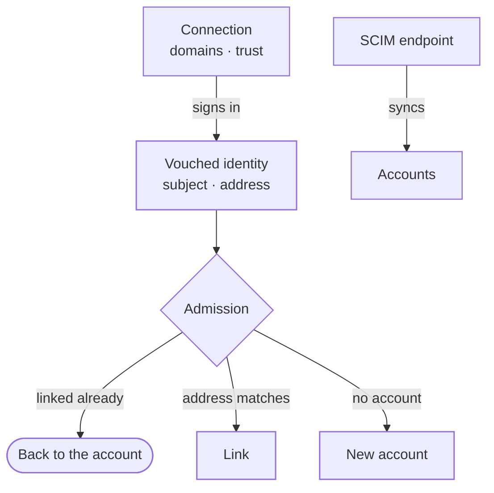
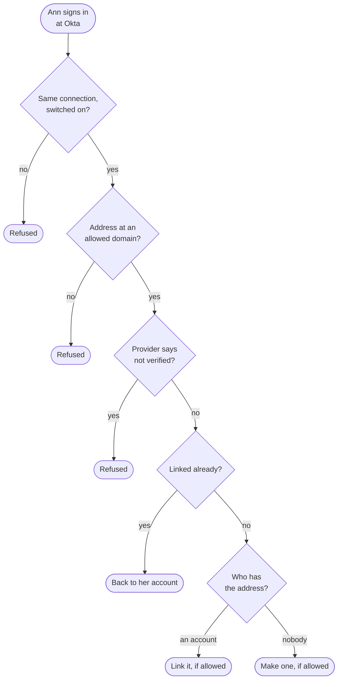
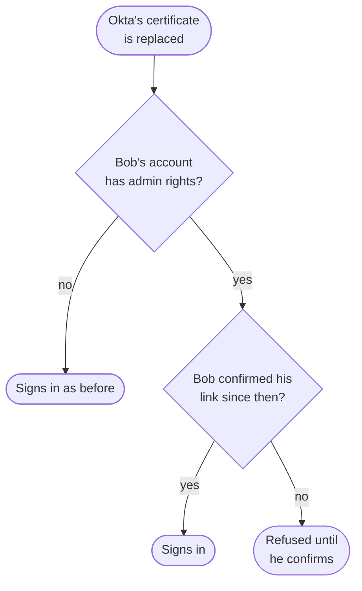
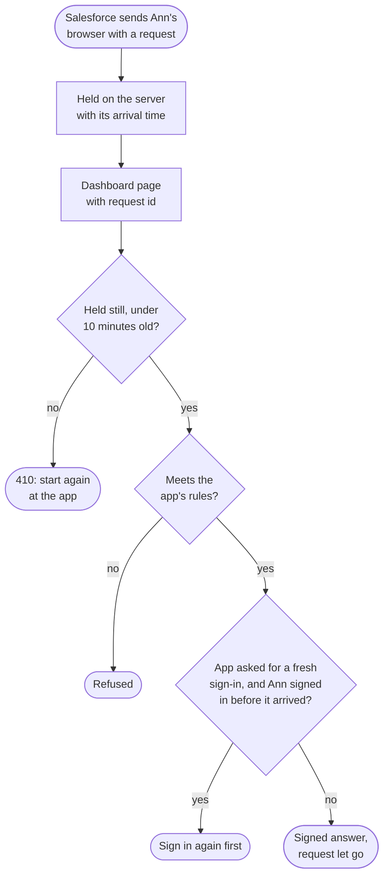
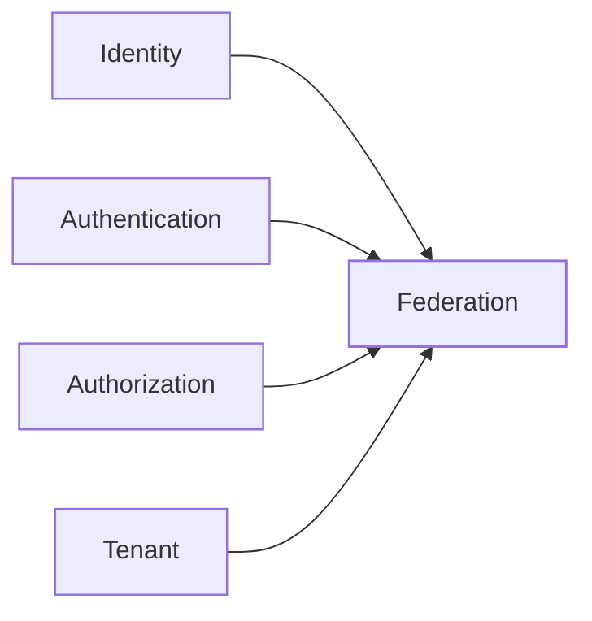

The federation context lets a tenant sign people in through an outside **identity provider**, such as Okta, Azure AD or Google Workspace. The tenant adds a **connection** to the provider over SAML or OIDC. When someone signs in there, the provider says who they are, and a **link** ties that person to their account here. A tenant may also sync its users from a directory over **SCIM**.

A provider's word only goes so far. It speaks only for the email domains the tenant proved it owns. It never links an account that holds admin rights on its own, and its word on a second factor never counts for one.

The code is in `crates/ianua-domain/src/domains/federation`:

| Part | What it holds |
|---|---|
| `connection` | A connection to one provider: its settings, the domains it may speak for, how far it is believed, its SAML keys and its group mapping |
| `vouched_identity`, `oidc`, `saml` | What a provider said about the person signing in, the SAML documents this platform writes, and single logout |
| `service_provider` | A SAML app the tenant's people sign in to, with this platform as the provider |
| `admission` | What a sign-in through a provider may do: come back, link an account or make one |
| `link` | The tie between who a person is at a provider and their account here |
| `scim` | The tenant's SCIM endpoint and what its changes do to accounts |
| `directory_profile` | What the switched-on SCIM endpoint may do to accounts and groups |
| `control`, `account_privilege` | Who may change a connection or SCIM, and whether an account holds admin rights |

The use cases are in `crates/ianua-app/src/use_cases/federation`, in folders for `connections`, `links`, `scim`, `service_providers` (SAML apps), `idp` (answering SAML apps) and `logout`. The routes are in `crates/ianua-api/src/routes/federation.rs`, all under `/api/v1/organizations/{org_slug}/tenants/{tenant_slug}`.

## How the parts fit

## Who may change a connection

A connection decides whom a provider may speak for. So every change to a connection, and to SCIM, names who makes it and needs a right. Changes that let a provider speak for more people, or be believed more, need the full right. Changes that only stop it need the update right, so whoever may edit a connection can switch it off during an incident.

| Change | Right it needs |
|---|---|
| Add a connection | Create federation |
| Rename it, change which profile fields it fills, switch it off, stop it making accounts | Update federation |
| Drop domains, or move the domain that sends people straight to it | Update federation |
| Stop trusting its addresses or its second factors | Update federation |
| Roll over to the provider's next certificate, stop mapping its groups | Update federation |
| Change its settings or keys, switch it back on, let it make accounts | Manage federation |
| Add a domain, trust its addresses, trust its second factors | Manage federation |
| Map its groups, require or stop requiring encrypted assertions | Manage federation |
| Delete it, with every link to it | Delete federation |
| Any change to SCIM | Configure SCIM |

Sam may update federation. He may rename the Okta connection or switch it off. He may not mark it as trusted for addresses. Fay manages federation, so she may make every connection change, but still no SCIM change, which is its own right. She may not, for example, make a SCIM removal delete accounts, or make synced users wait for a confirmation before they sign in. Deleting a connection needs the delete right, which the full right covers but the update right does not, since the people it made accounts for often have no other way in.

A new connection starts switched on, but makes no accounts, speaks for no domain and is trusted for nothing. An admin sets each of those up.

## One provider per connection

A connection keeps its provider for good: its protocol, its OIDC issuer or its SAML entity id. A change that names another provider is refused. A person is linked by the name the provider gives them, its **subject**, and a subject means something only at the provider that issued it. If a connection could point at another provider, whoever that provider calls `00u123` would sign in as the person the old one called that. Another provider gets a connection of its own.

A SAML connection takes only the persistent `NameID` format, which never names another person. With an email address as the subject, the next person given that address would land in the account of the one who left.

For OIDC, enter the client secret exactly as the provider issued it, including any spaces or punctuation. Ianua encrypts it for storage and uses the unchanged value when authenticating to the provider. The same applies to an organization's identity provider.

## Domains a connection speaks for

A connection may speak only for email domains the tenant registered and proved it owns. A domain that is not verified now is refused, and a wildcard domain is never allowed. The domain rules would also take a proof held by another tenant of the same organization, but the app does not offer that yet: only the tenant's own domains can be bound.

This matters because an address a provider vouches for becomes a verified address here, and tokens this platform issues tell apps it is verified. Fay may manage federation in her own tenant. Without the proof, she binds `globex.com` to a provider she runs, and apps trust her as Globex's CEO.

A domain matches exactly. A connection for `acme.com` does not speak for `eu.acme.com`. One of the allowed domains may be the **hint**: when Ann types `ann@acme.com`, she is sent straight to that provider. The sign-in page asks `POST .../federation/discover` with the address. Only a switched-on connection whose hint is that domain, and which may speak for it, is named. Nobody is signed in yet, so the answer never says whether the address has an account.

## Signing in through a provider

The first checks apply to everyone, even a person linked long ago. A switched-off connection lets no one in.

People are matched by their link, never by their address. A provider can give an address to somebody else later. It never gives them the same subject.

What is known about the person is worked out from the tenant's records: the link for their subject, the account with their address, any link that account has at this connection, and what each account holds. The sign-in never takes this on someone's word. A link loaded for another subject or connection, or an account loaded with another address, is refused. So Mallory, signing in as `00u-mallory`, never comes back to Bob's account because the wrong link was handed in.

### The first sign-in

The first time Ann signs in through Okta, there is no link yet. What happens next depends on who has her address:

| Who has the address | What happens |
|---|---|
| An account with no admin rights, that proved the address | It is linked to Ann, if her address is proven |
| An account with admin rights | Refused. Its owner links it themselves |
| An account that never proved the address | Refused |
| An account linked to someone else at this provider | Refused |
| Nobody | An account is made, if the connection makes them and her address is proven |

Ann's address is **proven** when the provider says it verified it, or when the tenant marked the provider as the authority for its addresses. Many providers let a person type any address they like, so a provider that says nothing proves nothing.

An account whose address an admin or a directory typed in never proved it. Okta vouching for the same address does not show the account belongs to Ann.

### Accounts with admin rights

An account counts as **privileged** when it holds any built-in permission that gives power, even only viewing users, through its roles, its groups or an active break-glass grant. The metrics overview every member holds through the Member role gives no power, since it shows counts and never a person, a record or a setting. App-defined permissions do not count either. When Ann holds "manage users" for an hour during an incident, her account is privileged until the grant ends.

What an account holds is always read from the tenant's records, never stated by the caller. Records that name a role or group that is not there are refused as corrupt, and say nothing about the account.

A provider never links a privileged account on its own. Fay may manage federation. Without this rule, she connects a provider she runs, binds `acme.com` to it and signs in as the CEO. Instead, the CEO links the account herself, after proving who she is again.

## Linking and removing a link

A link is made only from what a provider just vouched for. Nobody types in a subject. So Mallory, linking from her own account, cannot link Ann's Okta subject to it and catch Ann's sign-ins.

A link is a new way into the account, much like a new passkey. It needs one of three grounds:

| Grounds | Who |
|---|---|
| A first sign-in | What the sign-in above allowed, for that account |
| An admin | Someone who may update users and holds everything the account holds |
| The holder | The person, after proving who they are again just now, the way they sign in: their password (and a code, when they have a second factor), a passkey, a sign-in link mailed to them when they have neither, or a provider already linked to them |

An open session is not enough for the holder. Mallory, holding Ann's stolen session, would link her own provider and keep a way in after Ann changes her password.

A link can also prove its holder again. Ann's tenant signs everyone in through Okta, so she has no password or passkey here. Signing in at Okta again just now counts as a fresh proof of her account, for example to change her address. The provider must vouch for the subject the link names, so Mallory's own Okta sign-in proves nothing about Ann. A second factor the provider proved counts. Without one, Ann's own second factor here answers, when she has one.

Removing a link only takes a way in away. So the holder may remove one from their own sign-in, with no fresh proof. An admin who may update users and holds everything the account holds may remove one too. The event for each new link says whether a first sign-in, an admin or the holder made it, and the event for each removal whether an admin or the holder made it, so the person can be told.

## When a provider's keys change

A new SAML certificate lets whoever holds its key sign in every person linked through that connection. So a certificate change records when the connection was re-keyed. Other setting changes, and OIDC connections, whose provider never changes, do not re-key.

A connection may hold the provider's next certificate beside its current one, so a provider that publishes its next key ahead of the switch signs nobody out on the day it switches. Answers signed with either are taken. Once the provider has switched, `POST .../federation/connections/{id}/certificate/roll-over` keeps only the next one. Nobody new may sign answers then, so it needs only the update right and re-keys nothing.

A SAML connection may also take only **encrypted assertions**, sealed by the provider to a key of this platform's, so the browser they pass through cannot read them (`PUT .../encrypted-assertions`; `DELETE` takes readable ones again). The key pair is made here or brought by the tenant. The private key is sealed before it is kept, and only the certificate comes back.

Each SAML connection has its own metadata document, `GET .../federation/connections/{id}/saml/metadata`, for the admin to import at the provider. It names this platform, where answers and logouts go, and the certificates for signed requests and sealed assertions when the connection uses them.

Bob is an admin. After the change, he signs in another way, proves who he is again, and confirms the link (`POST .../federation/connections/{id}/link/reconfirm`). Then Okta signs him in again.

## Second factors from a provider

A provider may say the person used a second factor, or a hardware key, when they signed in there. By default that is not believed, and a sign-in through the provider counts as one factor. Nothing stops a provider from claiming more than it checked.

A tenant may mark the provider as trusted for factors. Even then, it never counts for a privileged account. Without this rule, Fay marks a provider she runs as trusted, signs in there as an admin and skips the admin's own second factor.

For OIDC, only `mfa` in the `amr` claim counts, and `mfa` with `hwk` counts as a hardware key. For SAML, a short list of known context classes counts, and `SmartcardPKI`, a smartcard unlocked with its PIN, counts as a hardware key. An unknown or missing class counts as one factor.

## Making accounts and profile fields

A connection may make an account on someone's first sign-in. It may give each new account a default role. The role may carry no built-in permission that gives power, since nobody looks at each person a provider makes; the metrics overview is allowed. Admin rights are always given by a person. The person setting the role must also be able to hand out everything it carries.

A provider's claims may fill three profile fields only: the display name, the language and the timezone. A claim never fills the address, which needs its own proof, nor a role or a group, which would let a provider hand out rights. Two claims for one field are refused.

### Mapping a provider's groups

Roles and groups come from a provider only through a **group mapping**, which is off until an admin sets one (`PUT .../federation/connections/{id}/group-mapping`). Each rule says that people the provider puts in a group, such as Okta's `ops`, get a role or a group here at sign-in. A connection holds at most 200 rules. Every rule is a grant to everyone in that provider group, so a role or group mapped may carry no built-in permission that gives power, and the admin must be able to hand out everything it carries. Every sign-in through the connection takes back what the mapping gave and the provider no longer vouches for. When Okta drops Ann from `ops`, her mapped Ops role goes at her next sign-in. A role an admin gave her, or one she held before the mapping reached her, is never taken this way.

An OIDC provider's name claims (full, given and family name), picture and locale are each read as their own type. One that does not read is dropped, and the sign-in still goes ahead. So when Mallory's provider sends a name with a line break, a picture over plain HTTP or a made-up locale, none of them reaches an account.

## SCIM

SCIM lets a tenant sync its users from a directory, such as Okta, Azure AD or an HR system. The directory uses a bearer token. Only its hash is stored, and rotating it makes the old one stop working at once.

A new endpoint is switched on, gives no default role, lets synced users sign in at once and switches removed users off. The same default role rule as for connections applies.

While the endpoint is switched on, the directory may add people, rename them, change their language and timezone, make groups, and add people to, take them out of, rename and delete the groups it keeps. Those groups bring only the roles a person gave them. A group made in the dashboard belongs to a person, so the directory never renames or deletes it, and a group with subgroups is kept. Sam may edit the directory. Without this rule, he renames the dashboard group "Admins" to "Interns" over SCIM, and Ann gives it to a new intern along with the owner role. The directory registers the people it adds and never invites anyone: an invitation is a person asking someone in, and a request over SCIM could otherwise send an invitation link to Mallory's mailbox. Once an admin switches SCIM off, a request with the old token changes nothing, not even a group membership.

Nobody in the tenant is signed in when the directory acts on an account, so it gets a narrow control of its own over an account's sign-in, worked out from the tenant's records for one account at a time:

| What the directory does | When it is refused |
|---|---|
| Shut an account out (lock or switch it off) | It is the tenant's last administrator |
| Let an account back in | The account holds a built-in permission that gives power |
| Change an account's address | The account holds a built-in permission that gives power |
| Change what the directory records about it: its id there, department, manager or employee number | Never |
| Anything else to the account, such as erasing it | Always |

Okta switches Bob off the day he leaves, and SCIM locks his account. A directory mistake never leaves the tenant without an administrator. A leaked SCIM token cannot move Ann's admin account to Mallory's mailbox, where a password reset would hand it to her. A control made for Bob never passes for Ann.

An address sent by SCIM never counts as verified, whatever the tenant's sign-in connections trust. Each person the directory adds is mailed a link and confirms the address themselves. A leaked SCIM token, or a typo in the HR system, cannot hand anyone a verified address.

A tenant may choose whether removing a user switches their account off or deletes it. A privileged account is only ever switched off, whatever the setting. Deleting cannot be undone, and a leaked token or a directory mistake would otherwise delete every admin and leave no one to put things right.

## This platform as a provider

A tenant can also be the identity provider for its own **SAML apps**, such as Salesforce. Each app is named by its entity id and says:

- the addresses its assertions may be posted to: one default and up to 32 in all, matched exactly, so `/acs/../evil` is never one of them;
- how people are named to it (`NameID`): **persistent**, a pairwise id that stays the same for one person at one app and differs at every other app, so two apps cannot match their records; **email address**, sent only when the address is verified; or **transient**, a fresh value at every sign-in;
- what it is sent about the person: up to 64 attribute statements, from the address, display name, language, timezone, account id, role names and group names. A new app is sent the address as `email` and the display name as `displayName`;
- whether the response is signed as well as the assertion, whether assertions are encrypted to the app's key, and whether its requests must be signed with its key. Signed requests stop anyone else starting a sign-in in the app's name, with their own choice of `ForceAuthn` or address;
- where logout requests go. With no logout address, single logout with the app is off.

Adding an app needs both the create and the manage federation right. A change that sends more of a person, to more places or more keys, or checks less, needs manage. One that only narrows what the app gets needs update. Switching an app off needs update, switching it back on needs manage, and deleting it needs delete. The apps are served under `.../saml/apps`. The tenant's own metadata, `GET .../saml/metadata`, is public: it names the sign-in endpoints, the `NameID` formats and the certificate of the key that signs assertions now. It returns `404` while the tenant has no signing key.

### Answering an app's sign-in

An app sends the person's browser to `.../saml/sso`, by redirect or by post. The request is **held on the server** with the time it arrived, and nothing in it is read yet. The browser goes on (`302`) to the dashboard's `.../saml/sso` page with the id it is held by, `request=<id>`. With the person signed in, the page posts that id to `POST .../saml/sso/answer`.

The answer is about the person signed in to their own tenant session, never an account the request names. It reads the request and its arrival time from the server, never from the browser. It is refused with `410` when no request is held under that id, it was answered already, or it arrived more than 10 minutes ago.

Then the request must meet the app's rules: it names a switched-on app as its issuer, is signed when the app must sign, and asks for a registered address and the app's `NameID` format. Otherwise it is refused.

When the app asked for a fresh sign-in (`ForceAuthn`), the session's sign-in time is compared with the stored arrival time. A sign-in made before the request arrived does not count, and the answer is refused (`401`) until the person signs in again. Mallory, holding Ann's open session, cannot backdate a request to slip past an app that wants a fresh sign-in before a payment.

The answer is signed with the tenant's key, kept against the session so a logout reaches the app, and recorded as `federation.saml_assertion_issued`. The held request is then let go, so it is answered once.

A sign-in can also start here, such as from an app tile: `POST .../saml/apps/{app_id}/sign-in` answers to the app's default address.

### The SAML documents

The context writes the SAML documents this platform sends: assertions, responses, logout messages and metadata. Every name, value and URL written into them is escaped, and the ids they carry are only ever valid XML ids. A response takes only an assertion signed with the tenant's key, so an unsigned assertion never reaches an app. Every time is written in UTC. A time that cannot be written is refused rather than left empty, since some apps read an empty `NotOnOrAfter` as no end at all.

## Single logout

Single logout works both ways. When a person signs out, `POST .../saml/slo/start` gives the logout requests for every app their session signed in to and for the provider it was opened through. Each is kept until its answer comes back, and the browser posts each one in turn. This runs while the person is still signed in. When a sign-in through a provider ends with the dashboard trading its one-time code for a session, the provider session moves to that new session, so a logout either way reaches the session the person goes on with.

A peer may also ask to log the person out here: an app at `.../saml/slo`, a connection's provider at `.../federation/connections/{id}/saml/slo`. The request is taken only from the peer it names, signed as that peer signs. It must carry its issue time, and is taken only within five minutes of it, a minute of clock difference allowed either way, and only once: a request with the same issuer and ID is refused. An app's request ends the person's session here only when it names them as this platform named them to that app. A provider's request ends it only when it names the subject the session was opened with, and, when it names sessions, the provider session too. Whatever happens, the peer gets a signed answer. An answer to a request sent from here is taken once, only from the peer it went to, and within 10 minutes.

## Events

The context records an event when a connection is created, activated, disabled, updated or deleted, when an account is made on a first sign-in, when an account is linked, a link is removed or a link is confirmed again after a re-key, and when SCIM is enabled, disabled, has its token rotated or its settings changed. It also records when a SAML app is created, updated or deleted, when a person is signed in to an app (`federation.saml_assertion_issued`), and when a logout request is sent or its answer taken. The link event says whether the link came from a first sign-in, an admin or the holder, and the removal event whether an admin or the holder made it. Signing in to an app and the logout messages are a person's own activity: they go in the audit trail but not in colleagues' feeds. Every other federation event reaches their feeds.

## Where it sits

Federation sits above the tenant. Identity gives it the account and the verified address. Authentication gives it the sign-ins it checks and the factors it records. Authorization answers who may change a connection, who may act on an account, what a default role may carry, and, from its records of roles, groups and break-glass grants, what an account holds. The tenant gives it the domains a tenant proved it owns.
