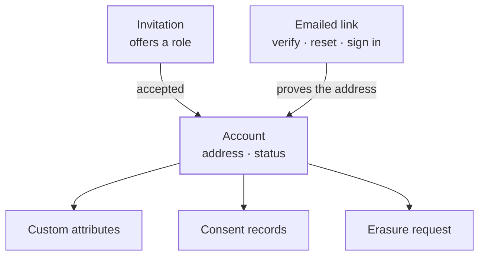
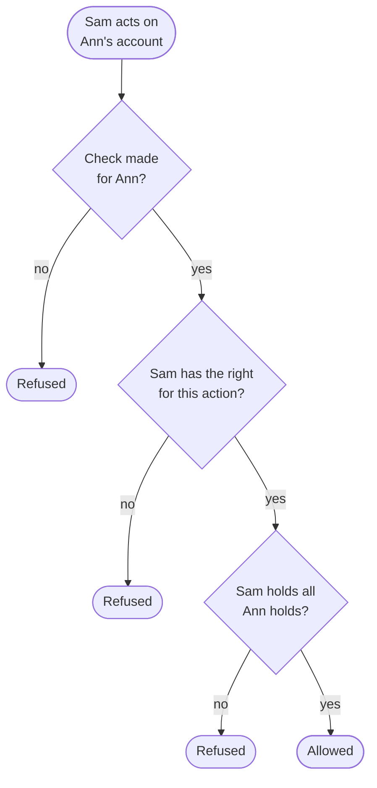
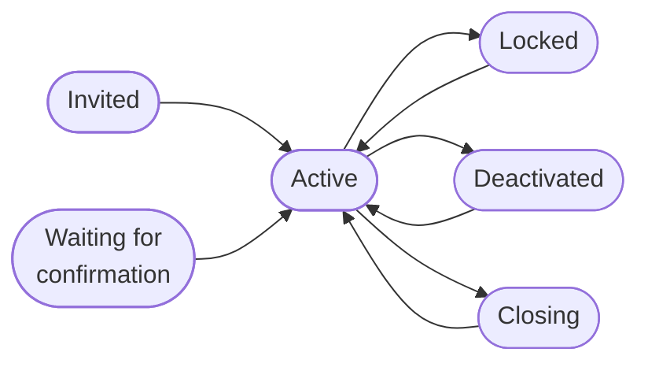
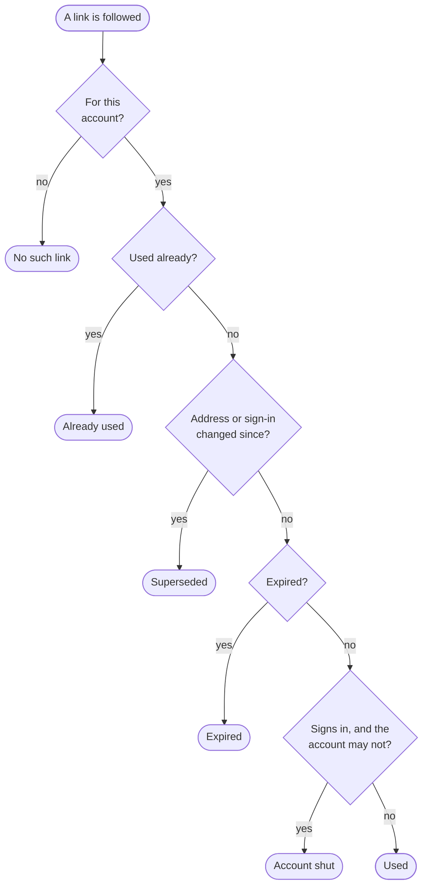
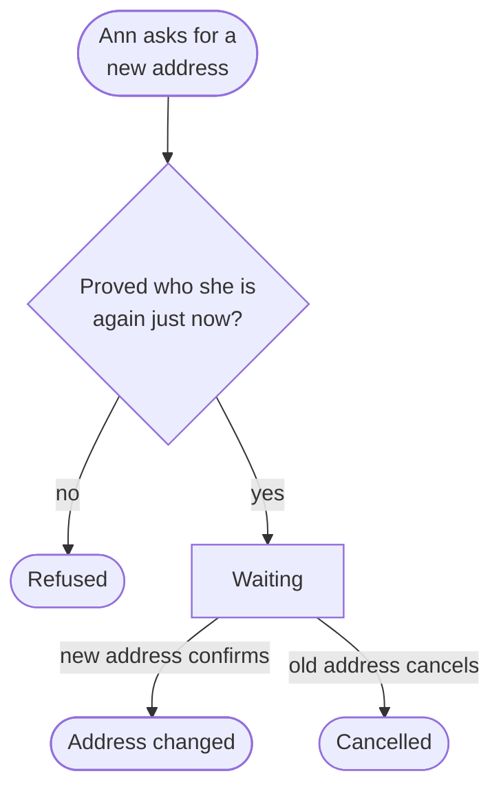
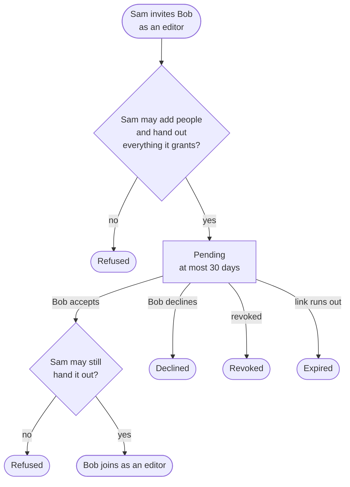
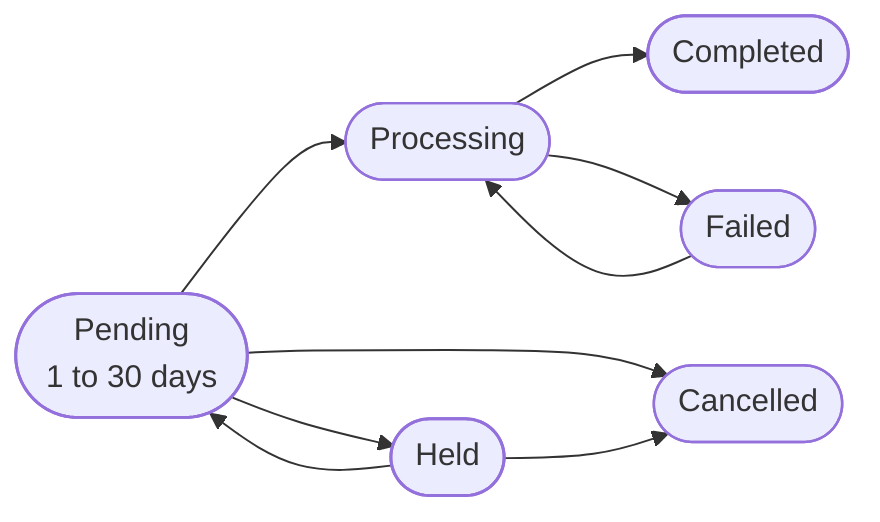
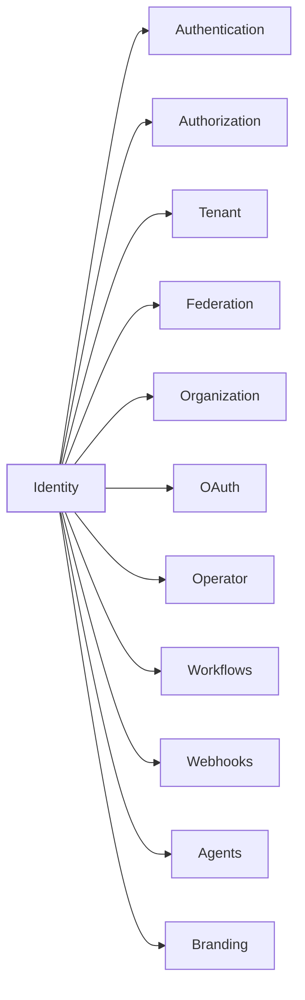

The identity context holds a person's **account** in one tenant: its address, its status and the fields a tenant adds to it. It also holds what is mailed to that address, the **invitations** that bring people in, and the person's **consent** and **erasure** requests.

Identity is the foundation. Nothing in it uses another context. Where a rule needs to know what someone holds or who is signed in, identity names the rule and a higher context answers it.

The code is in `crates/ianua-domain/src/domains/identity`:

| Part | What it holds |
|---|---|
| `account` | The user, their address, an email change, accounts imported from another system, and the checks for acting on an account |
| `invitations` | An offer to join a tenant with a role |
| `tokens` | The single-use links for verifying an address, signing in and confirming a sign-in, how long each kind of link may live, and the new link a dead one is renewed with |
| `privacy` | Consent records, copies of a person's data and erasure requests |
| `impersonation` | An admin acting as one of the tenant's people for a short while, for support |
| `attribute` | The custom fields a tenant declares for its users |
| `events` | What each change records |

The use cases are in `crates/ianua-app/src/use_cases/identity`, in folders for `users`, `email`, `invitations`, `privacy`, `impersonation` and `attributes`. The routes are in `crates/ianua-api/src/routes/identity.rs`, mostly under `/api/v1/organizations/{org_slug}/tenants/{tenant_slug}/users`.

## How the parts fit

## A verified address

An address counts as verified only when someone showed they hold it. There are three ways:

| Proof | How |
|---|---|
| A followed link | The person opened a link mailed to the address |
| An accepted invitation | The invitation was mailed there, and whoever accepted it holds the mailbox. One handed to the inviter on a deployment without a mail server proves nothing |
| A trusted provider | A sign-in provider said it verified the address, or the tenant trusts that provider for its addresses |

An admin, SCIM or LDAP may set an address, but it stays unverified until one of these proves it. Password reset links go to the address, so whoever controls it could take the account.

## Acting on someone else's account

Changing how another person signs in hands out all their account holds. So every such action passes one check, made for exactly that account:

| Action | Right it needs |
|---|---|
| Change the address, reset the password or second factor, link a sign-in provider | Update users |
| Lock or deactivate, activate or unlock | Deactivate users |
| Ask for, cancel, hold or release an erasure | Delete users |
| Record a consent withdrawal for them | Update users |
| Change their name, language or timezone | Update users |
| Change their directory records: the directory's id for them, their department, manager or employee number | Update users |
| Ask for a copy of their data for them | View users |
| Act as them for support | Manage users |
| Send an invitation | Create users, and every right the role grants |

Sam may update users, and Ann is an admin. He cannot reset her password, because she holds more than him. Bob holds no user rights, and Carol holds nothing either. Bob still cannot change Carol's address, because he lacks the right. A check worked out for Bob's own account does nothing on Ann's. The right is checked before the account is even looked up. Bob locks out a user id he made up, then Carol's, and is refused with `403` both times, so he cannot tell which accounts exist. A person changes their own name, language and timezone from their own sign-in, with no right needed.

The tenant always keeps one administrator. Locking, deactivating or erasing the last one is refused, so nobody shuts the tenant out of its own settings.

### When the directory acts

A tenant that syncs people over SCIM has nobody signed in when Okta switches Bob off the day he leaves. The directory passes the same account check, made for one account while SCIM is on, but it may do less:

| Action | The directory may do it |
|---|---|
| Lock or deactivate | Yes, except for the last administrator |
| Activate, unlock or change the address | Only for an account with no built-in permission that gives power; the metrics overview gives none |
| Change their name, language or timezone | Yes, while SCIM is on |
| Change their directory records | Yes |
| Open an account | Yes, waiting for its address to be confirmed. It never invites or imports anyone |
| Erase, record a withdrawal, ask for a copy of their data, or act as them | Never |

A leaked SCIM token could otherwise move Ann's admin account to Mallory's mailbox, and a password reset would hand it to her.

### Acting on your own record

A person acting on their own record proves it with their own finished sign-in instead. A directory client's bind with the account's password and its certificate counts the same way. That is how they record consent and ask for their own erasure. Linking a sign-in provider to their own account asks more: they prove who they are again, as for an address change.

## Account status

Invited, waiting, locked and closing accounts may also be deactivated straight away. Only an active account signs in. Confirming the address activates an account waiting for confirmation. Accepting an invitation activates an invited one. Either move is recorded as `identity.user_status_changed`, beside `identity.email_verified` or `identity.invitation_accepted`, like every other status change. An account switched off by mistake can be activated again, and it keeps the date it first joined. A deactivated account is never locked, and never gets a new password while it is off.

An active account that asks to be erased is **closing**: it cannot sign in while the erasure waits, so it is not used before it is deleted. It opens again when the erasure is cancelled. An admin cannot activate a closing account.

Locking, deactivating or closing an account first takes back every delegation it granted, then ends each of its sessions. Each ended session is recorded as `authentication.session_revoked`, with the reason `account_state_change`, naming the account. The one who shut the account out is the record's actor, so when Ann's account is locked after a break-in, the trail shows who threw out the session on her laptop, beside the status change. Deleting an account removes its sessions with it, and the deletion is the record.

## Emailed links

Every link is stored only as a hash, works once, and belongs to one account and the address it was mailed to.

| Link | Longest it may live | What it does |
|---|---|---|
| Verify an address | 7 days | Proves the address |
| Reset a password | 1 hour | Proves the address, so a new password may be set |
| Sign in | 1 hour | Signs the person in |
| Confirm a sign-in | 1 hour | Finishes one sign-in that raised a risk signal, for someone with no second factor |

A sign-in confirmation link finishes that one sign-in and nothing else. It never stands in for a sign-in link, nor the other way round. Mallory has Ann's password and is asked to confirm. If the confirmation link were a sign-in link, the link in Ann's mailbox would also open a fresh session for whoever follows it.

The lengths in the table are ceilings nothing may pass. The server's defaults are one hour to verify (`EMAIL_VERIFICATION_TTL_SECONDS`), 15 minutes to sign in (`EMAIL_MAGIC_LINK_TTL_SECONDS`) and one hour to reset (`EMAIL_PASSWORD_RESET_TTL_SECONDS`). A link is given a length of time, never a date, and it runs out that long after it is issued. The length must be more than zero, so no link is born already expired.

Ann asked for two reset links and used the second. The first no longer works, because her password changed after it was sent. Her account is locked after a break-in, and a sign-in link mailed earlier does nothing. Every refusal carries the same message, that the link cannot be used, so it does not tell a stranger the account is locked.

The reset kind in `tokens` serves organization accounts. A tenant's password reset link is kept by authentication as a reset request, but it keeps the same rules and the one-hour ceiling. It goes only to an address the person was shown to hold and only to an account that may sign in. Following it does nothing while the account may not sign in. An account with a second factor also gives a code to finish the reset; a factor that mails or texts its codes is sent one for the reset. The [Authentication](/ianua/domain-contexts/authentication/) page covers the reset itself.

No link is let through once it expires. So a stored link that says it was used at or after its expiry is refused as corrupt when it is loaded, rather than trusted.

## Changing the address

An open session is not enough to start a change. The person proves who they are again first: their password, together with a code when they have a second factor, a passkey, or a sign-in through a linked provider made just now. An account with no password or passkey follows a sign-in link mailed to it, with a code when it has a second factor. That proof counts for ten minutes. So Mallory, holding Ann's stolen session, cannot move Ann's address to her own mailbox.

On a deployment without a mail server the new address could never be confirmed, so asking for a change, or for another link, is refused.

The new address gets a link, and the change lands only when it is followed. The old address is told and gets a cancel link, which works until the change lands. The change is also refused if the account's address or sign-in changed after it was asked for, so resetting the password ends it too.

Ann asks for a new address on Friday and opens the link on Monday, after it ran out. Her dead link gets her a new one at the same new address, with no fresh sign-in. That works only for the change's own link, from her account, and only while the change still stands as asked: not landed, not cancelled, and her address and sign-in unchanged. A link that still works gets no second one. If Mallory asked for the change from a stolen session and Ann reset her password, the dead link stays dead.

A stored change that says it was confirmed at or after its link expired is refused as corrupt. One cancelled from the old address after that is fine, since the cancel link works until the change lands.

## Invitations

Sending an invitation makes a new account, so it needs the right to create users. The role is checked twice: when the invitation is sent, and again when it is accepted. The second check uses what Sam holds at that moment, worked out from the tenant's records, and only Sam: checking it against Ann, an admin, for an invitation Sam sent is refused. If Sam loses his rights in between, or the editor role is given more, accepting is refused. Only the invited account accepts, only while it still has the invited address and still waits to join. A deactivated account is not switched back on by an old link. Revoking an invitation shuts the invited account out, so it needs the right to deactivate users.

Like an emailed link, an invitation is given a length of at most 30 days, and runs out that long after it is sent. Sending it again starts a fresh length from the resend.

Bob opens his invitation a week late. His dead link gets him a new one, for at most 30 days, mailed to the same address, without asking an admin. Nobody in the tenant decides this, so the invitation must stand as it was sent: the link is its own, nobody revoked or declined it, it is not yet marked expired, and the account still waits to join at the invited address without having changed how it signs in. A link that still works gets no second one. Mallory cannot renew it with a link of her own, and a dead link read from an address the account has left gets nothing.

On a deployment without a mail server nothing is mailed: sending or resending an invitation hands its accept link to the admin who sent it, to pass on to the invitee, and a dead link is not renewed, so the admin sends it again. Accepting a link handed over this way lets the account in but leaves its address unverified, since nobody showed the invitee holds that mailbox. An account still waiting to confirm its address there stays waiting until an admin activates it by hand, which also leaves the address unverified.

A stored invitation that says it was accepted at or after its link ran out is refused as corrupt.

An invitation nobody answers can be marked expired once its link runs out, and not before. An invitation that expired, was declined or was revoked closes its invited account, so it does not wait in the user list for good. The account is deactivated, which keeps its history, and an admin may still let it in.

## Importing accounts

A tenant leaving another identity provider can bring its accounts over, password hashes included (`POST .../users/import`). It needs the right to create users. An import takes 1 to 10,000 records; a larger export is sent in parts. Every record is checked first, and a batch that names an address or an outside id twice, or holds a record or hash that does not check out, is refused whole. The plan must have room for every record. The import is then kept and answered at once with its id, and `GET .../users/imports/{id}` says how far it got.

A worker opens the accounts in chunks of 500. Each chunk is kept whole or not at all, so a worker that stops leaves the import exactly as far as its last kept chunk, and the next try goes on from there without opening anyone twice. A record is set aside, with its line, when its address has an account by the time its chunk runs (`address_taken`), when it names the account as its own manager (`own_manager`), or when the plan has no room left for another user by then (`user_limit_reached`). That last check runs again for every chunk, since two imports started together both pass the check at the start, and people sign up meanwhile. The rest of the import goes on.

Every account opens like a registered one, gets the tenant's default roles, read once per chunk, and waits for its holder to follow the link mailed to its address once its chunk is kept. The other system's word that an address was verified proves nothing here, so no imported address starts verified. The person then signs in with the password they already have, and that first sign-in replaces the foreign hash with one of the platform's own. Each account records `identity.user_imported`, and `identity.users_imported` tells colleagues once the import ends. After five failed tries the import is given up on: the chunks kept so far stay, and it is recorded as failed.

## Copies of a person's data

A person may ask for a copy of their data: everything kept about them (the right of access), or what they gave the service themselves, in a form another service reads (the right to take it elsewhere). Staff who may view users may ask on their behalf (`POST .../users/{id}/exports`). Either way the file is the person's: only they download it, for 7 days after it is ready, and then it is gone.

A copy of everything kept about someone holds their account and details, attributes, consents, the apps they let act for them, linked identities, roles and groups, every session still kept (open or ended) with how each stands, and their sign-ins: the ones they made, any lockout of their account, and the failed attempts typed with each address while their account held it. It also holds the failed sign-ins counted now against their address, the countries they signed in from, the password reset links and invitations they were sent (never the links), any emergency access given to them, their second factor, passkeys and remembered devices, the notices about their own account and how they chose to be told, the times staff asked to act as them and what was done while they did, and what they did themselves. No password, hash, token, key, factor secret or recovery code is ever in it.

A person's own sign-in list (`GET .../sign-ins`) shows the same sign-ins, newest first.

## Acting as someone for support

An admin may act as one of the tenant's people for a short while, to see what they see and put it right (`POST .../users/{id}/impersonations`). Acting as someone is holding all they hold, so the admin needs full control of users and must hold at least what the person holds. Nobody acts as themselves, nor as an account that may not sign in now. Each request has a reason, which the audit trail keeps, and a window of 5 to 60 minutes.

The tenant decides whether the person must approve first. An approval more than 24 hours after the request is refused, and the admin asks again. Either side may end it early. Every use checks again, so a window that ran out, an end the person asked for, or a lock put on the account stops the admin at once.

## Consent

A consent record says what the person agreed to or withdrew, which version of the terms, when and from where. Records are never changed; withdrawing adds a new one. Only the person, signed in, gives consent. An admin cannot tick "agreed to marketing" for them. Withdrawing only lowers what is done with someone's data, so staff who may update users can record a withdrawal for them, such as when Ann calls support to stop the marketing emails.

## Erasure

A person asks to erase their own data from their own sign-in. Someone else may ask for them only with the right to delete users and holding all the account holds. Deletion waits out a grace period of one to 30 days, so a request made by mistake or from a stolen session can be cancelled.

While it waits, the account is closed and cannot sign in. The person cancels through a link mailed to their address, which works only while the account still has that address. An admin who may delete users can cancel it too. Either way the account opens again.

A tenant under a court order or an audit duty can place a legal hold. A held request waits past its grace period until the hold is lifted. The person may still cancel it.

Deleting the account removes what belongs to it with it: its custom attribute values, the links mailed to it, its invitations, its consents, its copies of data and its support impersonations. The erasure request itself stays, as the record that the erasure was asked for and carried out.

## Custom attributes

A tenant declares the fields it adds to its users, such as a department, a cost centre or a salary. A value under a field nobody declared is refused, since nothing could show, filter or erase it.

Declaring a field and every change to one, from its name and help text to its options, limits, visibility, archiving and restoring, needs the right to update users. Sam may only view users, so he cannot declare a `clearance_level` that access rules then read, or rewrite the help text admins follow when they fill in `dept`.

Each field is one of 18 kinds, such as text, money, a date, one of a list, or a country. The kind decides how its values are stored and what may be asked of them. Dates and times have one spelling each, such as `2026-09-17` and `2026-09-17T09:30:00Z` in UTC, so "hired before 2020" compares them correctly. A number must be a real, finite number.

Fields live in one of two halves:

| Half | Who writes it |
|---|---|
| User | The person, or an admin for them |
| App | Admins and the application only |

Access rules may read app fields, so Ann cannot raise her own `app.clearance_level`.

A field marked **sensitive**, such as a salary, cannot be read, filtered or sorted by anyone without the right to manage users. Filtering counts too: Sam could filter for salaries above 100,000 and count the results. Only someone cleared for sensitive fields may mark one ordinary again.

A filter is checked against the declared fields before it reaches storage. The column it reads comes from the declaration, never from what the caller typed, and storage binds every value the caller sent.

## Events

The context records an event when a user is registered, invited, renamed or deleted, their language or timezone changes, a verification or welcome email is sent, an address is verified or changed, an address change is asked for, its link is sent again or it is cancelled from the old address, a password is reset, a status changes, an invitation is accepted, declined, revoked, resent or expires, consent is given or withdrawn, an erasure is asked for, cancelled, held, released, started, completed or fails, when attributes are declared, changed, archived, restored or deleted or their values change, when profile details change, when accounts are imported, when a copy of someone's data is asked for, ready, downloaded or expires, and when acting as someone for support is asked for, starts, is declined or ends. A management account's address change has its own events for the request, a resent link, a cancel from the old address and the confirmation.

Consent changes, preference and profile changes, copies of a person's data, address change requests and their resent links, and the verification and welcome emails are the person's own business, so they stay in the audit trail and out of colleagues' notifications. An imported account's own record notifies no one either. Everything else notifies, including an address change cancelled from the old address.

## Uses and used by

Identity sits at the bottom and uses no other context. Authorization answers the account check, who may open an account, who may change the attribute schema and see sensitive fields, the invited role check and what the inviter holds when an invitation is accepted. Federation answers the account check for the SCIM directory, and lets the directory open accounts and edit profiles. The tenant answers whether it takes sign-ups from anyone. Authentication answers who is signed in, through a sign-in or a directory bind, and who proved themselves again just now. The organization reuses the account check, the address rules, the emailed links and the invitation offer for its own members. OAuth, the operator, workflows, webhooks, agents and branding build on the account, on who is signed in and on who proved themselves again just now.
