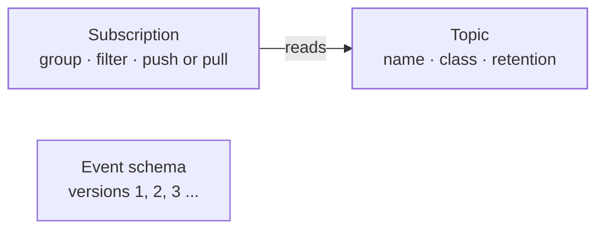
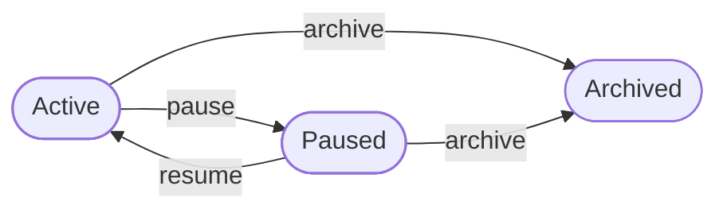
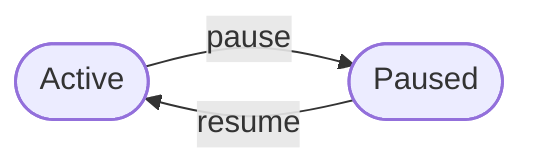

The messaging context holds a tenant's **topics**: named channels that its services publish messages to and subscribe to. It also holds each service's **subscription** to a topic, and the tenant's **event schemas**, versioned descriptions of what a message looks like. It decides who may make and change each of these, which services may hear a topic, and what a topic may carry.

Where it sits:

- It uses **authorization** for what a person holds, **consumers** for what a service holds, and **data classification** for how sensitive a topic's data is.
- It sits in the layer above consumers, beside branding, federation, OAuth, operator and routing. The organization sits one layer above.
- **Agents** build on it: a channel between two agents carries only topics that take agent messages.

Every change names who makes it and checks the messaging right for it. A person holds that right through their roles or an active break-glass grant. A service holds it only through its roles, and acts only with proof that it signed in.

The code is in `crates/ianua-domain/src/domains/messaging`:

| Part | What it holds |
|---|---|
| `topic` | A topic, its status, its retention and its data class |
| `topic_name` | The checked name services publish to |
| `subscription` | A service's subscription to a topic, its consumer group, filter and delivery mode, and the rule that a group's subscriptions read alike |
| `message_type` | The checked type a message may carry, and the filter a subscription reads some types through |
| `delivery` | Where a push goes and what signs it, how long a message waits to be acknowledged, and when it is set aside |
| `schema` | Event schemas, their versions and how a new version must fit the one before |
| `control` | The rule for who may make and change topics, subscriptions and schemas, and who is recorded as their creator |
| `events` | What the context records when these change |

The use cases are in `crates/ianua-app/src/use_cases/messaging`: `topics`, `subscriptions`, `schemas`, `channels`, and `broker` for publishing, pulling, watching and settling messages. They are served under `/api/v1/organizations/{org_slug}/tenants/{tenant_slug}/messaging` (`crates/ianua-api/src/routes/messaging.rs`).

## How the parts fit

| Who | Topic | Subscription | Event schema |
|---|---|---|---|
| A service, with its roles | Creates | Subscribes itself, if cleared | Registers |
| A person with messaging rights | Creates, pauses, resumes, changes, archives, deletes | Subscribes a service, pauses, resumes, deletes | Registers, adds versions, deletes |

A topic carries its own schema. An event schema is a separate record: topics do not point to one.

## Topic names

A topic name is what services publish to, such as `orders.created`, `payments.completed` or `inventory.low-stock`. A name:

- is 1 to 128 characters long,
- uses only lowercase ASCII letters, digits, hyphens and dots,
- starts and ends with a letter or digit,
- has no two dots in a row, so `orders..created` is refused.

Names are lowercase only, so `orders.created` and `Orders.Created` can never be two topics. A name read from JSON goes through the same checks.

On the message bus, the subject holds the tenant: `ianua.msg.{tenant}.{topic name}`. So a service in one tenant never reaches another tenant's topics.

## A topic

A topic has a display name, its topic name, an optional description, an optional schema, a retention rule and a data class. It records who created it: a person or a service.

### A topic's life

| Status | Publishing | New subscriptions | Changes |
|---|---|---|---|
| Active | Accepted | Accepted | Allowed |
| Paused | Refused | Accepted, and messages wait | Allowed |
| Archived | Refused | Refused | Refused. The topic is read-only for good |

A new topic starts active. Any other move, such as resuming an active topic or leaving archived, is refused.

A topic is deleted with every subscription to it. Only a paused or archived topic can be deleted, so none disappears while services still publish to it.

### Retention

| Rule | What is kept |
|---|---|
| Duration | Messages for a number of seconds |
| Message count | The last number of messages |
| Unlimited | Every message until someone purges them |

A duration or a count can never be zero, since that would drop every message as it arrives. A stored rule of zero does not load.

The rule is applied whenever a message is read. A message past its topic's limit is never handed out, to a service that was offline for days or to one that gets it again after a failed delivery. It is removed for every reader the moment one read finds it past the limit. A limit counts from when the bus first took the message, and a dead letter or its replay does not start it over. A count limit counts every message of the topic together, whatever its type.

The bus keeps no message longer than 7 days, so a duration above that, or unlimited, keeps a message at most that long. A message past its limit that nobody reads stays on the bus until the next read of its topic or those 7 days, but no reader can have it. A dead letter is kept apart for at most 30 days and is held to its topic's limit when that is shorter: past it, the letter is no longer listed or replayed.

Changing the rule drops what the old rule no longer kept before the new rule is saved. Tess's topic keeps messages for a minute; she lengthens it to an hour. Whatever had already passed the minute stays gone. She shortens an hour to a minute and every waiting message older than a minute is out of reach at the next read.

### Data class

A topic declares the most sensitive data it may carry, on the levels data classification defines: public, internal, confidential, restricted. It is chosen when the topic is made and can only rise after that.

Ann's `payroll.events` topic holds restricted messages. An agent that reads a topic is raised only to the topic's class. If she could relabel it public, an agent could read those restricted messages and still count as public. So lowering the class is refused. Less sensitive traffic goes to a new topic.

### Agent messages

Agents may exchange messages on a topic only when it is **active and has a schema**. Free text can hide a secret signal between two agents; a schema limits what a message can carry. A channel between agents also needs the topic's class to be at or below the highest class the channel allows.

An agent connects to send or read agent messages with its task token. The token must check against its tenant's key, name the tenant's agent audience and the tenant's own issuer, not be bound to a key, and its delegation must still be live. A token signed with Acme's key that names another issuer is refused, and so is one naming a tenant that is not on record.

## A subscription

A subscription says how one service receives a topic's messages.

| Field | What it says |
|---|---|
| Consumer group | Optional. The subscriptions of one group on a topic share its messages: each message goes to one of them. With no group, each subscriber gets every message |
| Delivery mode | **Push**: messages are posted to the subscription's own HTTPS address. **Pull**: the service asks for new messages |
| Filter | Optional. The leading parts of the message types it gets: `order.refund` gets `order.refund` and `order.refund.requested`, never `order.created` or `order.refunds`. A message without a type passes no filter |
| Acknowledgement | How long a handed-out message waits to be acknowledged, 5 seconds to 10 minutes, and how many deliveries it gets, 1 to 100. The default is 30 seconds and 5 deliveries |

A message that is not acknowledged is delivered again until its deliveries are spent. Then it is set aside as a **dead letter**, kept for the tenant to read and replay, and not delivered again. Without a limit, a message the service always fails on would hold up its subscription for good.

A push subscription posts to a public HTTPS address, so a push never reaches the platform's own network. Each push is signed with a secret the platform makes. The secret is sealed at rest, opened only to sign a push, and never shown in logs. Rotating it (`POST .../subscriptions/{id}/rotate-push-secret`) may keep the old secret signing beside the new one for up to 7 days, so the service can move over without refusing a push. A secret from an earlier rotation stops at once.

A consumer group is 1 to 128 ASCII characters: letters, digits, hyphens, underscores and dots. A filter follows a message type's rules: 1 to 128 characters of lowercase letters, digits and hyphens, in parts split by single dots, starting and ending with a letter or digit, so it can never be a wildcard.

The subscriptions of one group read through one consumer on the bus, so they must read alike. A subscription joining a group whose subscriptions filter or acknowledge otherwise is refused as a conflict; otherwise it would quietly read as the first one does. The group's consumer, with its waiting messages and dead letters, stays until the group's last subscription is deleted.

A subscription records the service it belongs to and the topic it reads, whoever made it. How far each service has read is kept by the message bus, not here.

**Who may subscribe.** A service may subscribe itself, or a person may subscribe one of the tenant's services. A new subscription is refused when:

- the service's roles, or the person subscribing it, do not give the right to create in messaging,
- a person subscribes a disabled service,
- the topic is archived,
- the topic's data class is above what the service is cleared for.

The clearance is the one stored on the service, never one the caller passes in. Ann's billing service is cleared for internal data. It asks to subscribe to `salaries.paid`, a restricted topic, to read every salary. It is refused. If Ann, who manages messaging, tries to subscribe it for the service, that is refused too. A service may subscribe to a paused topic: its messages wait until the topic resumes.

### A subscription's life

While paused, messages wait and are not delivered. Pausing a paused subscription, or resuming an active one, is refused.

## Event schemas

A topic's own schema is checked only for agent messages sent through the relay. A service's own publish to a topic is not checked against it.

An event schema describes the shape of a message, such as `OrderCreated`. It has a display name, a machine name such as `order-created`, an optional description, a format, a compatibility mode and a list of versions. Services generate their types from the latest version. Published messages are not checked against these versions.

| Format | What it is |
|---|---|
| JSON Schema | Draft 2020-12 |
| Avro | Apache Avro |
| Protobuf | Protocol Buffers |

A schema is registered with its first definition as version 1. Each new version is numbered one past the latest. A version never changes once it is added.

### Compatibility

The mode decides how a new version's **required fields** may differ from the latest version's:

| Mode | Dropping a required field | Adding a required field |
|---|---|---|
| None | Allowed | Allowed |
| Backward | Refused: data written before would not fit the new schema | Allowed |
| Forward | Allowed | Refused: data written after would not fit the old schema |
| Full | Refused | Refused |

A refusal names the field, such as `amount`.

A JSON Schema's required fields can always be compared. So a JSON Schema held to any mode other than none must be given the change to check. Ann drops a required field from a backward compatible JSON Schema and marks the change as not comparable, to skip the check. The version is refused. Only an Avro or Protobuf schema, or one with no mode, takes a version unchecked.

## Who may do what

The rights are written `messaging: <action>`. `messaging: manage` covers every other messaging action.

| Change | Made by | Right |
|---|---|---|
| Create a topic | A service or a person | `messaging: create` |
| Subscribe a service to a topic | The service itself or a person | `messaging: create` |
| Register an event schema | A service or a person | `messaging: create` |
| Pause or resume a topic | A person | `messaging: manage` |
| Archive a topic | A person | `messaging: delete` |
| Delete a paused or archived topic | A person | `messaging: delete` |
| Delete a subscription | A person | `messaging: delete` |
| Delete an event schema | A person | `messaging: delete` |
| Change a topic's schema or retention | A person | `messaging: manage` |
| Raise a topic's data class | A person | `messaging: manage` |
| Pause or resume a subscription | A person | `messaging: manage` |
| Add a schema version | A person | `messaging: manage` |
| Rotate a push subscription's secret | A person | `messaging: manage` |
| Publish a message | A service or a person | `messaging: publish` |
| Pull, acknowledge, refuse or watch messages, list or replay dead letters | A service or a person | `messaging: consume` |

A disabled service may not act at all. A topic or schema names its creator, worked out from the proof of who acts: the signed-in service, or the person's own account. So no caller can make things in someone else's name, and the audit trail shows which person or service it was.

Why each change is guarded:

- **Pausing a topic** stops every message on it. Sam may only view messaging. Without this check, he pauses `payments.settled` and every payment confirmation stops.
- **Resuming** undoes a pause someone made on purpose. Ann paused `orders.created` during an incident. Sam cannot resume it before the incident is over.
- **Archiving** shuts a topic for good. Someone who may create topics but not delete them cannot archive one.
- **The schema** decides what messages may carry. Sam may publish to `orders.created`, but he cannot drop its schema to send free text that hides a signal between agents.
- **Retention**: a shorter rule drops messages subscribers have not read. Sam cannot cut it to one second.
- **Raising the class** shuts out subscribers cleared below it. Sam cannot raise `orders.created` to restricted to lock out the billing service.
- **Pausing a subscription** stops a service hearing what it depends on. Sam cannot pause the payment workers' subscription.
- **A schema version** is what services generate their types from. A viewer cannot add one.
- **Deleting a topic** stops every service subscribed to it. Sam may publish, but he cannot delete `payments.settled`. Someone who may delete must pause or archive it first.
- **Deleting a subscription** drops the messages waiting for the service. Sam cannot delete the payroll service's subscription so it never hears of another payment.
- **Deleting a schema** breaks the next build of every service that generates types from it. Sam cannot delete `order-created`.

The right to publish is not the right to create. The service "billing-sync" may only publish. It cannot make its own `orders.created` topic to take over a name others publish to, subscribe to draw off messages meant for the payment workers, or register its own `order-created` schema.

## Publishing and reading

A person or a service publishes with `POST .../topics/{name}/publish`. It needs `messaging: publish`. A message is refused when:

- the topic does not exist or is not active,
- the payload is over 1 MiB,
- a header starts with `Ianua-`, in any mix of upper and lower case, which only the platform sets,
- its type, when it has one, is not a well-formed message type.

A message may name its type, such as `order.refund.requested`, in `message_type`. The type is what subscriptions filter on, and it comes back with the message when it is pulled or listed as a dead letter. A message without a type reaches only the subscriptions that filter on nothing.

The record of a published message holds the topic and the payload size, never the message itself.

Taking messages needs `messaging: consume`, which is kept apart from viewing: messages Ann pulls are messages the real service will not see. Pulling (`GET .../subscriptions/{id}/messages`), acknowledging, refusing, listing dead letters and replaying one all need it. The topic's class is checked against the reader's clearance on every pull. A push has no caller, so the service is checked as each message goes out: still enabled, and still cleared for the topic's class. When Fay raises `payroll.events` to restricted, pushes to a service cleared for internal data stop.

Watching a topic live over a WebSocket (`GET .../topics/{name}/stream`) hands over the same messages, so it takes the same right and clearance, and the topic must be active. A stream stays open long after it started, so it is checked again every little while and closes on the first refusal: a raised class, a paused topic or a session that stopped counting ends it.

## Limits

| Limit | Value |
|---|---|
| Topic name | 1 to 128 characters |
| Consumer group | 1 to 128 characters |
| Filter | 1 to 128 characters |
| Message type | 1 to 128 characters |
| Schema definition | Not blank, at most 65,536 bytes |
| Versions per schema | At most 1,000 |
| Retention duration or count | At least 1 |
| Message payload | At most 1 MiB |

Whether a definition is well formed for its format is checked where it is parsed, not here.

## What a stored row must satisfy

A row that breaks these is refused as broken storage, never repaired:

| Record | Refused when |
|---|---|
| Topic | It changed before it was created |
| Subscription | It changed before it was created |
| Event schema | It has no versions, its versions do not run 1, 2, 3 and on, a version is older than the schema, it holds more than 1,000 versions, or it changed before it was registered |

A stored retention rule of zero does not load either.

## Events

| Event | When |
|---|---|
| `messaging.topic_created` | A topic was created, naming the person or service that made it |
| `messaging.topic_paused` | A topic was paused |
| `messaging.topic_resumed` | A topic was resumed |
| `messaging.topic_archived` | A topic was archived |
| `messaging.topic_schema_changed` | A topic's schema was replaced |
| `messaging.topic_retention_changed` | A topic's retention rule was replaced |
| `messaging.topic_data_class_raised` | A topic's data class was raised |
| `messaging.topic_deleted` | A topic was deleted, with every subscription to it |
| `messaging.subscription_created` | A subscription was created |
| `messaging.subscription_paused` | A subscription was paused |
| `messaging.subscription_resumed` | A subscription was resumed |
| `messaging.subscription_deleted` | A subscription was deleted |
| `messaging.subscription_secret_rotated` | A push subscription's signing secret was replaced |
| `messaging.dead_letter_replayed` | A dead letter was put back in front of its service |
| `messaging.message_published` | A message was published |
| `messaging.schema_registered` | An event schema was registered |
| `messaging.schema_evolved` | A new version was added to an event schema |
| `messaging.schema_deleted` | An event schema was deleted |
| `messaging.channel_opened` | A person opened a channel from one agent's area to another agent |
| `messaging.channel_closed` | A channel between two agents was closed |

The two channel events are defined in the agents context, which holds the channels.

A subscription's record names it by its consumer group, or by its topic when it has none, copied when the event is written so it stays readable after the subscription is gone. A published message goes in the audit trail but not in colleagues' feeds: it is traffic on the bus, not a change to anything they share. Every other messaging event reaches their feeds.
