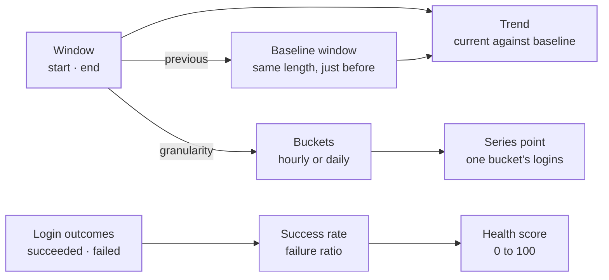

The metrics context holds the **figures on the organization and tenant overviews**: login success rates, failed attempts, latencies, trends and a health score. It does not count anything itself. The figures are loaded from storage outside the domain, and this context turns those raw counts into rates, ratios and percentage changes, so every overview works them out the same way.

Metrics is part of the foundation. It uses no other context, only the shared clock and error types. It has no aggregates, keeps nothing of its own in storage and names no rule for authorization to answer. Each part is a small value that is built, read and thrown away.

The code is in `crates/ianua-domain/src/domains/metrics`:

| Part | What it holds |
|---|---|
| `window` | The time window a figure covers, the window before it, and the bucket size for charts |
| `login_outcomes` | Succeeded and failed logins, the success rate and the failure ratio |
| `series` | One bucket of the success-rate line chart |
| `trend` | A value compared with the one before it: a direction and a percentage change |
| `latency` | A time in whole milliseconds |
| `health` | The health score from 0 to 100 |

The overviews are served at `GET /api/v1/organizations/{org_slug}/metrics` and `GET /api/v1/organizations/{org_slug}/tenants/{tenant_slug}/metrics`, by the use cases `organization::lifecycle::GetOrgMetricsUseCase` and `tenant::lifecycle::GetTenantMetricsUseCase`. The figures they share are put together once, in `crates/ianua-app/src/use_cases/metrics/overview.rs`.

This context is not the process metrics. `GET /metrics`, the Prometheus scrape of how the process runs, is served on the internal listener only, never on the public one, and says nothing about any tenant. It lives in `crates/ianua-app/src/use_cases/runtime/metrics.rs` and `crates/ianua-api/src/routes/runtime.rs`.

## How the parts fit

## The window

Every figure covers a window the caller picks. It includes its start and stops just before its end, so two windows that touch never count the same moment twice.

A window whose end is not after its start is refused: one that starts and ends at the same moment covers no time, and one whose end comes before its start makes no sense. Both are refused as invalid input.

The overview endpoints read the window from `?since=...&until=...`. With no `until`, the window ends at the next whole minute after now, so dashboards polling close together share a window. With no `since`, it starts 30 days before its end. A window longer than 90 days, a reversed one or a malformed time is refused with `422`.

**The baseline.** Each window has a window of the same length just before it, ending where it starts. A ten-minute window from 10:10 to 10:20 has the baseline 10:00 to 10:10. Trends compare against this baseline.

**Chart buckets.** The success-rate line chart splits a window into buckets. The bucket size follows the window's length, so the line stays readable. The reader that fills the chart is asked to use the window's own bucket size:

| Window length | Bucket |
|---|---|
| Two days or less | One hour |
| Longer than two days | One day |

## Login outcomes

The counts are how many logins succeeded and how many failed in the window. From them come two figures:

| Figure | How it is worked out | With no attempts |
|---|---|---|
| Success rate | Succeeded out of all attempts, as a percentage from 0 to 100 | No rate |
| Failure ratio | Failed out of all attempts, for the pie chart, with the rest as successes | 0 out of 0, with no percentage |

A tenant with 288 good logins and 12 failed ones has 300 attempts, a 96 percent success rate and a failure ratio of 12 out of 300, which is 4 percent.

A window with no attempts has **no** success rate, rather than a made-up 0 or 100 percent. The failure ratio then has no percentage, instead of dividing by zero. The counts never wrap around: a total that would overflow stays at the largest number, and the successes left over from a ratio never go below zero.

Each count is also reported on its own, so an administrator watching for a spike in failures sees the real number of failures, not only a rate.

## Series points

One point of the line chart holds the login outcomes for one bucket: the moment the bucket starts and the logins that fell inside it. Its success rate is worked out as above, so a bucket with no attempts has no rate. A bucket with nine good logins and one failure shows 90 percent.

## Trends

A trend pairs the value for the window with the same value for the baseline window. It is built from two counts, such as logins, or from two worked-out values, such as rates or latencies.

| Direction | When |
|---|---|
| Up | The current value is above the baseline |
| Down | The current value is below the baseline |
| Flat | The two are equal |

The percentage change is the difference divided by the baseline. Logins that rose from 100 to 150 are up 50 percent; logins that fell from 100 to 75 are down 25 percent. When the baseline is zero there is **no** percentage, because growth from nothing has no ratio: a new tenant that went from 0 logins to 10 is up, with no percentage. The trend keeps both values, so the overview can show them beside the arrow.

## Latency

A latency is a time in whole milliseconds, never negative. It is used for the 95th-percentile request latency and the average time to sign in. It prints with its unit, so 125 milliseconds shows as `125ms`.

## Health score

The tenant overview shows a health score from 0 to 100. The tenant metrics use case builds it from two rates: the login success rate and the share of requests through the proxy that were not blocked. A rate with no attempts or no requests has no data.

| Rule | Example |
|---|---|
| The score is the average of the rates that have data | Logins at 90, requests at 70: the score is 80 |
| A rate with no data is left out, so it does not pull the score down | Logins at 60, no requests: the score is 60 |
| With no data at all the score is 100, because no traffic is not a fault | A new tenant with no logins and no requests scores 100 |
| A rate below 0 or above 100 is held to that range first | 150 and -50 count as 100 and 0: the score is 50 |
| The average is rounded to the nearest whole number | 99.5 scores 100 |

Holding each rate to the range before averaging keeps the score itself between 0 and 100 whatever the stored counts say.

## Events

The context records no events. It only works out figures from counts that other parts of the platform record.
