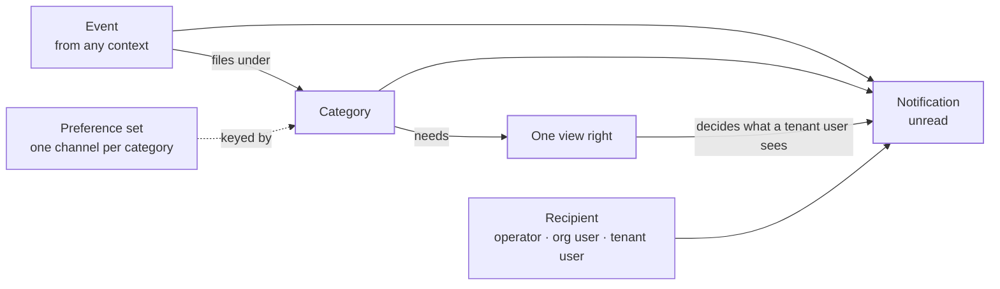
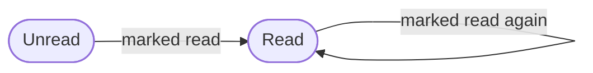

The notifications context holds **in-app notifications**: one record per person per thing that happened, read or unread. It sorts every event into a **category**, and each category names the one right a person needs to see it. It also says how urgent a notification is, holds each person's choice of **channel** per category, and holds an organization's **destinations**: a Slack channel, a Teams channel or a webhook its notifications are also posted to.

Notifications sits in the second layer from the top, beside agents. It uses authorization, for the rights each category needs, the organization and the operator, for who may change destinations and personal choices, and branding, to name the email in an undelivered mail. Webhooks and workflows build on it: both ask its visibility rule which events a person may see.

The code is in `crates/ianua-domain/src/domains/notifications`:

| Part | What it holds |
|---|---|
| `notification` | One notification, its title, and whether it has been read |
| `category` | The groups events fall into, the right each group needs, and the visibility rule |
| `severity` | How urgent a notification is: info, warning or critical |
| `channel` | How a notification reaches the person: in the app, also by email, or not at all |
| `preference` | A tenant user's channel for each category |
| `reach` | How a notification reaches its reader: by their rights, on their own account, or sent by name, and which events change how safe an account is |
| `personal` | An organization member's or an operator's channel for each category |
| `destination` | Places outside the app an organization's notifications go to |
| `reading` | Marking notifications read, and what that records |
| `recipient` | Who a notification is for: an operator, an organization user or a tenant user |
| `events` | The events this context records |

The use cases are in `crates/ianua-app/src/use_cases/notifications`: `inbox` (list, unread count, mark read, the live stream), `preferences` and `personal` (each person's channels), `destinations`, and `delivery` (the fan-out). The routes are in `crates/ianua-api/src/routes/notifications.rs` and, for the live streams, `crates/ianua-api/src/routes/realtime.rs`.

## How the parts fit

## A notification

A notification is made from an event. It holds:

| Part | What it is |
|---|---|
| Event type | What happened. The category and the right needed come from this |
| Severity | Info, warning or critical |
| Title | A short summary, at most 200 characters |
| Body | An optional longer text, at most 500 characters |
| Record | The record it is about, such as a user, a key or a route, or none |
| Reach | By rights, on the reader's own account, or sent by name |
| Read | Whether the recipient has read it |
| Created | When it was made |

The title is longer than the usual 100-character label, because it names the scope, the subject and who acted in one sentence. The title and the body may not be blank and may not hold control characters, such as a line break or NUL, or invisible characters, such as a right-to-left override.

The title and body are written from the event itself. The title says what happened, such as "Tenant activated", and the body says who did it and to what.

A notification about no one record points at nothing, so opening it never leads to a record that does not exist.

## A notification's life

Every notification starts unread. Marking it read is the only change, and marking a read one again leaves it read. A person marks one notification read (`POST .../notifications/{id}/read`) or all of them at once (`POST .../notifications/read-all`), only in their own inbox. A notification in someone else's inbox answers as if it did not exist.

## Who sees a notification

There are three kinds of recipient: an operator of the platform, a user of one organization, and a user of one tenant. Each has their own inbox: `/api/v1/notifications` for an operator, `/api/v1/organizations/{org_slug}/notifications` for an organization user, and `/api/v1/organizations/{org_slug}/tenants/{tenant_slug}/notifications` for a tenant user.

Each category needs one right to see its notifications. A tenant user's listing, unread count and live stream show a notification only when a right they hold in the tenant now covers that one. A right covers another when it is the same right, or when it is the **manage** right of the same area. Any right over users also covers `roles: view`. An operator's and an organization user's inboxes show everything sent to them.

| Category | What it covers | Right needed |
|---|---|---|
| Identity | Users joining, leaving and changing their email, and this context's own events | `users: view` |
| Crypto | Signing keys | `crypto: view` |
| OAuth | OAuth clients and API keys | `api_keys: view` |
| Authorization | Roles, groups, assignments, resource types, access requests and reviews, relationships, separation rules and clearance rules | `roles: view` |
| Policy | The tenant's authorization policy, its rollout, and the break-glass and access request policies | `policy: view` |
| Federation | Federation connections, linked accounts, SAML apps and single logout | `federation: view` |
| SCIM | SCIM provisioning | `scim: view` |
| Routing | Proxy routes and log targets | `routing: view` |
| Pipeline | Proxy pipelines and stages, honeypots, canary tokens | `pipeline: view` |
| Classification | Data classification rules | `classification: view` |
| Signals | Signal streams | `signals: view` |
| Webhooks | Webhook subscriptions and delivery | `webhooks: view` |
| Branding | Branding and the mail provider | `branding: view` |
| Authentication | Sign-ins, second factors, break glass, sessions, and the tenant's sign-in settings | `auth_config: view` |
| Organization | Organization and operator changes | `audit_log: view` |
| Tenant | The tenant's lifecycle and settings | `tenant_settings: view` |
| Domains | Custom domains, their certificates and DNS records | `domains: view` |
| mTLS | The tenant's mTLS trust anchor | `mtls: view` |
| Agents | Agents, their delegations, runs and approvals, and channels between agents | `agents: view` |
| Consumers | Consumers and their credentials | `consumers: view` |
| Messaging | Messaging topics, subscriptions, dead letters and schemas | `messaging: view` |
| Workflows | Workflows, their executions and integration accounts | `workflows: view` |
| Audit | The tenant's audit log: a broken chain, purged records and audit streams | `audit_log: view` |

Some rules decide the category:

- **A subject with its own right gets its own category.** A custom domain needs `domains: view`, the mTLS trust anchor `mtls: view`, SCIM `scim: view` and the policy `policy: view`. So seeing the notification never takes less than seeing the thing itself.
- **Every category needs a right.** A notification that needed none would reach every end user of the tenant, even one who signed up a minute ago.
- **Organization and operator events need the audit log.** They record what someone outside the tenant did to it.
- **Channels between agents file under agents**, though their events carry messaging names.
- **The audit log has a category of its own.** Muting routine changes never mutes a broken chain.

### What happens to a person's own account

One kind of notification shows whatever its reader holds: a notice to the person an event happened to, of something that changes how safe their own account is. Carol may see no users at all. Without this, an admin locks her out, resets her factors or gives her account a role, and she is the one person who never hears of it.

A notification reaches its reader in one of three ways:

| Reach | When | Shows |
|---|---|---|
| By rights | The reader runs what it happened to, or it happened to them but changes nothing about how safe their account is | While a right they hold covers its category |
| On their own account | It happened to the reader's own account, and changes how safe it is | Whatever they hold |
| Sent by name | A workflow's `notify` step sent it to them | Whatever they hold |

A notice sent by name comes from a workflow acting for a person who may view people. Pat's workflow signs Lee out and tells Lee why. The notice lands in Lee's inbox and on Lee's open dashboard, in the app only. The audit trail records `notifications.notice_sent`: who sent it, through which run, to whom and under what title. Its message stays in Lee's inbox.

A notice may offer to ask for access (`offer-access`). Pat's workflow tells Lee "You may ask to join Support". The notice names the group as the record it is about, so Lee's dashboard can offer the request in one press, and the trail records `notifications.access_offered`. The offer gives nothing: Lee still asks, and someone still approves.

The events that change how safe an account is:

| Context | Events |
|---|---|
| Authentication | A session revoked or suspended; a password changed, reset or found in a breach; a passkey added or removed; a second factor added, removed or reset; a device remembered or forgotten; an account locked out; recovery codes made or used; break-glass access given or taken back |
| Identity | The account's status changed (locked, switched off, reopened); its address changed; an admin reset its password; someone began or stopped acting as the person |
| Authorization | A role given, taken away or run out; joining or leaving a group, or a membership running out |

Carol still sees nothing about anyone else's account in those categories: a notice of Dave's lock in her inbox, kept from when she ran users, stays hidden. Only her own inbox is read, and only notices made about her own account reach her this way.

Such a notice cannot be switched off, and is also mailed to the person's address once that address was proved theirs, whatever channel they chose for its category. A locked or switched-off account cannot sign in to read it, and whoever took over an account could otherwise switch the category off first. An address set on someone else's word is not mailed, so a mistyped or planted address does not learn what happened to the account.

### The category comes from the event

A notification is made from its event type alone. Its category, and so the right needed to see it, is never given separately.

Sam may see branding but not signing keys. If a category could be given beside the event, a key rotation filed as branding would reach Sam. Because the category comes from the event, the key rotation needs `crypto: view` and never reaches him.

### The same rule for webhooks and workflows

The visibility rule above also decides what a webhook may receive and which events a workflow may start on. Sam may view users but not keys. He creates a webhook for key events, to have them sent to his own server. The webhook is refused, because a webhook receives only events its creator may see.

## The live stream

Each inbox also has a live stream over a WebSocket: `/api/v1/ws/notifications` for an operator, `/api/v1/organizations/{org_slug}/ws/notifications` for an organization user, and `/api/v1/organizations/{org_slug}/tenants/{tenant_slug}/ws/notifications` for a tenant user. A tenant user's stream shows only notifications whose category a right they hold covers when it opens, and notices about their own account. An update that is no notification at all never reaches them.

A stream stays open long after it opened, and rights can be taken away meanwhile. So the server asks again whenever its recheck interval has passed: before the next message, or on a tick for a quiet stream.

- What the stream shows **narrows** to the categories the person may still see. Ann loses `crypto: view` while her stream is open. From the next recheck, key notifications no longer reach her.
- Notices about her own account still reach her, whatever she still holds.
- The stream **closes** when her session or key no longer counts. It closes with code 1008, "no longer admitted".
- It **never widens**. After a new role, the dashboard connects again to see more.

A stream also closes once it has lasted its longest lifetime, and the client connects again and is checked from scratch.

## How urgent a notification is

| Severity | Events |
|---|---|
| Critical | Break-glass access granted, an account locked out, an account under attack |
| Warning | An organization's status changed, a payment failed, an organization's ownership transferred, a sign-in failed, a session revoked, break-glass access revoked, a signing key revoked, an OAuth client or API key revoked, a domain lost its verification, a domain's certificate is about to expire |
| Info | Everything else |

A new event is info until it is named here. Severities are ordered, info below warning below critical, so a filter for "warning and above" always means the same thing. A notification keeps the severity it was made with.

## Channels and preferences

| Channel | What it does |
|---|---|
| In app | Shows in the app only. The default |
| In app and email | Shows in the app and also sends an email |
| Disabled | Delivers nothing for this category |

A person picks one channel per category, for their own inbox only. Nobody changes another person's choices: Sam turning off Ann's security alerts would keep her from hearing of an attack on her own account. A tenant user's **preference set** always holds exactly one channel for every one of the 23 categories:

- A category they never set is in app.
- When a list names a category twice, the later entry wins.
- Changing one category's channel leaves every other category as it was.

Organization users and operators choose the same way, at `.../notifications/preferences` on their own inbox. Their choices are kept and recorded on their own plane, not in any tenant.

The fan-out reads the choice. A person who disabled a category gets nothing for it. One who picked in app and email is also mailed the title and body. The one exception is a notice about their own account, which no choice switches off (see [What happens to a person's own account](#what-happens-to-a-persons-own-account)).

## Who is told

When an event is recorded, the fan-out tells the other people of the plane it happened on. The person who acted is never told of their own action.

- An organization's events, and a tenant's events made by an organization user or an operator, go to the organization's users.
- A tenant's other events go to the people who run it: its administrators, and the organization's members with access to it, up to a set number of each. Never to its users at large: an admin action in a tenant of thousands tells its admins, not thousands of customers.
- Platform events go to the operators.

A tenant user who runs nothing is told only what happened to their own account, from either plane: Carol hears that her account was locked whether a tenant admin or an organization member locked it. The account an event happened to is the user it names as the account itself, the holder of a role or the member of a group. A user it names for another reason, such as the colleague who granted a role, is not told as if it were their own account. Of anything that changes nothing about how safe their account is, the person is told only while they may sign in and may see its category.

Each notification is kept, pushed to the person's open dashboards, and mailed when they chose mail, or, for a notice about their own account, to their proved address whatever they chose. A tenant user's mail goes out through the tenant's own mail provider once a test send through it worked, and through the platform's mail until then. Mail to organization users and operators always goes through the platform. A person or destination that cannot be reached is skipped and logged, and the others still get theirs.

## Security alerts

A few events fire on a single request, so whoever sends the requests decides how often: a canary credential presented or found leaking, an automated attack detected, a refresh token used again, an account coming under attack from many networks, an agent's sign-in refused as an attack, and a mail given up on after its last try. They stay out of colleagues' feeds, yet someone must hear of them. They are security alerts. The first one tells the people who run the plane: for an attack, the tenant's administrators, and on the organization's plane only its admins and owners; for a mail given up on, whoever may manage the tenant's mail (`branding: update`), administrator or not. After that, at most one alert of the same kind goes out on the same plane each hour, and it says how many happened since the last one. Every occurrence is still in the audit trail. Each person is told only while they may sign in and may see the alert's category. If the shared cache is down, each node still sends at most one alert of a kind per hour. Honeypot hits and purges of old audit records stay in the trail only.

An agent's sign-in refused as an attack is held back where it is recorded instead: a replayed or forged assertion, or one naming another agent. Mallory forging the billing agent's assertions all day writes one record an hour about that agent and that kind of attack, saying how many attempts it stands for, and each record is told to the tenant's administrators. Her replays of the payroll agent's assertion in the same hour are recorded and told on their own. A refusal that is the agent's own slip, such as an assertion that ran out on the way or was made for another endpoint, records nothing, and neither does an agent id the tenant does not have.

## Destinations

An organization may also send its notifications outside the app: to a Slack channel, a Teams channel or a webhook of its own (`.../organizations/{org_slug}/notifications/destinations`). Each destination has a filter: the categories it receives, each named once, and the lowest severity it receives. A notification for the organization, or for one of its tenants, is posted to every active destination whose filter covers it. A paused destination gets nothing until it is resumed.

Adding, changing, pausing, resuming and removing a destination needs the right to manage the organization's notifications. Where alerts go decides who learns of an attack first, so a plain member cannot point them elsewhere.

A Slack or Teams incoming-webhook address is itself the key that posts to the channel. So it is kept sealed, never shown and never put in a record. Its host is checked first: a Slack address must be on `hooks.slack.com`, and a Teams address on `webhook.office.com` or `logic.azure.com`. Every address must be public HTTPS. A failed post is logged by the destination's id, never its address.

## What a stored row must satisfy to load

A stored notification is refused as broken when it reaches its reader on their own account for an event that changes nothing about how safe an account is. No notification like it is made, and it would show a category to someone who may not see it. Each other part is read through its own checked type. The category and the right needed are not stored. They are worked out again from the event type on every read. So a changed row cannot show a key rotation to Sam: read back, it still needs `crypto: view`.

A tenant user's stored preference is never refused either. It is one category and one channel, each read through its own type. An organization user's or an operator's stored choices are refused as broken when they name one category twice.

A stored category, channel or severity key that is not one of the known names reads as nothing. It is never read as some other value.

## Events

| Event | When | In the audit trail |
|---|---|---|
| `notifications.notification_read` | A person marked a notification read | No |
| `notifications.all_notifications_read` | A person marked all their notifications read at once | No |
| `notifications.preferences_updated` | A tenant user changed the channel for a category | Yes |
| `notifications.member_preferences_updated` | An organization user changed the channel for a category | Yes |
| `notifications.operator_preferences_updated` | An operator changed the channel for a category | Yes |
| `notifications.destination_added` | An organization added a destination | Yes |
| `notifications.destination_changed` | An organization changed a destination's name, address or filter | Yes |
| `notifications.destination_paused` | An organization paused a destination | Yes |
| `notifications.destination_resumed` | An organization resumed a destination | Yes |
| `notifications.destination_removed` | An organization removed a destination | Yes |
| `notifications.mail_undelivered` | An email could not be delivered after every retry | Yes |

Read receipts are one person's screen state. They fire each time the list is opened and say nothing about who did what, so they stay out of the audit trail. They are still published, so read state stays the same across a person's devices. A read goes to the reader's own plane: a tenant user's to the tenant, an organization user's to the organization, an operator's to the platform.

A notification read event links the notification by its id and title, copied when the event is raised, so the event stays readable after the notification is gone. The bulk read event keeps how many were marked. A preference event keeps the category and the new channel. None of these puts the person who acted in its payload: they are the record's actor. A destination event names the destination and its kind, never where it points.

Sign-in and reset links are mailed in the background, so the person who asked never sees a failure. An undelivered mail is where it shows up: it names the email, the address, how many times delivery was tried, and the last error the mail service gave, held as untrusted text. A tenant's lost mail is recorded in that tenant's trail; the platform's own in the platform's.

Notification events are never themselves made into notifications, so sending notifications cannot loop, except a mail given up on, which is a security alert to whoever may manage the tenant's mail.
