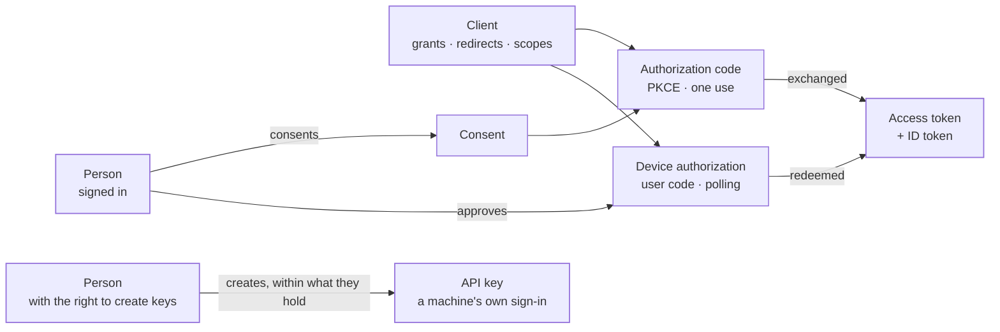
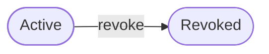
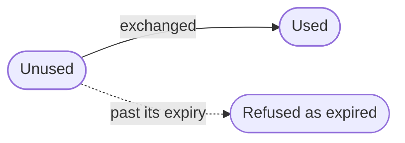
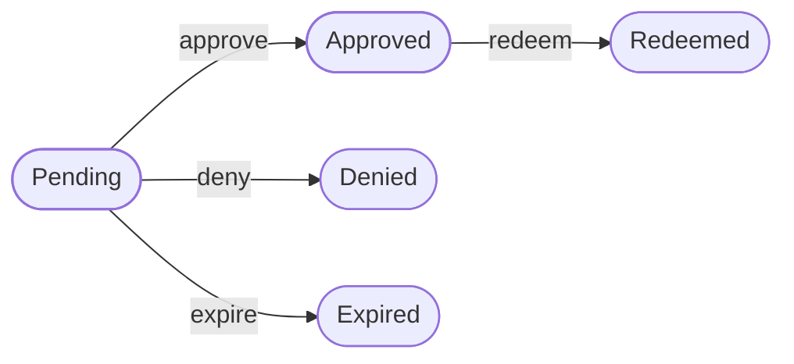

The OAuth context holds a tenant's **OAuth clients**, the apps and machines that may get tokens for its people, and its **API keys**, which sign a machine in with the permissions they carry. It holds the **consent** a person gives a client. And it holds what OAuth hands out: **authorization codes**, **pushed authorization requests**, **device authorizations** for screens without a browser, **access tokens**, **refresh tokens**, and the claims of the **ID token** that tells a client who signed in.

Where it sits:

- It uses **authorization** for what a person holds when they change a client or a key, **identity** for the account and its address, and **authentication** for how a person signed in.
- It sits in the layer above consumers, beside branding, federation, messaging, operator, organization and routing. No other context builds on it.
- Consent and device approvals need the person themselves. Identity names that rule, and authentication answers it with the person's finished sign-in to this tenant, or a directory client's bind with the account's password and certificate.

The code is in `crates/ianua-domain/src/domains/oauth`:

| Part | What it holds |
|---|---|
| `clients/client`, `clients/status` | A client, the grants it may use, its redirects and scopes, and whether it is active or revoked |
| `clients/credential` | How a client proves itself at the token endpoint |
| `clients/settings`, `clients/lifetimes` | What else a client is set up with: token form, binding, consent, sign-out notices and token lifetimes |
| `clients/registration` | Apps registering themselves, and the initial access tokens that let them |
| `clients/api_key` | A key a tenant gives to a machine, and what it may carry |
| `clients/consent` | The scopes one person gave one client |
| `grants/authorization_code` | The short-lived code of the code flow, with PKCE |
| `grants/pushed_request` | An authorization request a client pushes before sending the browser |
| `grants/device_authorization`, `grants/device_auth_status` | The device flow, and where a request stands |
| `grants/access_token`, `grants/jwt_access_token` | An issued access token, the grant it stands for, and its signed JWT form |
| `grants/refresh_token` | Refresh tokens, rotated on each use |
| `grants/token_binding` | What a token must be presented with: nothing, or a `DPoP` key |
| `grants/token_exchange` | Swapping a token for a narrower one for another client |
| `grants/id_token` | The claims of an OIDC ID token |
| `control` | The rule for who may change clients and keys |
| `events` | What the context records |

The use cases are in `crates/ianua-app/src/use_cases/oauth`: `clients`, `api_keys`, `registration`, `flows` (the browser, device and sign-out flows, and `userinfo`) and `token` (one use case per grant, introspection and revocation). The routes are in `crates/ianua-api/src/routes/oauth.rs`, under `/api/v1/organizations/{org_slug}/tenants/{tenant_slug}`. Discovery is at `.../.well-known/openid-configuration`.

## How the parts fit

API keys stand apart from clients. A person who may create keys makes one, and it carries no permission that person does not hold. A key has its own scopes and expiry, and never goes through a code or a token exchange.

## Who may change clients and keys

A client decides where codes and tokens for the tenant's people are sent. A key signs a machine in with the permissions it carries. So every change to either names the person making it and needs the API key right for that change:

| Change | Right |
|---|---|
| Register a client, create a key, issue an initial access token | `api_keys: create` |
| Rename a client or key, change its scopes, change a client's redirects or settings, rotate a client's secret | `api_keys: update` |
| Revoke a client, a key or an initial access token | `api_keys: revoke` |

`api_keys: manage` covers all three. Only a person signed in to the tenant holds these rights, through their roles or an active break-glass grant. Authorization answers the check.

Each right covers only its own change. Creating is not updating, so a person who may create clients may still not change the redirects of one that exists.

Sam may only view API keys. Without this check, he adds his own server to the redirects of the tenant's portal client and collects every code it hands out.

## A client

A client has a public client id, a name, the way it proves itself, the grants it may use, its redirect URIs, the addresses a person may be sent back to after signing out, and the scopes it may ask for.

A client proves itself at the token endpoint in exactly one way, fixed when it is registered: a secret, sent in the `Authorization: Basic` header or in the form body; a JWT signed with its own private key; or nothing, for a **public** client such as a single-page app, a mobile app or a CLI. Any other way is refused. Mallory learns the client id of an app that signs its requests with a key; if a secret also worked for it, she would only have to guess one. Only the hash of a secret is kept. Proving itself with a TLS client certificate is not offered, since no client certificate reaches the API.

A secret can be rotated. The old one may keep working for an overlap of up to 30 days, so the app's servers can move without an outage, or stop at once after a leak.

The grants a client may use:

| Grant | What it is |
|---|---|
| Authorization code | A person signs in and approves, and the client swaps the code for tokens |
| Client credentials | Tokens for a machine acting as itself |
| Refresh token | Swapping a refresh token for a new access token |
| Device code | A person approves, on a second screen, a device that cannot show a browser |
| Token exchange | Swapping a token the client was handed for a narrower one for another client |

A client is refused when:

- it is given no grant at all, since it could never get a token,
- it uses the authorization code flow with no redirect URI, since the code would have nowhere to go,
- it lists a redirect URI, a sign-out address or a scope twice,
- it is public and asks for client credentials or token exchange, which hand out tokens on the client's own proof.

The same rules hold when its redirects or scopes are replaced later. Removing the last redirect of a code flow client is refused.

A redirect URI is one of three kinds, at most 2048 bytes and never with a fragment:

- an `https://` address with no user name or password in it and no host that is a private or otherwise blocked IP address,
- a loopback address, `http://127.0.0.1` or `http://[::1]`, for a desktop app or CLI; the port is not compared, and `localhost` is refused, since a name can be pointed elsewhere,
- an app's own scheme in reverse-domain form, such as `com.acme.app:/callback`.

A client id is 1 to 255 characters with no spaces or control characters.

Beyond those, a client is set up with how long its tokens last, whether people are asked to consent, whether its access tokens are opaque or signed JWTs, how it hears about sign-outs, and what its tokens are bound to. A new client gets the platform's lifetimes, asks for consent, gets opaque bearer tokens and hears of no sign-outs. A client's own lifetimes never pass a day for an access or ID token, or 90 days for a refresh token family.

### A client's life

A revoked client never comes back. A new client is made instead. A revoked client cannot be renamed, or have its redirects, scopes or settings changed: each edit is refused as a conflict. Without this, Sam revokes a client and then edits it quietly back into shape.

## Apps that register themselves

An app may register itself as a client (`POST .../oauth/register`), but only with an **initial access token** the tenant handed out. An open registration endpoint would let anyone put a consent screen in the tenant's name in front of its people. A token allows 1 to 1,000 registrations and lives at most 30 days. Only its hash is kept, and the raw token is shown once. Revoking it stops new registrations; clients that already registered with it stay.

What an app registers is held to more than an admin's client. It always asks people for consent, and it never acts as itself, so it may not ask for client credentials or token exchange. It gets a registration access token of its own, with which it reads, changes or deletes its registration at `.../oauth/register/{client_id}`, and nothing else. It may never make itself first-party.

## API keys

A raw key looks like `ik_live_{slug}_{lookup}_{secret}`:

- The `ik_live_` start lets secret scanners find a leaked key in git.
- The slug is readable, which helps when debugging.
- `ik_live_{slug}_{lookup}` is the **key prefix**, kept in plain text to find the key.
- The whole key is kept only as a hash. The raw key is shown once, when it is made, and never stored.

A key records the person who made it as its creator, taken from their sign-in, not from a name the caller fills in. It keeps tenant users and org users apart, so a key Ann made as an org user never signs in as a tenant user who does not exist.

**A key acts in its creator's name.** What it may do is the permissions its scopes name that its creator holds today, never what the scopes alone say. A key stops when its creator may no longer sign in. Sam made a reporting key that views users while he could also manage roles. The key views users and never manages roles, since its scopes do not name it. Sam made another key scoped to manage roles. He loses the role right, and that key loses it with him, without anyone touching it. Sam is locked out after a break-in, and every key he made stops with him. A break-glass grant is never carried to a key.

A key has no revoked state of its own: revoking a key deletes it. A key that exists works until its expiry, if it has one, and stops at the exact moment it expires.

Whoever makes a key may give it an end (`expires_at` in RFC 3339); left out, it never ends. Tess makes the contractor a key for three weeks. A minute before the end it works. From the end on, every request with it is refused as a wrong key is, with the same `401`, so nobody can tell it was ever good. That holds at once, before anything removes the key. An hourly sweep then deletes keys past their end and records one `oauth.api_key_expired` for each. A key read back shows `expires_at`, and a key with no end leaves the field out.

A key may be **paused** instead (`POST …/api-keys/{id}/pause`). It signs in nothing from that moment, and nothing about it is lost. Pat's workflow sees the deploy key used from a new country and pauses it, and the pipeline stops at once. Once someone has looked, they resume it (`…/resume`) and it works as before. Pausing needs the right to revoke keys, since it takes access away. Resuming needs the right to update keys and every permission the key carries, as making it did, since it gives that access back. Each records `oauth.api_key_paused` or `oauth.api_key_resumed`. A key read back shows when it was paused (`paused_at`).

Each time a key signs in, the country its address is in is noted, when it can be placed. A key remembers the last 16 countries it signed in from. The first one is where the key lives and records nothing; a country it never signed in from before records `oauth.api_key_used_from_new_country`, naming the key and the country, which a workflow may start from to pause it. An address that cannot be placed notes nothing. The country is checked on every request, even when the key's last use was written down a moment ago: Ann's deploy key works from Germany, and a stolen copy used from Brazil 30 seconds later is recorded on that first request. A request that brings nothing new costs one read and no write. Two requests from Brazil at the same instant record Brazil once, since only the first to write lands.

A key records when it last signed a request in and, when known, the address it came from, so its owners can spot one that leaked or sits unused. A request marks its key at most once per interval on each server, so a read is not turned into a write every time. Marking it records no event.

### What a key may carry

A key's scopes name the permissions it may be spent on, such as `idp:metrics:view`. Every answer about a key (`GET .../oauth/api-keys` and `GET .../oauth/api-keys/{id}`) lists its `scopes` as they were written, so its owners see what it reaches without the raw key; an organization key's answer lists its `org:` scopes the same way. A key is refused when:

| Rule | Why |
|---|---|
| It has no scopes | It could do nothing |
| A scope names no permission the system checks, such as `projects:read` | Every request with it would fail |
| A scope reaches a permission the person making it does not hold | A key never does more than its maker could |
| Its expiry is not ahead of now | A key never starts out expired |
| It is made with a key and ends later than that key, or never | A leaked key must not leave a successor that outlives it |

The maker's rights are their standing rights only. What a break-glass grant adds is for the emergency, not for handing on to a key.

Changing a key's scopes holds the person to both sides. They must hold everything the key carries now and everything it is to carry. So they widen a key only as far as they reach themselves, and narrow only a key they could have made.

Sam may only view metrics and manage keys. He cannot make a key that manages users, or widen his metrics key to manage users. And with only the update right and metrics viewing, he cannot cut Ann's user-managing key down to metrics viewing and stop her user sync.

## Consent

Consent is the set of scopes one person gave one client. A later request for the same or fewer scopes is already covered. One asking for more adds the new scopes to the consent. Withdrawing consent removes every scope, so even a scope given before needs asking again, and it also revokes what the client holds for that person.

Consent is the person's own. Giving it, widening it and withdrawing it each need the person themselves to be signed in. Without this, an admin's session agrees for Ann that a reporting app may read her mail, and the app gets tokens for her without her ever being asked. Likewise Mallory, signed in as herself, cannot widen Ann's consent to an app she runs, or withdraw Ann's consent to the app Ann uses.

## Authorization codes

A code is issued after the person consents, sent once to the client's redirect, and swapped by the client for tokens at the token endpoint. Only its hash is kept.

**When it is issued**, the client must be active and allowed the code flow, the redirect must be one the client registered, and every scope must be one the client was given. Mallory starts a sign-in naming the web app but with `https://evil.com/callback` as the redirect. No code is issued, so none is sent to her. A request for a scope the client was never given gets no code either.

**The session that consents must still count.** A code is made from the session the person consented in. Its sign-in must be finished and must still count now. Ann's account is locked after she signs in, and her open session consents to the web app. No code is issued, so a locked account gets no tokens.

A code carries what the token exchange and the ID token need: the person, the client, the redirect, the scopes, the PKCE challenge, the nonce the request carried (or that it carried none), the session, and how the person signed in. The person, their way in, their second factor and when they signed in are all read from the session, never written by the caller. Mallory signs in with a password alone. No one can write "a hardware key" on her code, so no app that asks for a hardware key lets her in.

**When it is swapped**, the checks run in this order, and the first that fails refuses the swap:

| Refusal | When |
|---|---|
| Already used | The code was swapped before, as in a replay |
| Expired | Its lifetime has ended, at or after the expiry instant |
| Client refused | The client is another one, is not active, or may no longer use the code flow |
| Scope withdrawn | The client has since lost a scope the code carries. The code is refused whole, not narrowed, so the client asks again for what it still holds |
| Redirect mismatch | The redirect is not exactly the one the code was issued for |
| Verifier mismatch | The PKCE verifier does not match the code's challenge |

A refused swap leaves the code unused. Only a swap that passes every check marks it used, with the time. The swap is also refused when the session the code was consented in has since been signed out of.

**PKCE** is required, and only `S256` is offered. The `plain` method sends the verifier itself as the challenge, so anyone who saw the authorization request could redeem an intercepted code. The challenge is compared in constant time. Mallory presents the right client and code but not the verifier, which only the app that started the sign-in holds, and the swap is refused.

A code challenge is 43 to 128 characters of letters, digits, `-`, `.`, `_` and `~`. A nonce is 16 to 256 characters with no spaces or control characters.

### Pushed authorization requests

A client may push its authorization request straight to the server first (`POST .../oauth/par`), proving itself, and send the browser on with only the `request_uri` it gets back. The parameters never pass through the browser, so nobody changes the scopes or the redirect on the way. A pushed request is screened as a browser's would be, lives 60 seconds, is used once, and only by the client that pushed it. Pushing is allowed, not required.

## Device authorizations

The device flow is for TVs, command-line tools and other devices without a browser. The device asks for a code at `POST .../oauth/device/code` and shows a short user code and a URL. The person opens the URL on their phone or laptop, types the code and approves or denies. The device polls the token endpoint with the device code grant until the request is decided.

Denied, expired and redeemed go nowhere. An approved request may only be redeemed.

| Step | Who | Refused when |
|---|---|---|
| Start | A client | It is not active, was not given the device flow, or asks for a scope it was not given |
| Approve | The person signed in | Someone else is signed in, the request has run out, or it is not pending |
| Deny | The person signed in | Someone else is signed in, or it is not pending |
| Redeem | The client that started it | Another client asks, the client is no longer active or allowed the device flow, the request has run out, or it is not approved |
| Expire | The platform | It is not pending |

**Only the person approves for themselves.** The device gets tokens for whoever approved, so an approved request always names its approver, and only that person's own sign-in approves. Mallory types the code from her TV and names Ann as the approver while signed in as herself. It is refused, and the request still waits. She cannot deny Ann's TV in Ann's name either.

**A machine-only client cannot start it.** A client must be given the device grant by name, so one with only client credentials is refused.

**One approval gives one set of tokens.** Redeeming moves the request to redeemed, and polling again with the same device code gets nothing. A device that polls before anyone approves cannot jump from pending to redeemed. Another client that saw the device code and polls with it is refused, and the approval stays for the device that asked.

A request reads as expired from its expiry instant on, even before anything marks it.

**The user code** is 1 to 20 capital letters, digits and `-`, such as `ABCD-1234`. While a request waits, whoever holds the code can approve it with their own account. So the code never prints in a log, an error or a debug dump, and the event for a new request carries only the client, never the code. Sam cannot read a live code from the audit log and approve that device in his own session. Nor from a copy of the database: the code is kept only as its keyed hash, by which a typed code is found, and encrypted, for the approval page to show. Only the hash of the device code is kept.

**The poll interval** is the shortest wait, in whole seconds, the device leaves between polls. It is at least 1 second and at most 65,535. The default is 5 seconds. A zero is refused, since it would have the device poll the token endpoint without pause. A device that polls sooner than its interval is told to slow down, and its interval grows by 5 seconds.

## The token endpoint

Every grant is asked for at `POST .../oauth/token`, which a client proves itself to in the way it registered.

- **Client credentials** are for a confidential client the admins registered. A public client proves nothing, and an app that registered itself was never checked. No refresh token follows; the client proves itself again instead.
- **Refresh tokens** work once. Using one hands out the next in the same family and retires it. A retired token presented again means someone else holds a copy, so the whole family is revoked, the thief's copy and the person's alike, and `oauth.refresh_token_reused` is recorded.
- **Token exchange** lets a confidential client the admins allowed swap a token it was handed for one meant for another active client of the tenant. The new token carries the subject token's scopes or fewer, never more.
- **A token for a tunnel.** With an authorization code, a refresh token or a device approval, a client may name a resource (RFC 8707): `resource=urn:ianua:stream-route:` followed by a stream route's id. The access token is then meant for that route's signed-in tunnel alone, and its `aud` names the route, so no app, API or other tunnel takes it. The route must be an active signed-in tunnel of the tenant, and the client must take JWT access tokens, which the gateway reads at the tunnel. Anything else is refused as `invalid_target` before the code, refresh token or device approval is used, so the client can ask again without it. Ann's command-line tool signs her in with the device flow, then asks with `resource=urn:ianua:stream-route:<the SSH route's id>` and opens the SSH tunnel with what it gets.

A client revokes its own tokens at `POST .../oauth/revoke`. A token that is unknown, already ended or another client's is answered the same as one revoked, so a caller learns nothing about tokens it does not hold. Revoking a refresh token ends its whole family.

A resource server asks whether an access token works at `POST .../oauth/introspect`, proving itself as a confidential client. A token that does not work says only that it is inactive: revoked, expired, never issued, its client revoked or its person shut out all answer the same. A working token is described with its scopes, client, subject, audience and times, its `token_type` (`DPoP` or `Bearer`), what it is bound to (`cnf`) and who acts for its subject (`act`).

## Access tokens

Each access token issued is recorded, so a presented token finds its own grant: one client, one person, the scopes the person gave, until it expires or is revoked. Only the hash is kept. The raw token goes to the client once and cannot be recovered. A client may choose signed JWT access tokens instead of opaque ones, which a resource server checks on its own. Their claims come from the token record, never from the caller.

A token is usable while it is not revoked and before its expiry instant. Revoking it stops it at once, even with most of its lifetime left. Revoking it again keeps the first time, since it has not worked since then. A token covers only the scopes it was issued with: one for `openid` and `email` does not cover `profile`.

### Tokens bound to a key (DPoP)

A bearer token works for whoever holds it. Mallory copies one out of a log and calls the API as Ann. A **DPoP-bound** token (RFC 9449) works only beside a proof signed with the key it was bound to, which never left Ann's app.

A client sends a proof in the `DPoP` header. A request with no header proves nothing. A header sent twice, or empty, is refused rather than read as none. A proof that is sent must check out, or the request is refused outright:

- its signature holds under the public key in its header, with `ES256`, `RS256` or `EdDSA`; never `none`, never a shared secret,
- it was made for this request's method and address,
- it was made within the last 60 seconds, and no more than 5 seconds ahead of the server's clock,
- it was never used before: each key and proof id is remembered until the proof runs out, so a copied proof cannot be sent again,
- at a resource, it names the access token it is sent beside.

Discovery lists the algorithms as `dpop_signing_alg_values_supported`. Checking the signature is the job of the `DpopProofVerifier` port (`crates/ianua-app/src/ports/oauth/proofs.rs`), whose adapter is being rebuilt with the infrastructure layer.

At the token endpoint, a request that proved a key gets a token bound to it. A client may require binding: then a request with no proof is refused with `invalid_dpop_proof`. A public client's refresh tokens are bound to its key as well, so a copied refresh token is useless without the key. A confidential client proves itself on every refresh, so its refresh tokens stay bearer.

At `userinfo`, and at every resource that takes an access token, a bound token presented without a matching proof is refused as an invalid token. Introspection answers a bound token's key thumbprint as `cnf.jkt`.

**Certificate-bound tokens are not offered.** No TLS client certificate reaches the API, so discovery does not list `tls_client_certificate_bound_access_tokens`. A client set to bind its tokens to its certificate is refused at the token endpoint with `invalid_request`.

## ID tokens

The ID token tells a client who signed in. Its claims are built once and cannot be changed after. Without that, a caller could set `email_verified` or `aal` by hand before the token is signed.

The claims come only from the grant the client was just handed: a code it swapped, a refresh carrying a grant on, or a device approval it collected. Who the token is for, how they signed in, when, and the nonce are read from that grant. A refreshed token states the sign-in its session recorded, never the time of the refresh, and carries no nonce. A token for a device states no sign-in and names no session. The build is refused when:

- a code has not been swapped for tokens, or a device approval not collected,
- the grant went to another client,
- the account is not the one the grant is for,
- a refresh names a session other than the one its grant was given in,
- the grant did not ask for `openid`.

Claims follow the scopes the person granted. The address and whether it is verified come only with `email`; the name, language and timezone only with `profile`; the roles only with `roles`.

| Claim | What it holds |
|---|---|
| `iss` | The tenant's issuer |
| `sub` | The person's id |
| `aud` | The client id |
| `exp`, `iat` | When it expires and when it was issued, in whole seconds since the epoch |
| `auth_time`, `acr`, `amr`, `aal` | How the person signed in, when that is known: when, the assurance level, the methods as RFC 8176 names them |
| `sid` | The session the grant was given in |
| `nonce` | The nonce the request sent. Left out when it sent none, and never one it did not send |
| `at_hash` | A hash of the access token handed out with it |
| `email`, `email_verified` | The person's address, and whether they proved they hold it |
| `name`, `locale`, `zoneinfo` | Their display name, language and timezone |
| `roles` | The names of the roles they hold |
| `tenant_id` | The tenant, since one provider serves many |

`email_verified` is read from the person's address, never set on its own. Mallory signs up with `ceo@acme.com` and never confirms it. Her token carries `email_verified: false`, so an app that links accounts by verified email never sees it as true.

`amr` names only what the session recorded:

| Sign-in | `amr` |
|---|---|
| Password | `pwd` |
| Magic link | `otp` |
| Passkey | `swk` |
| Through SAML or OIDC | nothing for the first step, since how the provider checked the person is its own business |

A second factor adds its own reference and then `mfa`: `otp` for a TOTP or recovery code, `sms` for a texted code, `hwk` for a hardware key, `swk` for a passkey. A provider that reports only that it asked for more than one factor adds `mfa` alone. A reference already in the list is not added twice. A mailbox confirmation or a mailed code is no second factor and adds nothing. So a password and a TOTP code give `pwd`, `otp`, `mfa`.

The same claims, as the scopes allow, are answered at `GET` or `POST .../oauth/userinfo` for a token that acts for a person and carries `openid`.

## Lifetimes

Codes, device requests, access tokens and ID tokens each take a lifetime when they are made. A lifetime is longer than zero and at most `u32::MAX` seconds, about 136 years. Nothing here is issued already expired.

## What a stored row must satisfy

Each record is checked again when it is read back. A row that breaks a rule is refused as broken storage, never repaired.

| Record | Refused when |
|---|---|
| Client | It has no grant, uses the code flow with nowhere to redirect, lists a redirect URI, a sign-out address or a scope twice, is public with client credentials or token exchange, or registered itself and acts as itself |
| API key | It has no scopes or a scope that names no permission, has a last-use address but no last-use time, was used before it was made, or expires at or before the time it was made |
| Authorization code | It records a second factor only an outside provider reports on a sign-in ianua checked itself, was issued before its session signed in, expires at or before the time it was issued, or was swapped before it was issued |
| Device authorization | It expires at or before the time it was started, or was polled before it was started |
| Access token | It expires at or before the time it was issued, was revoked before it was issued, or is meant for a tunnel but acts for no person |

A stored consent has no part that can contradict another, so it loads as stored.

## Events

| Event | Recorded when | Notifies colleagues |
|---|---|---|
| `oauth.client_created` | A client is registered by an admin | Yes |
| `oauth.client_registered` | An app registers itself | Yes |
| `oauth.client_updated` | A client's name, redirects, scopes or settings change | Yes |
| `oauth.client_secret_rotated` | A client's secret is rotated | Yes |
| `oauth.client_revoked` | A client is revoked | Yes |
| `oauth.initial_access_token_issued` | An initial access token is issued | Yes |
| `oauth.initial_access_token_revoked` | An initial access token is revoked | Yes |
| `oauth.api_key_created` | A key is made | Yes |
| `oauth.api_key_updated` | A key's name or scopes change | Yes |
| `oauth.api_key_revoked` | A key is revoked | Yes |
| `oauth.api_key_expired` | A key passes its expiry | Yes |
| `oauth.authorization_request_pushed` | A client pushes an authorization request | No |
| `oauth.authorization_code_issued` | A code is issued after consent | No |
| `oauth.authorization_code_exchanged` | A code is swapped for tokens | No |
| `oauth.access_token_issued` | An access token is issued | No |
| `oauth.refresh_token_reused` | A retired refresh token comes back and its family is revoked | No |
| `oauth.token_revoked` | A client revokes one of its tokens | No |
| `oauth.token_exchanged` | A client exchanges a token | No |
| `oauth.device_authorization_requested` | A device flow starts | No |
| `oauth.device_authorization_approved` | A person approves a device | No |
| `oauth.device_authorization_denied` | A person denies a device | No |
| `oauth.device_authorization_collected` | A device collects its approval | No |
| `oauth.consent_granted` | A person gives a client consent | No |
| `oauth.consent_revoked` | A person withdraws consent | No |
| `oauth.back_channel_logout_sent` | A logout token is posted to an app's server after a sign-out | No |

Codes, tokens, device approvals, exchanges and consent are the signed-in person's own activity. They go in the audit trail but not in colleagues' feeds. Changes to clients, keys and what lets apps register do reach them.
