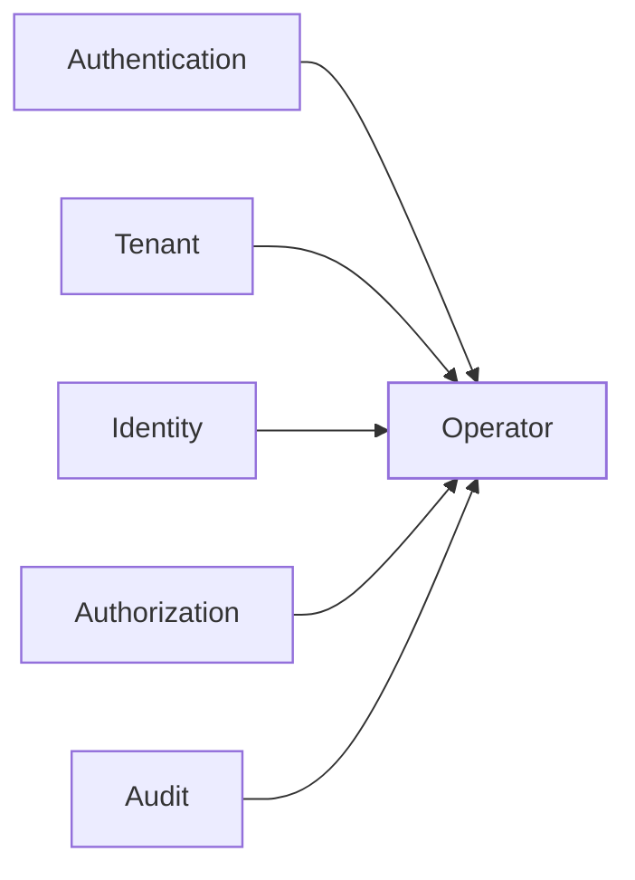
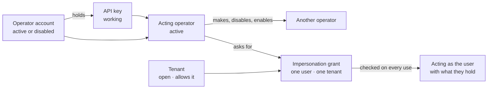
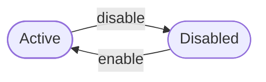
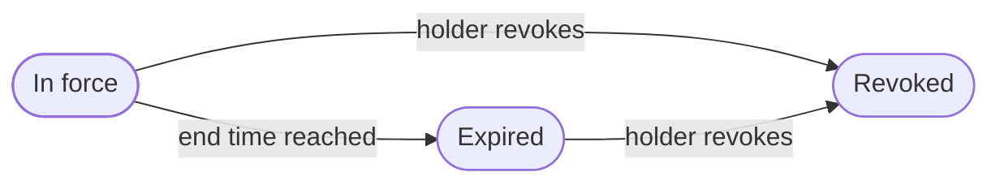

The operator context holds the platform's **operators**: the engineers who run the control plane. It says when an operator may act, and who may make, disable or enable an operator account. It holds the **API keys** an operator acts through. It also holds **impersonation grants**: time-limited permission for one operator to act as one user in one tenant, for a stated reason.

Operators are not tenant users and belong to no tenant. They hold no tenant rights of their own. What lets an operator act is that they are an operator holding a working key of their own, whose account is still active. Inside a tenant, an operator acts only as the user a grant names, with what that user holds.

## Where it sits

The operator sits above the tenant and consumers, beside branding, federation, messaging, OAuth and routing. The organization and notifications sit higher and take the acting operator proof for their own operator actions. Authentication gives it the password check. The tenant gives it the tenant a grant is made in: whether that tenant is open, and whether its compliance posture lets operators act as its users. Identity gives it the user a grant acts as, and the email change flow that moves an operator's address. Authorization works out what that user holds in the tenant. Audit gives it the proof that lets every acting operator read the whole platform's audit log.

On the operator plane, authorization does not answer for operators. An operator holds no role and no permission there. Instead, every change names the acting operator through a proof the context makes itself, described below.

The code is in `crates/ianua-domain/src/domains/operator`:

| Part | What it holds |
|---|---|
| `identity` | The operator account, its password check, and disabling and enabling it |
| `status` | Where an account stands: active or disabled |
| `control` | The proof that an operator holds a working key, or a sign-in, and may act now |
| `api_key` | The keys an operator acts through |
| `impersonation` | Grants that let an operator act as one tenant user for a while |
| `events` | What the context records |

The use cases are in `crates/ianua-app/src/use_cases/operator`, in `accounts`, `keys` and `impersonation`. They are served under `/api/v1/operators` (`crates/ianua-api/src/routes/operator.rs`). These routes belong to no organization or tenant.

## How the parts fit

## An operator account

An account has an id, the address the operator is known by, a password hash, a status and the time it was made. A new account starts active. Two operators never share an address: a new account or an address change naming an address another operator has is refused.

These are the only two moves. Disabling a disabled account, or enabling an active one, is refused, so a repeated click does not record a change that never happened.

Disabling an operator also revokes every impersonation grant they hold. Their keys stop working at once, because a key acts only while its operator is active.

## Acting through a key

Every operator endpoint takes the operator's own API key. The context turns the operator's account and their key into an **acting operator**, read fresh on every request. Every change below takes one.

A key starts with `opk_`, so secret scanners find one that leaks. Only the key's hash is kept, never the key. The raw key is shown once, when it is made.

A key acts for the operator who made it, and only while both the key and the account work. Acting through a key is refused when:

| Case | Example |
|---|---|
| The key is another operator's | Mallory copies Carol's key and presents it with Bob's account, to act as Bob |
| The key was revoked | Bob's key leaked into a CI log and he revoked it. Mallory calls the platform with the copy |
| The key has ended | Bob's key was made to last a day. Mallory finds it a week later. It stops working at the instant it ends |
| The account is disabled | An operator disables Bob. His key, never revoked, does not act as him |

The check looks at the account and the key as they stand when the operator acts. So once Bob is disabled, a key he made before does not let him act.

### Signing in for a key

An operator gets their first key, and every key after a key ran out, by signing in with their address and password (`POST /api/v1/operators/sign-in`). The password check turns into a sign-in proof, and the proof makes a key of their own that ends after `OPERATOR_KEY_TTL_SECONDS`, twelve hours by default. The raw key is shown once. Nothing else on the operator plane takes a password: every later call carries the key.

Every refusal answers alike, as not found: an address no operator holds, a wrong password, a disabled account, and a network locked out of the address. Operators are held to the strict lockout: three wrong passwords from one network in five minutes lock that network out of the address for an hour, so even the right password from it is refused until then. An address with no operator and a disabled account take as long as a real check, so the time does not tell them apart either. The endpoint is limited per client address like every other sign-in. A key that worked records `operator.operator_api_key_created`; a refusal records `operator.operator_sign_in_failed`, with the address as typed and why.

Mallory, who knows Bob's address, guesses his password from her laptop. After her third guess her network is locked out of Bob's address for an hour. Bob, from his own office, still signs in.

### Making and revoking keys

An operator makes keys only for themselves (`POST /api/v1/operators/{id}/keys`, with `id` their own; another operator's `id` is not found). A key may be given an end time. A new key is refused when its end time has already passed. A key made through another key ends no later than that key. Without this, Mallory, holding a copy of Bob's key that ends tomorrow, makes a key that never ends and keeps acting as Bob after the leaked one runs out.

A key is always its maker's own, and only that operator revokes it, one at a time by its prefix or all at once (`.../keys/revoke-all`, which also ends the key the request came with). Revoking a key twice is refused, and the first revocation time is kept. Carol cannot quietly end the key Bob's deploy relies on; if she sees a key misused, she disables Bob, which stops every key he holds and names her as the one who did it. Another operator's key reads as missing (`404`), the same as a prefix nobody holds, so a prefix cannot be used to learn which keys exist.

## Changing an operator's address

Operators act through keys, so no password proves one of them again. So an operator's address is moved by **another operator**, never by the operator themselves (`POST /api/v1/operators/{id}/email`). Carol cannot move her own address: whoever holds her key would otherwise send it to their own mailbox.

The account keeps its old address until the link mailed to the new address is followed. The old address is told and gets a link that stops the change. Asking for the address the account already has is refused.

## Who may do what

| Change | Who may make it |
|---|---|
| Make an operator | Any acting operator, for an account other than their own |
| Disable an operator | Any acting operator, for an account other than their own |
| Enable an operator | Any acting operator, for an account other than their own |
| Change an operator's address | Any acting operator, for an account other than their own |
| List operators, or look one up | Any acting operator |
| Make an API key | Any acting operator. The key is always theirs |
| Revoke an API key | Only the operator it acts for |
| Ask for an impersonation grant | Any acting operator. The grant is always theirs |
| Revoke a grant | Only the operator who holds it |
| Act as a tenant user | Only the operator a grant names, while it holds |
| Make the first operator | The platform, when it is installed, with nobody acting |

An operator reaches every tenant the platform runs, so only an acting operator makes another. Without this, anyone who reaches the operator API makes themselves an operator.

**Nobody makes, disables, enables or moves the address of their own account.** An operator who disabled themselves by mistake could leave the platform with nobody to run it, and whoever holds Carol's key could send her address to their own mailbox.

The platform's first operator has nobody to make it, so the install step makes it without an acting operator, and only while no operator exists yet. Once one exists, it makes nothing. Its password is held to the rules every new organization starts with, and a password found in known breaches is refused, as is one the breach service could not look up.

## Impersonation grants

A grant lets one operator act as one user in one tenant until a set time. It names the operator, the tenant, the user, the reason and the end time, so the audit trail can show them.

The grant always belongs to the operator who asks for it (`POST /api/v1/operators/{id}/grants`, with `id` their own). Without this, Bob names Carol as the holder and acts as Acme's admin with her name on every audit line.

### Limits and numbers

| Value | Limit |
|---|---|
| Length of a grant | More than zero, at most 24 hours |
| Reason | Required, not blank, at most 500 characters, no control or invisible characters |
| Grants in force | One per operator for the same user and tenant |

A grant asked to end now, or in the past, is refused: it would only sit in the audit trail as access that was never usable. Exactly 24 hours is allowed. Anything more is refused, so Bob cannot keep acting as Ann for days.

### Asking for a grant

A grant is made against the tenant itself. It is refused when:

| Case | Refused as |
|---|---|
| The tenant does not exist, or the user is not in it | Not found |
| The terms name a different tenant from the one given | Invalid. Otherwise Bob passes in a tenant that allows impersonation, with terms naming a user in Acme, which forbids it |
| The tenant is not open | Forbidden. Acting as a user is acting in the tenant's name, which a suspended, archived or deleted tenant serves to nobody |
| The tenant's compliance posture forbids operator impersonation | Forbidden |
| The end time is not in the future, or is more than 24 hours away | Invalid |
| The operator already holds a grant in force for this user | Conflict |

A tenant is open while it is provisioning or active.

### A grant's life

A grant ends at its end time. The end time itself is outside the grant: counting it as inside would let Bob act as the user a moment past the time he was given.

Only the operator holding a grant revokes it, when the work is done (`DELETE /api/v1/operators/grants/{id}`). A grant past its end time can still be revoked. Revoking it a second time is refused, and the first revocation time is kept, so the record shows when access ended. Carol, another operator, cannot revoke Bob's grant halfway through his support call with nothing on record against her name: his grant reads as missing to her (`404`), the same as an id that never existed. If she sees a grant misused, she disables Bob instead, which revokes every grant he holds at once.

### Using a grant

Asking for a grant answers its id. Bob then calls the user's tenant with his own key and names the grant in the `ianua-operator-impersonation` header. The request acts as Ann. The same header on another tenant's path is refused, and so is the header with anything but an operator's own key. A grant of another operator's reads as missing.

Time alone is not enough. Every use checks the operator's key, the operator, the tenant and the user as they stand at that moment, and the grant is refused when:

| Case | Example |
|---|---|
| The operator's key does not act for them | Bob's key was revoked, or has ended |
| The operator is not the one the grant names | Carol takes Bob's grant and presents it as her own |
| The operator is disabled | Carol disables Bob during his two-hour grant |
| The tenant is not the grant's tenant | Bob presents his Acme grant with Globex, which allows impersonation |
| The tenant is no longer open | The platform suspends Acme during Bob's grant |
| The tenant now forbids impersonation | Acme gives Bob two hours, then forbids impersonation ten minutes later. Bob is refused from that moment, not when the two hours end |
| The grant was revoked | Bob revoked it when he finished |
| The end time has come | Bob's grant ends at 15:00. He presents it at 15:00 exactly |
| The user is not the one the grant names | Bob's grant names Ann. He presents it with Sam, an admin of Acme, to act with Sam's rights |
| The user may not sign in | An Acme admin deactivated Ann. Bob, acting as Ann, is refused, as Ann would be |
| The tenant's records come from another tenant | Bob presents his Acme grant with records read from Globex, to act there |

Each of these is refused as forbidden, except a key or account that no longer exists, which is unauthenticated. Tenant records that name a role which is not there are a different error: broken stored data, not a refusal.

### What the operator holds as the user

Once a grant holds, the operator acts as the user with the user's standing rights, worked out from the tenant's own records at that moment. Bob, acting as Ann, a viewer in Acme, may view users and nothing more.

The user's break-glass access is not carried. Ann's emergency grant to manage roles was given to Ann for her incident, so Bob acting as her does not get it.

The audit record of every change made this way names both the operator and the user, so the trail shows who really made it.

## What a stored row must satisfy

| Row | Refused as broken when |
|---|---|
| Operator | Never. Each field is already a checked type and no two fields can contradict each other |
| API key | Its prefix does not start with `opk_`, it ends at or before the time it was made, or it was revoked before it was made |
| Impersonation grant | It ends at or before the time it was made, lasts longer than 24 hours from the time it was made, or was revoked before it was made |

So a key row changed in storage to the prefix `oak_`, to hide it from secret scanners, is refused when it is read. A grant changed in storage to last three days is refused too, and Bob cannot act as the user longer than any grant may last. A key or grant whose end time has passed still loads, and is refused when used.

## Events

| Event | Filed under | What it names |
|---|---|---|
| `operator.operator_created` | The platform | The operator and their address |
| `operator.operator_disabled` | The platform | The operator |
| `operator.operator_enabled` | The platform | The operator |
| `operator.operator_api_key_created` | The platform | The operator and the key's prefix |
| `operator.operator_api_key_revoked` | The platform | The operator and the key's prefix, or no key when every key of the operator was revoked at once |
| `operator.operator_sign_in_failed` | The platform | The address as typed, why it was refused, and the client's address. No other operator is notified |
| `operator.impersonation_granted` | The user's tenant | The user, the reason and the end time |
| `operator.impersonation_revoked` | The user's tenant | The user |
| `operator.dead_job_retried` | The platform | The operator who retried it, the job's id and kind, its tenant and how often it had run, never its payload. See [Scheduling](/ianua/domain-contexts/scheduling/) |

Revoking every key at once records one event, and nothing when no key was in force. Operators belong to no tenant, so every account event names the operator; nothing else says whose account changed. Moving an operator's address records `identity.management_email_change_requested`. Every operator event is written to the audit trail and counts as worth a notification.
