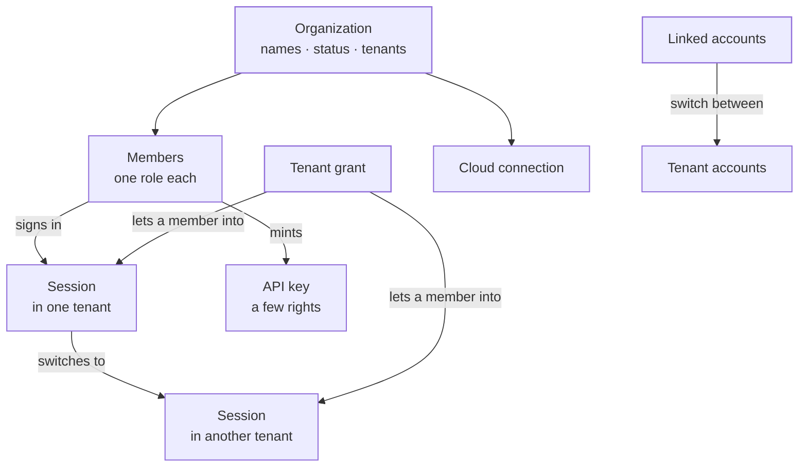
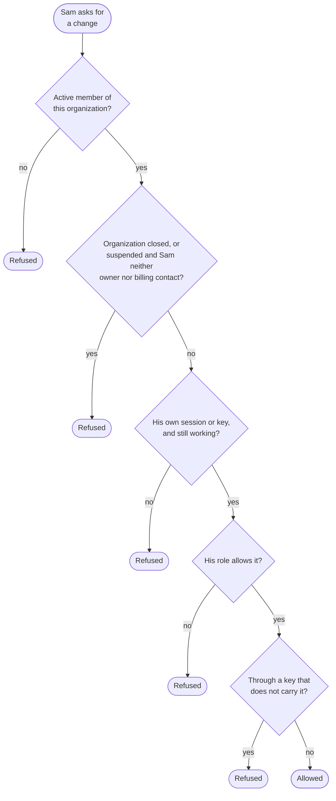
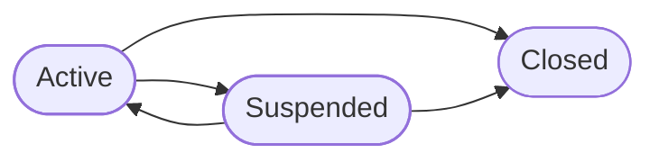
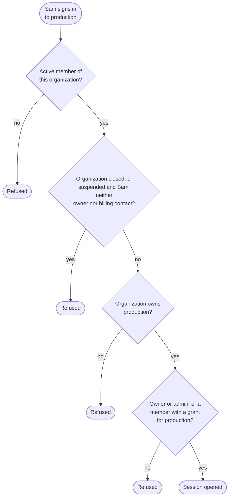
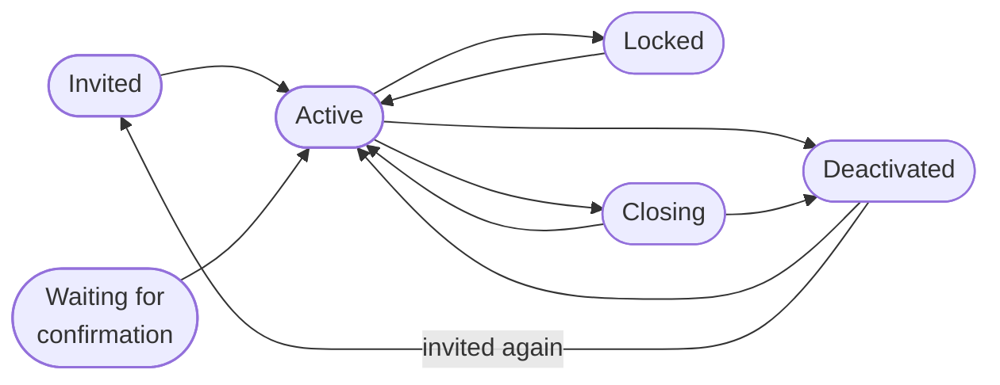
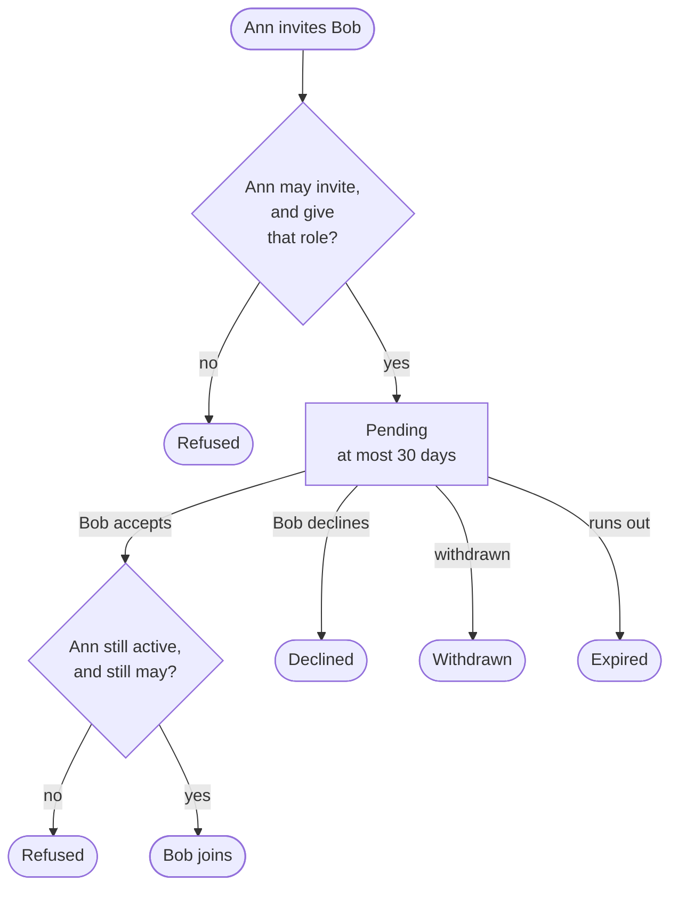
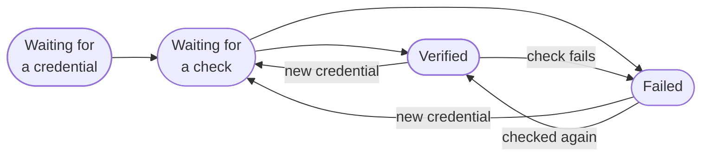
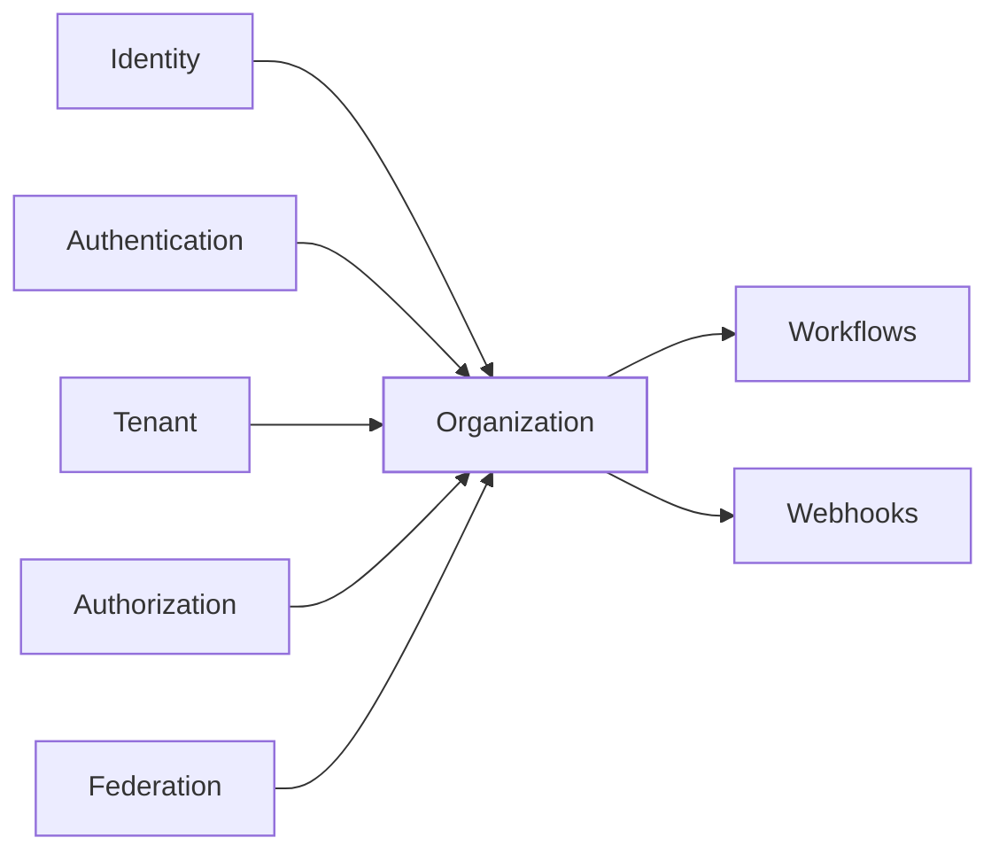

The organization context holds the **organization**: the company that owns a set of tenants. It also holds its **members**, the people who run it from the management plane, how they **sign in**, which **tenants** each of them reaches, the **API keys** scripts use, and the organization's **connections** to its own cloud accounts.

Members are not tenant users. A tenant user is someone whose identity ianua manages. A member is someone who manages ianua: its tenants, users, policies and routes. Members have their own passwords, sessions, second factors and invitations.

The code is in `crates/ianua-domain/src/domains/organization`:

| Part | What it holds |
|---|---|
| `lifecycle` | The organization, its names, its contact address and its list of tenants |
| `status` | Whether the organization is active, suspended or closed, who suspended it, and whom each status lets in |
| `signup` and `founding` | A sign-up waiting for its founder to prove their mailbox, and the proof that makes the founder the first owner |
| `members` | Members, their roles, invitations, ownership hand-over, tenant grants, linked accounts, the check for who acts, acting on another member's account, what a member holds inside a tenant, and members' consent and erasure |
| `access` | Sessions, the check a session passes each time it is used, sign-in settings, the organization's identity provider, emailed links, passkey challenges and API keys |
| `billing` | The organization's subscription and its payments |
| `branding` | The logo, color and sender name of the organization's own dashboard and mail |
| `cloud` | Connections to the organization's own cloud accounts and the credentials for them |
| `events` | What the context records when something changes |

What members do runs through the use cases in `crates/ianua-app/src/use_cases/organization`, such as `sign_in`, `members`, `invitations`, `identity_providers` and `api_keys`.

## How the parts fit

## Roles

A member holds one of five roles. From the least to the most:

| Role | What it may do | Tenants it reaches |
|---|---|---|
| Viewer | Look around: the organization, its tenants, members, sessions, activity, metrics, branding and bill, the audit log and activity showing its own records alone. Mark their own notifications read | None |
| Billing | Run the subscription and its payment, and read the organization, its metrics and their own notifications | None |
| Member | Look around as a viewer does, except the bill; the audit log and activity also show the tenants granted to them | Only those granted to them |
| Admin | Run the organization day to day: everything except closing it and changing what it pays | Every tenant |
| Owner | Everything in the organization | Every tenant |

Anyone changes their own name, language and timezone, and reads their own account and reach (`GET .../me` and `GET .../me/access`), whatever their role: the dashboard is built from it. Reading another member's reach needs the right to view members. A billing contact and a viewer reach no tenant, even if a grant was handed to them by mistake, so the person who pays the bill does not read every user's sessions. Their session works on the organization alone, as does a plain member's before anyone grants them a tenant. An owner or admin can still hand some of their rights to a script through an API key.

## Who acts, and through what

Every change names the member who makes it and what they act through: their own signed-in session, or an API key they made. A session carries the member's whole role. A key carries only the rights written on it, and never more than the member's role holds today.

A session stops working when it is ended, runs out, or sits unused past the idle timeout. It also stops when its member is no longer active or has changed how they sign in, such as their password or a second factor, since it opened. The session a member adds a passkey or an authenticator app from keeps working: the passkey after they prove who they are again, the app by the code from it that confirms it. The session of anyone but an owner or the billing contact stops the moment the organization is suspended, and every session stops once it is closed.

A session in use stays alive. A request let in on a member's session or API key marks it used, so a member working steadily never hits the idle timeout. So that every read does not become a write, each server marks a credential at most once per interval, which the server sets when it is wired up. Marking never brings back a session that already stopped. The same mark records when a key was last used, so its owners can spot a forgotten one and revoke it.

The check reads the organization as it stands when the change is asked for. Sam signed in this morning, and the platform suspended Acme at noon. His next change is refused, even though his session was opened while Acme was active.

| Action | Right it needs |
|---|---|
| Rename, change the display name or contact address | Update the organization |
| Change the sign-in settings | Sign-in settings, from a signed-in session |
| Add, change, switch or remove the identity provider | Sign-in settings |
| Change the dashboard's logo, color or sender name | Update branding |
| Run the subscription and its payment | Billing |
| Suspend the organization or lift a suspension | Suspend the organization |
| Close the organization | Close the organization, which only an owner holds |
| Hand ownership to another member | Being that owner, from a signed-in session |
| Add a tenant | Create tenants |
| Remove a tenant, or archive, restore or delete one | Delete tenants |
| Suspend or switch a tenant back on | Update tenants |
| Add a member directly | Create members |
| Invite, resend or withdraw an invitation | Invite members |
| Change a member's status, role, password or address | Update members |
| Change someone else's name, language or timezone | Update members |
| Remove a member | Remove members |
| Give or take away a member's tenant access | Manage tenant access |
| Make an API key | Create API keys |
| Revoke someone else's key | Revoke API keys |
| End someone else's session, or unlink someone's account | Update members |
| Reset someone else's second factor, or let them in or shut them out | Update members |
| Erase someone else's account | Remove members |
| Connect a cloud account or give it a credential | Update the organization |

The platform itself may also add and remove tenants, change the organization's status, withdraw invitations and grants, and revoke keys and sessions, such as when a member leaves.

Asking to erase someone else's account, or withdrawing their consent for them, checks the right before the member is read. Sam, a plain member, is refused with `403` whether the member id he names is real or made up, so he cannot use the answers to learn who is a member.

Whoever controls how an account signs in can become it. So on top of the right, a role decides which roles its holder may give, take away, or act on, whether that is a status, password, address or profile:

| Role to give, take or act on | Who may |
|---|---|
| Owner or Billing | Only an owner. One reaches every tenant, the other decides what the organization pays |
| Admin | An owner or an admin |
| Member or Viewer | Anyone holding the member right for it |

Sam is a plain member. He cannot reset the password of Ann, an owner, nor rename her to "Former employee". His role does not carry the right to update members, and even with it he would not be an owner.

Acting on another member's account, such as resetting their second factor, goes through a check made for that one account. It passes for no other, and never for the member's own account, which changes only through steps that prove them. The member right and the role rule apply as above. Without them, Sam resets the second factor of Ann, an owner, signs in with her password and reaches every tenant.

## The organization keeps an owner

An organization with no active owner can never be run again. Nobody could close it, change what it pays or hand out the owner role. So deactivating, locking, demoting or removing the last active owner is refused. Ann, the only owner, cannot deactivate herself by mistake.

An owner hands the organization over in one step. The heir, another active member of the same organization who is not an owner yet, becomes an owner, and the one handing over becomes an admin. Done as two changes, the organization would keep two owners if the second never came. Only the owner themselves hands their ownership over, signed in, never through a key. Mallory holds a key Ann made. She cannot use it to make herself the owner and Ann a mere admin.

## Organization status

Closed is final. No member acts on a closed organization, owners included, so it takes no new tenants, names or settings. The platform can still remove its tenants, so it can be wound down.

The organization remembers who suspended it. An owner may pause their own organization and switch it back on. A suspension the platform made only the platform lifts, so Acme's owner cannot undo it the moment it happens. The platform suspends for one of two reasons: a payment owed past its grace, which paying lifts, or an operator's decision, which only an operator lifts. While the organization is suspended, only owners and the billing contact sign in and act, so they can sort out what caused it and nobody else works in it. A plain member already signed in is out at once.

Each payment notice carries the provider's event id and when it was created. An event already acted on is acknowledged and changes nothing, and a failed charge or settlement created before one already applied changes nothing, so a late failure cannot mark a paid organization as owing.

## Signing in

An organization chooses how its members sign in. The settings hold:

| Setting | What it says |
|---|---|
| Ways in | Any of password, passkey, a link mailed to the member, and single sign-on over SAML or OIDC |
| Single sign-on | Optional, or enforced |
| Second factor | Off, optional or required, and which kinds members may set up |
| Breached passwords | Off, warn, or block a new password found in known breaches |
| Password rules, sessions and lockout | How strong passwords must be, how long sessions last, and how many wrong guesses from one network lock that network out of an account, for how long |
| Challenge threshold | How many failed sign-ins naming the organization put its sign-in under pressure, so a device no member trusted must pass a challenge first |
| Networks | The address ranges that may sign in. Empty lets every address in |
| Step-up | When a sign-in must clear a higher bar than a password |

A new organization allows password and passkey, makes a second factor optional, offers an authenticator app as that factor, and blocks breached passwords. Its sessions last 8 hours with a 1 hour idle timeout, and 10 wrong guesses lock an account for 15 minutes. A member who set up a second factor is asked for it on every device they have not trusted. Sessions can be set from 5 minutes to 30 days, and no session opens for longer than 30 days.

Settings that would let nobody in are refused when they are built: no way in at all, a way in the management plane does not support, no way in that can reach the assurance the settings ask for, single sign-on enforced with neither SAML nor OIDC switched on, no kind of second factor listed, or numbers out of range or at odds with each other. Members answer only codes from their own authenticator app, or use a passkey. So a second factor sent by mail or text is refused here: no member sign-in could answer it.

Enforced single sign-on means members sign in only through the organization's identity provider, so a leaver loses access the moment the provider drops them. Bob left Acme. He cannot sign in with the password he set years ago, nor by a mailed link. Owners keep their other ways in, so a provider that is down or set up wrong does not lock out the people who could fix it.

Under block, a password found in known breaches is refused when it is set, and so is one whose lookup could not be made, with a "try again". Under warn it is taken, and the finding is logged. Neither the password nor anything made from it is logged.

The owner's password is set before the organization has settings of its own, so founding holds it to the settings every new organization starts with: the password rules, and breached passwords blocked. That covers the public sign-up, an installation's install, and a member founding another organization. Ann signs Acme up with a password from a leaked list. The sign-up is refused, nothing waits for a link, and she picks another. If the breach service cannot be reached, the sign-up is refused with a "try again" too.

The settings decide who reaches the management plane at all. So they change only from a signed-in session, never a key. The new settings must also still let in the very sign-in that saves them. Ann saves an address list that leaves out her own network. It is refused, so she does not lock every owner out, herself included.

### Which organization

The sign-in page names no organization. An address is unique within an organization, not across the platform, so one person may have an account on the same address in several. The password settles which is meant. When it opens one account, that one signs in. When it opens more than one, nothing is opened: the answer is `status: "choose_organization"` with the organizations to pick from. The person signs in again with the same address and password, naming one in `organization`, so the choice is bound to the proof. Someone without the password learns nothing, since every refusal answers as an unknown address does.

A mailed sign-in link and a password reset link work the same way across organizations. Each organization holding the address gets its own link, naming that organization, and the person chooses by following one. The answer to asking for a link is the same whether or not anyone has the address.

### When failures flood in

Member sign-in holds up under a flood of guesses the way a tenant's does (see [Authentication](/ianua/domain-contexts/authentication/#when-failures-flood-in)). Before any password is hashed, the sign-in is held to a count of failures, and while that count is at its threshold, a device no member trusted must pass a challenge.

Which count depends only on what the sign-in names, never on the accounts behind the address, so the answer is the same whether or not the address has one:

| The sign-in names | Count | Threshold |
|---|---|---|
| An organization | That organization's | The organization's own, 200 unless it set another, from 10 to 1,000,000 |
| No organization | Every such sign-in on the platform | The deployment's |

A sign-in answered as invalid credentials counts against that count, and against each organization where the address has an account. So guesses through the sign-in page, which names no organization, still raise Acme's own count. A device counts as trusted when any account on the address remembered it. Without a challenge provider, a device nobody trusted is refused, and single sign-on and trusted devices still work.

### Mailed links

When the organization allows it, a member asks for a sign-in link by address, at `/api/v1/login/magic-link`, and follows it to sign in without a password. The link lives at most an hour and works once, and each new link replaces the ones sent before. It goes only to a member whose organization allows mailed links and does not sign them in through single sign-on. Following it proves the mailbox, not a second factor, so the sign-in still owes whatever the organization asks for.

A sign-in that is asked for more proof, from a member who holds no second factor, waits instead for a confirmation link mailed to their address. Setting a factor up there and then would prove nothing, since whoever holds the password could add their own.

### The identity provider

An organization may connect one identity provider of its own, its company directory over SAML or OIDC, for its members to sign in to the dashboard through. It is separate from a tenant's connections, which sign in that tenant's users. Adding, changing, switching or removing it needs the sign-in settings right. A new provider starts switched off, with its addresses and its report of second factors untrusted, so nobody signs in through it before it was checked and switched on.

The provider vouches only for members the organization already has, found by the address it proves. Nobody becomes a member by signing in. The address must be the member's, and proven: the provider said it verified it, or it is trusted for its addresses. Mallory points a provider of her own at a sign-in naming Ann's address. It opens nothing. A second factor the provider reports counts only when it is trusted to report one, and never for an owner, so nobody skips an owner's second factor through a directory they run.

A provider sign-in starts at `/api/v1/login/sso` and comes back at `/api/v1/login/sso/callback`. The request is remembered against a secret the browser keeps, so only the provider's answer to that request, brought back by the same browser, is taken. A forged or replayed answer, one from a provider switched off or replaced since, and an address that matches no member all open nothing.

### Sessions

Every active member signs in, whether or not they reach a tenant. A session opens in one tenant, or on the organization alone when the member reaches no tenant: a billing contact or a viewer always, and a plain member nobody granted a tenant yet. Sam accepted his invitation a minute ago and holds no grant. He still signs in, reads the organization, his own account and his sessions, and is told he has no tenant access. A billing contact or a viewer who names a tenant still lands on the organization alone.

Without a tenant named, the session opens in the first active tenant the member reaches, or the first one they reach when none is active, or on the organization alone when they reach none. A tenant named that the organization does not have is refused as bad credentials are. A session on the organization alone acts in no tenant: every tenant endpoint refuses it with `403`, as it refuses a session opened in another tenant. Signing in to a named tenant is checked like this:

Sam is granted only `staging`. He cannot pick `production` at sign-in. A member ends their own session. Ending someone else's needs the right to update members.

A member moves to another tenant without signing in again. The move opens a new session there and ends the old one. It is checked against the member's grants exactly as signing in is, so Sam cannot switch his `staging` session to `production` either. Only a session that still counts moves: it is the member's own, owes no step, has not ended or sat idle too long, and the organization still lets the member in. Ann cannot switch a session that still owes its second factor to skip the code. The new session keeps the old sign-in and ends when the old one would have, so switching never makes a sign-in last longer. A session that works on the organization alone moves into a tenant the same way. Ann grants Sam `staging` after he signed in: he moves into it (`POST .../switch-tenant`) or signs in again and lands there. A billing contact's or a viewer's session moves into no tenant.

A member who must set up a second factor before they are let in may use the sign-in that is waiting for it to set that factor up, for 10 minutes after it began, and for nothing else. A member who signs in with a passkey alone gets in this way, with no password to type again.

## Tenant grants

An owner or admin reaches every tenant through the role alone. A plain member reaches only the tenants granted to them. A billing contact and a viewer reach none. Each grant names a tenant role, the same kind of role the tenant's own users get, so the organization and the tenant share one way of saying who may do what.

A grant needs the right to manage tenant access. It goes only to a member of the same organization, and only for a tenant the organization owns. An owner or admin is never given one, since they already reach everything, and a billing contact or viewer is never given one, since their role reaches no tenant. A role from another tenant is not caught here: the code that loads the role must load it from the grant's own tenant.

What a member holds inside a tenant is worked out from records, never written by hand. It is worked out for the session the member opened in that tenant, from their grants and the tenant's own roles. An owner or admin holds everything there, including clearance to see restricted data. A plain member holds what the roles in their grants for that tenant give, and nothing more, data clearance included. Sam's grant for `staging` gives him nothing in `production`.

A session opened in `staging` does not act in `production`. An organization API key never acts inside a tenant: it acts on the organization only. A tenant API key a member made acts in that tenant with what its scopes name and the member holds there at the moment it is used. Sam's key in `production`, where he has no grant, holds nothing, whatever its scopes say. A key presented as someone else's acts for nobody. A grant naming a role the tenant does not have is treated as broken data and refused.

Every way a member acts in a tenant without a session there runs the same check first: their tenant keys, the workflows they published, the webhooks they made, the invitations they sent and the count of who else may approve a policy. The member must be active, the organization must own the tenant, and it must still let them in. Once the platform suspends Acme, Sam's keys stop with his sessions, and an invitation he sent offers nothing. Ann, an owner, keeps working, and counts as someone other than a tenant admin who may approve that admin's policy.

## Member status

Invited, waiting and locked members may also be deactivated straight away. A deactivated member may be invited again, which reopens their account. A member who asked to be erased is closing while the grace runs, and active again if they cancel. Only an active member signs in. A member added directly is active at once, but their address counts as verified only once they follow a link mailed to it.

## Passwords and emailed links

A member changes their own password by giving the current one, or through a reset link mailed to their address. A member with a second factor must also give a code from it to reset, so a mailbox alone does not open their membership. Someone else may set it only with the right to update members. Mallory at Alice's unlocked screen cannot set a password of her own without knowing Alice's.

Links work like the tenant ones. Each is stored only as a hash, works once, and belongs to one member and the address it was mailed to. Each is issued with a lifetime counted from the moment it is made, so none can be issued already expired. A verify link lives at most 7 days and a reset link at most 1 hour. A link stops working once the member's address changes or they change how they sign in. A new password also ends every session opened before it.

An installation's first owner has no mail server to receive a verify link. So founding an installation hands them a **setup token** instead. Ann installs ianua on her own server, and the install shows her the token once. Using it proves her address the way a link would, so she can sign in the first time. It lives at most 1 day and works once, only for the owner it was made for. Only founding an installation issues one: an ordinary organization never gets one, and once the owner exists no further token can be made.

A stored link that says it was used at or after it expired cannot have happened, since no link is let through once it runs out. Loading one is refused as broken data. The same holds for a stored invitation accepted after its link ran out, and a passkey challenge settled after it expired.

## Invitations

The invitation always goes to the invited account's own address. Only that account accepts, only while it still has that address and still waits to join, so a deactivated member is not switched back on by an old link. Accepting sets their password and marks the address verified, and the member's move from invited to active is recorded as a status change, beside the accepted invitation. On a deployment without a mail server the link was handed to the sender instead, which proves no mailbox, so accepting it leaves the address unverified. A member still waiting to confirm their address there stays waiting until someone who may update members activates them, which leaves the address unverified too.

The sender is checked again on accept. Sam was an owner, invited a friend as an owner, then lost the role. The friend does not join as an owner on Sam's old word. Resending makes a new link and needs the invite right. It is refused once the member has left the invited address, so the new link does not go to the old mailbox.

On a deployment without a mail server nothing is mailed: inviting or resending hands the accept link to the member who sent it, to pass on to the invitee.

An invitation that expired, was declined or was withdrawn closes its invited account. The account is deactivated, which keeps its history, and someone who may update members may still let it in, or invite it again.

## API keys

A key lets a script act for the member who made it. It looks like `oak_{org_slug}_{secret}`, so secret scanners can find a leaked one, and only a hash of the secret is stored. Making one needs the right to create keys. Its rights must be organization rights, at least one, all of which the maker holds right now. A key making a key passes on no more than its own rights, and ends no later than it. A key cannot be made already expired.

The key is checked against its maker every time it is used. If Ann loses her owner role, her keys lose what the role gave them. A key is revoked by its maker, by someone with the right to revoke keys, or by the platform. Revoking cannot be undone, and the key stays on record for the audit trail. Each key shows when it was last used, to within that interval, so a key nobody uses any more stands out.

## Linked accounts

One person may have accounts in several tenants of the same organization. A linked group connects them, so the person can switch tenants without signing in again. The accounts themselves stay apart in their own tenants.

A link is made only from the person's own finished sign-in to that account, and only for an account with a verified address. A new link also needs their sign-in to an account already in the group. Mallory runs the sign-in provider of tenant A and makes an account there with Ann's verified address. She still cannot link it to Ann's account in tenant B, because she cannot sign in as Ann there.

Every link in a group shares one verified address, and each tenant appears once. Groups are found by their own id, not by the address, so someone who starts a group under Ann's address first does not stop Ann making her own.

A switch rests on the person's own finished sign-in to the account they switch from, never on an account id. Mallory holds no session of Ann's. She cannot name Ann's account and land in Ann's linked one. A sign-in that still owes a step switches nowhere, so a second factor is not skipped by switching.

A switch is checked at the moment it happens. Both tenants must still belong to the organization. Both accounts must still be the linked ones, with the group's address still verified. The target account must be able to sign in, and the target tenant must accept that way of signing in from that address, as any sign-in there would. The carried sign-in must meet the target tenant's baseline, or the switch is refused.

When the carried sign-in proved no second factor, the new session owes what a sign-in to the target account would. Ann signed in to `staging` with only her password. Her `production` account has an authenticator app, so the switch asks for its code.

## Cloud connections

An organization can connect its own cloud account, so tenant data can be built there. The organization owns the connection, and each tenant decides whether to use it. Starting a connection and handing it a credential need the right to update the organization, since it decides where tenant data lives.

Only a verified connection is used. A credential must be for the connection's own cloud, and an AWS role must name the external id the connection was started with. The first check ties the connection to the account it opened. A later credential that opens a different account is refused, so Mallory cannot swap in a role from her own account and have the next tenant built there. A connection is disconnected only once no tenant still has a database in that cloud account.

Credentials never show their secrets in logs. A connection's credential and its external id are sealed before they are stored, so the database never holds either in clear, and the external id is kept as it was first made, since the customer has placed it in a trust policy. A Google key must sign in at Google's own endpoints. A Kubernetes server must be an `https` address whose host is not a private, loopback or internal-only one, such as `localhost` or a name under `.internal` or `.svc`.

## Events

The context records an event when the organization is created, renamed or given a new display name or contact address, its status or sign-in settings change, its branding changes, or a tenant is created in it. It records its identity provider being added, changed or removed, and its subscription and payments changing. It records members being created, deleted, invited, reopened, renamed, verified or moved to a new address, their status, role, tenant access or preferences changing, ownership handed over, and invitations being accepted, declined, withdrawn, resent or expiring. It records sign-ins that work or fail, sign-in links and single sign-on started, sessions ended or moved, tenant switches, accounts linked or unlinked, passwords reset, asked to be reset or changed, second factors, recovery codes, trusted devices and passkeys added or removed, API keys made or revoked, members' consent and erasure, and cloud connections started, given a credential, verified or disconnected.

Sign-ins and their steps, setting up a second factor or passkey, passkey challenges, sign-in links, sessions moving, the verification and welcome emails, starting a checkout, and consent given or taken back happen often, so they stay in the audit trail and out of colleagues' notifications. Everything else notifies.

## Uses and used by

The organization sits above the tenant, beside branding, messaging, OAuth, the operator and routing. Federation gives it the SAML and OIDC settings and the vouched identity its own identity provider is made of. It uses identity for addresses, emailed links, invitation rules, the rules for acting on another person's account, and the tenant accounts it links. Authentication gives it sign-in progress, second factors, passkeys, passkey challenges, and the methods, limits and address-list check its sign-in settings are made of. It reads the tenant to check that a switch is allowed, and takes from it the clouds a connection can name. The tenant, in turn, asks the organization through a check of its own whether a member may make, suspend, archive or delete a tenant. Making one needs the right to create tenants. Authorization gives it the tenant's roles and the rules for tenant API keys, so it can work out what a member, or a key they made, holds inside a tenant. Workflows and webhooks build on the organization: a workflow a member published and a webhook a member made run its check of whether that member still reaches the tenant, and then ask what they hold there.
