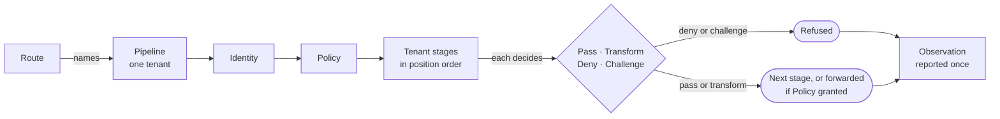
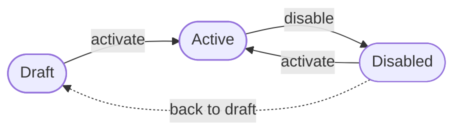

The proxy context holds a tenant's **pipelines**: the ordered list of **stages** a request passes through on the routes that name the pipeline. Every pipeline runs an **Identity** stage and a **Policy** stage first, and nobody may remove them. The tenant adds the rest, such as a rate limit, a geofence or a cache. The context also holds the rules for one request on its way through: what each stage decides, who the caller is, which client address and trace to believe, what may be rewritten, and what is reported once the request is done. Last, it holds **log targets**, the places a tenant sends its request records to.

## Where it sits

Proxy sits in the top layer, beside webhooks and workflows. It uses six contexts below it:

| Context | What proxy takes from it |
|---|---|
| Routing | Routes that name a pipeline, and the rule for who may change one |
| Authentication | The assurance level a Step-up stage asks for, and the level the caller has |
| Agents | What an agent's task token confines it to |
| Data classification | Sensitivity levels for the Data classify and Redact stages |
| Crypto | The public key an agent's token may be bound to |
| Audit | The Datadog sites a log target can ship to |

Making, changing or deleting a pipeline needs a right that routing names and authorization checks. Making or deleting a pipeline needs `pipeline: manage`. Any other change needs `pipeline: update`, which `pipeline: manage` also covers. The full routing right does not cover pipelines.

The code is in `crates/ianua-domain/src/domains/proxy`:

| Part | What it holds |
|---|---|
| `pipeline` | A pipeline: its stages, their order, and every change to it, including a stage's new settings |
| `pipeline_status` | Where a pipeline stands: draft, active or disabled |
| `issued` | A canary decoy or a WASM module handed to a tenant for its stages |
| `stages/stage` | Each kind of stage, its settings, and which chain it runs in |
| `stages/rules` | What each kind's settings must hold to do anything at all |
| `stages/decision` | What one stage decides about a request |
| `stages/posture` | What a device reported about itself, and the rule a Device posture stage holds it to |
| `stages/token_budget` | A limit on what a caller spends on a language model |
| `request/context` | What a request carries from one stage to the next |
| `request/forwarded` | Which client address to believe, and what the upstream is told |
| `request/transform` | What a stage may rewrite on the request and the response |
| `request/graphql` | Depth and cost limits for a GraphQL request |
| `request/trace` | W3C trace context: joining a caller's trace |
| `request/body` | Whether the part of a body the proxy read is all of it |
| `request/device` | Which device a request comes from: a device certificate, else the session's trusted device |
| `assertion` | The identity assertion the gateway hands an upstream |
| `exchange` | The narrowed token a Token exchange stage hands an upstream |
| `observation` | What is reported about one finished request, and which check refused it |
| `log_shipping` | Log targets: where a tenant's request records go, which of them, and in what shape |
| `events` | Pipeline changes, threats seen, uploaded modules, classification rules, log targets |

## How the parts fit

## A pipeline

A new pipeline holds two stages: Identity, then Policy. Both are **locked**, so the tenant may not remove or switch off either. Every other stage is one the tenant chose, and it may remove it again.

**Identity and Policy run first.** Identity runs first, so Policy decides on a known caller. Policy runs next, then everything else. Three rules keep that order:

- A new stage goes at the end. The position the caller asked for is overwritten. Sam adds a geofence asking for position 50, ahead of Identity at 100. It is placed after Policy instead, so it never judges traffic before anyone knows who sent it.
- A reorder names every stage exactly once, in one step. Identity and Policy move back to the top whatever the order says, and the rest keep their order. An order that leaves a stage out, names one twice or names a stage from elsewhere is refused, and nothing changes.
- Identity and Policy are never added. A pipeline holds one of each.

Each stage gets its own position, so the run order never depends on how a tie is broken. A switched-off stage keeps its place. It is skipped, not removed.

## A pipeline's life

| Status | What it means |
|---|---|
| Draft | Being set up. A new pipeline starts here |
| Active | Runs on live traffic |
| Disabled | Switched off, to stop it in an emergency or to change it |

The status rules also allow a disabled pipeline back to draft, drawn dotted above, but the pipeline itself has no step that does it. Every other move is refused, and so is a move to the status it already has. A draft cannot be disabled, and a live pipeline cannot go straight to draft.

When a request arrives, the application refuses it unless the route's pipeline is active and holds Identity and Policy, both switched on.

**Stages change only while the pipeline is off.** Adding, removing, switching on or off, reordering stages and changing a stage's settings work in draft or disabled, never in active. Sam may not edit the stages in front of the payments API while it carries traffic. He has to disable it first.

A stage's settings change in place, so a tenant can raise a rate limit or add a country to a geofence without taking the stage out. The stage keeps its id, its place and whether it is on. The new settings must be for the same kind of stage, and Identity and Policy have none to change.

**Turning it on checks the routes.** A pipeline whose cache keeps one answer for every caller may not run a route that needs sign-in. Ann reads her payslip through a signed-in route. Sam turns the pipeline off, adds a shared cache and turns it back on. Turning it on is refused and the pipeline stays off, so he is never served Ann's payslip. A switched-off shared cache counts too, because switching it back on does not look at the routes again.

The check sees only the routes it is handed, so it must be handed every route that runs this pipeline, and only those. A route that runs on another pipeline is refused, and the pipeline stays off. So another pipeline's public route cannot stand in for Ann's payslip route and let the check find nothing wrong. A route can only ask a real proxy pipeline whether it caches for everyone, so no stand-in can claim a shared cache caches nothing.

**A pipeline in use is never deleted.** Deleting is refused while any route still runs the pipeline, so no route is left with no checks to run. Sam deletes the pipeline in front of Ann's payslip route. It is refused. As with turning it on, the routes handed in must be this pipeline's own.

## Who may change a pipeline

| Step | Right |
|---|---|
| Make a pipeline | `pipeline: manage` |
| Delete a pipeline no route runs | `pipeline: manage` |
| Rename, activate, disable | `pipeline: update` |
| Add, remove, switch on or off, reorder stages, change a stage's settings | `pipeline: update` |
| Get a canary decoy, upload a WASM module for a Custom stage | `pipeline: update` |

A decoy and a module are not kept on a pipeline. The tenant puts the decoy, or the module's reference, into a stage the usual way. Handing them out still needs the right: Sam, who may only view pipelines, cannot ask for decoys to learn what the tenant plants, or upload a module of his own to run inside the proxy.

Only a person signed in to the tenant holds these rights, so an agent never changes a pipeline. Sam's agent may manage routing. Without this rule, it removes the rate limit and geofence in front of the payments API and calls it as often as it likes. Holding the full routing right is not enough: Sam with it may not disable a pipeline, remove a stage, delete a pipeline or make one of his own.

## Kinds of stage

A stage runs in one of two chains: before the request is forwarded, or after the upstream answers. Three run in both.

| Stage | What it is for | Runs |
|---|---|---|
| Identity | Verifies the caller's session or token. Locked | Before |
| Policy | Checks the route's authorization policy. Locked | Before |
| WAF | Blocks known attack patterns, by anomaly score | Before |
| Geofence | Allows or refuses by the client's country | Before |
| Device posture | Allows only a device whose reported state meets the rule | Before |
| Data classify | Tags fields by how sensitive they are, for a later stage to redact | Before |
| Token exchange | Mints a narrowed token for the upstream | Before |
| Rate limit | Limits requests per window | Before |
| Token rate limit | Limits tokens spent on a language model | Both |
| Step-up | Asks for MFA when the route needs a higher assurance level | Before |
| Request sign | Signs the request for the upstream | Before |
| Redact | Hides classified fields in the response | After |
| Response sign | Signs the response for the caller | After |
| Cache | Caches responses | Both |
| Custom | Runs a tenant's own WASM module | Before |
| CORS | Cross-origin rules for the route | Before |
| Honeypot routes | Decoy paths no real client asks for | Before |
| Recon detection | Slows or blocks clients that scan | Before |
| Fingerprint | Spots known bot and AI user agents | Before |
| Security headers | Adds hardening headers to the response | Before |
| IP reputation | Refuses clients on a denylist | Before |
| Canary token | Decoy credentials no real client is issued | Both |
| Terminate | Answers without asking the upstream | Before |
| GraphQL | Depth and cost limits for GraphQL | Before |
| Request transform | Rewrites headers and query parameters on the way in | Before |
| Response transform | Rewrites headers on the way out | After |
| MCP | Checks an MCP tool call against the caller's granted tools | Before |

An audit record names a stage by its kind alone, such as `rate_limit`, never by its settings, which may hold decoys.

## Limits and numbers

A stage whose settings could not do its job is refused, whether it is built in code, read from JSON or loaded from storage.

| Stage | What its settings must hold |
|---|---|
| Rate limit | At least 1 request, a window of 1 second to 1 day |
| Token exchange | At least one scope, a token lifetime of 1 second to 5 minutes |
| Request sign, Response sign | A lifetime of 1 second to 1 day |
| Cache | An entry lifetime of 1 second to 1 week |
| CORS | At least one origin, a preflight cache of 0 seconds to 1 day |
| Honeypot routes | At least one path, a block of 1 second to 1 week |
| WAF | At least one rule set, a threshold and body cap of at least 1 |
| Geofence | At least one country to allow or block, none on both lists |
| Recon detection | A window of 1 second to 1 day, see below |
| Security headers | At least one header to set |
| IP reputation | A range to deny, or clients flagged on any tenant to deny |
| Canary token | At least one decoy, each 16 to 512 characters with no spaces, line breaks or control characters |
| Custom | 1 to 10,000 ms, and 64 KiB to 256 MiB of memory |
| Terminate | A status of 200 to 599, a content type, a body of at most 64 KiB |
| Device posture | Something to ask for, and a report age of 1 minute to 1 week |

**Recon detection** has three signals: the share of 404 and 403 answers, how many distinct paths are tried, and how many 401 answers come back. The share must be above 0 and at most 1. The other thresholds and the minimum number of requests must be at least 1. Slowing comes before blocking: it takes 1 to 3 tripped signals to slow a client, and at least that many, and at most 3, to block it. A slowed request is held 1 ms to 60 seconds.

**Security headers** sets only the headers the tenant opts in to. `includeSubDomains` needs a `Strict-Transport-Security` max-age to go with it.

**CORS** may not allow credentials with a wildcard origin. If a browser ever honoured that, any site could read an answer meant for a signed-in user.

**A signature is never written over a header the proxy owns.** Sam points a request-signing stage at `x-forwarded-user`, so the signature would overwrite the identity the proxy asserts. That is refused, and so is its spelling `X_Forwarded_User`, `x-ianua-assertion` and headers that frame the connection, such as `content-length`. A response-signing stage may not write over a header that frames the connection either.

## Device posture

A device agent or a device manager reports what it knows about a device: its operating system and version, and whether disk encryption, a screen lock, a host firewall and device management are on. A Device posture stage holds the request's device to a rule:

- whether the device must be one a person marked as trusted,
- the oldest version allowed of each operating system it names, and whether other systems pass at any version or are refused,
- the protections that must be on,
- how old a report may be and still count.

Which device a request comes from is told in this order:

1. A device certificate the connection presented, verified against the tenant's trusted certificate authorities. The device service is asked about the device by the certificate's fingerprint.
2. Otherwise, the trusted device the person's session was signed in from. When Ann signs in and her browser presents the secret of a device she remembered, her session names that device. Every session a refresh carries on from it names it too, and the tokens the session hands out carry it as `did`.

With neither, the device is unknown and every posture rule refuses, without the device service being asked. An OAuth access token held by an app's server names no device, since the server is not the person's device.

A report that names a trusted device counts as trusted only while the person asking remembered that device and has not revoked it. Ann revokes her stolen laptop: its certificate still reaches the device service, but a rule asking for a trusted device refuses it. Bob's request never counts as coming from Ann's laptop.

It refuses by default. No report, a report older than the rule trusts, a report dated more than 5 minutes ahead of the clock, or a fact the rule asks about that nobody reported each fails. A laptop whose disk encryption nobody checked is treated like one without it. If the device service fails or does not answer in time, the request is refused as unavailable (503), not as a device that fell short, so an outage is not mistaken for a bad device.

## Token exchange

A Token exchange stage gives the upstream a token of its own instead of the caller's credential. The token:

- names the stage's one audience,
- carries only the scopes the stage asks for that the caller holds, through their token's scopes or a permission their roles give them, never one more,
- lasts the stage's lifetime, at most 5 minutes, and never past the caller's own credential,
- names whom the request is for and, for an agent, the agent acting (`act`) and its delegation.

It is signed with the tenant's assertion keys, typed `ianua-exchanged+jwt`, and an upstream checks it against the same published key set as the identity assertion. It is never accepted as a credential, by the gateway or the API.

It refuses by default. An anonymous request, a request the policy has not let through, a caller holding none of the scopes asked for or whose credential has run out gets no token, and the request is not forwarded. A tenant with no assertion key that signs gets no token either.

## Token rate limit

A token rate limit caps what one caller spends on a language model per window, not how many requests it sends. One request can cost a thousand times another.

| Setting | Limit |
|---|---|
| Tokens per window | 1 to 100,000,000 |
| Window | 1 second to 1 day |
| Fallback charge | At most the tokens per window. Default 1,000 |
| Provider format | OpenAI style or Anthropic |

The cost is only known after the provider answers. So admitting a request **reserves** the fallback charge, at least one token, and the request is refused when that would not fit. Once the answer says what it cost, the reservation is settled:

- An answer that reports its cost is charged that, and any unused part of the reservation comes back.
- An answer that reports nothing, or zero in and zero out, is charged at least what it reserved. Mallory streams without asking for usage, so no cost comes back. She is still charged the full fallback.
- Each request adds its reservation as it is admitted. Mallory sends many requests at once to spend one budget twice. With 10,000 tokens and a 1,000-token reservation, ten fit and the eleventh is refused.
- A refund that arrives after its window has ended is dropped, so it never adds budget to the next window. An overrun is charged to the window it lands in.
- A reported total stops at its largest value instead of wrapping round to almost nothing.

Windows are counted from the Unix epoch, so every proxy instance agrees where one ends. A tenant may choose to charge only the one-token reservation when usage is unknown. A caller can then mostly avoid the limit.

## GraphQL limits

A GraphQL request says what it wants in its body, so one `POST /graphql` can read one field or overload the backend.

| Setting | Allowed | Default |
|---|---|---|
| Depth | 1 to 64 | 15 |
| Cost | 1 to 1,000,000 | 1,000 |
| Rate-limit units per cost point | 0 to 1,000 | 0 |

A query deeper or costlier than the limit is refused. Mallory sends a query only two levels deep that costs 50,000. The depth check would let it through, and the cost check refuses it. A query breaking both is told about its depth. The refusal names the limit and what was asked, never the operation or a field, so it gives away nothing about the schema.

Every operation counts as at least one against a rate limit, so a million free queries still count. Only a query may be cached. If the answer to Ann's payment were cached, Sam's later payment would get Ann's answer and never reach the backend.

## What a stage decides

| Decision | What happens |
|---|---|
| Pass | The request goes on to the next stage |
| Transform | The request is changed, then goes on |
| Deny | Refused now. No later stage runs |
| Challenge | Refused until the caller answers: MFA, CAPTCHA, consent or device enrollment |

Every decision carries a reason for the audit log. A denial always answers with a status from 400 to 599, so it never reads as success.

## A request on its way through

**The caller is set once.** The Identity stage records who the caller is, and that can happen only once. Identity proves the caller is Ann. A later stage then tries to record Mallory as the caller. It is refused, and Ann stays the caller.

**A request starts as not let through.** Who the caller is and whether they are let through are separate questions: a public route lets an anonymous caller through, and a signed-in caller can still be refused. A request reads as let through only once that is recorded, which the Policy stage does when its policy allows the request. A stage before it errors, so Policy never runs on Mallory's request. It still reads as not let through, so nothing forwards it on a missing decision. Being signed in is not enough either: Identity naming Mallory lets nothing through. Once recorded, the grant is never taken back. A later stage that refuses the request does so with its own decision.

A caller is exactly one of a person, an agent under one delegation, or a consumer with the credential it presented. A request can never read as an agent with no delegation, or as a person and a consumer at once.

**A response the proxy serves itself never prints.** A cached answer or a Terminate stage's answer shows its status, header names and body length when printed, never header values or the body.

## Which client address to believe

**The peer decides.** If the connection comes from a proxy the deployment trusts, the client is the rightmost `X-Forwarded-For` entry that is not itself a trusted proxy. Otherwise the peer is the client and the header is ignored.

- Mallory sends `X-Forwarded-For: 203.0.113.9` straight to the proxy. With no trusted proxies, her own address is used.
- Mallory sends `1.2.3.4` through the ingress, which appends her real address. Her real address, the rightmost one that is not a trusted proxy, is the client.
- The walk stops at an entry it cannot read and uses the peer, never an address further left that the client typed.

Trusted proxies are single addresses or CIDR blocks. An entry that cannot be read is dropped, so a typo trusts less, never more. An empty list trusts nobody.

**What the upstream is told.** The proxy sends `X-Forwarded-For`, `X-Forwarded-Proto`, `X-Forwarded-Host` and `Forwarded` with what it saw. Each is a header the proxy owns. A host that would split the header, such as one holding a line break and `X-User: admin`, is refused.

## What may be rewritten

A header the proxy owns is one the proxy sets itself. That covers every `x-forwarded-` and `x-ianua-` header, `Forwarded` and the other headers proxies and CDNs read as the client's address, and headers frameworks read as the real method, path or host, such as `x-http-method-override` and `x-original-url`. Names are compared ignoring case, with `_` read as `-`.

**On the request,** a tenant's transform may not set or drop an owned header, or a header that frames the connection, such as `Connection`, `Transfer-Encoding` or `Content-Length`. Sam adds a transform that sets `x-forwarded-user`. The upstream would treat his callers as whoever he named. The transform is refused, and so is one that drops `x-ianua-assertion`. The same check runs on a transform read from JSON.

**Query parameters.** A parameter the tenant sets replaces every copy the client sent under that name, and one the tenant drops is dropped. Both match every spelling a server reads as the same name: any case, `+` or `%20` for a space, an array suffix such as `debug[]`, `.` or a space for `_`, or a copy after a `;`. A route pins `version=2`. Mallory sends `version[]=9`, which some servers read as `version`. Her copy is dropped. Names and values are ASCII, at most 1,024 bytes, with no control characters, and a set value is percent-encoded.

**On the response,** a transform may set or drop any header except one that frames the connection. It may also remove or rename fields in a JSON body. A rename gives a field a new name, never a new place, so the new name may not hold a dot.

## Traces

A request that arrives with a valid `traceparent` joins that trace, keeps the caller's sampling choice, and the upstream is told the proxy's own span is its parent. A header that cannot be read starts a new trace instead: an empty one, the reserved version `ff`, an all-zero id, a field of the wrong length, uppercase hex, or a version `00` header with a fifth field. A later version is read by its first four fields.

## What is reported

Every finished request is reduced to one observation: its correlation id, tenant, route, method, and path as untrusted text without its query string or fragment, where sign-in codes and tokens travel; client address, who asked, what was decided, its trace, how long it took and the sensitivity levels found. It never holds a token, a header or a body.

A refusal also says what refused it, with its reason and the status returned. That is either one of the gateway's own checks, made before any stage runs, or the stage that refused, by its kind. The gateway's checks are: no tenant it serves, or a closed one; no route; an app sign-in address that refused; a body too large; the route's pipeline not running; and an upstream that could not be reached or did not answer in time. When a tenant policy rule made the refusal, its name is kept too. Every record also names the version of the tenant's policy that ruled on it (`policy_version`), or none when the request was settled before the policy was read. An admin asking why Ann was refused this morning sees that it was the geofence, or the rule "contractors off hours", without reading the gateway's code. A WebSocket the gateway closes when access ended, a check failed or the credential ran out keeps that on its handshake's record as `closed`, with its reason and when.

A request that ended without a recorded decision reports `500`, so a proxy bug shows in the error rate instead of the success rate. For metrics, a status is reported by its class, such as `4xx`, so a client probing many statuses cannot flood the metrics store.

### Searching the records

`GET /api/v1/organizations/{org_slug}/tenants/{tenant_slug}/gateway/requests` finds the requests the gateway decided for a tenant. It narrows by decision, by what refused, by rule, by text in the reason, by route, by who asked and by time, and pages the results, 50 by default and at most 100. A record says who called what, so reading them needs the right to read the audit log, not only to view routing.

### How long records are kept

Request records, and the records the gateway keeps of TCP and UDP connections, are kept as long as the tenant's retention says, the same number of days as its audit records. A sweep runs every hour and removes each tenant's records from before that cutoff, oldest first. When the retention was shortened, records written before the change keep the longer period, as audit records do. Acme keeps 30 days: a request from 31 days ago is gone within the hour, one from yesterday stays. A busy tenant's backlog is removed in bounded steps over several hours, so no tenant holds the database up. A record removed this way is not written to the audit trail: it was what the gateway saw, never the trail. A log target that has been failing for longer than the retention misses the records removed meanwhile.

## Log targets

A tenant with a security team wants its request records in its own tools too, without polling the dashboard. A **log target** names one place to send them:

| Destination | What it needs |
|---|---|
| HTTPS | A collector on the public internet that takes batches by `POST`, such as a Splunk HTTP event collector |
| Bucket | An S3-compatible endpoint, the region requests are signed for (such as `eu-central-1`, or `auto` for Cloudflare R2 and Google Cloud Storage), and a bucket name of 3 to 63 lowercase letters, digits, dots and hyphens. A credential is required |
| Datadog | A Datadog site. A credential is required |

Each target also says which records it sends, every one, refusals only, or every refusal and a share of 1 to 100 percent of the rest, and the shape they are written in, JSON lines or OpenTelemetry log records. Sampling never drops a refusal. Mallory's probes are the records a security team looks for, so a target sampling 1 percent still gets every one of them.

The credential is sealed as soon as it arrives. It is never shown back, never put in an event, and opened only to send a batch. An audit record names a destination by its kind alone, never its address, whose path may carry a token.

| Step | Right |
|---|---|
| See targets | `routing: view` |
| Make one | `routing: create` |
| Change, rename, pause or resume one | `routing: update` |
| Delete one | `routing: delete` |

A record says who asked for what and what was decided, so it is worth stealing. Without the right behind every change, Sam points the target at his own server and reads who called what. Pausing needs the right too, since the security team then stops seeing traffic.

The gateway hands each batch to the tenant's targets. Only that tenant's records are sent, whatever else the batch holds. One destination that is down does not stop the others. A failed send is logged, naming the target but never its address or credential, and the batch is not tried again.

The endpoints are under `/api/v1/organizations/{org_slug}/tenants/{tenant_slug}/gateway/log-targets`.

## What a stored row must satisfy

A stored **pipeline** is refused as broken when:

- Identity or Policy is missing, held twice or switched off,
- any stage runs before them, or Policy runs before Identity,
- two stages share a position, or one stage id is held twice,
- it changed before it was created.

Someone edits the database to switch off a pipeline's Policy stage, so traffic would pass unauthorized. The row is refused.

A stored **stage** is refused as broken when it is locked but is not Identity or Policy, or is Identity or Policy but not locked, or when its settings break the rules above. A stored rate limit of zero requests is refused.

## Events

| Event | When |
|---|---|
| `proxy.pipeline_created`, `proxy.pipeline_deleted` | A pipeline is made or deleted |
| `proxy.pipeline_renamed` | A pipeline gets a new name. It carries the name before and after |
| `proxy.pipeline_activated`, `proxy.pipeline_disabled` | A pipeline starts or stops running on live traffic |
| `proxy.stage_added`, `proxy.stage_removed` | A stage is added or removed |
| `proxy.stage_enabled`, `proxy.stage_disabled` | A stage is switched on or off |
| `proxy.stage_reconfigured` | A stage's settings change. It names the stage and its kind, never the settings |
| `proxy.pipeline_reordered` | The stage order changes. It carries the whole new order |
| `proxy.honeypot_hit` | A client asks for a decoy path |
| `proxy.automated_threat_detected` | Recon detection slows or blocks a client |
| `proxy.canary_token_triggered` | A client presents a decoy credential |
| `proxy.canary_token_leaked` | An upstream answer holds a decoy credential |
| `proxy.canary_token_generated` | A tenant makes a new decoy credential |
| `proxy.wasm_module_uploaded` | A tenant uploads a module for a Custom stage |
| `proxy.classification_rule_added`, `proxy.classification_rule_changed`, `proxy.classification_rule_removed` | A tenant tags a field as sensitive, changes the tag, or removes it |
| `proxy.log_target_created`, `proxy.log_target_changed`, `proxy.log_target_deleted` | A log target is made, changed or renamed, or deleted |
| `proxy.log_target_paused`, `proxy.log_target_resumed` | Sending to a log target stops or starts again |

The four threat events fire on single requests, and whoever sends the requests decides how often. They are audited but never reach colleagues' feeds. Mallory asks for the decoy path a thousand times, and no feed fills with her noise. Every other proxy event is told to colleagues.
