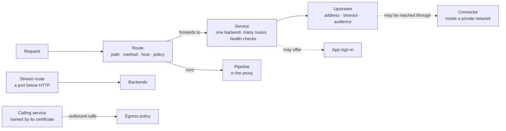
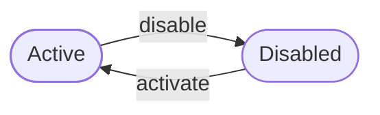

The routing context decides **which request reaches which backend, and under what rule**. It holds a tenant's **routes**, which match a path and send it on, and its **services**, the backends those routes forward to. It also holds **stream routes**, ports for traffic below HTTP such as a database connection, **app sign-in**, which lets people sign in on an app's own domain, **connectors**, which reach backends inside a private network, and **egress policies**, which say where a service that agents can reach may itself go.

Routing sits in the sixth layer, beside branding, federation, messaging, OAuth, the operator and the organization. It uses two contexts below it. Authorization gives it the person acting and the rights they hold. Data classification gives it the levels a route and an egress policy carry. Agents and the proxy sit above it and use it.

The code is in `crates/ianua-domain/src/domains/routing`:

| Part | What it holds |
|---|---|
| `route` | A route: what it matches, its policy, the service and pipeline it uses, and how the gateway picks one route for a request |
| `route_status` | Whether a route, a service or a stream route is active or disabled |
| `policy` | What a caller must prove before a route lets them through |
| `service` | A backend, named once and shared by many routes, and the app sign-in it offers or accepts |
| `backend` | The upstream a service forwards to: TLS to it, retries, how a backend is picked, the circuit breaker, health checks, finding backends by name, and whom the gateway's assertion names |
| `matching` | Path patterns, hosts, header and cookie conditions, path rewrites and the rules for URL parameters |
| `sign_in` | App sign-in, accepting another service's sign-in, and where to send a person back after signing in |
| `stream` | Stream routes: a port, a protocol, who may pass and the backends behind it |
| `connector` | Connectors: agents inside a tenant's network that reach private backends, and what each may dial |
| `egress` | Egress policies: where a service may send traffic, and the decision on each outbound call |
| `import` | The record left when a configuration document is applied to the gateway |
| `control` | The rule for who may change routing |
| `events` | What the context records |

## How the parts fit

A route never holds an address of its own. It names a service, so twenty routes to one backend share one address, one timeout and one view of whether it is healthy. A service holds no path, method or policy. Two routes to the same backend often need different ones: a public read and an admin delete use the same service but expose very different things.

## Who may change routing

Every change to a route, a service, a stream route, a connector or an egress policy names the person making it and needs a routing right. The person comes from authorization, which works out what they hold in the tenant. Only a person signed in to the tenant holds one, so an agent or a machine caller never changes routing.

| Change | Right it needs |
|---|---|
| Add a route, a service, a stream route, a connector or an egress policy | `routing: create` |
| Any change to one, including turning it on or off | `routing: update` |
| Delete one | `routing: delete` |
| Make or delete a request pipeline | `pipeline: manage` |
| Change a pipeline or its stages | `pipeline: update` |

`routing: manage` covers every routing right. The pipeline rights are named here and checked by the proxy, where pipelines live. There is no narrower right for deleting a pipeline, so it needs the full one.

Sam may only view routing. Without this check, he makes the route to the payroll records public, or points its service at his own server. Sam may update routes but not create or delete them. He can edit the routes that exist, but he cannot add one of his own or delete the one in front of the payroll records.

An egress policy also records who made it.

### Deleting

Deleting takes away more than an edit can, so it has its own right and its own checks:

| Record | Deleted only when |
|---|---|
| Route | It is disabled first. The traffic it took already goes to the next route that fits, so a live route is never deleted in one slip |
| Service | No route forwards to it, and no other service accepts its app sign-in |
| Stream route | Always, with the delete right. Disabling keeps the port's settings ready to open again. Deleting loses them and frees the port |
| Connector | It is revoked first, and no service is reached through it |
| Egress policy | Always, with the delete right. A service with no policy reaches nothing, so deleting the one that lets billing reach its payment provider stops billing |
| Pipeline | No route runs on it |

A service with a route still forwarding to it would leave the route with no backend. "admin-api" accepts the sign-in of "portal". If Sam deletes "portal", "admin-api" goes on trusting sessions nothing can issue or end. Both deletes are refused.

The caller hands in every route that forwards to the service, and every service that accepts its sign-in. A list holding a route of another service, or a service that accepts someone else's sign-in, is refused. Without this, Sam passes routes that never reach the service and the check sees nothing.

## Switching on and off

Routes, services and stream routes share one status:

Each starts active. Activating an active one, or disabling a disabled one, is refused. A disabled route is never picked for a request. A route whose service is disabled is passed over too, so the request goes to the next route that fits.

## Attack mode

During an attack on one app, its route can be put in **attack mode** for 5 to 1440 minutes (`POST …/routes/{id}/attack-mode` with `minutes`, or the `attack-mode` workflow step). Until it ends, the gateway checks every request to the route before its pipeline. An address any tenant's decoys or recon scoring caught is refused. Each address may send 60 requests a minute, counted across every gateway, and is refused with `429` past that. If the count cannot be read, the request is refused rather than let through. These refusals are recorded with the gateway check `attack_mode`.

Attack mode ends on its own, so a forgotten one never keeps people out for good. Starting it again restarts its time from now. `DELETE …/routes/{id}/attack-mode` ends it early. A route shows `attack_mode_until` while it is on. Starting and ending it need the right to update routing, and are recorded as `routing.route_attack_mode_started` (with when it ends) and `routing.route_attack_mode_ended`. Nothing is recorded when it ends on its own.

## The start page

`GET …/me/apps` answers the apps the signed-in person may open: each active route that takes `GET` on a path with no `{part}` to fill in (a trailing `/*` opens at its prefix). Each one is asked of the gateway's own access decision, as a `GET` of that path by this person, from their session as it stands: what they hold and how strongly they signed in. Pat sees the projects app and the wiki, but not the payroll app his role does not reach. What only a real request shows, the country, the device, the request's risk, counts as unknown, so a rule that needs it leaves the app off. An app that asks for a stronger sign-in or a key proof first is listed with `opens` set to `step_up` or `key_proof`; the others say `now`. Each item names the route, its name, the path and the addresses it answers on (empty for every address of the company). The list grants nothing: opening an app is decided again by the gateway.

When the gateway turns a signed-in person away from an app, it records `proxy.person_turned_away`, naming the app and the reason, at most once per person and app in ten minutes, so a page that keeps retrying does not fill the trail. A workflow may start from it.

## Routes

A route holds:

| Setting | What it is |
|---|---|
| Name | Shown in the dashboard |
| Path pattern | Which paths it takes, such as `/api/v1/projects/*` |
| Methods | Which HTTP methods it takes. An empty list, or one holding `Any`, takes every method |
| Hosts | Which of the tenant's domains it answers on. Every one by default |
| Conditions | Up to 16 header or cookie conditions a request must all meet. None by default |
| Policy | What a caller must prove |
| Service | Where it forwards |
| Pipeline | The checks that run on it. Always named, never a default |
| Path rewrite | What path the upstream sees |
| Priority | A number from 0 to 65535. Lower is tried first |
| Data class, action class, reach, parameter rules | What agents are held to on this route |

The pipeline is always named, so anyone reading the route sees what runs on it. Moving a route to another pipeline is one write, so the route is never between pipelines.

### Path patterns

A pattern is made of whole path segments:

| Part | What it fits | Example |
|---|---|---|
| Literal text | The same segment, ignoring ASCII case | `/health` |
| `{name}` | Any one non-empty segment, captured as `name` | `/users/{id}` |
| A trailing `/*` | The prefix itself and anything below it, captured as `rest` | `/orders/*` fits `/orders`, `/orders/` and `/orders/42/items` |

Literal segments ignore case because many upstreams do. Sam asks for `/ADMIN/users`, hoping the strict `/admin/*` route passes it by and a broad `/*` route sends it to an upstream that serves `/ADMIN` as `/admin`. The strict route takes it. What a pattern captures keeps the case the client sent, since an id or a file name may depend on it.

Only a canonical path is matched. It is decoded once and has no empty, `.` or `..` segment. It holds nothing an upstream reads as more than the path: no `;`, `%`, `\`, `?`, `#` or control character. So the path a route matched is the path the upstream reads, and `/public/..;/admin/users` can never match an open route while reaching a closed one.

A pattern written with a `%` escape, such as `/caf%C3%A9/*`, is refused. Paths are matched decoded, so it would match nothing, and a broader route would take its requests instead.

### Header and cookie conditions

Two routes on one path can send a request to two backends by what it carries: a blue/green switch on a header, or a canary pinned by a cookie the app sets for its testers. A condition reads one header, by name in any case, or one cookie. It asks that the value is sent, is not sent, is exactly a value, or starts with one. A header sent more than once is read by its first value. There are no patterns, since a badly written one would run on every request and could take seconds on a long header.

One header or cookie is read once per route. Two conditions on it either repeat each other or can never both hold, so a list with both is refused. A condition only narrows which requests the route takes. A request it turns away goes to the next route that fits, under that route's policy, so a narrower route never lets anyone past a broader one.

### Which route takes a request

A route can take a request when it is active, its service is serving, and its host, method, path and conditions fit. Among those, the gateway's order picks one:

1. The lowest priority number.
2. On the same priority, the most specific pattern. A pattern not ending in `/*` beats one that does. After that, more literal segments win, then more segments in all. So `/api/users` beats `/api/{name}`, which beats `/api/*`, and `/api/users/*` beats `/api/*`.
3. On a full tie, the route listed first.

Priority comes before specificity. With `/api/users` at 100 and `/api/*` at 50, a request to `/api/users` takes `/api/*`. When no route fits, nothing is picked and the request should be denied.

### Hosts

A tenant answers on several domain names. A route may be bound to some of them. Ann puts the admin pages on `admin.acme.com` only, and they do not match on `app.acme.com`. A request on another domain goes to whichever other route fits.

- The list is never empty. A route reachable on no name could never be requested, and disabling it does that.
- Matching ignores the case the client typed.
- A wildcard such as `*.acme.com` serves names exactly one label below it, such as `api.acme.com`, but not `a.b.acme.com` or `acme.com`. That is what a certificate for it covers, so routing agrees with the TLS handshake.
- When the host of a request is not known, only a route on every host can take it.

The domain decides which route is picked, never who is let through. Whoever sends the request picks the domain, so the route's policy still decides.

### What the upstream sees

| Rewrite | Path sent upstream |
|---|---|
| Keep | The path as it arrived. The default |
| Strip prefix | What the trailing `/*` caught: every segment before it is dropped, `{name}` ones too. `/tenants/{id}/*` sends `/tenants/7/orders/1` as `/orders/1`, and a pattern without `/*` sends `/`. To keep `{id}`, use a template such as `/{id}/{rest}` |
| Template | A path built from `{name}` placeholders, such as `/internal/user/{id}` for a route on `/v1/users/{id}` |

A template may only name what the pattern captures. A template naming `{id}` on a pattern `/users` is refused when the route is saved, so the route is not left failing on every request. Every `{` must be closed by a `}` around a non-empty name, with none nested. If a placeholder still has no value when the path is built, the template gives no path at all, never one with a literal brace in it. The request is then to be refused.

The pattern and the rewrite change together, since the rewrite may only name what the pattern captures.

## Route policies

| Policy | Who gets through |
|---|---|
| Public | Anyone. No sign-in |
| Authenticated | Anyone signed in with a valid session or token |
| Require system permission | Someone holding at least one of the listed built-in permissions |
| Require custom permission | Someone holding at least one of the listed permissions the tenant's app defines |
| Require scope | An API key or OAuth client token with at least one of the listed scopes |

Every policy but Public needs sign-in, even with an empty list, so an anonymous request never reaches such a route.

Two rules hold wherever a route meets its service or its pipeline:

**A signed-in route needs a pinned audience.** The service's upstream must name the audience a token is made for. Ann's tenant has a billing client and a reports client. Without this rule, a token Sam got for reports opens the billing routes. It is checked when a route is created, when its policy or service changes, and when the service's upstream is replaced.

**A signed-in route never shares a cache.** Ann reads her payslip through a signed-in route whose pipeline keeps one cached answer for everyone. Without this rule, Sam asks for the same path a moment later and is served Ann's payslip. It is checked when a route is created, when its policy or pipeline changes, and when the pipeline is turned on. A public route may share a cache, since nobody signs in to read it.

A route asks the pipeline itself whether it shares a cache, and only the proxy's own pipeline can answer. No code outside the domain can supply a stand-in that names a shared-cache pipeline and claims it caches nothing.

A policy change is judged against the route's own service and pipeline. Passing in another one, so the check looks at the wrong one, is refused. Replacing a service's upstream works the same way: it is judged against every route that forwards to that service, and a list holding another service's route is refused. Without this, Sam drops the audience and passes a public route of another service, and the check never sees the signed-in route that relies on it.

## What agents are held to on a route

| Setting | What it says | A new route |
|---|---|---|
| Data class | The most sensitive data the route serves or accepts | Internal |
| Action class | What kind of action the route takes, such as read, delete or financial | Undeclared |
| Reach | Fixed: the service goes only where it was built to. Open-ended: it fetches whatever URL or host it is given | Fixed |
| Parameter rules | Which hosts the route's URL parameters may name | None |

An open-ended route counts as communicating, unless it was declared a delete, a configuration change, a financial action or an admin action, which are riskier still. Declared a read, it is judged as communicating. Declared financial, it stays financial. The declaration is stored as written.

An open-ended route with no parameter rules needs a person's approval for every call an agent makes, since it would take the agent anywhere it names.

Without the routing right behind each of these, Sam's agent marks the payroll route as public data, relabels a delete as a read, and its own checks then let it through.

### Parameter rules

A service that fetches what it is told to gets past every other control: the agent names a destination, and the request leaves from the service. A parameter rule stops that first hop. It names one parameter, where it is carried (the query, a top-level JSON body field, a path capture or a header), and the hosts it may name.

- A rule names 1 to 32 hosts, each exact. A wildcard is refused.
- A parameter name is 1 to 64 letters, digits, `_`, `-` or `.`.
- One parameter in one place has one rule, in any spelling a server reads as the same name. A list with rules for both `url` and `URL` is refused, since only the first would apply.

### Screening a request

A route with no rules passes everything. On a route with rules, every place a request carries values is screened: the query, what the path captured, the headers and the JSON body. Ann's rule keeps `url` in the query to one host. Without the other places, Sam sends `/fetch/evil.net/x` or an `X-Target: evil.net` header and reaches any host.

A **declared** parameter must name a listed host:

- It is a bare host or an `http` or `https` URL, compared without case.
- A URL with user info, such as `https://docs.example.com@evil.net/`, an IP address, or any other scheme, such as `file:`, is refused.
- A rule is matched under any spelling a server reads as its name. `HOST=`, `;host=`, `host[]=` and `ho%73t=` are all judged by the rule for `host`.

An **undeclared** parameter is refused when it names an address, read the way a lenient URL parser or resolver would read it. When in doubt it counts. That covers:

- a URL with a fetchable scheme in any spelling, such as `https://`, `https:host` or `https:\\host`,
- a network path such as `//host` or `\\host`,
- a percent-escape or a full-width dot,
- an IP address in any form a resolver accepts, such as `127.1` or `0x7f000001`,
- a dotted host name, with or without a trailing dot,
- a host with a port, or with anything after it, such as `evil.net/x`,
- `localhost`, or a single label with a port.

A plain word, a bare number, a sentence or an email address passes. So does `50%` in a header or the body. In the query a lone `%` is a broken escape, which is refused, as the next paragraph says.

The query is split on `;` as well as `&`, since some servers split there. Names and values are decoded once, as the upstream will. A value still holding `%` after that was encoded twice, which is how a host gets past a check that decodes once, so it is refused. So are a broken escape, a control character and a backslash.

The proxy reads or replaces some headers itself: `Authorization`, `Proxy-Authorization`, `DPoP`, `Cookie`, `Host` and the headers it sets for upstreams. Those are not screened.

The JSON body is checked whole:

- A body that cannot be read whole as a JSON object is refused. Sam pads a body past the inspection limit and hides an address after it, and it does not get through.
- An object that names the same key twice is refused, at any depth. Parsers disagree on which copy wins.
- A declared field must hold at least one string, and every string in it must name a listed host. A number, `true`, `false`, `null`, an empty list or a key naming another address in it is refused.
- An undeclared field is refused if anything in it names an address, however deep. A number written as `127.1` counts, since a resolver reads it as an IPv4 address.

A refusal names the parameter but never its value. The name comes from the request, so it is cleaned before it reaches a log. A field named to forge a log line holds no line break by then.

## Services

A service holds a name, an upstream, how its backends are probed, its app sign-in settings and its status. Replacing the upstream changes every route that uses it at once.

### The upstream

| Setting | What it is |
|---|---|
| URL | The primary backend. Always present |
| Timeout | How long the proxy waits for an answer, 1 to 300 seconds. 30 by default |
| Host header | Keep the host the client asked for, or send the upstream's own |
| Extra backends | Weighted backends, for canary releases and traffic splits |
| Discovery | Find the backends by name instead of by address |
| Sticky sessions | Pin a caller to one backend by user id, consumer id, a cookie, a header or source IP |
| Audience | The audience a token must name here, or none, in which case no token identifies a caller |
| Identity | A token, or a client certificate from the mutual-TLS handshake |
| Plaintext HTTP/2 | Whether the backend speaks HTTP/2 without TLS. Declared, never guessed |
| TLS | For a backend on a private PKI: the CA bundle its certificate must chain to, a client certificate to present, and the server name to send and check. Unset, the public roots are trusted |
| Retries | When a failed request is tried again. Unset, it never is |
| Balancing | How one backend of several is picked: in turn by weight, the one with the fewest requests in flight, or a hash ring over the sticky key. In turn by default |
| Circuit breaker | Whether failures of real traffic set a backend aside. On by default: 5 failures in a row set it aside for 30 seconds |
| Assertion audience | Whom the gateway's signed identity assertion names: the service's own id, `urn:ianua:service:<id>` by default, or a name the upstream already checks for |
| Reach | Whether the gateway dials the backends itself, or through one of the tenant's connectors |

With no extra backends, every request goes to the URL. With extras, the URL joins them at a weight of 100, unless it is listed among them with a weight of its own. So a service at `a` with `b` weighted 10 sends about one request in eleven to `b`. A weight is never zero, which would send a backend nothing.

On a client-certificate route a bearer token does not count, even a valid one. Only the certificate does. Without this, Sam sends any token and skips the certificate check.

Plaintext HTTP/2 is declared because a wrong guess breaks the connection. The one hint a request carries, `content-type: application/grpc`, is the client's claim about itself, not the backend's.

Every service of a tenant checks the gateway's assertion against the same tenant key. An assertion made out to no one in particular, sent to one app, would be just as good at another. So each service's assertions name it, and an upstream accepts only those made out to it.

The settings must also agree with each other:

- TLS settings apply to `https` backends only. On a plain `http` address they would read as protecting a connection sent in the clear.
- TLS verification is never switched off. A server name may not be a wildcard, since the gateway sends one name and checks the certificate against it.
- Least connections takes no sticky key, and a hash ring needs one.
- Every try of one request together, each waiting up to the timeout, may not pass 300 seconds. Three tries of 120 seconds are refused, so a hanging backend cannot hold a client for many timeouts in a row.
- Backends behind a connector are not found by DNS discovery, since the gateway's resolver cannot see that network.

**Retries.** A request is sent 2 to 5 times at most, the first try included. A retry is made on a connection that could not be opened, or on a `502`, `503` or `504` answer, whichever the service names. The first wait is 10 to 5000 milliseconds and doubles each time, up to a longest wait of at most 30 seconds. A `502`, `503` or `504` means the request may have reached the backend, so it is tried again only for a method that changes nothing more when sent twice: `GET`, `HEAD`, `OPTIONS`, `PUT` or `DELETE`. A service also says which methods are retried. With "idempotent only", a `POST` or `PATCH` is never tried again, even on a connection that could not be opened. With "every method", any method is tried again on a connection that could not be opened, since it sent nothing. A service may say it retries every method only when it retries on a connection that could not be opened and nothing else, so a payment is never sent twice (`crates/ianua-domain/src/domains/routing/backend/retry.rs`, `RetryPolicy::decide`).

**Circuit breaker.** A breaker waits for 1 to 100 failures in a row and sets a backend aside for 1 to 600 seconds. Like health, it decides where traffic goes, never who is let in.

**Internal addresses.** A service's upstream, and a stream route's backends, may not point at an internal address, such as the metadata service or the deployment's own network. An IP address or a name that can only be internal is refused when the change is saved, unless the operator allows that network in `UPSTREAM_NETWORKS`, a comma-separated list of CIDR ranges. The list belongs to the deployment, never to a tenant. An upstream reached through a connector is held to the connector's scope instead, as below.

### Health checks

Probing is on by default. Turned off, every backend always counts as healthy: health decides where traffic goes, not who is let in.

| Setting | Range | Default |
|---|---|---|
| Path | | `/healthz` |
| Interval | 5 to 3600 seconds | 10 |
| Timeout | 1 to 300 seconds, and shorter than the interval | 5 |
| Successes before a backend is used again | 1 to 10 | 2 |
| Failures before a backend is taken out | 1 to 10 | 3 |
| Panic threshold | 0 to 100 percent | 50 |

A probe that outlives its interval overlaps the next one, and probes pile up, so that is refused.

Below the panic threshold, health is ignored and traffic goes to every backend. Once most of a pool looks dead, the probe is more likely wrong than the backends. Take a service with one backend that fails its check: without panic mode, every request would fail on an unproven signal. A fully healthy pool is never in panic. A threshold of 0 turns panic off, so a dead pool takes no traffic.

After each probe round the gateway reports what it holds of each backend, up or down, and the report is good for three probe intervals. `GET …/services/{id}/health` shows it. When no gateway has reported within that time the state is `unknown`, never healthy: the gateway may have stopped, or not reached the service yet. With probing off the state is `not_probed`.

### Discovery

A service pointing at replicas that come and go cannot list them. With discovery, the proxy looks up a name instead:

| Kind | What it asks for |
|---|---|
| SRV | Records with a port and a weight per target, as a service registry publishes them |
| Address | `A` and `AAAA` records. The port comes from the upstream's URL, and every target gets the same weight |

The name is 1 to 253 letters, digits, dots, hyphens or underscores. It is looked up again every 5 to 3600 seconds. Faster overloads the resolver, and slower leaves a move unnoticed for too long. A name that resolves to nothing is an answer of its own, kept apart from a lookup that failed.

## App sign-in

A service can ask the gateway to answer sign-in addresses on the hosts it is served on:

| Action | Address under the prefix | The gateway shows a page |
|---|---|---|
| Log in | `/login` | Yes, unless moved |
| Sign up | `/signup` | Yes, unless moved |
| Second factor | `/mfa` | Yes, unless moved |
| Verify an email address | `/verify` | No, it is a link |
| Log out | `/logout` | No, it is a button |
| Single sign-on with the tenant's outside identity provider | `/sso` | No, the browser is sent there |
| Return from the outside identity provider | `/sso-callback` | No, it is a redirect |
| Passkey | `/passkey` | No, it is asked for from the log in page |
| Ask for a new password | `/forgot-password` | Yes, unless moved |
| Set a new password | `/reset-password` | Yes, unless moved |

The prefix is `/.ianua` unless set, so the addresses never take a path the app already uses. Each action can be moved, for an app that wants its login at `/login`. A moved action's page is the app's own, and the gateway answers only the form's post there. Every path under the prefix is kept from the app, answered or not. Two more fixed addresses sit under the prefix: one where the owner's pages fetch tokens for other services, and one where a service with a cookie of its own receives the sign-in.

A password that an admin set, or that has expired, is replaced inside the sign-in on the app's host: the browser keeps a short-lived token in its challenge cookie, sends the new password with it, and the sign-in finishes. Nothing is mailed, so this works the same without a mail server.

People land on `/` after signing in unless another page is set. The service also chooses what a signed-out browser on a protected page gets: `401`, as any other client does, which is the default, or a trip to log in and back afterwards.

The settings are refused when:

- no host is named, a host is a wildcard, or a host is named twice in any case. The session cookie belongs to one host.
- the prefix is `/`, which would take every path of the app, or an action is moved to `/`, the app's home page.
- two actions, or an action and a fixed address, end up at the same path.
- people would be sent to a sign-in address after signing in.

A sign-in path is matched exactly, never as a prefix. It starts with `/`, is at most 256 characters of letters, digits and `-`, `.`, `_`, `~`, has no empty, `.` or `..` segment, and does not end in `/`.

### Accepting another service's sign-in

A person signs in once, on the hosts of the service that owns the sign-in. Another service accepts that sign-in only when told to, so turning on sign-in for one app never opens a second one. It is also told how the sign-in reaches it:

| Delivery | How |
|---|---|
| Same host | On the owner's hosts, with the owner's cookie, for example under `/api` |
| Own cookie | A cookie of its own, on named hosts of its own, set by a short hop through each |
| Tokens | Bearer tokens for this service, a few minutes long, which the owner's pages fetch |

An own cookie is set on at least one named host, each once. A wildcard is refused: Sam sets the cookie on `*.example.com`, and every subdomain he controls would receive the session.

A service's sign-in settings must agree:

- It has sign-in of its own or accepts another's, never both.
- It cannot accept its own sign-in as another's.
- Its own sign-in needs a pinned audience, since the session it hands out names that audience.
- Accepting another's by its own cookie or by tokens needs a pinned audience too. On the owner's hosts it does not.
- The audience cannot be dropped while sign-in needs it, or while a signed-in route uses the service.

### Sending a person back

After signing in, a person is sent back to a path on the same host, such as `/projects?tab=open`. It comes from the address bar, so it is taken to be hostile. It must start with a single `/`, be ASCII, 1 to 2048 characters, with no backslash and no control character. It is checked again after percent-decoding.

Sam sends Ann a sign-in link ending in `?return_to=//evil.example`. Without this check, Ann signs in and lands on Sam's page. `//evil.example`, `/%2F%2Fevil.example`, `/\evil.example`, a full URL and `javascript:` are all refused.

## Stream routes

A database connection, a message broker or a plain TLS tunnel carries no method, path or headers. A stream route lets the proxy carry them anyway, so they are not reached around it. It has a port the proxy listens on, a protocol, who may pass, which server names it answers, its backends and its timeouts.

| Protocol | What happens | A client certificate | A server name |
|---|---|---|---|
| TCP | Bytes forwarded as they are | No | No |
| TLS terminate | TLS ends at the proxy, then forwarded in the clear | Yes | Yes |
| TLS passthrough | TLS forwarded untouched. Only the server name is read | No, it is inside the tunnel | Yes |
| UDP | Datagrams, decided per flow | No | No |

What is checked on the wire is one of three, chosen by name:

| Policy | What is checked |
|---|---|
| Mutual TLS | A client certificate, verified against the tenant's trusted CAs |
| Tunnel | The signed-in tunnel. The client opens an HTTPS `CONNECT` to the gateway carrying the caller's token, and the stream runs inside it |
| Public | Nothing. Anyone who can reach the port |

On top of that, the route says who may pass by name:

| Access | Who |
|---|---|
| Any holder | Whoever the policy lets through: anyone on a public port, or any certificate from the tenant's CAs on a mutual TLS one |
| People | People signed in to the tenant, through the tunnel, who meet a route policy. The policy is asked each time, and a denial, no decision or an error closes the connection |
| Consumers | Only the named consumers, 1 to 100, known by their certificate or their tunnel token |

A connection on a stream route that is switched off is refused. A port open to any certificate from the tenant's CAs lets in every machine that ever got one. Naming the consumers stops that. The postgres port names only "billing-sync". Mallory holds a certificate from the tenant's CA, issued to a test machine, and is refused.

The rules hold whatever order the settings are changed in:

- A stream route has at least one backend.
- Mutual TLS needs the proxy to finish the handshake, so it is refused on every protocol but TLS terminate. Sam sets up TLS passthrough that needs a client certificate. Without this rule, the route reads as protected, the proxy never sees the certificate, and anyone who can reach the port gets in.
- The tunnel carries a TCP stream, so it is refused on every protocol but TCP.
- A server name restriction needs a handshake to read the name from, so it is refused on TCP and UDP. There it would match nothing while looking narrowed.
- A public port knows no one, so it is open to any holder only. A tunnel always names its caller, so it names the people or consumers it lets in.
- A client certificate names a consumer, never a person. People come in through the tunnel, and are held to a policy that asks for sign-in.

A connection that sends no server name matches only a route with no restriction. Otherwise a client could get past a restriction by sending no name.

On a port that ends TLS, the name the client asks for must be one of the tenant's own. A client asking one tenant's port for another tenant's name is refused at the handshake. On a mutual TLS port, the certificate is checked against the tenant's own CAs only, and a tenant that trusts no CA has every handshake refused. A certificate that belongs to no consumer counts as any holder's. A certificate whose consumer was switched off, or that the consumer no longer uses, is refused. It is never let in as anyone's.

The tunnel opens with one HTTPS `CONNECT` on the route's port, carrying `Proxy-Authorization: Bearer` and the token. The token is a consumer's API key, or a token the tenant signed with the audience `urn:ianua:stream-route:` followed by the route's id. A person's tool gets one at the token endpoint by naming that audience as its `resource` (see [OAuth](/ianua/domain-contexts/oauth/#the-token-endpoint)). Each route has its own audience, so a token for one tunnel or for an app never opens another. A consumer's checks while its tunnel stays open do not count against its quota; only opening the tunnel does. An agent's task token is refused: a raw stream would carry it past every limit its task names. The gateway answers `407` without a token, `403` when the token or the caller is refused, and `200` once the caller is let in and the backend answered. Where the `CONNECT` asks to go is not read: the route names its backends. While the tunnel is open the token is checked again every 30 seconds, and the route asked again. A token that ran out or was withdrawn, a person switched off, a narrowed route, or a check that could not be made closes the tunnel. It closes when the token expires at the latest.

Every connection a stream route's port takes leaves a record, whatever was decided: the route and its port, the client's address, the server name it asked for, who was named on it, whether it was let in and why, the backend it reached, how many bytes moved each way and how long it lasted. Never a byte of what moved, a token or a certificate. The gateway writes the records in batches to the `stream_records` table and can read none of them back. Mallory knocking on the postgres port without a certificate is there for the admin to find.

A backend is a host and a port, not a URL. The host is a DNS name or an IP address. A host that could carry a path or a header, such as `db.internal/../admin`, is refused. An IPv6 host is dialled in brackets, as `[2001:db8::1]:5432`.

## Connectors

Some backends have no public address. A **connector** is a small agent the tenant runs inside its own network. It dials out to the gateway and holds a link open, so nothing in the network has to accept connections from the internet. A service whose upstream is reached through the connector has its connections opened down that link, and the connector dials the backend from inside. [Connectors](/ianua/concepts/connectors/) explains it end to end.

An admin creates the connector and is shown a one-time enrollment code, good for an hour. Only a digest of the code is kept. The agent presents the code once, with a signing request for the key it holds its link with. The request is signed by that key, so the agent shows it holds it; only the key is taken from it. The connector pins the key, and the platform's connector authority signs a certificate for it that lasts a day. A code that is wrong, already used, expired, or for a revoked connector is refused alike with `403`, and the refusal says no more, so a guesser learns nothing. Enrolling is `POST /api/v1/organizations/{org_slug}/tenants/{tenant_slug}/connectors/enroll`, made by the agent with no session or key.

In the last eight hours of its certificate, or once it has run out, the agent asks for the next one with a new signing request for the same key at `POST .../connectors/{id}/renew`, and gets a certificate lasting a day from then. Asked earlier, it gets a certificate ending when the one it holds ends, so an agent whose answer was lost can ask again and asking early never lengthens what it holds. A request for any other key, for a revoked connector, or for one that never enrolled is refused alike with `403`. The gateway lets a link in only with a certificate from the authority for a connector of the tenant it names, enrolled with the same key and not revoked.

The gateway notes when it last saw each connector's link, shown as `last_seen_at`. Noting it needs no right and records no event.

Each connector has a **scope**: the networks, such as `10.20.0.0/16`, and the domains, such as `payroll.corp.internal` or `*.corp.internal`, it may be asked to dial. A scope names at least one and at most 64. Without it, any route of the tenant could ask the connector to dial anything in there, such as the domain controller.

- A service reached through a connector must name one of the tenant's own connectors that is not revoked, and every backend must sit inside its scope.
- A new scope is refused while a service reached through the connector falls outside it, so no service is left unreachable.
- Changing the scope needs `routing: update`. Without it, Sam widens the scope of a connector in the payroll network and points a route at the database behind it.
- Revoking is for good. Its links are closed, its next certificate is refused, and nothing is sent through it again. A connector whose key may have leaked is replaced, not trusted again.

## Egress policies

An agent may be kept off the internet and still call a service that fetches whatever it is asked to. The request then leaves from the service. So each such service sends its outbound traffic through the egress gateway, which lets a connection out only to a host and port the service's policy lists.

A policy names:

- the service, by its client certificate: a SPIFFE ID with a path and no `*`, or `sha256:` and the 64 lower-case hex digits of the certificate's fingerprint,
- 1 to 32 destinations, each a host and a port, none listed twice,
- the most sensitive data an agent may have touched for a call it caused to be let out.

A destination names one exact host. A wildcard is refused, since over a public suffix it would be the whole internet. Egress reaches public destinations only. A private, loopback or link-local address, a cloud metadata address, and a name that can only be internal, such as `metadata.google.internal`, `db.svc.cluster.local` or `printer.local`, are refused. Port 0 is refused.

Sam's agent reads customer records and calls a fetch service. Without the routing right behind every change, Sam adds his own server to the list and the agent sends the records there.

### The decision on an outbound call

An outbound call may carry the signed assertion the data plane gave the agent's request. Then the gateway knows which agent caused it and how sensitive the data it has touched is.

| Case | Decision |
|---|---|
| The service has no policy | Refused: `no_policy` |
| The host and port are not listed | Refused: `destination_not_listed` |
| The agent behind the call has touched data above the policy's class | Refused: `data_too_sensitive` |
| The call carries no assertion, and the policy lets out less than restricted data | Refused: `unattributed` |
| Anything else | Let out |

Host names compare without case. A subdomain of a listed host is not listed.

A call with no assertion could come from any agent, so it counts as carrying the most sensitive data. Ann lets a fetch service send out public data only. Sam's agent has read restricted records and has the service call out without the assertion. The call is refused.

A request that does not name a host and port the gateway can judge is refused as `malformed_target`.

## Configuration documents

A tenant's gateway can be exported as one document and applied from one, so it can live in a repository, be reviewed and be applied to staging before production. Applying it creates, changes and removes what it describes, each through the same steps and checks as a change by hand. It runs in one of two modes: `merge`, the default, creates and updates what the document names and leaves the rest alone, and `replace` also deletes what the document leaves out. By default an apply is a dry run that reports the plan and changes nothing. Writing has to be asked for. The person made one change, the document, so one record covers the whole apply. The endpoints are under `/api/v1/organizations/{org_slug}/tenants/{tenant_slug}/gateway/config`.

## Limits and numbers

| What | Limit |
|---|---|
| Route priority | 0 to 65535, lower first |
| Upstream timeout | 1 to 300 seconds, 30 by default |
| Weight of the primary URL beside extra backends | 100, unless listed with its own |
| Header and cookie conditions per route | Up to 16 |
| Tries per request, the first included | 2 to 5, all of them together at most 300 seconds of timeout |
| First retry wait | 10 to 5000 milliseconds, doubling up to a longest wait of at most 30 seconds |
| Circuit breaker | 1 to 100 failures in a row, 1 to 600 seconds aside. 5 and 30 by default |
| Health check interval | 5 to 3600 seconds, 10 by default |
| Health check timeout | 1 to 300 seconds, shorter than the interval, 5 by default |
| Health thresholds | 1 to 10, 2 to come back and 3 to be taken out by default |
| Panic threshold | 0 to 100 percent, 50 by default, 0 is off |
| Discovery refresh | 5 to 3600 seconds |
| Discovery name | 1 to 253 characters |
| Path rewrite template | Up to 2048 characters |
| Hosts per parameter rule | 1 to 32 |
| Parameter name | 1 to 64 characters |
| Sign-in path | Up to 256 characters |
| Return path | 1 to 2048 characters |
| Stream route listen port | 1024 to 65535. Lower ports are refused, since the data plane does not run as root and could never bind them |
| Stream backend port | 1 to 65535 |
| Stream backend weight | 1 to 1000 |
| Stream connect timeout | 1 to 60 seconds, 10 by default |
| Stream idle timeout | 60 seconds to 12 hours, 1 hour by default |
| Consumers named on a stream route | 1 to 100 |
| Connector enrollment code | Good for 1 hour, used once |
| Connector certificate | Good for 1 day, renewed in its last 8 hours |
| Connector scope | 1 to 64 networks and domains |
| Egress destinations | 1 to 32 per policy |
| Calling service's identity in an egress policy | Up to 512 characters |

## What a stored row must satisfy

A stored row that breaks a rule is refused as broken storage, never repaired.

| Record | Refused when |
|---|---|
| Route | Its pattern holds a `%` escape, its rewrite names a parameter the pattern does not capture, a parameter is ruled on twice, it changed before it was created, its host list is empty, or its reach is not `fixed` or `open_ended` |
| Service | Its sign-in settings contradict each other or its upstream: it has its own and accepts another's, has its own without an audience, accepts its own as another's, or takes another's by its own cookie or tokens without an audience. Or it changed before it was created |
| Stream route | It has no backend, asks for a client certificate on a protocol the proxy does not finish, restricts to a server name on a protocol that carries none, names who may pass in a way its protocol and policy cannot deliver, has an unknown protocol or policy, or changed before it was created |
| Connector | Its code was good for longer than an hour after it was made, it enrolled before it was created, its certificate ends before it enrolled or more than a day after it last changed, it was seen before it enrolled, or it changed before it was created |
| Egress policy | It says an agent or a consumer made it, rather than a tenant user or an organization member, lists no destination, more than 32 or one twice, or changed before it was created |

Stored settings are read through the same checks as new ones. An upstream with a zero timeout or a backend of weight zero, or one missing its audience and identity fields, does not load. Without that last check, a row that lost those fields would load as taking a token. Sam would then reach a service meant for client certificates with a bearer token. Probe settings whose timeout outlives the interval, a discovery refresh of 0, a malformed rewrite template, a parameter rule or egress destination with a wildcard, app sign-in settings with the prefix `/`, own-cookie hosts that are empty, and a stream backend, port or timeout out of range are each refused the same way.

## What is unique

A save that would break one of these is refused as a conflict.

| What | Unique within |
|---|---|
| A route's, service's, stream route's or connector's name | The tenant |
| A host a service's app sign-in answers on, or its own session cookie is set on | The tenant: one service per host. Two services on one host would each hand out sessions the other trusts |
| The egress policy of a service | The tenant: one policy per service |
| A stream route's listen port | The whole deployment, across every tenant, since one socket per port is bound for everyone |

## Events

| Event | When |
|---|---|
| `routing.route_created` | A route was created. It carries the path pattern |
| `routing.route_updated` | A route changed |
| `routing.route_deleted` | A route was deleted |
| `routing.route_activated` | A route was turned on |
| `routing.route_disabled` | A route was turned off |
| `routing.route_attack_mode_started` | A route went into attack mode. It carries when attack mode ends |
| `routing.route_attack_mode_ended` | A route's attack mode was ended early |
| `routing.service_created` | A service was created |
| `routing.service_updated` | A service changed |
| `routing.service_deleted` | A service was deleted |
| `routing.app_sign_in_changed` | A service's sign-in was turned on, moved or off, or it started or stopped accepting another's. It carries the hosts the addresses answer on |
| `routing.stream_route_created` | A stream route was created. It carries the port and protocol, so the data plane can bind the port |
| `routing.stream_route_updated` | A stream route changed |
| `routing.stream_route_deleted` | A stream route was deleted and its port released |
| `routing.stream_route_activated` | A stream route started taking connections |
| `routing.stream_route_disabled` | A stream route stopped taking connections |
| `routing.connector_created` | A connector was created, waiting for its agent to enroll |
| `routing.connector_enrolled` | A connector's agent presented its code |
| `routing.connector_renewed` | A connector's agent was given the next day's certificate for its key. Audited, but colleagues are not notified |
| `routing.connector_updated` | A connector's scope changed |
| `routing.connector_revoked` | A connector was revoked |
| `routing.connector_deleted` | A connector was deleted |
| `routing.egress_policy_created` | An egress policy was made |
| `routing.egress_policy_updated` | Its destinations or its data class changed |
| `routing.egress_policy_deleted` | An egress policy was removed |
| `routing.gateway_config_imported` | A configuration document was applied to the gateway. One record covers the whole apply, with its mode, `merge` or `replace`, and how many services, pipelines and routes it created, changed and removed |

Each route, service and stream route event names the record by its id and its name at the time. An egress policy event carries the service, its destinations as `host:port` and its data class.
