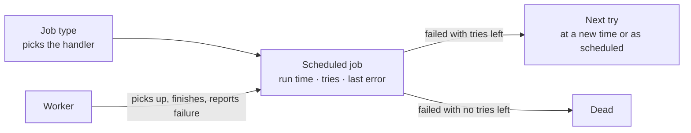
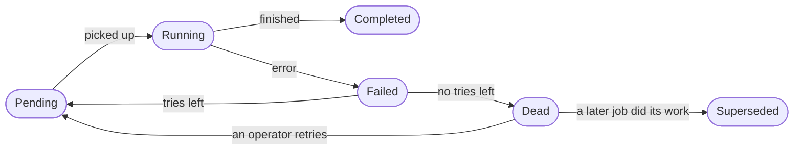

The scheduling context holds **scheduled jobs**: pieces of work that run at a set time, such as checking a domain again or sending an email. A job keeps when it should run, how many times it has been tried, how many tries it gets and the last error it hit. When a try fails, the job either waits for another try or gives up.

Scheduling is part of the foundation. It uses no other context. It names no rule for authorization to answer: a job holds no right of its own, and it changes only as a worker picks it up, finishes it or reports a failure.

The code is in `crates/ianua-domain/src/domains/scheduling`:

| Part | What it holds |
|---|---|
| `job` | A scheduled job, its tries, its last error, and when a retry runs |
| `job_status` | Where a job stands, and the moves between states |
| `job_type` | The name that tells a worker which handler runs the job |

## How the parts fit

## A scheduled job

| Field | What it holds |
|---|---|
| Type | Which handler runs the job |
| Payload | Text only the job's handler reads, such as `{"domain_id":"abc"}` |
| Run at | When the job should run next |
| Attempt | How many times the job has started running |
| Max attempts | How many tries the job gets before it is dead. Never zero |
| Status | Where the job stands in its life |
| Error | The last error the handler reported. Cleared when the job completes |
| Created at | When the job was made |
| Last attempted at | When the job last started running |

A new job starts pending, with no tries, no error and no attempt time. It keeps the payload exactly as it was given, so the worker runs it against the right record.

## Job type

A job type is two or more names joined by dots, such as `domain.verify_retry` or `email.verification.send`. It:

- uses only lowercase ASCII letters, digits, `_` and `.`,
- is at most 128 characters long,
- has at least one dot and no empty part, so `nodots`, `.email` and `email..send` are refused.

An empty type is refused too, since it would pick no handler.

## A job's life

| Step | What happens |
|---|---|
| Pick up | Only a pending job can start. The job moves to running, counts one more try and records when it started |
| Complete | Only a running job can complete. Its error is cleared |
| Fail | Only a running job can fail. It keeps the error, then goes back to pending if it has tries left, or ends as dead if not |
| Retry | Only a dead job can be retried, by an operator. It goes back to pending with one more try, due at once, and keeps its tries and its last error |

A job whose worker stopped is given up when its hold runs out, and a step of a tenant's setup or teardown is handed out again under the same key. Once a later job has done the step, the given-up job is superseded: it stays on record with its tries and its last error, and operators no longer find it among the dead.

Any other move is refused. A job that never ran cannot be marked completed. A running job cannot go straight back to pending: it must fail first, so the failure is counted. Completed is final, and dead stays dead until an operator retries it.

**Failed is never kept.** A failure turns into pending or dead in the same step, so a job is never left sitting as failed.

**When a retry runs.** The worker that reports a failure says when the next try runs:

| Choice | Next run |
|---|---|
| At a time | The time given, such as five minutes later as a backoff |
| As scheduled | The time the job was already due |

A job has tries left while its count of tries is below its maximum. So a job allowed two tries may retry after its first failure, and has none left once its second try starts.

## Keys that keep work from being queued twice

A job may carry a key, and how long the key holds is chosen when it is queued:

| Hold | Queued again |
|---|---|
| While it waits or runs | Once the last one ended, as a run's drive after the run is woken |
| For as long as it is kept | Never, whatever became of it. This is work done once per event: a delivery to one webhook, a run started by one event |

A worker in the background removes ended jobs after 14 days, longer than the bus keeps an event that could be delivered again, so an event the bus delivers twice never does its work twice. An event delivered again while its job still waits or runs, or after it ended, queues nothing.

## What is refused and why

**A finished job does not run twice.** A worker finishes a job. A second worker then reads the same job and tries to start it. It is refused, because only a pending job can start. The work runs once.

**A failure message cannot flood or forge the log.** The error a handler reports is treated as untrusted text. It is cut to 512 characters, and control characters, invisible characters and line separators are replaced. Mallory's mail server answers a failed send with ten thousand characters and a line break meant to forge a second log line. The job keeps the first 512 characters, with the line break replaced.

## What a stored job must satisfy to load

A stored job is refused as broken, never repaired, when:

- it counts more tries than it is allowed,
- it counts tries but records no attempt time, or records an attempt time with no tries,
- its last attempt comes before it was created,
- it holds an error but was never tried,
- its status contradicts its tries or its error, as below.

| Status | Must hold |
|---|---|
| Pending | A try left. Otherwise a worker would start one try too many: an email job with all five of its five tries used would send Ann a sixth email |
| Running | At least one try counted |
| Completed | At least one try counted, and no error |
| Dead | Every try used, and the error that ended it. A dead job with tries left would show an operator a job given up too early |
| Superseded | Every try used, and the error that ended it, as a dead job |
| Failed | Never stored |

Every state a job reaches through its own steps passes these checks.

## Running due jobs

The app runs the queue in `ProcessJobsUseCase`, in `crates/ianua-app/src/use_cases/scheduling`. Nobody calls it: it runs in the background, so it acts for no one. Each run asks the queue for a batch of pending jobs whose time has come. The queue port asks that claiming be atomic, so no two workers take the same job, and that each claimed job comes back running. A claimed job that comes back not running is refused as an internal error.

Each job goes to the handler registered for its type:

| What happens | The job |
|---|---|
| The handler finishes | Completed |
| The handler fails | Failed, with the handler's message, and tried again after a wait |
| No handler knows the type | Failed as scheduled, so it stays due and is picked up again until its tries run out. It is not lost while a handler is being deployed |

The waits come from a list: the first wait after the first failure, the second after the second, and the last one repeats for every later failure. A list with no wait at all is refused, since a failed job would retry at once, again and again.

The queue only writes down how a job ended. The job itself decides whether it is completed, pending again or dead.

## Dead jobs for operators

An operator reads the jobs that used up their tries with `GET /api/v1/operators/dead-jobs`, newest first and a page at a time, across every tenant. The app answers it in `ListDeadUseCase` (`crates/ianua-app/src/use_cases/scheduling/list_dead.rs`), and only for an operator whose own key still works. Each entry shows:

| Field | What it holds |
|---|---|
| `id` | The job's id |
| `job_type` | What kind of work it was |
| `tenant_id` | The tenant it worked for, or `null` for the platform's own work |
| `attempts` | How many times it ran |
| `reason` | Why its last run failed, as its handler reported it |
| `created_at` | When it was queued |
| `last_attempted_at` | When it last ran |

The payload is never shown. Only the job's handler reads it, and it may name what only its tenant should see: a mail job's payload names the person it was for. A tenant user's session is refused.

## Retrying a dead job

Once whatever made a job fail is put right, an operator gives it one more try with `POST /api/v1/operators/dead-jobs/{id}/retry`. The app answers it in `RetryDeadUseCase` (`crates/ianua-app/src/use_cases/scheduling/retry_dead.rs`), again only for an operator whose own key still works. The job goes back to pending, due at once, with its maximum raised by one, so it runs once more. Should that try fail too, it is dead again, and may be retried again.

| Answer | When |
|---|---|
| `204` | The job waits again |
| `404` | The queue holds no job with that id |
| `409` | The job is not dead: it waits, runs or finished, or another operator retried it a moment before |
| `409` | The same work, queued again under the job's key, waits or runs already, so retrying would do it twice. The dead job stays dead |

The queue puts the job back in one statement that changes it only while it is still dead at the try the operator read. Bob and Carol retry the same mail at once: one puts it back, the other gets `409`, and the mail goes out once. The retry is kept in the database before the answer, so a worker that restarts picks the job up like any other pending job.

## Events

A retry records `operator.dead_job_retried` in the platform's audit log, naming the operator who retried it, the job's id and kind, its tenant and how often it had run, never its payload.

Nothing else in the context records events. Marking a job done or failed is the queue's own bookkeeping, not a change anyone made. Each handler records the change its job carries out.
