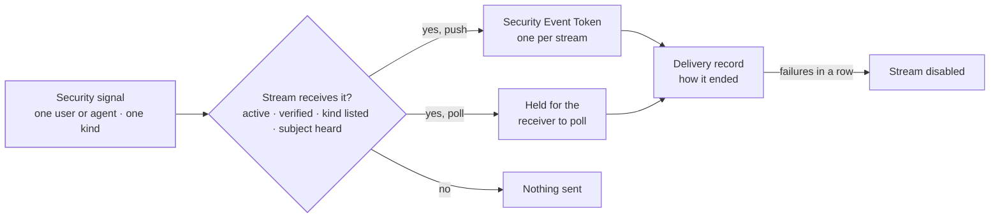
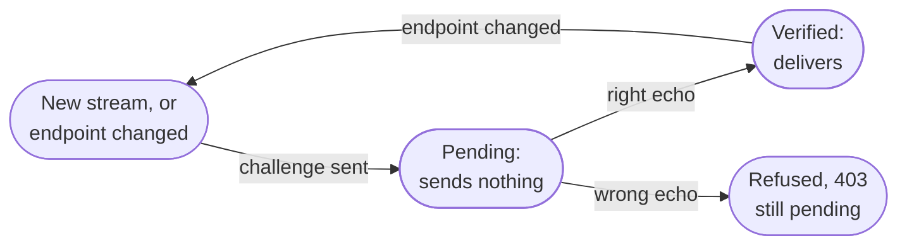
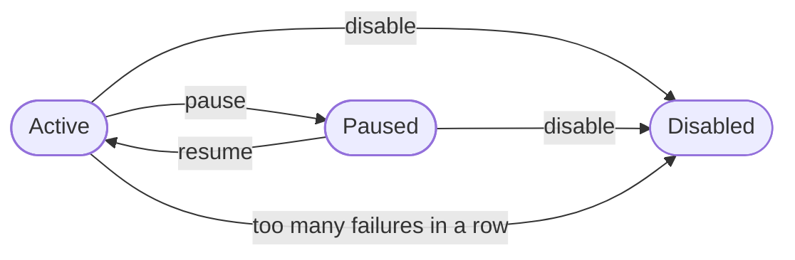

The signals context holds a tenant's **security signals**: short notices that a session was revoked, an account was locked, a credential changed, and so on. It also holds the **signal streams** that receive them. Each stream is one relying party's receiver, which says which kinds of signal it wants, about which users and agents, and how they reach it. With these, a relying party learns of a revoked session right away, instead of when its token runs out.

The signals follow the Shared Signals standards: CAEP and RISC name the events, each signal is a Security Event Token (RFC 8417), pushed (RFC 8935) or polled (RFC 8936).

Signals is part of the foundation. It uses no other context. Where a change needs a right, signals names the rule and authorization answers it, with the right to view signals (`signals: view`) or to update them (`signals: update`).

The code is in `crates/ianua-domain/src/domains/signals`:

| Part | What it holds |
|---|---|
| `signal` | A security signal, whom it is about, the thirteen kinds of signal, and the event name each one goes out under |
| `stream` | A signal stream, its endpoint and the proof that the endpoint is the receiver's, its status and its failure count. `stream/changes.rs` holds an update, `stream/receiver_requests.rs` what a receiver asks of its stream |
| `subjects` | Which users and agents a stream hears about |
| `receiver` | A stream's receiver, signed in with its stream's own key |
| `verification` | The verification event sent down a stream |
| `delivery` | The `Authorization` header a push carries, and the record of one delivery to one stream |
| `set` | The claims of the Security Event Token a stream is sent |
| `events` | The events a stream's changes record |
| `control` | The rule for who may change and manage the streams |

The use cases are in `crates/ianua-app/src/use_cases/signals`.

## How the parts fit

## A security signal

A signal says what happened, to whom, in which tenant and when. It is about a user of the tenant or an agent. It gets its own id when it is raised, and it names its tenant, so it can be kept to that tenant's streams.

There are thirteen kinds. Each goes out under an event name that CAEP or RISC defines. A receiver ignores a name it does not know, and an ignored revocation leaves the session open. So where the standards have no exact name, the signal goes out under the nearest one that still cuts access:

| Kind | What happened | Goes out as |
|---|---|---|
| Session revoked | A session was ended | CAEP `session-revoked` |
| Session suspended | A session was put on hold | CAEP `session-revoked` |
| Token compromised | A session's token may be in other hands | CAEP `session-revoked` |
| Credential changed | A password, passkey or second factor changed | CAEP `credential-change` |
| Credential compromised | A credential is known to be in other hands | RISC `credential-compromise` |
| Assurance changed | A session proved a second factor and stands at a higher level | CAEP `assurance-level-change` |
| Account locked | The account was locked | RISC `account-disabled` |
| Account disabled | The account was switched off, or waits to be erased | RISC `account-disabled` |
| Account purged | The account was deleted for good | RISC `account-purged` |
| Identifier changed | The address the user is known by changed | RISC `identifier-changed` |
| Permissions changed | What the user or agent holds changed | CAEP `token-claims-change` |
| Device compromised | A device stopped being trusted | CAEP `device-compliance-change` |
| Risk level changed | The user's risk level changed | CAEP `risk-level-change` |

Each kind carries the fields its event name requires, so a signal cannot be raised that a receiver would have to reject:

| Kind | Carries |
|---|---|
| Credential changed | Which credential (`password`, `fido2-platform`, `fido2-roaming`, `x509` or `app`) and what happened to it (`create`, `revoke`, `update` or `delete`) |
| Credential compromised | Which credential, as above |
| Assurance changed | The `NIST-AAL` namespace and the level now: `nist-aal1`, `nist-aal2` or `nist-aal3` |
| Permissions changed | Every permission the subject holds now, as tokens name them |
| Device compromised | A move from `compliant` to `not-compliant` |
| Risk level changed | The level now: `LOW`, `MEDIUM` or `HIGH`, about the user |
| Every other kind | Nothing beyond the subject |

An agent signs in from no device of its own, proves no second factor and is known by no address, and CAEP names no risk level for one. So a compromised device, a risk level, an assurance level or a changed address is never reported about an agent. Such a signal is refused when it is raised.

## What raises a signal

The planner reads every recorded event and asks what it means for a person or an agent of the tenant. The code is `crates/ianua-app/src/services/signals/user.rs` for people and holdings, and `agent.rs` beside it for agents.

| Event | Signal |
|---|---|
| `authentication.session_revoked` | Session revoked. After a used refresh token was used again: token compromised, or else session revoked |
| `authentication.session_suspended` | Session suspended. After a request broke what the session is bound to: token compromised, or else session suspended |
| `authentication.password_changed`, `authentication.password_reset_completed`, `identity.password_reset` | Credential changed: `password`, `update` |
| `authentication.passkey_registered`, `authentication.passkey_removed` | Credential changed: `fido2-platform` for a passkey on the device it was made on, `fido2-roaming` otherwise; `create` or `delete` |
| `authentication.mfa_enrolled`, `authentication.mfa_unenrolled` | Credential changed: `app`, `create` or `delete` |
| `authentication.password_breach_detected` | Credential compromised: `password` |
| `authentication.mfa_verified` | Assurance changed, to the level the session stands at |
| `identity.user_status_changed` | Account locked for a lock; account disabled for a switch-off or an account waiting to be erased. Unlocking or reopening cuts no access and is no signal |
| `identity.email_changed` | Identifier changed |
| `identity.user_deleted` | Account purged, or else account disabled |
| `authorization.role_assigned`, `authorization.role_revoked`, `authorization.role_assignment_expired` | Permissions changed, for the role's holder when it is a person or an agent |
| `authorization.group_member_added`, `authorization.group_member_removed`, `authorization.group_membership_expired` | Permissions changed, for the member |
| `authentication.break_glass_granted`, `authentication.break_glass_revoked` | Permissions changed |
| `signals.signal_reported` | What was reported: risk level changed (low, medium or high), credential compromised (`password`), or device compromised |

An admin's reset of every factor goes out through the factor and each passkey it removed, so it is not sent again as a whole. Too many wrong passwords from one network (`authentication.account_locked_out`) lock that network out of the account, not the account, so they are no signal: told the account was locked, a receiver would shut its owner out because someone else guessed. A change to a group's own roles reaches everyone in the group, names no one subject, and is not signalled.

**Whom a signal is about.** An event names the account when someone other than its holder acted: an admin, a directory sync or the platform. When the holder acted, the record's actor names them. Only the events a holder makes about their own account (a logout, a password change, a passkey, a second factor, a password reset, a proved factor) are read from the actor when they name nobody. Every other event that names nobody means no signal, never a signal about whoever acted. An admin removed Ann's passkey: without this, a receiver would be told the admin's credential changed, end the admin's sessions and leave Ann's open.

**One event, several signals.** Some events offer more than one, the most precise first, and each stream is sent the first one it takes, once. A stream that asked for stolen tokens hears that a reused refresh token's session was a stolen token; a stream that asked only for revoked sessions still hears the session was revoked. A deleted account reaches a stream asking for purged accounts as purged, and one asking only for disabled accounts as disabled.

**What someone holds now.** A permissions change carries every permission the subject holds when it is planned, read from the tenant's access records, not the one role that changed.

**A signal reported by hand.** Some signals have no change of their own to follow. A workflow's `send-signal` step reports one about a person, as the person the run acts for, who must be allowed to update signal streams. Pat's workflow sees Lee sign in from a country Lee never visits and reports Lee's risk as high. The report is recorded as `signals.signal_reported`, naming Lee and what was said, and goes out to every stream that takes it like any other signal. Risk level changes and compromised devices are raised this way only.

## The token a stream is sent

Each signal is a Security Event Token addressed to one stream, signed with the tenant's current signing key. A tenant with no active signing key sends nothing rather than sending it unsigned.

| Claim | What it holds |
|---|---|
| `iss` | The tenant's issuer, the same one its sign-in tokens carry |
| `jti` | The signal's own id, so a receiver can match the token to a delivery record |
| `iat` | When the signal happened |
| `aud` | The stream's endpoint |
| `events` | Exactly one entry, under the signal's event name |

The entry names the user or agent with an opaque subject: the platform's own id for them. A receiver matches it against an id it already holds, such as the `sub` from an earlier sign-in. The entry also carries when the event happened and the fields its kind requires. The token's `typ` is `secevent+jwt`, which the crypto context keeps from ever passing as an access token.

A verification event goes out the same way, signed alike, so a receiver checks every token it is sent the same way. Its subject is the stream itself.

## A signal stream

A stream belongs to one tenant and has:

| Field | What it is |
|---|---|
| Endpoint | The receiver's HTTPS address on the public internet |
| Verification | Whether the endpoint has shown it is the receiver's: pending or verified |
| Delivery method | **Push**: the platform posts each token to the endpoint. **Poll**: the token is held until the receiver polls for it |
| Authorization header | What each push sends in the `Authorization` header, such as `Bearer` and the receiver's own token, or none. Sealed at rest and never shown again |
| Receiver key | The digest of the key the receiver manages the stream with |
| Signal kinds | Which kinds it receives, at least one |
| Subjects | Which users and agents it hears about |
| Status | Active, paused or disabled |
| Failures | How many deliveries in a row have failed |

**Which signals a stream receives.** A stream is sent a signal only when all four hold: it is active, its endpoint is verified, the signal's kind is in its list, and it hears about the user or agent the signal is about. Anything else sends nothing.

**The list of kinds is never empty.** A stream receives only the kinds it names. An empty list is refused, when the stream is registered and when its list is replaced, rather than read as "every kind". So no receiver is sent every signal about every user because a list was left out. A refused replacement keeps the kinds the stream had.

**The endpoint must be public.** The platform sends requests to the endpoint from inside the deployment, so it must be a host only the public internet can answer for. Refused are:

- `localhost` and any name under `.localhost`
- names under `.local`, `.internal`, `.lan`, `.home.arpa`, `.svc` and `.cluster.local`
- a single-label name such as `receiver` or `db`
- IP addresses in the loopback, private, link-local, unique-local, unspecified and other internal ranges, in IPv4 and IPv6

Mallory has taken over an account that may change streams. Without this rule, she moves the payroll app's stream to `https://localhost/sse`, `https://signals.lan/sse` or `https://receiver/sse`, and the platform pushes to a service on its own network. None of these can become an endpoint.

**The authorization header is the receiver's secret.** It is 1 to 4096 visible characters and spaces. A line break is refused, so it cannot write headers of its own. It is sealed before it is stored and opened for one push at a time. Reading a stream shows only whether pushes carry one.

## Whom a stream hears about

A new stream starts hearing about every user and agent of the tenant (`ALL`, the default) or about none (`NONE`). After that, subjects are added and removed one at a time:

- A stream that started with every subject keeps the ones removed from it.
- A stream that started with none keeps the ones added to it.

Adding a subject it already hears about, or removing one it does not, changes and records nothing. A stream lists at most 10,000 subjects. Adding names a user or agent by its id in the opaque format, and the subject must be the tenant's.

Sam may only view the streams. Without the rights check, he removes himself from the payroll app's stream, and the app never learns his session was revoked.

## Proving the endpoint

A new stream, and a stream moved to another endpoint, delivers nothing until that endpoint echoes a **challenge**: a random value the platform makes and sends to it. The stream keeps the challenge until the echo arrives.

The challenge goes out as a verification event, with the challenge as its `state`. It is pushed to a push stream's endpoint, or held for a poll stream's receiver. If it cannot be sent, that is logged: the stream stands, and keeps delivering nothing until an echo arrives. The receiver echoes it to `POST .../streams/{id}/confirm` with a body of `{"challenge": "..."}`. This route needs no session or key: the challenge is the proof.

| Step | What happens |
|---|---|
| Echo the right value | The endpoint is verified. The stream delivers to it from then on. No event is recorded |
| Echo a wrong value | Refused with `403`. The endpoint stays unverified |
| Echo when already verified | Refused with `422`. There is nothing to confirm |
| Echo for a stream the tenant does not have | Refused with `401`, not `404` |
| Change the endpoint | The new endpoint has proved nothing yet. It waits for its own new challenge, and the old endpoint's challenge does not count for it |

Mallory has no access to the receiver. She answers a new stream's challenge with a guess. It is refused and changes nothing, and the stream still sends nothing until the real endpoint echoes the real value.

Mallory has taken over an account that may change streams. Without this proof, she moves the payroll app's stream to her own server and reads every security signal the tenant raises. With it, nothing goes to her server until it echoes the new challenge. So a stream pointed at a server that never asked for the tenant's signals sends it nothing.

**The challenge goes to the endpoint alone.** Registering a stream, or changing its endpoint, sends the challenge to that endpoint. Nobody else is given it: not the person who registered the stream, and not anyone reading it later. Reading a stream shows only whether its endpoint is pending or verified, and the challenge never prints.

Sam may view the streams. If reading one gave him its challenge, he would point the payroll app's stream at his own server and confirm it himself with the value he read, and every security signal would reach him. Reading shows him only "pending", which confirms nothing.

## The receiver manages its own stream

Registering a stream hands back a **receiver key**, once. Only its digest is kept. The receiver presents it as its bearer token to:

| Route | What it does |
|---|---|
| `POST .../streams/{id}/poll` | Acknowledges the events it took and is handed the next ones |
| `POST .../streams/{id}/verify` | Asks for a verification event |
| `POST .../streams/{id}/subjects/add` | Makes the stream hear about a user or agent |
| `POST .../streams/{id}/subjects/remove` | Makes the stream stop hearing about one |

The key manages its own stream and nothing else. It registers no stream and changes none. So a receiver never needs one of the tenant's API keys, which reach every stream and every user. A person who may update signals may call these routes too, for any of the tenant's streams.

**These routes do not say which tenants exist.** The receiver routes, `confirm` included, are open to callers with no session. A path that names no tenant, or a closed one, answers `401` exactly like a wrong key or a wrong challenge. So does a key for a stream the tenant does not have. Mallory, holding neither a key nor a challenge, tries tenant names and learns nothing from the answers. These routes are also limited per client address.

**Polling.** Only a poll stream is polled; polling a push stream is refused with `409`. The body names, in `ack`, the `jti` of each event received since the last poll, which the stream then drops. `maxEvents` asks for at most 1 to 100 events, 100 when left out. The answer holds the oldest events not yet acknowledged, in `sets`, each a signed token under its `jti`, and `moreAvailable` when more wait. An event stays until it is acknowledged, so a poll whose answer was lost is handed the same events again. A poll always answers at once. Nothing is recorded: each event was recorded when it was raised.

**Verification events.** A receiver may ask for one to check the stream works end to end. It may give a `state` of 1 to 256 characters, which the event carries back so it can match it to its request. Only an active stream with a verified endpoint is sent one; otherwise the request is refused with `409`, so asking cannot make the platform call an endpoint that never proved it is the receiver's. Each stream may ask only now and then; asking again a moment later is refused with `429`. Each request is recorded, so a receiver asking again and again shows in the trail. The answer does not wait on the receiver.

**Discovery.** `GET .../.well-known/ssf-configuration` describes the tenant's transmitter to anyone: its issuer, where its keys are published, push and poll delivery, the endpoints above, bearer authorization, `ALL` as the default subjects, and every event name a stream may ask for.

## A stream's life

A new stream starts active, with no failures counted. Active and paused move between each other, and either can be disabled. A disabled stream stays disabled: resuming, pausing or disabling it again is refused. Delivery starts again only with a newly registered stream.

While a stream is paused it receives nothing, not even a delivery record. Signals raised during the pause are dropped, not kept for later.

**Deleting a stream.** Only a disabled stream may be deleted. An active or paused one is refused, so it is disabled first and no stream is deleted while a receiver relies on it.

## Failures in a row

Each stream counts how many pushes in a row have failed:

- A successful push sets the count back to zero, so old failures never add up to a disable.
- A failure adds one. When the count reaches the limit and the stream is active, the stream is disabled, and `signals.stream_disabled` is recorded together with the stream it switched off.
- A paused stream keeps its status when a failure is counted, so a person can still resume it. A disabled stream stays disabled.
- The count stops at its highest value instead of wrapping back to zero.

The limit is at least one. A limit of zero is refused. A deployment sets it with `SIGNAL_DISABLE_AFTER_FAILURES`, 20 by default.

## Delivery

Planning queues one job for each signal and each stream that takes it now, keyed by the event, the signal's subject and the stream, so an event delivered to the planner twice queues nothing twice. Each job hands its signal to its one stream, so one slow receiver holds up neither the request that raised the event nor another receiver.

When the job runs, the stream is read again and sent the signal only if it still takes it. A push the receiver did not take is tried again on the queue's backoff, under the same token id, so a receiver drops a repeat. Each failed try counts towards the failures that switch the stream off. A stream that is gone, paused or no longer takes the signal ends the job.

## Who may do what

| Action | Needs |
|---|---|
| List or read streams, their status and their deliveries | `signals: view` |
| Register a stream | `signals: update` |
| Change the endpoint, delivery method, authorization header or signal kinds | `signals: update` |
| Pause, resume or disable | `signals: update` |
| Delete a disabled stream | `signals: update` |
| Poll, ask for a verification event, add or remove a subject | The stream's receiver key, or `signals: update` |
| Confirm the endpoint | No right. The echo must match the challenge sent to that endpoint |
| Count a delivery's success or failure | No right. Delivery does this, not a person |

A stream decides which outside receiver hears of every revoked session and locked account in the tenant, and whether it hears at all. Sam may only view the streams. Without this check, he points the payroll app's stream at his own server and reads every security signal, or pauses or deletes it so the app never learns a session was revoked. Each of these changes is refused, and the stream keeps sending every signal it wanted to the app.

## Limits and numbers

| What | Limit |
|---|---|
| Endpoint challenge | 32 to 256 ASCII characters, with no spaces, tabs, line breaks or other control characters. The platform makes it from 32 random bytes |
| Signal kinds on a stream | At least one |
| Subjects a stream lists | At most 10,000 |
| Authorization header | 1 to 4096 visible characters and spaces |
| Receiver `state` on a verification request | 1 to 256 characters |
| Events handed back by one poll | 1 to 100, 100 by default |
| Failures in a row before a stream is disabled | `SIGNAL_DISABLE_AFTER_FAILURES`, 20 by default, at least one |

## Delivery records

Each delivery to a stream is recorded, so an operator can see what was sent to a receiver and whether it arrived. A record names the stream, the signal, its kind, how long the request took and when it was made. It also says how it ended:

| Status | What it means |
|---|---|
| Success | The receiver answered with a 2xx code |
| Failed | The receiver answered with any other code |
| Timeout | The receiver did not answer in time |
| Unreachable | The request could not be sent, such as after a DNS failure or a refused connection, or the token could not be signed |
| Queued | The stream uses poll delivery, so the token was held for the receiver to poll |

A pushed delivery that got an answer always carries the code, and success is read from that code. So a delivery never reads as successful with a 500, or as answered with no code.

## What a stored row must satisfy

A stored stream is refused as broken when:

- it changed before it was registered,
- it names no signal kind, or
- it lists more than 10,000 subjects.

A stored push outcome is refused as broken when its result and its code contradict each other: a success or failure with no code, a timeout or unreachable outcome with a code, or a result the code does not match, such as a success with a 500.

## Events

| Event | Recorded when |
|---|---|
| `signals.stream_registered` | A stream is registered |
| `signals.stream_updated` | A stream's endpoint, delivery method, authorization header or signal kinds change. One update records one event |
| `signals.stream_paused` | A stream is paused |
| `signals.stream_resumed` | A paused stream is resumed |
| `signals.stream_disabled` | A stream is disabled, by a person or by its failures |
| `signals.stream_deleted` | A disabled stream is deleted |
| `signals.subject_added` | A user or agent is added to what a stream hears about |
| `signals.subject_removed` | A user or agent is removed from what a stream hears about |
| `signals.verification_requested` | A verification event is asked for and sent down a stream |

Each event names the tenant and the stream. It labels the stream with the endpoint's origin only, such as `https://rp.acme.com`. An endpoint's path or query often carries its secret, so an address like `https://rp.acme.com/sse?key=s3cret` never lands in the audit trail. A change the receiver makes with its key is recorded as done by the platform.
