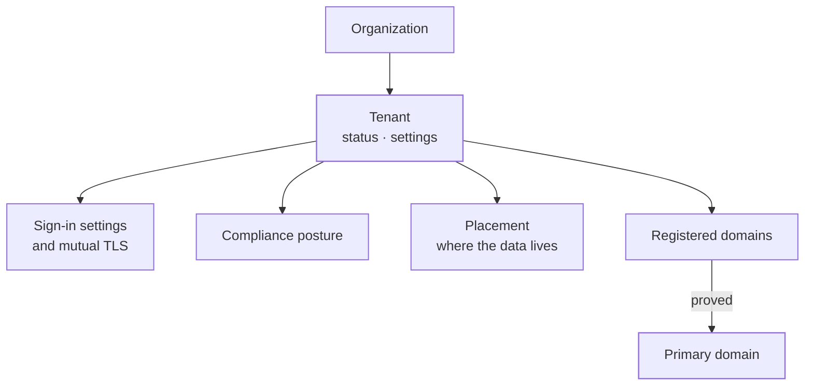
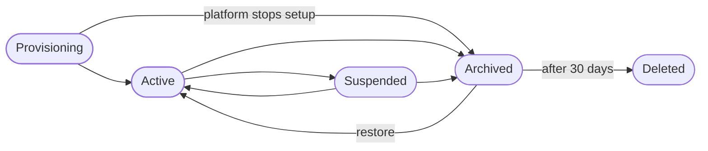
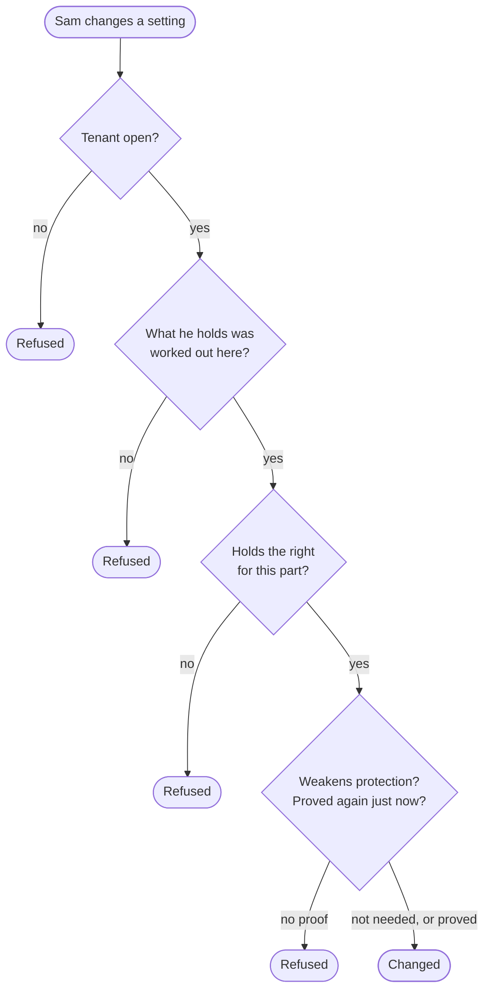
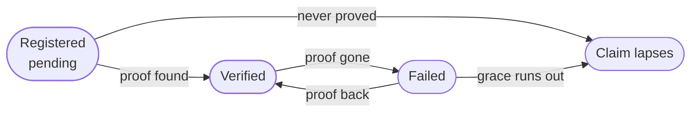
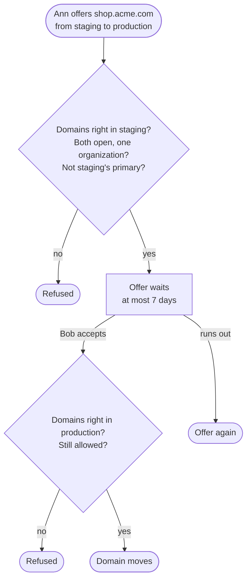
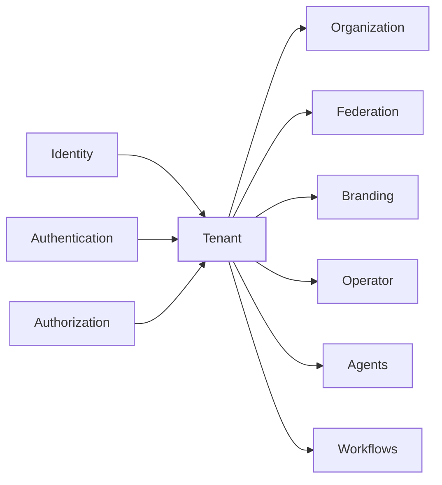

The tenant context holds a **tenant**: one separate set of users, settings and data inside an organization. It says how a tenant moves through its life, who may change its settings, who it lets sign in at all, how long it keeps its audit records and where its data lives. It also holds the tenant's own **domains**: proving them, their certificates, and the DNS we answer for them.

Every change names the person or the platform making it. The tenant checks the right for it itself, so a path that skips the API's checks still cannot change anything.

The code is in `crates/ianua-domain/src/domains/tenant`:

| Part | What it holds |
|---|---|
| `lifecycle`, `status` | The tenant, how it moves through its life, and how its settings change |
| `control` | Who may change a tenant, and the right each part needs |
| `access` | Sign-in settings, the check every sign-in passes first, sign-ups, and mutual TLS |
| `environment` | Whether the tenant serves production, staging or development |
| `clone` | Copying one tenant's setup into another of the same organization |
| `compliance`, `compliance_limits` | Data residency, audit retention, operator impersonation, and what the deployment allows |
| `audit_streams` | Streams that send the tenant's audit records to a SIEM it runs |
| `provisioning` | Where the data lives, how isolated it is, and how big its database is |
| `setup` | The steps that make a new tenant usable, and which waits on which |
| `custom_domains` | Domains the tenant registers, proves, hands over and serves DNS for |

The use cases are in `crates/ianua-app/src/use_cases/tenant` (`lifecycle`, `settings`, `clones`, `audit_streams`), and the routes under `/api/v1/organizations/{org_slug}/tenants`.

A tenant's **slug** is its short name, such as `production`. It is unique within its organization only: Acme and Globex can each have a `production` tenant, but Acme cannot have two. A second one in the same organization is refused with **409**. A tenant is found by its organization's slug and its own together in paths, at sign-in and in LDAP names. The slug cannot be changed later.

Platform addresses use a permanent random label, independently of either slug: `k7f3q9.apps.example.com`, with an app at `wiki.k7f3q9.apps.example.com`. Self-hosted installations may use the flat shape, `wiki-k7f3q9.apps.example.com`, with an operator-managed wildcard. On nested deployments, the tenant may explicitly enable readable addresses such as `production.acme.apps.example.com`. This setting defaults off and changes are audited. Public certificate authorities publish readable names in certificate transparency logs; disabling the address cannot remove that history.

## How the parts fit

## A tenant's life

A new tenant starts in **provisioning** while its setup runs. The setup is a short plan of steps, each waiting on the ones it needs:

| Step | Waits on | What it does |
|---|---|---|
| Database | nothing | Makes the tenant's own schema, instance or cluster. Only a tenant that does not share the platform's database has this step |
| Signing key | the database, when there is one | Makes the tenant's first signing key, signing with RS256, which every OpenID Connect client accepts |
| Assertion key | the database, when there is one | Makes the tenant's first assertion key, signing with ES256, which the gateway signs `X-Ianua-Assertion` with. It is kept apart from the signing keys, and the gateway can read it but not write it |
| Starting roles | the database, when there is one | Makes **Admin**, with every built-in permission, and **Member**, with a view of the metrics, given to every new user |
| Activate | every other step | Makes the tenant active |

Each step runs as a background job, so it can run again after a crash, and a step run twice changes nothing the second time. Steps that wait on the same thing run at the same time. When two of them finish at the same moment, the second to save the setup sees that the first changed it, reads it again and records its own step on top, at once. So the signing key and the starting roles can finish together and both still count, and the tenant is activated once. If a step's job is lost, such as with a worker that stopped, the background sweep that picks up stalled work queues the ready steps again once the setup has stood unchanged for 15 minutes (`WORKER_RECONCILE_STALE_AFTER_SECONDS`). The sweep looks every 5 minutes. A step that keeps failing stops the setup and is recorded as `tenant.infra_failed`, naming the step and why; the tenant stays provisioning until an operator fixes the cause. Its status alone would then read like a setup still running, so every tenant answer (`GET .../tenants/{tenant_slug}` and each tenant in the list) carries `setup`, with a `state` and a `failed_step`: `running` while the setup goes on, `failed` with the step (such as `signing_key`) once a step failed for good, and `over` once the tenant left provisioning. `failed_step` is `null` unless the setup failed. The reason a step failed stays in the record and is not shown in the answer. The starting roles can be made only at their step of a setup: outside it, every role goes through the check that its maker may hand out what it grants.

Its users may already sign in while it provisions, so the first sign-in can happen while the last steps finish. Provisioning and active tenants are **open**. A suspended, archived or deleted tenant is **closed**: it lets nobody sign in, and it takes no settings changes.

| Step | Who may take it |
|---|---|
| Create a tenant | The platform, or a member of the owning organization who may create its tenants |
| Finish provisioning | The platform only. An operator may activate a tenant by hand when setup stalls, at `POST .../tenants/{tenant_slug}/activate` |
| Suspend, reactivate | The platform, or a member of the owning organization who may update its tenants |
| Archive, restore, delete | The platform, or a member of the owning organization who may delete its tenants |
| Archive a tenant still provisioning | The platform only, since only the platform stops a setup it runs |
| Delete before the wait ends | The platform only, with a reason, at `POST .../tenants/{tenant_slug}/early-deletion` |

A member of another organization is refused every step, whatever they hold there. Sam, a plain member of Acme, does not hold the right to create Acme's tenants, so he cannot make a tenant of his own under Acme.

**Archiving is not deleting.** An archived tenant keeps its data and can be restored. It can be deleted only 30 days after it was archived. So an owner who archives by mistake, or someone holding a stolen owner session, cannot wipe a tenant in the same minute. Deleting is its own call, `DELETE /api/v1/organizations/{org_slug}/tenants/{tenant_slug}`, which is refused until the 30 days have passed. Nothing deletes a tenant on its own once the wait ends yet. Deleting takes the tenant off its organization and cannot be undone.

The platform may delete an archived tenant early, for abuse such as phishing or for a court or regulator's order. It must give one of those two reasons with a note, and the reason goes on the record. A member of the organization always waits.

**Teardown.** A deleted tenant is closed at once. Then its teardown removes what it held, as a short plan of steps like the setup's:

| Step | Waits on | What it does |
|---|---|---|
| Data | nothing | Removes everything the tenant held, wherever it lives, but its audit trail |
| Audit trail | nothing | Moves the audit trail from the tenant's own database to the platform's. Only a tenant with a database of its own has this step |
| Database | every other step | Removes the tenant's own schema, instance or cluster. Only a tenant with a database of its own has this step |

The audit trail is kept for as long as the tenant's retention says, so the record of what happened in a tenant outlives the tenant. Its database is never removed before its trail is safe. Each step runs as a background job and can run again after a crash. Removing the data and moving the trail run at the same time; when both finish at the same moment, both count, as in the setup, and the database step is queued once. The last step done is recorded as `tenant.torn_down`. A step that keeps failing stops the teardown and is recorded as `tenant.teardown_failed`, naming the step and why. What the steps before it removed stays removed.

**The platform's hold.** When the platform suspends or archives a tenant, it holds it. While it is held, only the platform reactivates or restores it. Archiving a held tenant keeps the hold, so archive and restore cannot wash it away.

The platform suspends Acme for abuse. Ann, Acme's owner, tries to reactivate it a minute later and is refused. Had Ann suspended it herself, she could reactivate it again.

## Environments and clones

An organization may keep one tenant per stage of the same product. Each tenant is labelled `production`, `staging` or `development`. A new tenant serves `production`. The label is changed at `PUT .../tenants/{tenant_slug}/environment` with the right to update the tenant's settings, and only while the tenant is open.

A **clone** copies one tenant's setup into another tenant of the same organization, such as production into a new staging tenant. It is started at `POST /api/v1/organizations/{org_slug}/tenant-clones`, naming the source, the target and the parts to copy, and followed at `GET .../tenant-clones/{clone_id}`. Starting one needs the right to create the organization's tenants.

| Part | What it copies |
|---|---|
| `settings` | Sign-in settings, mutual TLS, timezone and locale |
| `branding` | The login page's look and the email templates |
| `roles_and_policies` | Roles, groups and access policies, without who holds them |
| `routes` | Proxy routes and the services they forward to |
| `oauth_applications` | OAuth applications, without their secrets |

People, sessions, signing keys and secrets are never copied, so a clone gives the new tenant the same shape, never the same users or the same keys. The two tenants must be different tenants of one organization. The source must not be archived or deleted, and the target must be provisioning or active. A clone names at least one part and each part once, and only one clone copies into a tenant at a time, so the target is never a mix of two.

Starting a clone only records what is to be copied. A worker then copies the parts one by one and saves each as soon as it is copied, so a worker that stops half way starts again at the first part not yet copied. The clone ends as completed, or as failed when meanwhile the source is archived or deleted, the target is closed, or a part cannot be copied. What was copied before a failure stays.

## Changing the settings

| Part | What it covers | Right it needs | Fresh proof |
|---|---|---|---|
| Profile | Name, contact address, timezone, locale, primary domain, environment | Update tenant settings | No |
| Sign-in | Methods, MFA, passwords, sessions, address list, self-registration | Update sign-in settings | Yes |
| Mutual TLS | Whether clients show a certificate, and who may sign it | Update mutual TLS | Yes |
| Compliance | Residency, audit retention, operator impersonation | Update compliance | Yes |
| Audit streams | Adding or pointing a stream of the tenant's audit records somewhere else. Pausing, resuming or removing one needs the right but no fresh proof | Update compliance | Yes |
| Domains | Offering a domain to another tenant or accepting one, the records in a delegated zone | Update domains | No |
| Domain claims | Registering a new domain | Create domains | No |
| Domain removal | Removing one of the tenant's domains | Delete domains | No |

What a person holds comes from their roles in one tenant, or from an active break-glass grant there, and the check names that tenant. Sam is an admin in his own tenant. That does nothing in Ann's.

Sign-in settings, mutual TLS and compliance decide how well the tenant is protected. So an open session is not enough to change them. The person proves who they are again first, as they do to change their address, and that proof counts for ten minutes. Mallory, holding Ann's stolen session, cannot turn MFA off, open self-registration or let operators in.

## Who may sign in at all

Every way of signing in passes one check first, before any user is looked up:

| Question | Refused when |
|---|---|
| Is the tenant open? | It is suspended, archived or deleted |
| Is this method on? | The tenant switched it off |
| Can this method ever be strong enough? | The tenant asks for a stronger sign-in than this method can ever give, such as a password where only a passkey or single sign-on is strong enough |
| Is the caller at an allowed address? | An address list is set, and the caller is not on it or their address is unknown |

Because the questions come before the user, every email address gets the same answer.

Sign-in settings are checked when they are built and when they are read back. At least one method is on, some method can reach the required strength, and the numbers make sense: a session lasts five minutes to thirty days, it may go idle for at least a minute but never longer than it lasts. An account locks after 2 to 100 failed attempts and stays locked for thirty seconds to a day.

**Nobody saves themselves out.** The same check runs on new settings, for the person saving them. Ann is the only admin. She saves an address list without her own office, or turns off passkeys, the one way she signs in. Both are refused, since nobody could sign in to undo it. A member of the organization signs in to the organization, not the tenant, so they are not checked this way and can always mend it.

**Signing up.** Most tenants let in only the people an admin adds or invites. A stranger may open an account of their own only when the tenant gives its word for it: it is open, its sign-in settings take sign-ups, and the word is for its own accounts. That word opens only the person's own account, which waits for them to confirm their address. It invites nobody. Mallory finds the sign-up form of a tenant that only invites, or of a suspended one, and is refused. Acme taking sign-ups does not let her sign up in Globex.

**Mutual TLS** may be off, optional or required. When it asks for certificates, it must trust at least one certificate authority. Otherwise "required" would turn every client away.

A tenant may also give the revocation lists (CRLs) its authorities publish. Then every client certificate is checked against them in the handshake, and the check fails closed: a revoked certificate is refused, and so is one whose issuer no list covers, and every certificate once a list is past the date it said it would be replaced by. Ann's laptop is stolen; her admin adds a list naming her certificate, and the laptop is turned away at the next connection. Lists are only taken with mutual TLS on, at most 32 of them. The gateway never asks an OCSP responder while a client waits.

## Compliance

A tenant's compliance posture has three settings:

| Setting | What it says |
|---|---|
| Data residency | The one jurisdiction its data must stay in, such as the EU, the UK or Switzerland, or anywhere |
| Audit retention | How many days audit records, and the gateway's request and connection records, are kept |
| Operator impersonation | Whether platform operators may act as its users |

A residency is met only by the exact jurisdiction. Data in Zurich does not meet an EU residency, and London is not in the EU.

The deployment sets the limits. Retention must lie in its range, by default 30 to 3,650 days. A deployment that keeps every tenant's data in one jurisdiction never lets a tenant change to another, or to anywhere. The tenant's data must also already sit inside the residency it declares. A new tenant starts at the deployment's defaults: by default data anywhere, 365 days, and impersonation forbidden until the tenant allows it. Operators read the posture each time they act as a user, and a closed tenant refuses them.

**A shorter retention only reaches new records.** Ann cuts retention from 3,650 to 30 days. The records already written keep the 3,650 days they were written under. Only records from then on follow the 30 days. So one change cannot delete nine years of audit at the next purge.

A customer running their own database declares its residency. The platform cannot see where that database is, so it shows as the customer's word, not as something checked.

## Where the data lives

A tenant's placement is chosen when it is created and never changes. Moving a tenant is a data migration, not an edit. It sits on our infrastructure in a region, in the customer's own cloud account, or in a database the customer already runs. Its isolation is a shared database, a schema of its own, an instance of its own or a cluster of its own. Customer-owned infrastructure cannot share a database or schema with other tenants.

The placement must meet the residency the tenant declares: at creation, where that is the deployment's default, on every compliance change, and whenever the tenant is read back. So no tenant can claim EU residency while its data sits in Virginia.

## Domains

A tenant registers a domain, then proves it holds it. Registering needs its own right to create domains, apart from changing the ones the tenant holds. Sam, who may only view Acme's domains, cannot claim names a sibling tenant is about to prove and hold them up. It either publishes a token in a TXT record, or delegates the hostname to our nameservers. An installation run for one organization may list parent domains it already owns, and names under them need no proof. That list is empty by default, since on a shared installation it would let any tenant take any name under it. Each registration gets nameserver names of its own. Acme deletes its registration for `auth.acme.com` but leaves its records in place. Eve registers the same name, and the old records prove nothing for her.

A claim holds its name against other tenants. A claim never proved lapses after a while, so Eve cannot keep Globex out of `globex.com` by registering it and waiting. A proved claim that loses its proof keeps the name for a grace period, long enough to survive a bad DNS answer, then lapses too. A domain gets a certificate only once it is verified. A stored domain that was never proved but has an active certificate is refused as corrupt when it is read back.

**Removing a domain** takes down every route and sign-in page served on it, and frees the name for any other tenant to claim. So it needs its own right to delete domains, apart from changing them. Sam, who may only view Acme's domains, cannot remove `login.acme.com` and lock Acme's people out of signing in.

**The primary domain.** Requests for a tenant's primary domain are sent to that tenant. So it must be a domain this tenant verified, never one it only typed in, and never a wildcard. A new tenant has none. When a domain is removed or loses its proof, the tenant lets go of it as its primary domain. A primary domain cannot be handed over until another is chosen. Nobody chooses that, so it names nobody, and it works on a closed tenant too.

**Handing a domain over.**

Handing a domain over changes who answers for it on both sides. So an admin of the giving tenant offers it, and an admin of the receiving tenant accepts it. Neither can push or pull a domain alone. Everything is checked again on accept, since either tenant may have changed.

**Delegated zones.** A delegated hostname gets a zone the tenant may fill with address, alias, text, mail, service and CAA records. Every record written or removed names the person doing it, who needs the right to change the tenant's domains in this tenant. Sam, who may only view them, cannot remove the mail record under `auth.acme.com` and make Acme's mail bounce, and Mallory, an admin of her own tenant, cannot touch Acme's zone at all. We keep two kinds of record. The address on the hostname itself is what brings traffic to the proxy. The `_acme-challenge` names come and go while a certificate is issued. Writing or removing either is refused. So is a name outside the zone, an alias on the hostname itself, or an alias beside another record at the same name.

Our nameservers answer only for a zone whose delegation was proved. Acme deletes its registration for `auth.acme.com` but leaves the delegation to us in place. Eve registers the name, and until she proves it, which the old delegation never lets her, our nameservers refuse every query for it. So she cannot answer for Acme's name and get a certificate for it. The proof reads the delegation from the zone above the name, never from our own answer. When two tenants' proved zones sit one inside the other, the outer one answers. Our nameservers refuse a name in no zone they hold, rather than saying it does not exist, and do not answer "everything at this name" queries.

## Events

The context records an event when a tenant is provisioned, changes status, is renamed or deleted, is deleted early by the platform with its reason, its contact address, timezone, locale, environment, sign-in settings, mutual TLS or compliance posture change, its provisioning fails, a check finds its audit chain broken, or old audit records are purged. It records a clone started, completed or failed, and an audit stream created, changed, paused, resumed or removed. For domains it records a registration, a proof made or lost, a certificate asked for, issued, uploaded, replaced, removed or close to expiry, a domain offered, handed over or removed, a new primary domain, and every DNS record set written or removed, with the values it held before.

Every tenant event notifies colleagues except the purge of old audit records, which happens on every run. A compliance change records all three settings before and after, so a reviewer can see exactly what was given up.

## Uses and used by

The tenant sits above authorization. Authorization answers whether a person holds the right for a part of the tenant. Identity says what counts as a fresh proof of the person acting, and what kind of account a sign-up may open. Authentication makes that fresh proof, and gives the sign-in methods, MFA, session and lockout limits and the address-list check the settings are made of. The organization answers whether its member may take a step in a tenant's life, through a check the tenant defines. Organization, federation, branding and the operator build on the tenant. Agents and workflows borrow its way of naming the person behind an account.
