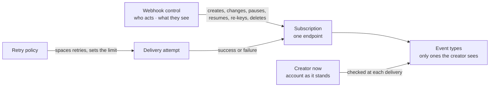
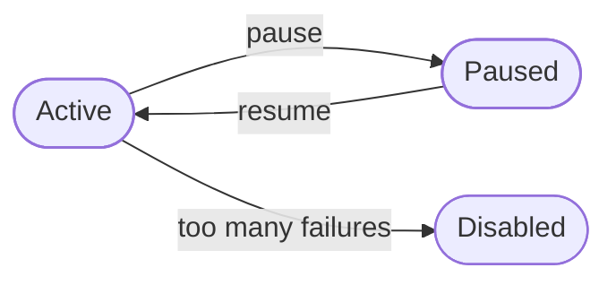

The webhooks context holds a tenant's **webhook subscriptions**: an outside server the tenant's events are sent to, signed with a secret. It decides which events a subscription receives, who may create, change, pause, resume, re-key and delete one, and when an endpoint that keeps failing is switched off. It also holds the **retry policies** that space out failed deliveries, how a delivery is **signed**, the **catalog** of events a webhook may receive, and the record of each **delivery attempt**.

Webhooks sits in the top layer, beside proxy and workflows. It uses four contexts below it: authorization, for the rights a change needs and for what a subscription's creator holds; identity and organization, for the creator's account as it stands at each delivery; and notifications, whose event categories say which events a person may see. No context uses webhooks.

Where a change needs a right, webhooks names the rule and authorization answers it. The rule checks the webhooks right (`webhooks: update` or `webhooks: manage`), held through the person's roles or an active break-glass grant.

The code is in `crates/ianua-domain/src/domains/webhooks`:

| Part | What it holds |
|---|---|
| `subscription` | A subscription: where events go, the secrets they are signed with, which events it receives and which retry policy it uses. `subscription/changes.rs` holds an update and a secret rotation |
| `subscription_status` | Where a subscription stands: active, paused or disabled |
| `catalog` | The events a webhook may be subscribed to, with what each means |
| `signing` | What a delivery is signed over, and the headers that carry it |
| `retry_policy` | The three retry policies: how failed deliveries are retried, how long one may take, and when an endpoint is switched off |
| `delivery` | The record of one try at delivering an event, and how it ended |
| `control` | The rule for who may change a subscription, and what its creator may see |
| `creator` | A subscription's creator as the records hold them at delivery: a tenant user, or an organization member with their organization and tenant grants |
| `events` | The events the context records |

## How the parts fit

## A subscription

A subscription holds:

| Field | What it is |
|---|---|
| URL | The HTTPS address events are posted to. It must be on the public internet |
| Signing secret | The secret deliveries are signed with, sealed at rest |
| Previous secret | The secret before the last rotation, while it still signs |
| Event types | The events it receives. Never empty |
| Retry policy | `Standard` (the default), `Aggressive` or `Patient` |
| Status | Active, paused or disabled |
| Description | An optional note on what it is for |
| Creator | The person who made it. Every delivery asks again what they may see |
| Failures | How many deliveries in a row have failed |
| Last delivered | When a delivery last succeeded |

The signing secret is made at random by the platform. It is shown once, when the subscription is made, and stored only sealed. It is sealed, not hashed, because signing a delivery needs the secret itself. A sealed secret never prints, so it cannot end up in a log line or an error.

## Changing a subscription

An update may change the URL, the event types, the description and the retry policy. A part left out keeps what it has. New event types are checked against what the person updating may see, as at creation. A new URL starts with no failures counted. An update that changes nothing records nothing.

A disabled subscription is not changed. It is replaced with a new one.

## How a delivery is signed

Deliveries follow Standard Webhooks. The domain names three headers:

| Header | What it holds |
|---|---|
| `webhook-id` | The message id. It is the same on every retry and on a resend, so a receiver can handle the event once |
| `webhook-timestamp` | When this try was sent, in whole seconds since 1970. Each try gets its own time |
| `webhook-signature` | One signature per secret that still signs, marked `v1` |

What is signed is the id, the timestamp and the body, joined by dots. Each try is handed to the sender with every secret that still signs: the current one, then the one before it while its overlap lasts. The sender that computes the signatures and makes the request is in the infrastructure, which is being rebuilt.

**Rotating the secret.** A rotation makes a new secret, shown once. The old one may keep signing beside it for up to 7 days, so the receiving servers can move over without refusing a delivery. Left out, the old secret stops at once, as after a leak. A rotation during an overlap ends the older secret at once: only the secret just replaced keeps signing.

## A subscription's life

A new subscription starts active, with no failures and no delivery yet. Only an active subscription receives deliveries.

| Move | What happens |
|---|---|
| Pause | Deliveries stop. The failure count is kept |
| Resume | Deliveries start again. The failure count goes back to zero |
| Too many failures | Switched off for good. Nothing more is delivered |

**Disabled is final.** A disabled subscription cannot be resumed, paused or disabled again. The tenant makes a new one instead. Moving a subscription to the status it already has is refused too, so a second pause is reported, not ignored.

No person disables a subscription. It disables itself, only from active, after too many failures in a row. A paused one only counts the failure.

## Which events it receives

A new subscription names the event types it wants. Each one must be an event its creator may see. Every event belongs to a notification category, and each category needs a view right to see. Naming an event the creator may not see is refused as forbidden.

An empty list means every event the creator may see at the time it is made, never every event there is. If the creator may see no event at all, the subscription is refused.

The **event catalog** lists the events a person may subscribe a webhook to, each with its dotted name and what it means. It shows only the events their standing rights let them see, and never a webhook's own delivery record, so it never offers an event they could not pick.

Sam may not read signing key events. He makes a webhook with no event types, hoping to get every event. It gets the user and login events he may see, and no key events.

**What the creator may see is asked again at each delivery.** An event is sent only when the subscription lists it and its creator may still see it, worked out from the creator's own records in the tenant as they stand, read alone, never every record of the tenant. Only the creator's standing rights count here, from their roles or, for an organization member, their tenant grants. A break-glass grant does not count. A webhook outlives the emergency, so what it receives must not rest on access that ends with it.

Sam makes a webhook for key events while he may read them. Then he loses that right. From then on no key event is sent to his server, while the user events he may still see are. A creator who left the tenant or was removed holds nothing, so nothing is sent.

**The creator's account is loaded fresh for each delivery.** A webhook keeps sending while its creator is signed out, so what they may see comes from their account as it is now, not from a sign-in:

| Creator | What they may see | Sends nothing when |
|---|---|---|
| A tenant user | What their roles give them in the tenant | Their account may not sign in, such as after it was deactivated |
| An organization member | What their tenant grants give them | Their account may not sign in, they belong to another organization, the organization does not own the tenant or is closed, or it is suspended and they are not an owner |

Sam, a plain member of Acme's organization, makes a webhook for user events, which his grant in the tenant lets him see. They reach his server. Once the platform suspends Acme, they stop. Once his grant is withdrawn or his membership ends, they stop too.

Sam's account is deactivated, but his role is still on record. Nothing more is sent to his server, because an account that may not sign in sees nothing.

The account given for a delivery must be the one that made the webhook. Mallory cannot have Sam's webhook checked against Ann's rights, so that what Ann may see reaches Sam's server. Any other account is refused as forbidden.

**A subscription never receives its own deliveries.** Each delivery records an event. If a webhook could receive that event, every delivery would raise another one to deliver, without end. A list that names it is refused, and an empty list leaves it out.

## Where events may go

The URL must be HTTPS and on the public internet. These are refused:

| Refused | Examples |
|---|---|
| Plain HTTP | `http://hooks.acme.com/events` |
| A name with no dot | `https://localhost/admin`, `https://billing/hook` |
| A name under an internal suffix | `.internal`, `.local`, `.localhost`, `.lan`, `.home.arpa`, `.svc`, `.cluster.local` |
| An internal address | Loopback, private, link-local, unspecified, multicast and reserved addresses, in IPv4 or IPv6, including IPv4 written as IPv6 |

The name check ignores letter case and a trailing dot, so `https://LOCALHOST./admin` is refused too.
Mallory makes a webhook for `https://169.254.169.254/latest` or `https://payroll.internal/run`. Without this check, every event would make the platform call a service inside its own network. Neither URL is accepted, so no subscription can be made for it.

## Who may do what

| Action | Right it needs |
|---|---|
| List or read subscriptions, their deliveries and the event catalog | `webhooks: view` |
| Create a subscription | `webhooks: update` |
| Change a subscription | `webhooks: update`, and the subscription must not be disabled |
| Pause a subscription | `webhooks: update` |
| Resume a subscription | `webhooks: update` |
| Resend an earlier delivery or send a test event | `webhooks: update`, and the subscription must not be disabled |
| Rotate the signing secret | `webhooks: manage` |
| Delete a subscription | `webhooks: update`, and the subscription must be paused or disabled |

`webhooks: manage` covers `webhooks: update`. The update right does not cover rotating the secret. Whoever sets the secret can sign messages the receiving server takes for the tenant's own deliveries.

Sam may only view webhooks. Ann paused a webhook because its server was taken over. Without this check, Sam resumes it and events flow to the attacker again. The resume is refused and the webhook stays paused.

Sam may create, pause and resume webhooks. He sets a secret of his own on Ann's webhook, so he can sign messages her server takes for real deliveries. The rotation is refused, because it needs the full webhooks right, and the old secret stays.

Deleting a subscription takes its delivery history with it. Sam may only view webhooks. He deletes the one that feeds the security team's alerting, so its record of what it sent goes too. The delete is refused. Ann, who may update webhooks, cannot delete it while it is active either; she pauses it first, so nobody deletes a webhook still in use by mistake.

The person who makes a subscription is kept as its creator. What they may see is read from the same person who passed the rights check, so it is never someone else's.

## Failures and switching off

Each failed delivery adds one to the subscription's failure count. A success sets it back to zero and records when it happened. When the count reaches the limit of the retry policy the subscription chose, an active subscription is disabled.

The disable is reported once, at the failure that caused it. A failure after that is only counted. The try, its count and the record of the switch-off are kept together, so a subscription is never switched off with no record of why.

With a limit of five, the first four failures are counted and the subscription stays active. The fifth disables it.

A test event is never counted. Testing an endpoint that is down does not switch it off. A resend is counted like any delivery.

## Resends and test events

A person may send a delivery again. The resend carries the same message id, so a receiver that already handled it drops it, and it is signed with every secret that signs now. It is refused when the creator may no longer see the event. It is not retried.

A test event sends a sample of one event the subscription lists, marked as a test and holding none of the tenant's data. It is signed like any delivery, so the owner can check their endpoint verifies it. The attempt shows in the delivery history.

A disabled subscription is not resent to or tested. Each subscription may be resent to or tested only now and then. One asked a moment ago is refused as too many requests.

## Retry policy

A subscription picks one of three retry policies. A retry policy says how a failed delivery is retried:

| Setting | What it is |
|---|---|
| Retries | How many times one delivery is retried |
| First delay | The wait before the first retry |
| Multiplier | How much each wait grows |
| Longest delay | The wait never grows past this |
| Failure limit | Failures in a row, across all events, that switch the subscription off |
| Timeout | How long one delivery may take. An endpoint that does not answer in time counts as timed out |

The first try waits nothing. Retry `n` waits the first delay times the multiplier to the power `n - 1`, but never more than the longest delay. A part of a second is dropped.

The three policies are:

| Policy | Retries | First delay | Multiplier | Longest delay | Timeout | Failure limit |
|---|---|---|---|---|---|---|
| Standard | 5 | 10 s | 2 | 5 min | 30 s | 50 |
| Aggressive | 3 | 1 s | 2 | 30 s | 10 s | 20 |
| Patient | 10 | 30 s | 3 | 1 hour | 60 s | 100 |

Under the standard policy, retries one to five wait 10, 20, 40, 80 and 160 seconds. Retry ten would wait 5,120 seconds, so it waits 300.

### Limits

A subscription cannot set its own numbers today, only pick one of the three. The domain can still build a policy from its own numbers, and such a policy must keep within these:

| Setting | Allowed |
|---|---|
| Retries | 0 to 20 |
| Multiplier | 1 to 10. Not a number and infinity are refused |
| Longest delay | Up to 86,400 seconds (a day) |
| First delay | From 0 up to the longest delay |
| Failure limit | 1 to 1,000 |
| Timeout | 1 to 120 seconds |

A multiplier below one would shrink each wait. A failure limit of zero would switch an endpoint off on its first failure, and a timeout of zero would time out every delivery.

The upper limits stop one endpoint holding the platform's capacity. A worker waits on each delivery for the timeout, and each retry stays queued for its delay. Without these limits, Mallory sets a 121 second timeout, 21 retries or a wait over a day, and points them at an endpoint that never answers, so it holds workers and queue space. Each setting is refused.

## A delivery attempt

Each try at delivering an event is kept for debugging and audit. One event has several records when it is retried. A record names the subscription, the message id, the event type sent, how the try ended, how long it took in milliseconds, which try it was (the first is 0) and when it was made.

| Outcome | When |
|---|---|
| Success | The endpoint answered with a 2xx code |
| Failed | The endpoint answered with any other code |
| Timeout | The endpoint did not answer in time |
| Unreachable | The request could not be sent, such as after a DNS failure or a refused connection |

The outcome is read from the code the endpoint answered with, so a record cannot call a 500 a success. A stored outcome is refused as broken when a success or failure has no code, a timeout or unreachable outcome has one, or the code contradicts the result.

## What a stored subscription must satisfy

A stored subscription is refused as broken when it:

- subscribes to no event,
- subscribes to its own deliveries,
- changed before it was created,
- was delivered to before it was created,
- was delivered to after it last changed. Every delivery moves its change time, so a later delivery time cannot be true.
- has an old secret that stops signing before the subscription was created.

## Events

| Event | When |
|---|---|
| `webhooks.subscription_created` | A subscription was made |
| `webhooks.subscription_updated` | A subscription's URL, event types, description or retry policy changed. It names the parts that changed |
| `webhooks.subscription_paused` | A subscription was paused. Events raised while paused are not delivered, then or later |
| `webhooks.subscription_resumed` | A paused subscription was resumed |
| `webhooks.subscription_disabled` | A subscription was switched off after too many failures in a row. It carries the failure count |
| `webhooks.subscription_deleted` | A subscription was deleted |
| `webhooks.secret_rotated` | A subscription's signing secret was replaced. It carries when the old secret stops signing |
| `webhooks.delivery_attempted` | An event, a resend or a test was sent to an endpoint. It carries the event type sent and how the try ended |

Each event names the subscription and only the **origin** of its URL, such as `https://hooks.acme.com`. A URL like `https://hooks.acme.com/services/T0/B0/s3cret` keeps a secret in its path, and neither the path nor a query reaches the audit trail. The origin is copied when the event is written, so the entry stays readable after the subscription changes or is removed.

A delivery attempt is recorded for every try, whatever its outcome, so the audit trail shows which of the tenant's events left the platform and where to. It is kept out of colleagues' notifications, which it would flood. Every other webhooks event is notified.
