The workflows context lets a tenant design a **workflow**: a graph of steps such as agent runs, calls to an integration, conditions, approvals, waits, loops and code. A person **publishes** one version of it. Each time it runs, that run is an **execution**, and an execution always acts for one person and never does more than they may.

An agent may run a workflow's steps, but never writes or changes a workflow. Only people design them.

The code is in `crates/ianua-domain/src/domains/workflows`:

| Part | What it holds |
|---|---|
| `design` | A version: its steps, how they connect and sit on the canvas, its conditions, an agent flow's stages, its authors, and the rules for publishing it |
| `triggers` | What starts a version, the secret its webhook is called with, and the registration a service's events arrive through |
| `data` | The data steps hand on, and how large it may grow |
| `execution` | One run of a version and every step in it, real or a test, and starting a failed run again |
| `integration` | What an integration offers, how its steps' forms and previews look, and a tenant raising an operation's risk for itself |
| `account` | The accounts an integration's calls act through, and connecting one by signing in |
| `sandbox` | A named recipe of code, pinned packages and run limits, saved as versions whose packages are built into one bundle, or of a company's own container image pinned to its digest and scanned before it runs; a version may hold an agent under rules, its code the check of the agent's answers; and the image registries a tenant allows |
| `guardrail` | The checks a guardrail step runs on a text: personal data, ways of tricking a model, banned words |
| `control` | Who may change a workflow, and who may decide its steps |
| `events` | What the context records |

## How the parts fit

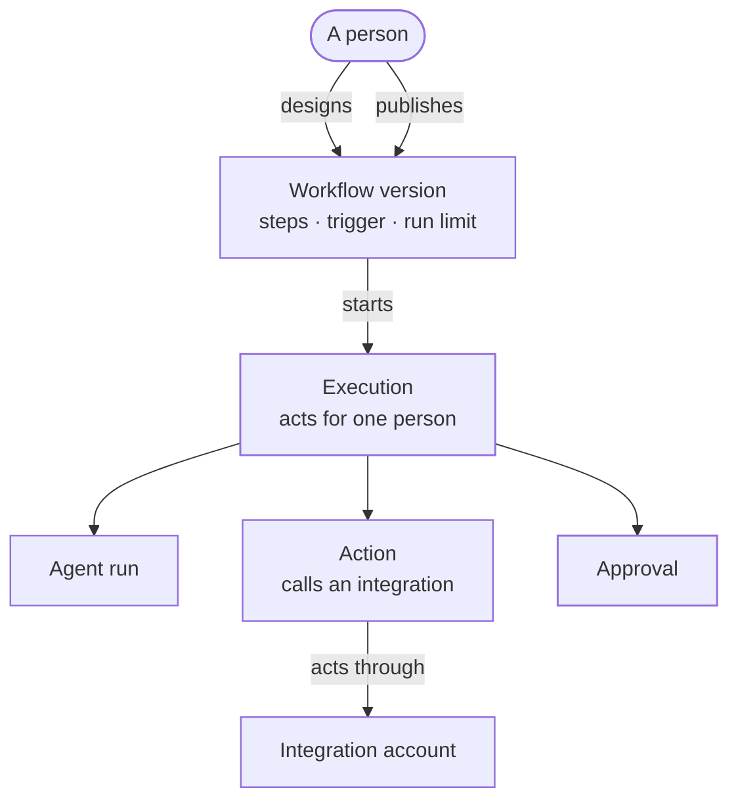

A version holds up to 64 steps and 256 edges. The steps are:

| Step | What it does |
|---|---|
| Agent run | Starts a governed agent run, capped at 50 steps or fewer, and at what its model may spend when the author sets that |
| Action | Calls one operation of an integration |
| Condition | Decides which way to go on, from up to 32 clauses |
| Transform | Builds new data from its input |
| Approval | Waits for one or two people to approve, for at most 7 days |
| Wait | Pauses for a set time, at most 30 days, or until working hours begin |
| Loop | Runs its own steps once for each item of a list, at most 1,000 items and 10 at a time |
| Guardrail | Checks a text from an earlier step for personal data, attempts to trick a model and banned words, before the run goes on |

A wait may wait for **working hours** instead of a set time: days of the week and a time they open and close, on the clock of one time zone, such as Monday to Friday, `09:00` to `17:00` in `Europe/Berlin`. A run reaching it while the hours are on goes on at once. One reaching it on a Saturday night waits until Monday at 9:00 Berlin time, summer time included. Hours open and close on the same day, and a wait for them lasts at most eight days.

An agent run's **spending cap** is the most its model calls may cost, in millionths of the tenant's billing currency (`spend_cap_micros`). Ann caps her order summary at two units. Once its calls cost more, the run stops as over budget and the step fails with it, so a runaway agent cannot spend without end. A provider with no price, or one that reports no usage, stops a capped run after its first call, since its spend cannot be counted. A cap of nothing is refused. A step with no cap has no spending limit. A step may also name an amount below its cap (`ask_past_micros`) past which its run pauses until a person lets it go on, as any agent run's may. An agent flow's runs take the same cap and amount.

An agent run step may **check another agent's work** (`checks`, the key of an earlier agent step). Pat's workflow has the Triage bot propose a fix and the Code reviewer check it. The checking run is asked, after its instruction and the work it is given, to start its answer with one line: `OK` if the work holds, or `NOT OK` if it does not, then its reasons. Its step hands on the whole `answer`, the `verdict` (`ok`, `not_ok`, or `unclear` when the first line says neither) and the `notes` after it, so a condition after it can send a disagreement to a person. A checking step is given no tool, so it judges and does nothing else. Publishing refuses a check of a step that does not come before it, or of a step run by the same agent, which would only agree with itself.

## Loops

A loop runs a group of steps once for each item of a list an earlier step gave back, such as each issue a search found. Each run of the group is a **pass**, an execution of its own. So every rule an execution keeps holds inside a pass too: its approvals, its retries, its time limit and its audit trail.

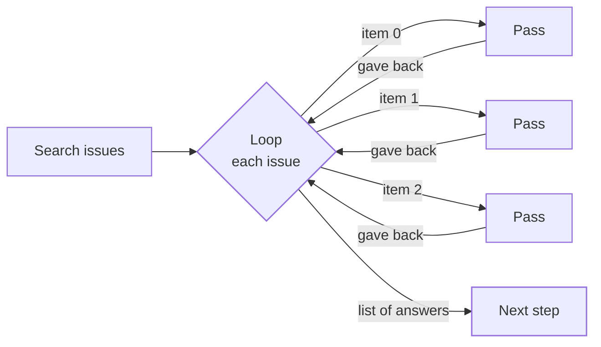

- **What a pass starts with.** A step inside the loop finds its item at `trigger.item` and its position, counted from 0, at `trigger.index`. The loop may also map fields of its own input for every pass, found beside them. Nothing else from before the loop reaches a pass, and a step inside may not read a step outside.
- **What the loop gives back.** A list with one entry per item, in the order of the items. Each entry holds the output of the pass's last steps, under their keys.
- **Who it acts for.** A pass acts for the same person as the run that started it, under the same version, chain and deadline, with the data class the loop step was handed.
- **How many.** The loop names the most items its list may hold, at most 1,000. A longer list fails the loop before any pass starts, so no item is left out unnoticed. A value that is no list fails it too, and an empty list gives back an empty list at once. The loop also names how many passes run at the same time, from 1 to 10.
- **When a pass fails.** The loop fails, naming the item, and so does the run. The passes still running are stopped and end as `loop_ended`. When the run ends for any other reason, such as being cancelled or running out of time, its running passes are stopped the same way.
- **Approvals.** A high-risk action inside a loop needs its approval inside the loop, right before it. Each pass then asks for it about its own item, unless the approval covers the whole loop (below). An approval before the loop does not count.
- **Limits on shape.** A loop holds no loop of its own. Step keys are unique across the whole workflow, the loop's own steps included.

A pass is never started again on its own: a failed run is started again as a whole. Lists of runs leave passes out. A run's passes are read through `GET /api/v1/organizations/{org_slug}/tenants/{tenant_slug}/workflows/executions/{execution_id}/passes`, and each pass names its run, its loop step and its item.

### One approval for the whole loop

An approval step inside a loop may say `covers: "whole_loop"` instead of the default `each_pass`. Then one approval, listing every item the loop will act on, is asked before any pass starts. Ann's loop closes 120 stale issues; Bob approves once instead of 120 times.

- **Where it sits.** Only as the loop's first step, with no step before it, and at most once per loop. What a pass's approval lets through is then the item, its position and the fields the loop maps, which is exactly what the list shows. Publishing refuses it outside a loop.
- **The items are fixed when it opens.** The list the loop was handed is kept with the approval. A loop started again opens a new approval over the list it gets then, and pages opened of the old list count for nothing, so nobody approves an item they were not shown.
- **Every page first.** The approver reads the items page by page through `GET …/executions/{execution_id}/approvals/{step}/items`, with the usual `after` and `limit`. Each page served is kept as opened by that person, and each answer says how many of the items they were shown so far (`shown` of `total`). A yes through `POST …/approvals/{step}/items/approve` counts only once every item was on a page they opened; before that it is refused with a plain message saying how many they have seen.
- **The same rules as any approval.** The right to approve and clearance for the data the loop was handed; never the person the run acts for; before a high-risk action, two different people who are not authors, each with a fresh second-factor `mfa_code`; nobody once the window closed. A Slack channel named on the step is asked too.
- **What is recorded.** `workflows.approval_granted` on the loop step, naming the approver, how many items there were, how many pages they opened and when they were shown the last item they had not seen.
- **A no, or no answer.** `POST …/approvals/{step}/deny` fails the loop, and the run, before any pass runs. A window that closes with nobody approving fails it the same way.
- **The passes.** Once approved, every pass goes through its approval step at once, under that approval, which holds in each pass for its window from the moment the pass starts. Each pass still checks it right before the high-risk action. A test stands in for the approval as for any other.

While it waits, the loop step's `passes.approval` reads `waiting`, and `given` once approved.

## Who an execution acts for

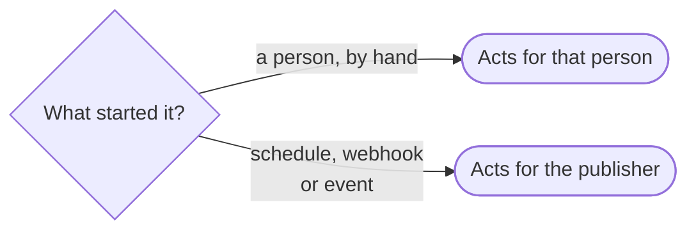

An execution starts only while that person may run workflows. One started by an event also needs the person to still see that event. Sam published a workflow on signing key events while he could read them. After he loses that right, the next key event does not start it.

When a schedule, webhook or event is refused this way, the refusal is recorded with its reason and colleagues are told. Ann published the nightly payroll run and then left. The next night the team hears that payroll did not start, so someone drafts and publishes it under their own name.

Nobody signs in when a schedule fires, so what the person holds is worked out from their account as the records hold it at that moment. That person may be a tenant user or a member of the organization that owns the tenant. A member's rights come from their tenant grants, so their workflows start only while those grants, their membership and the organization still let them in. Acme's organization is suspended and Sam is not one of its owners, so his nightly export does not start, just as his keys stop working.

Every later agent run or action acts for the person the execution acts for, with what they hold at that step, however long ago it started and whoever started it. Bob starts Ann's workflow by hand and is then shut out. An approval resumes it the next day, and its next step finds Bob holds nothing and stops. Ann's account never stands in for his.

## Webhooks and their secret

A workflow that starts on its webhook starts only when the call carries the webhook's secret. Someone who may update workflows issues the secret. It is shown to them once, and only its hash is kept. They may replace it, so a call with the old one starts nothing more, or revoke it, so the webhook starts nothing until a new one is issued.

A run started this way acts for the person who published the version in service. So the secret starts a version only when the person who issued it, or last replaced it, published that version. Sam may edit workflows. He cannot issue a secret for Ann's webhook workflow and start runs that act for Ann whenever he likes. When someone else publishes the next version, they issue a new secret, and so take on what it starts.

The webhook is `POST /api/v1/organizations/{org_slug}/tenants/{tenant_slug}/workflows/triggers/{trigger_id}`, with the secret in the `Ianua-Trigger-Secret` header and the run's data as the JSON body. It needs no session and is limited per client address. Every call that is not let in gets the same `401`: an unknown webhook, a wrong or missing secret, no version in service, or a version someone other than the secret's issuer published. A caller without the secret learns nothing about the workflow behind the address. A call that is let in answers `202`, with the new run, or with the reason the publisher may not start it now.

## Service events

A workflow may start on an event an outside service sends, such as an issue opened in a GitHub repository. Its trigger names the integration, the event, the account to watch through and the event's filters, such as the repository. Publishing the version registers the trigger at the service through that account, and archiving it removes the registration. Each registration has its own address and its own secret, which the service signs every delivery with.

A delivery starts the version in service for its publisher, as a webhook call does. Pat opens an issue in acme/web, so GitHub's signed delivery starts Ann's workflow with the issue's number and title. Mallory posts the same delivery signed with a secret of her own, and nothing starts. GitHub sends the delivery again, unsure it arrived, and nothing more starts. [Integrations](/ianua/architecture/infrastructure/integrations/#starting-on-a-services-events) lists the events each service offers.

## Rules that run before a change

A workflow may start **before** a change happens in the tenant, and decide it. Ann wants no one made an admin on a weekend: her workflow starts before an admin role is given, checks the day, and ends in Allow or Refuse. The changes a rule may decide:

| Change | When it is asked |
|---|---|
| `access_given` | Someone is added to a group |
| `admin_given` | A role holding a built-in permission reaches someone: given to a person or a group, offered in an invitation, named at registration, met by joining a group that carries it, gained by a role people hold, or handed to every new user |
| `app_opened_to_workflows` | An app is opened to workflows |
| `audit_exported` | An export of the tenant's audit trail is asked for |

The change waits while every published rule on it runs, for its publisher as an event workflow does, handed what the change would do: the group and the member, the role and the holder, the app, or the export's format and who asked. For `admin_given` the holder names a person, `group:` and the group's id, `every_holder` when a role people hold gains a built-in permission, or `every_new_user` when such a role becomes one every new user gets. The change goes ahead only when every rule ends in the company step `allow`. A rule that ends in `refuse`, ends without deciding, may not start, or does not decide within 10 seconds refuses the change with `403` (the person is told a company rule refused it). With no rule on a change, it goes ahead as before, and the change is still checked against the caller's rights either way. Each rule's run is kept the moment it starts, so it shows among the workflow's runs whether the change then goes ahead or not.

Publishing refuses a rule that could end without deciding: every step with no step after it must be `allow` or `refuse`. It also refuses approval, wait, agent and code steps in a rule, since none can answer while a change waits.

## Chains of workflows

A workflow started by another workflow's event continues that chain. A chain holds at most three executions, the first included, so workflows cannot set each other off without end.

## Who may change a workflow

| Action | Workflow right |
|---|---|
| Create a workflow | Create |
| Rename a draft, replace its steps, change its trigger or run limit | Update |
| Describe a draft, choose who hears of its failed runs, move its steps on the canvas | Update |
| Ask the tenant's model to suggest steps | Update |
| Fill a step form's list through an account | Update, through an account they own or may manage |
| Test a draft | Update and Run |
| Publish a draft | Update |
| Archive a version | Delete |
| Start the next draft of a version | Create |
| Issue, replace or revoke a webhook's secret | Update |
| Raise or change an operation's risk | Update |
| Remove a risk override | Manage |
| Connect an integration account | Connect accounts |
| Start a run by hand, or start a failed run again | Run |
| Make an agent flow | Create and Run |
| Approve or deny a step | Approve |
| Cancel an execution or a flow that acts for someone else | Manage |
| Delete someone else's agent flow | Delete |

Reading workflows, their runs and flows needs the View right. Sam may only view workflows. He cannot rewrite Ann's draft, and he cannot cancel her payroll run halfway. Ann may cancel any run that acts for her, and delete any flow she made once its run has ended.

A right that does not depend on the record is checked before the record is read, so someone without it is refused with `403` for a real id and a made-up one alike: deciding an approval step, restarting a run, changing or removing a risk override. Where who may act depends on the record, a record someone may not act on reads as missing, with `404`, the same as an id that never existed. Sam may run workflows but not manage them. Ann's run, Ann's flow and Ann's integration account all read as missing to him when he tries to cancel, delete or change them.

## Publishing

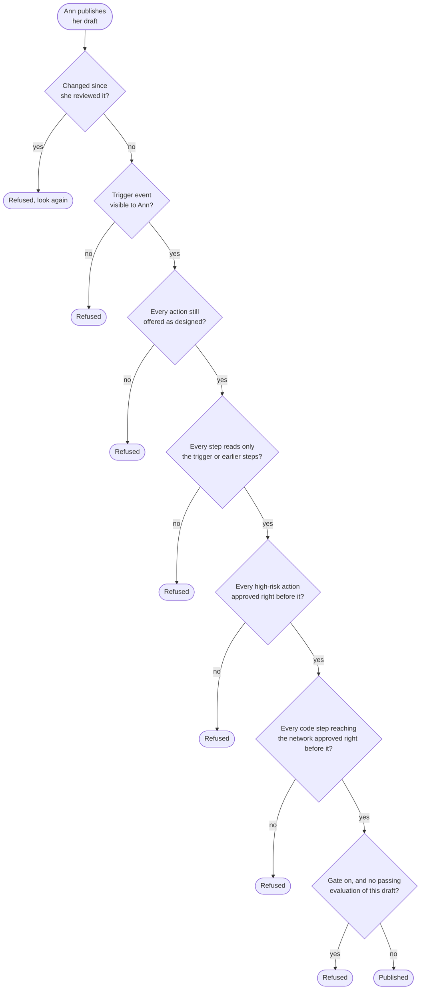

Publishing a new version takes the one it replaces out of service in the same step, so a workflow has one version in service and its trigger never starts two. Runs already going finish on the version they started with.

A version runs with its publisher's authority, so the publisher names the revision they reviewed. Bob edits Ann's draft just before she publishes, so a step pays him through her account. The draft differs from the revision Ann reviewed, so publishing is refused and she sees his change.

High risk means moving money, deleting, administering, configuring, or not saying what it does. Its approval must name the action's class, or name no class at all. Between such an action and its approval there is nothing that waits, runs an agent or calls another integration, so what people approved is what runs, while it is still current. A version also never reads a step that cannot come before it.

## One action, start to finish

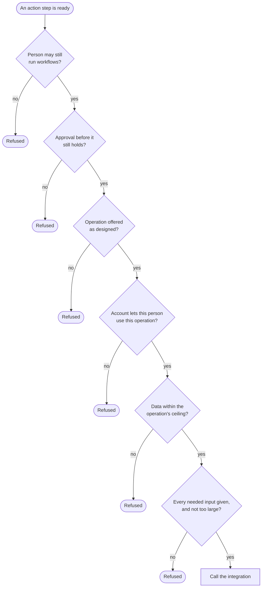

Every refusal fails the step with a record and calls nothing.

An integration may turn a call away because it is down, busy or limiting the rate, and did nothing. The step is then ready again with the same input. It may call again 30 seconds later, and 2 minutes after a second refusal. Each new try asks every question above again, so if Ann left in between, the call is not made. After three tries, or when the next one would fall after the execution's deadline, the step fails. A call that may have acted is reported as failed, never turned away, so nothing is done twice.

An approval holds until its decision window closes, or for 15 minutes after it was given if that is later, and never past the execution's own deadline.

The data an execution holds carries a class, the most sensitive thing it has read. Each step's output carries the most sensitive of its input and what it read, so the class only rises. An action is never handed data above what its operation may receive. Company steps take data up to confidential whatever the limits on outside services are, because they act on the tenant's own records and send nothing out.

## Who may decide a step

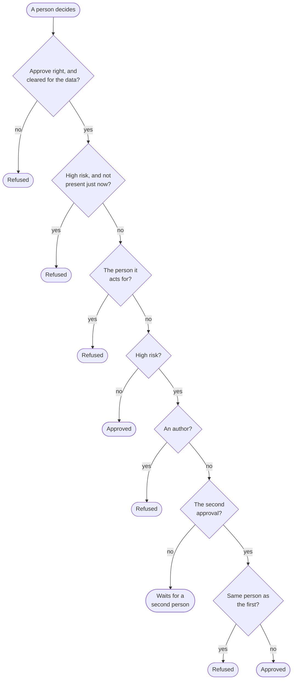

An approver's clearance and presence come from proofs, never from what the request says. Everyone in a tenant is cleared for internal data. Only the data access rights a role or an active break-glass grant gives clear someone for confidential or restricted data, and restricted covers confidential. An approver of a high-risk step counts as present only with a fresh code from their own second factor, sent with the approval. Someone with no second factor cannot approve a high-risk step at all. Mallory holds Sam's session and tries to approve with a code from Ann's authenticator. It is refused, so the stolen session approves no high-risk step.

The approver is shown the step's data, the amount and the payee, not just its label, and the approval counts only for that data. The second approval of a high-risk step must come from a different person than the first, through any of their accounts. Denying needs the same right and clearance as approving, and fails the execution.

A finished approval records who gave it and when the last approval came. A stored run is read back only if that record could have come from approving: one person on a step that needs one, two different people on a step that needs two, never the person the run acts for, and no author on a step that needs two. It also holds no longer than its window or 15 minutes after it was given, whichever is longer, and never from before the run started. Mallory edits a stored run so an old approval covers a payment for another hour. The run is refused as corrupt, and the payment is never made.

An approval step may also ask in a Slack channel, through one of the tenant's connected Slack accounts (`slack: {account_id, channel}` on the step). When the step opens, a background job posts its summary to the channel with Approve and Deny buttons. The buttons only open the approval in the dashboard: a press counts once the person has signed in there and decided, under every rule above. Bob approves payments from the finance channel; Mallory, who reads the channel, decides nothing by pressing. A post Slack refuses, or an account no longer there, is logged and left: the approval stays open in the platform's inbox either way.

## Integration accounts

An account holds the credential an action acts through. The credential is sealed before it is stored and opened only for the call that uses it, so the database never holds it in clear. Its owner is always the person who connected it. Only the owner widens what it allows: sharing it with the tenant, changing its operations, replacing its credential or turning it back on. They also need the right to connect accounts to do it.

An account is lent to a run only while it is active and its owner may still lend accounts, and only for an operation its scope allows. One kept to its owner is lent only to runs that act for the owner's own account. What it lends covers one account, one operation and one person, and an action step takes it only when all three match the step and its run. What the owner holds is worked out from their own account as it stands, even while they are signed out. Ann shares her account and then loses the right to connect accounts, or leaves. From then on it acts for nobody.

To stop a leaked credential quickly, the owner or anyone allowed to connect accounts may disable an account or keep it to its owner. Either of them may also rename it.

A credential is tried before it is kept. When Tess connects the team's GitHub token, or replaces it, GitHub is asked about it first. A token GitHub refuses is never kept, so a typo shows up at once instead of in every run that uses it. When GitHub cannot be asked, the token is not kept either, since nothing vouched for it. An integration with no service of its own, such as the HTTP request step, keeps the credential unchecked. Sam, who may not connect accounts, or who does not own the account he tries to change, is refused before any service is asked, so he cannot use the platform to test tokens.

Where the deployment has registered an app with a service, Tess may connect an account by signing in there instead of pasting a token. Only Tess, who began the sign-in, can finish it, and the credential the service issues is tried before it is kept, as a pasted one is.

A version in service needs every account it acts through. When one is disabled, removed, kept from its publisher or no longer allowed for a step, the version is held, and the workflow says which account it needs and why. It starts nothing until someone publishes a next version with an account that works. Ann's workflow comments on new GitHub issues through Tess's account. Tess disables the account after a leak, so Ann's workflow is held and Ann is told, instead of every new issue failing a run.

## Calling a protected app as the run's person

A Protected apps step calls one of the tenant's own apps behind the gateway. It does not use an account: it acts as the person the run acts for. Pat runs a workflow that reads order 7 from Acme's orders app. The gateway sees Pat, and the orders app's own rules decide whether Pat may read it, exactly as if Pat had signed in.

The step must name the app's route, and that route must be open to workflows. Every route starts closed. Tess, who may change routing, opens the orders route, and closing it stops every such call from the next request on. Each call carries a pass made just for it, for Pat and that one route, which lapses after a minute. A pass made for the orders route opens no other app. If Pat is deactivated mid-run, the next call is refused. A run acting for an organization member, who holds no account in the tenant, is refused.

## Reading a protected database as the run's person

A Protected data step reaches one of the tenant's own databases behind the gateway, through a stream route. It also acts as the person the run acts for. Pat runs a workflow that reads yesterday's orders from Acme's orders database. The gateway sees Pat, and the stream route's own access decides whether Pat may reach it, as if Pat came through the signed-in tunnel.

The step must name the stream route, and that route must be open to workflows. Every stream route starts closed. Tess, who may change routing, opens it with a login of the database, such as a user made for workflows that may only read. Only a stream route that lets people in can be opened. The password is kept sealed for that route, where the gateway never reads it, and closing the route forgets it. Each call carries a pass made just for it, for Pat and that one stream route, lapsing after a minute.

The login also says how the connection is protected. TLS runs from the worker to the database itself, checked against the database's own certificate, unless Tess turns it off for a database that serves none. A database without the TLS asked for is refused, never spoken to in the clear.

What a step may do once through is what the login may do, decided by the database itself. Postgres, MySQL, Redis and MongoDB are offered. Postgres's and MySQL's `query` run in a read-only transaction, so the database refuses a change however the statement is written. Redis and MongoDB have no such mode, so their reads check what they are asked: a Redis read takes only commands that read, and a MongoDB aggregate refuses the stages that write. An `execute`, or any other step that may change data, counts as a write and needs an approval where one is asked for.

## What a builder is shown

Each integration presents itself with a title, a description, an icon and a brand colour. The colour must be dark enough that a white logo on it stays readable. Each operation comes with a guide: a title, what it does, what each input means, and the values it gives back for later steps. GitHub's "open an issue" gives back the issue's number at `json.number`, which a comment step can read. A guide only explains. Whether a step fits its operation is decided by the operation alone, so rewording a guide never changes a published workflow.

Each input also says how the builder asks for it, from a fixed set of blocks: a line of text, a longer text, a number, a switch, a date and time, names and values, a choice of two to eight options, or a list to pick from. Options carry a tone, such as a calm one for "not planned". An input may be folded under more options, show an example while empty, or carry a warning. A required input is never folded away. An integration only names blocks, tones and styles. The dashboard draws them in its own theme, so no integration can make a field unreadable.

A list to pick from is filled live by one of the integration's own reads. When Ann opens GitHub's "open an issue" form, the repository list comes from her account's repositories, and once she picks `acme/web` the labels list comes from that repository's labels. A list is only filled by an operation declared as a read, checked again before every call, so a form can never make a change at the service. Only the account's owner, or someone who may connect accounts, fills a list through it. Anyone else types the value. A list holds at most 200 options. When the service gives no list, the builder shows what it said and Ann types the value instead.

Some operations come with a preview that looks like the product they act in: a chat message, an issue, a ticket's status, a calendar event, an email or a text message. The preview names which input fills each part, such as the title and the labels of an issue. An integration whose form or preview breaks these rules is refused when the platform starts.

## Building a workflow

The builder reads, for each step of a draft, what it may read: the trigger's data first, then each step that can come before it, each value at the path an input names, such as `trigger.issue.title`. A value whose shape only a run shows is marked as such.

Ann may also describe what she wants in a sentence, such as "when an issue is labelled bug, post it to #team". The tenant's own model provider proposes steps, either a whole new workflow or what comes after one step of her draft. Every proposed step is checked against what the integrations offer now. One that fits nothing is left out with a note saying so, never invented. Nothing is saved. The builder places what Ann keeps and saves it as a draft, where the publish rules hold it like any other.

Where each step sits on the canvas is kept with the draft. Moving steps records nothing and keeps the draft's revision, since no run changes because of it.

Whoever has a draft open is told at once when someone else changes it, and whoever watches a run sees each step start and end as it happens. Both are live streams over a WebSocket, under `/api/v1/organizations/{org_slug}/tenants/{tenant_slug}/ws/workflows/`: `{workflow_id}/draft` for a draft and `executions/{execution_id}` for a run. Neither stream carries data: the builder reads the draft or the run again, as the reader may see it. A stream closes once its reader may no longer see what it shows.

## Testing a draft

Ann may test her draft, or the version in service, on example data before she publishes. Nothing outside changes. Every step that writes, sends, deletes or has no declared effect, every agent run, approval and wait, and code that may reach the network answers at once with a stand-in. The stand-in says it stood in and what it would have used. Reads, conditions, transforms and code with no network run for real, so Ann sees real data flow through her steps.

A test is kept apart from real runs. It is listed only among tests, is never the latest run of a workflow, may not be started again, and tells nobody when it fails. Its failed steps and its end are recorded in the audit trail only.

## Evaluations

Ann saves sample cases for her workflow: each a name, an input, how sensitive that input is, and one to ten checks of the results. A workflow keeps one set of up to 50 cases across its versions, so the cases written for version 3 try version 4 too. A check reads a path the way a step reads its input, such as `trigger` or `summarise.answer`, and expects the value there to equal a value exactly, to contain a text, or to match a short pattern where `*` stands for any run of characters and `?` for any one. Checks are decided by the data alone, so the same draft always comes out the same way.

An evaluation tries the latest version, as it stands, against every case. Each case runs as a test of the draft, so nothing outside changes, at most five at once while the others wait their turn. Each case ends one of three ways:

- **Passed:** its test succeeded and every check held.
- **Failed:** its test did not succeed, or a check did not hold. The evaluation says which check and what it found there, cut to 500 characters.
- **Not run:** its test was refused, the person who started the evaluation may no longer test workflows, the draft changed while the case waited, or the hour an evaluation may take ran out.

The evaluation passes only when every case passed. Its cases' tests act for whoever started it, as they hold rights at the moment each case starts. Bob starts one and then loses the right to change workflows, so the cases still waiting do not run.

A set may hold publishing back until the draft's last evaluation passed: that evaluation must have tried the draft as it stands now. The gate is off unless the author turns it on. Bob changes a step after Ann's evaluation passed, so with the gate on, publishing is refused until the draft is evaluated again.

Someone who may view workflows reads sets and evaluations. A case whose input is above their clearance shows only its name, and a failed case whose test held data above their clearance shows that it failed but not what it found. Starting an evaluation needs the rights to change and to run workflows. An ended evaluation is kept for 30 days.

Grading an answer with a model, and evaluating an agent on its own outside a workflow, are not built yet.

## Who hears of a failed run

A failed run tells the tenant's administrators. A version may also tell its authors, the people who wrote part of it. Ann's payroll workflow tells its authors, so when a run fails, Ann and Bob, who both edited it, are told as well. A run carries the choice of the version it ran, so changing it later does not change who heard of an earlier failure.

## Risk overrides

An integration declares how risky each of its operations is, and the domain cannot check it told the truth. A tenant may know better: "update row" in its finance sheet moves money. It raises that operation's class for itself.

An override only raises. What a workflow sees is the stricter of the two, so no override makes an operation look safer. A risk raised after a version was published makes its step refuse rather than run unapproved. Removing an override lowers the risk again, so only someone with full control of workflows may do it.

## Memories

A memory is a named store of texts that workflow steps keep and search by meaning. Acme keeps each support ticket in its "Support tickets" memory, and when a new one comes in, a step finds the three past tickets most like it for the agent answering it. "Refund please" finds "I want my money back" though they share no word.

Each text kept is turned into a vector, a list of numbers, by an embedding model, and a search finds the texts whose vectors are nearest. A vector only means something beside vectors the same model made, so a memory keeps its embedding model and the length of its vectors from the day it is made. The model comes from one of two places:

- **The tenant's model provider.** A provider that speaks OpenAI's API, OpenAI itself or a self-hosted server such as Ollama or vLLM, may offer an embedding model beside its chat model, such as `text-embedding-3-small`, at the same endpoint with the same key. Anthropic's API has no embeddings endpoint, so an Anthropic provider offers none. A provider must be cleared for data as sensitive as the memory may hold, since every text kept is sent to it.
- **The platform's own embedding server**, where the deployment runs one, for a tenant with no embedding model of its own.

If that model is no longer offered, the memory takes no new texts and finds nothing new, rather than mixing vectors that do not compare. Its texts stay.

Two steps use a memory, both under the built-in `memory` integration:

- **`remember`** keeps a text of up to 8,000 characters. It counts as a write. A text exposed to data more sensitive than the memory's clearance is refused, so a memory cleared for internal data never takes HR records.
- **`find-similar`** finds the texts most alike, from 1 to 20, three by default, each with its similarity from -1 to 1 and when it was kept (`kept_at`). Its answer counts as the most sensitive of the texts it found.

Company data never goes away by itself. A memory is never emptied because it sat idle or a limit was reached: once the tenant's memories hold as many texts as they may, a new text is refused and nothing kept is removed. Only someone who may delete workflows deletes a memory, typing its name to confirm. Before that, and through its waiting period, they can read its texts page by page, oldest first, each with how sensitive it may be and when it was kept, to keep a copy. After deletion a memory waits 30 days, taking no texts and finding nothing, and can be brought back with every text in that time. After that a sweep deletes it and its texts for good. Deleting the tenant deletes its memories with the rest of its data. Making, deleting, bringing back and the final deletion are each on the audit trail.

## Guardrails

A guardrail step checks a text from an earlier step before the run goes on with it. Pat's workflow has an agent draft a reply to a customer. A guardrail after it reads `draft.answer` and checks it, and only then does the reply go out.

It runs one or more of three checks:

- **Personal data.** Every field of the checked value that the tenant's own classification rules hold at a level or above, the same rules the gateway hides fields by. The level is confidential unless the author picks internal or restricted. Field paths are read from the checked value's own root, as from an app's answer. An agent's answer is one text with no fields inside, so the shapes personal data takes in free text are looked for too: an email address, a payment card number whose check digit holds, and an IBAN whose check digits hold. These count as confidential.
- **Attempts to trick a model.** A fixed, small set of known phrasings, such as "ignore all previous instructions", "reveal your system prompt" or "you are now an unfiltered model", and the markers a chat model reads as a new speaker, such as `<|im_start|>` or `[INST]`. Words are compared in any case, a few words apart at most. Like the gateway's prompt-injection rules, these catch known phrasing only: someone who rewords it is not caught.
- **Banned words.** The words and phrases the step names, up to 200, matched as whole words in any case: "guaranteed returns" matches "GUARANTEED returns!" but not "guaranteedreturns". They are kept on the step itself, so a run checks exactly the words reviewed when its version was published, and changing them is a new version.

The author picks what a finding does:

- **Stop** (the default): the step fails as `guardrail_found`, naming the checks that found something, and the run fails with it.
- **Remove**: what was found is taken out and the run goes on. A classified field is hidden as its rule says, removed, masked or replaced by the gateway's keyed digest. Anything found in a text is replaced by `***`.
- **Record**: the run goes on with the text as it was.

Every finding is recorded, whatever the step does: its kind, its check, the field it is in and, inside a text, the characters it covers. The text it matched is never recorded, so a card number the step kept out of the run stays out of the audit trail too. The step hands on `checked` (the value, with its findings taken out when it removes them), `findings` (the first 100) and `found` (how many in all). Its output counts as sensitive as its input, even with findings removed, since the checks catch what they know and no more.

A check that cannot run stops the run, whatever the author picked: the step fails as `guardrail_unchecked`, with `rules_unreadable` when the classification rules could not be read, or `no_text` when nothing stands where the step reads. Only a step that checks for personal data reads the rules. Publishing refuses a guardrail whose text starts at a condition, an approval or a wait, which hand nothing on to check. A guardrail runs for real in a test, since it changes nothing outside.

## The company's own steps

The built-in `ianua` integration offers steps that act on the company itself. Pat's workflow starts when Lee signs in from a risky place, signs Lee out everywhere and pauses Lee's agents. No account is connected: the platform makes each step itself, through the same action a person takes in the dashboard, as the person the run acts for.

Each step is that person coming through the run. The action asks again what they hold the moment it acts, so Pat's workflow can do no more than Pat could do by hand then. If Pat loses the right to manage people, the next step that needs it fails. Once the run has ended, nothing acts through it. A step is refused in the action's own words, and a store that does not answer turns the step away to be tried again; trying again finds only what is still left to do, such as the sessions not yet ended.

Every record a step makes names the person and the run: the audit log shows the session's end as Pat's, through that workflow run. An event a step raises continues the run's chain, so a workflow it sets off never loops for ever.

The steps:

- **People:** look up a person (`find-person`), invite one with a role (`invite-person`, mailing them a link to this tenant), suspend them (`suspend-person`, which locks the account), reset their two-step sign-in (`reset-two-step`), sign them out everywhere (`sign-out`), forget every device they remembered (`forget-devices`) and revoke the API keys they made (`revoke-keys`), pause one API key until someone resumes it (`pause-key`) or resume it (`resume-key`, an admin step, since it gives access back), tell the connected security tools their risk level or that their password or a device is compromised (`send-signal`), and put a notice in their inbox (`notify`, a title and an optional message, for a person who may view people). A person is named by their address or their user id.
- **Access:** list a group's members (`list-members`), add to or remove from a group (`add-to-group`, `remove-from-group`), take someone out of every group they are in directly (`remove-groups`), give someone named rights for a few minutes in an emergency (`break-glass`, with a reason, ending by itself), check whether they may do an action on a kind of thing or one of them (`check-access`, by the tenant's own permissions and relations), give access for a while (`grant-access`, a group membership of 1 to 720 hours that ends by itself), offer someone to ask to join a group (`offer-access`, a notice naming the group; someone still approves the request), remind someone every 1 to 168 hours until an access request is approved, denied, withdrawn or runs out (`remind-until-decided`, while the run lasts; each round sends one notice, and the step ends saying how the request ended), approve or deny an access request (`decide-request`) open an access review of a group (`open-review`, due in two weeks, access nobody answers for is kept), and suggest keep or remove beside people in an open review (`suggest-review`, a list of up to 500, each naming a `person` by address or user id or an `agent` by id, `keep` or `remove` as its `suggest`, and a one-line `reason`; for a person who may assign roles, never about their own access, and the reviewers still decide every one).
- **Agents:** pause an agent (`pause-agent`), end one of its runs (`end-agent-run`), list its recent runs with what they spent (`agent-actions`), take back every task it still holds and every task passed on from them (`revoke-agent-tasks`), and take one thing it was given, such as `calendar:abc123`, out of every task it holds (`narrow-agent`).
- **The platform:** count the recent requests to an app and how many were refused (`read-requests`), close an app to workflows (`close-app`), put an app in [attack mode](/ianua/domain-contexts/routing/#attack-mode) for 5 to 1440 minutes (`attack-mode`, giving back when it ends), search the audit trail (`search-audit`), ask for a [sealed export](/ianua/domain-contexts/audit/#sealed-files) of it as CSV or JSON, handing on its `export_id` (`make-audit-pack`), decide a guarded change in a [rule that runs before it](#rules-that-run-before-a-change) (`allow`, `refuse`), classify a field so the gateway masks it (`classify-field`), and hide the fields of some data the company classifies (`hide-fields`). Hiding follows the same rules the gateway applies to an app's answer: each field at the level asked for or above (confidential when none is named) is removed, masked or replaced by the gateway's own keyed fingerprint, as its rule says, with field paths read from the data's root. The data still counts as sensitive as it came, since what is left may hold something no rule names.

A step that changes who can do what, such as adding to a group, inviting someone with a role, breaking glass, suspending someone or closing an app, is an admin action, so publishing asks for an approval right before it. Steps that only narrow what someone may do, such as signing out, forgetting devices, revoking keys, pausing an agent or taking back its tasks, run at once. No step gives an agent more than it has.

## Sandboxes

A sandbox is a named recipe for a piece of code: its language, the code, the packages it uses and how much one run may take. Ann makes one called "Clean issue text" for Python. Its language never changes.

Each save is a new **version**, numbered from 1, that is never changed afterwards. A version holds:

- **The runtime.** Picked by the person saving it, of the sandbox's language: `python-3.11`, `python-3.12`, `python-3.13`, `node-20`, `node-22` or `node-24`.
- **The image.** The exact container image the platform offers that runtime in when the version is saved, named by its content, such as `python:3.13-slim@sha256:…`. The version runs in that image every time after. When the platform moves a runtime to a newer image, only versions saved later get it, so code already reviewed never changes under anyone.
- **The code.** At most 256 KiB, with no control character other than line breaks and tabs.
- **Its packages.** At most 50, each at one exact version, such as `requests` `2.31.0`. A range such as `>=2.0` is refused, and so is a package named twice. Python names are read as PyPI reads them, so `Requests_Toolbelt` is `requests-toolbelt`. JavaScript names follow npm's rules and its versions have three numbers.
- **Its limits.** How long one run may take, from 1 to 300 seconds, and its memory, from 64 to 2048 MiB.

A sandbox keeps at most 50 versions. An archived sandbox takes no new version.

**Code from a repository.** Instead of writing the code, Ann can import it from a file of her company's GitHub or GitLab repository, such as `scripts/tidy.py` on `main`. It is read through an account she connected herself, or one she may manage. The version keeps the file's text and the exact commit `main` pointed to then, never the branch, so a later change to `main` changes nothing that runs. Reading the version shows where it came from.

**Code to a repository.** Ann can push a copy of a saved version to a folder on an existing branch, through such an account: its code as `main.py` or `main.js`, and its pins as `requirements.txt` or `package.json`. Each file becomes a commit of its own. The version saved in the platform stays the one that runs. The push is recorded as `workflows.sandbox_version_pushed`, with the commit it became.

**Code written for you.** Ann can describe in words what the code should do, and the tenant's own model provider writes it in the sandbox's language. The model is told the names of the fields the code is handed, never their values, and only the packages Ann names. When a trial fails, its error can go back to the model to fix the code. Nothing is saved or run: Ann reads the code, saves it as a version and tries it.

**A version's bundle**

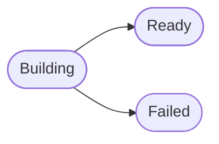

**Building a version's bundle.** Saving a version queues a `sandbox.build` job. The job fetches each package at its exact version and checks it against the fingerprint its registry published. It refuses, and fails the version naming the package, when:

- the package or its version does not exist,
- what was fetched does not match its fingerprint,
- an npm package has an install script (`preinstall`, `install`, `postinstall`) or native code to compile,
- a Python package has no wheel that runs on every platform (`py3-none-any`); source packages are never built,
- a package says it does not run under the version's runtime: a Python package's `requires_python`, or an npm package's `engines.node`. A range written in a form not read is taken as saying nothing,
- an archive is broken, or a path in it climbs out of its folder or is a link,
- the bundle would hold more than 200 MiB or 50,000 files.

Nothing a package holds runs while it is built. A package a pinned one says it needs, but that the version does not pin, is not fetched: the version names it among its `unlisted` packages, so it can be pinned in the next version. When the registry cannot be reached, the job tries again later, and fails the version as `registry_unavailable` after its last try. A ready version's bundle is kept in the tenant's files with its SHA-256, and is removed with the tenant.

**A code step** runs one sandbox version's code. It names the version, never the sandbox, so what runs is what was reviewed. Publishing is refused while a code step's version is gone, still building, failed, or of an archived sandbox. The step hands the code only the fields it maps, as one JSON object:

- Python defines `def main(input):` and returns a value.
- JavaScript exports one function, `module.exports = (input) => ...`, which may be async.

What the code returns is the step's output, at the sensitivity of its input, since the code reads nothing else. An object's fields come back in name order, as an integration's answer does. What it prints goes to the error stream, never into the answer.

Each run gets a container of its own, started by a `workflow.run_code` job. The container:

- reaches no network, unless its version names allowed hosts (see below),
- has a read-only root and only a small `/tmp` that runs nothing,
- runs as nobody, with no capabilities and no way to gain any,
- is held to the version's memory with no swap, one CPU and 128 processes.

The version's code and bundle are mounted read-only. The container is removed when the run ends. The step fails as:

- `code_raised` when the code raised an error, with the end of what it wrote,
- `code_timed_out` when it ran past its limit,
- `code_out_of_memory` when it used more memory than it was given,
- `code_output_unreadable` when what it returned was no JSON, or more than workflow data may hold,
- `code_not_run` when the version is gone, no code runs on this deployment, the version names allowed hosts and the deployment gives code no network, or no container could be started. A container that cannot start is asked for again every 30 seconds, up to 30 tries.

**Allowed hosts.** A version may name up to 20 hosts its code may reach, by their exact DNS names, such as `api.github.com`. A wildcard, a port or an address written as numbers is refused. The hosts are kept with the version, so changing them makes a new version, and the record of the save names them. Each run of such a version reaches those hosts, and nothing else, through the platform's network filter:

- only over an encrypted connection to the host's port 443,
- only when every address the host's name leads to is public, never a private, loopback or cloud metadata address,
- with a ticket naming exactly the version's hosts, which ends when the run's time does.

The container itself still has no route out: it reaches the filter and nothing else. The filter is set as the code's proxy, which Python and Node (with `NODE_USE_ENV_PROXY`, set for it) use. A version that names no hosts reaches no network at all.

A code step whose version names allowed hosts may change something outside, as an action that does not say what it does may. So publishing refuses it unless an approval that declares no class sits right before it, inside the loop when the step is in a loop. That approval is high risk like any other: two different people give it, neither an author of the workflow nor the person the run acts for, each with a fresh code from their own second factor. A code step that reaches no network needs no approval.

**Trying a version.** Someone who may change workflows can try a built version of an active sandbox on sample input, before it goes in a workflow. A worker runs it in a sandbox of its own, as a code step would, with the same limits and allowed hosts. The trial answers at once as `running`; reading it later shows what the code gave back, or why it failed, with the same failure codes as a code step. Starting one is recorded as `workflows.sandbox_trial_started`, naming the hosts the version may reach. Each plan caps how many trials run at once. A trial is kept for a day after it ended, then removed; one whose run cannot find a sandbox is tried again, and ends as `code_not_run` after its last try.

A worker that stops in the middle runs the code again. For a version that reaches no network that is safe, since it changes nothing outside. A version that reaches its hosts may then call them twice, so its code should make a repeated call harmless. A step that already settled is never run again.

Code runs in one of three ways, as the operator sets it:

- **On one server**, through a container command such as `docker`, and in production under a container runtime such as gVisor's `runsc`. The worker then holds the container engine itself.
- **On one server, through the sandbox gate**, a separate process that is the only one holding the container engine. The worker can only ask it for a run: the runtime, the exact image, the version's limits and the run itself. The gate sets the container's locks alone, the same as above, and starts only the runtimes' own images. It refuses an ask a version could not hold, such as another image or longer limits. A container's unpacked packages sit in its memory, so it gets the version's memory plus room for them. The Docker Compose setup runs code this way.
- **On Kubernetes**, in a pod of its own in a namespace that holds nothing else, under a runtime class such as gVisor's. The pod holds no Kubernetes key, and the namespace's network policy lets nothing in or out. The worker hands the pod its bundle, code and input through the Kubernetes API, the pod reads exactly that many bytes, and the pod is deleted when the run ends. Each pod serves one run only. Once a runtime and memory size has run, each worker keeps a few pods of it started and waiting, so the next run of it does not wait for a pod to start; the first run of a new runtime or size still starts its own. Two workers never take the same waiting pod, and a pod left waiting too long is removed. One worker holds a fixed number of runs at once, and the namespace's quota bounds every worker's pods together, waiting ones included, so a burst of code steps waits its turn.

With none set up, every code step fails at once as `code_not_run`.

**A company's own image.** Some companies already have a program packed as a container image, such as Pat's code generator, written in neither Python nor JavaScript. A sandbox made with kind `image` runs such an image instead of code. It has no language, code or packages, and its kind never changes. The operator turns this on per installation with `SANDBOX_OWN_IMAGES`; it is off by default, and while it is off no image sandbox is made, no image version saved and no image version runs.

- **Only from allowed registries.** An administrator who may connect integration accounts allows a registry for the tenant, such as `registry.acme.example`, with the user and password or token its images are pulled with. The password is sealed before it is kept and is never shown again. A registry is on the list once. Removing it leaves the versions that name it as they are, but their next run fails as `code_not_run` until it is allowed again. Allowing and removing are recorded as `workflows.image_registry_allowed` and `workflows.image_registry_removed`, never with the login.
- **Pinned when saved.** Pat saves `registry.acme.example/tools/codegen:1.4`. The platform asks the registry, with its login, what that tag points to now, and the version keeps the digest, such as `registry.acme.example/tools/codegen@sha256:…`. A push to `1.4` next week changes nothing that runs. The registry's name must lead to public addresses only. An image over 2 GiB, counted as its registry counts its layers (for an image built for several systems, its largest Linux build), is refused, so every pull is bounded.
- **Scanned before it first runs.** Saving queues the same `sandbox.build` job, which scans the image for known vulnerabilities with the scanner the operator sets up (`IMAGE_SCAN_COMMAND`). One critical finding fails the version as `critical_vulnerabilities`, naming up to 20 of them; findings below critical are counted and shown beside the ready version. With no scanner set up, the version fails as `not_scanned`: nothing runs unscanned. A scanner that cannot scan is tried again, and the version fails as `scanner_unavailable` after the last try. A registry removed before the scan fails it as `registry_not_allowed`, and images turned off as `own_images_off`.
- **Run locked down as code is.** The image reads the step's mapped fields as JSON on its standard input, which is then closed, and writes its answer as JSON on its standard output. What it writes to its error stream becomes the failure's detail. It runs as its own entry point starts it, with no shell or `timeout` needed inside it, under the same locks as code: no network unless the version names allowed hosts (then only through the filter, with an approval before the step), a read-only root, no capabilities, running as nobody, the version's memory, and its answer read within the same bounds. It is stopped a moment after the version's time. Each run pulls the image again with the registry's login, within the start-up grace; an image that cannot be pulled fails the step as `code_not_run` at once. Through the gate, the gate takes images only from the registries the operator lists for it (`SANDBOX_GATE_TENANT_REGISTRIES`), beside the runtimes' own. On Kubernetes, each run's pod gets a pull secret of its own, deleted with the pod.

An image version is never pushed to a repository and never has code written for it.

**A version holding an agent.** A version may hold an agent instead of doing the work itself. Pat's team saves a version holding their reply agent, the rules it works under, and code that checks each reply: no internal names, no promise of a refund, under 200 words. The rules are kept with the version, like its image, so a step naming the version runs exactly what was reviewed, and changing a rule makes a new version. The record of the save names the agent. The rules say:

- which agent works, and with which of the tenant's model providers,
- its goal; the fields the step maps are added to it,
- its purpose, the action classes its calls may take, and the tools and integration steps it may call; with none, it only writes,
- which action classes wait for a person's approval; high-risk classes always do,
- how many steps it may take and how much it may spend, across every try. A spending cap is required. It may also pause for a person past a lower amount,
- how many answers it may give, from 1 to 3.

What the agent may read is what the step maps in and what its tools return. It starts at the sensitivity of the step's input, and a model provider cleared for less is never asked, as for any run.

A code step naming such a version starts a run of the agent, the same way an agent step does. The same questions come first: the agent may act, the person the run acts for still holds what it needs, and a live delegation from them backs a run with tools. Every tool call goes through the same call check and proxy decision as any agent run, deny by default. The run counts toward the plan's runs in flight, and waits for room as an agent step does.

When the agent answers, the version's code checks the answer in a sandbox of its own, with the version's limits and allowed hosts. It is handed `{"answer": "...", "try": 1}` and gives back `{"pass": true}`, or `{"pass": false, "broken": ["no promises of refunds"]}`. An answer that passes is the step's output, under `answer`. One that breaks a rule goes back to the agent with what the check said, and the agent answers again in the same run. A rule broken on the last try fails the run, and the step fails naming what the check said. A check that raises, runs past its time, gives back anything else, or cannot run at all fails the run at once, so no answer leaves unchecked. Every answer and every answer turned back is a step of the run, the second shown as `check_failed`.

Trying such a version runs its check on sample input, such as `{"answer": "Dear Pat, ...", "try": 1}`. To try the agent and its check together, run the workflow as a test.

Allowing or removing an image registry needs the right to connect integration accounts, and listing them the right to view workflows: `GET` and `POST …/sandboxes/registries` (a `host`, and a `username` and `password` together or neither), and `DELETE …/sandboxes/registries/{registry_id}`. Making an image sandbox takes `kind` `image` and no `language`; saving one of its versions takes `image` alone, with the limits and allowed hosts, and reads back with `kind` `image`, the pinned `image`, its `image_bytes` and, once ready, the counts of its `findings`.

Making a sandbox needs the right to create workflows, saving, trying or pushing a version or having code written the right to change them, archiving one the right to delete them, and reading them or a trial the right to view them. The endpoints are under `/api/v1/organizations/{org_slug}/tenants/{tenant_slug}/sandboxes`. `GET …/sandboxes/runtimes` lists the runtimes a new version may pick now, each with the image it would keep. Saving takes either `code` or `import` (an `account_id`, `repository`, `path` and `ref`), and may take `agent` beside either: its `agent_id`, `provider_id`, `goal`, `purpose`, `tools`, `approval_classes`, `max_steps`, `spend_cap_micros`, `ask_past_micros` and `tries`. A version of a company's image takes no `agent`. `POST …/sandboxes/{sandbox_id}/versions/{version_id}/trials` tries a version on its `input`, and `GET …/sandboxes/{sandbox_id}/trials/{trial_id}` reads the trial. `POST …/sandboxes/{sandbox_id}/versions/{version_id}/pushes` pushes a version to a `repository`, `branch` and `folder` through an `account_id`. `POST …/sandboxes/{sandbox_id}/suggestions` has the model at `provider_id` write code from `words`, with `fix` holding code that failed and what its trial said.

**Retiring a runtime.** The operator may retire a runtime, such as Python 3.11 at the end of its life. It is no longer offered for new versions, and a save under it is refused. Versions saved under it keep their image and still run, so no workflow breaks without someone changing it.

## Starting a failed run again

A run that failed or ran out of time can be started again in two ways:

| Way | Where it picks up |
|---|---|
| Re-run | From the trigger. Every step runs again |
| Retry | From the steps that did not finish. A step that finished for good, and every step that led to it, keeps what it produced |

Either way the failed run stays as it ended, for the audit trail, and a new run of the same version starts with the same trigger data. Only the person the failed run acted for may start it again, with the right to run workflows. The steps it keeps produced their outputs with that person's authority, and anyone else would read them. The new run acts for them with what they hold now, so a right they lost since does not come back through an old run. It is refused once the version it ran is no longer the one in service.

An approval is never kept. It is asked for again, so no action runs on a stale yes.

## Agent flows

An agent flow is a quick way to set a few agents to work. A person lays out stages of agent runs and starts them at once. A flow is a workflow, not a new kind of thing. It is made as one version, published as it is made and started by hand, so making one needs the rights to create and to run workflows. Its one run acts for its maker, and every rule above holds for it.

Each stage's runs start together. Between two stages, one step gathers every answer of the first stage and hands them to each run of the next, under the field `earlier`. A later run that sets `earlier` itself is refused, since the gathered answers would overwrite it. The gathering steps count towards the 64 steps a version holds. A flow's run may go on for at most a week, so the approvals its agents wait for have time.

A flow is never edited, drafted again or republished, and lists of designed workflows and their runs leave flows out. A failed flow is not started again: a new flow is made. Flows have their own endpoints under `/api/v1/organizations/{org_slug}/tenants/{tenant_slug}/flows`.

Listing flows and stopping one both answer where each flow's run stands, so a dashboard shows a flow still running without opening it:

| Field | What it holds |
|---|---|
| `status` | `Running`, `Completed`, `Failed` or `Canceled`. A run that ran out of time shows as `Failed`. Left out only for a flow with no run kept, as when its start failed halfway |
| `current_stage` | The first stage, counting from 0, with a run that has not finished, or the last stage once every run has. Left out when the reader is shown no run's steps |
| Each run's `status` | `Pending`, `Dispatched`, `Completed` or `Failed` |

Data above the reader's clearance is withheld, as when reading one run. The maker may always stop their own flow. If they may not view workflows, the answer shows only the flow's `status`, with no stage and no run's steps. Anyone else needs full control of workflows to stop it. Stopping a flow orders every agent run it leaves going to stop.

Once its run has ended, a flow may be deleted, and its run goes with it. Its maker may delete it, and so may someone who may delete workflows. A flow still running is refused until it is stopped, so no agent works on for a flow that is gone.

## Lifecycles

**A workflow version**

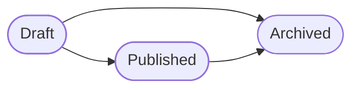

Only a draft is edited. A published version is followed by the next draft, and is left exactly as it was. Publishing that draft archives the version it replaces.

**An execution**

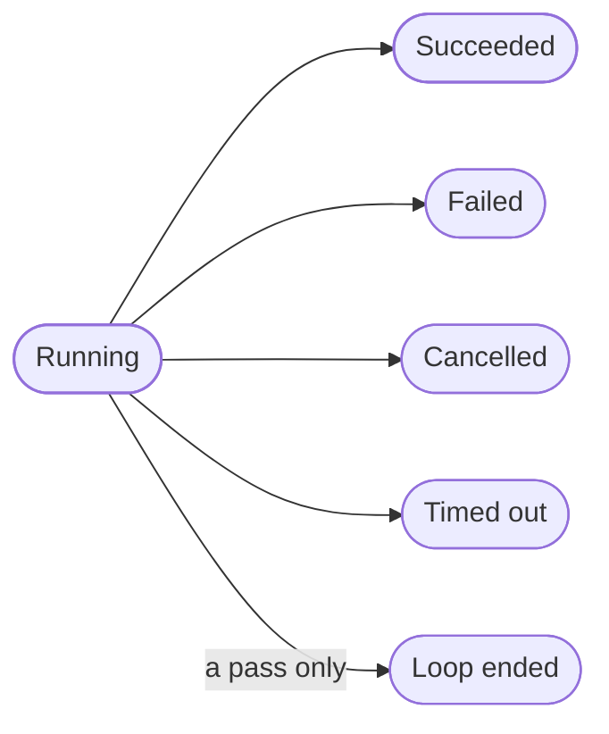

An execution may run at most 31 days, and less when its version says so. Only a pass ends as loop ended, when its loop failed or its run ended first.

An ended run is kept for 90 days, as `WORKFLOW_RUNS_KEPT_DAYS` sets, and an hourly sweep then removes it with its passes and what it waited on. A run still running or waiting stays however old, and a run that was started again stays until the run that picks up from it has gone. What a run did stays in the audit trail, which has its own retention. A deployment may not keep runs for fewer than 60 days, so a test run outlasts the evaluation that read it.

**A step**

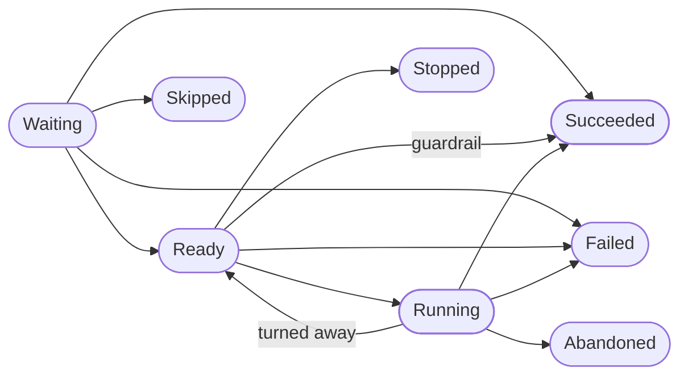

A step whose input would be too large fails straight from waiting. The domain does a condition's or a transform's work itself, so it goes straight from waiting to succeeded, or to failed when a transform's output is too large. An agent run, action, approval, wait, loop, code or guardrail step becomes ready and waits for work outside the domain. One refused before that work starts fails straight from ready. A guardrail goes straight from ready to succeeded or failed once the tenant's classification rules are read. An action whose call was turned away goes back to ready. A step no path reaches is skipped. A step ready when the execution ends never starts. A step whose work was under way is abandoned, and what came of that work is still recorded when it is reported.

**An evaluation**

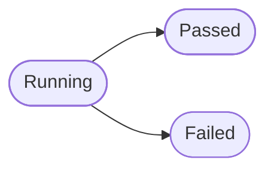

An evaluation ends once no case waits or runs, and within an hour. A case still waiting or running then could not run, so the evaluation fails.

**An integration account**

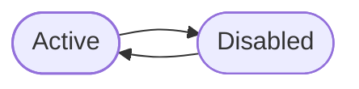

## Events

The context records an event when a workflow is created, a draft is renamed, described or has its steps, trigger, run limit or failure alert changed, a version is drafted, published, archived or held for an account it needs, a service registration is made, lapses or is removed, an agent flow is made or deleted, a webhook secret is issued, replaced or revoked, an execution starts and ends, a loop's pass starts and ends, a start is refused, a step starts, succeeds, fails, is skipped, put off for later, abandoned or stands in for a test, a test's step fails, a test ends, a workflow's sample cases are saved, an evaluation starts or ends, a guardrail finds something, an integration turns a call away, an approval is granted, an account is connected, changed, disabled or enabled, a sign-in to connect one begins or is refused, a service replaces an account's credential, an operation's risk is raised or an override removed, a sandbox is made or archived, or one of its versions is saved, built, fails to build, is tried or is pushed to a repository, and an image registry is allowed or removed.

Edits to a draft, flows made or deleted, sign-ins begun or refused, credentials a service replaced, registrations made or removed, steps starting, succeeding, being put off, skipped or abandoned, everything in a test, sample cases saved and evaluations started or ended, what guardrails find, calls turned away, executions starting, passes starting and ending, and sandbox versions saved, built, tried or pushed, happen often, so they stay in the audit trail and are kept out of colleagues' notifications. Everything else notifies, such as a refused start, a failed step, an ended execution or a newly published version.

## Uses and used by

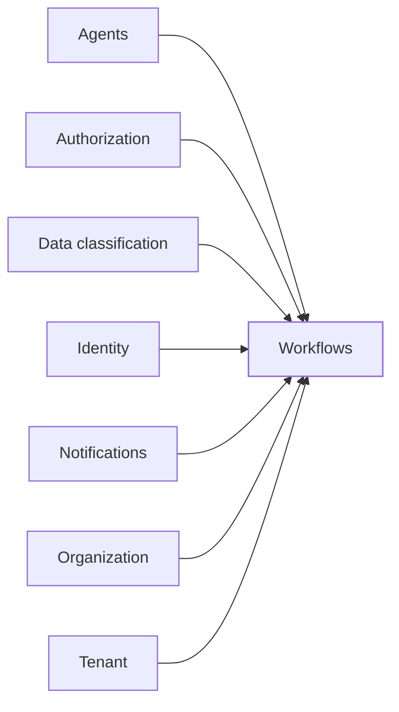

Workflows sits in the top layer. It builds on agents, authorization, data classification, identity, notifications, organization and tenant, and nothing else in the domain builds on it.
