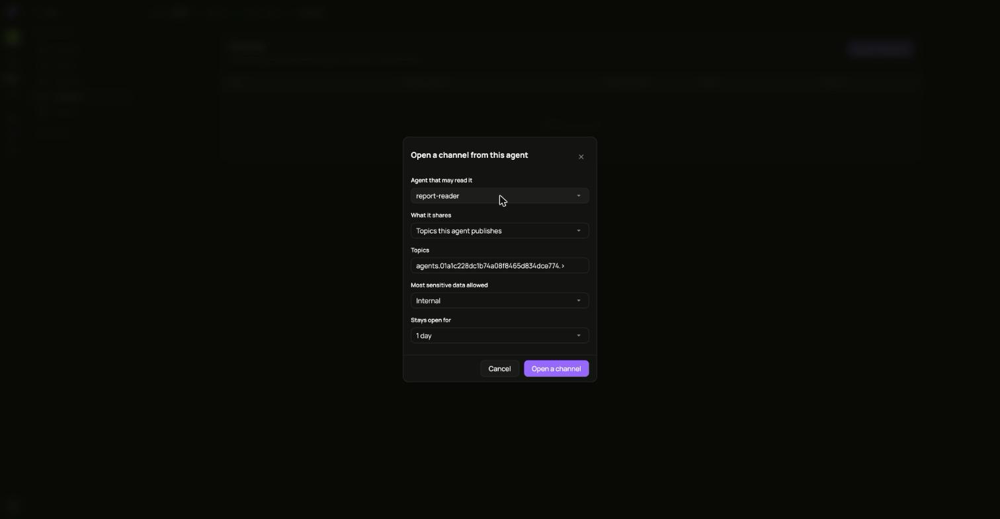
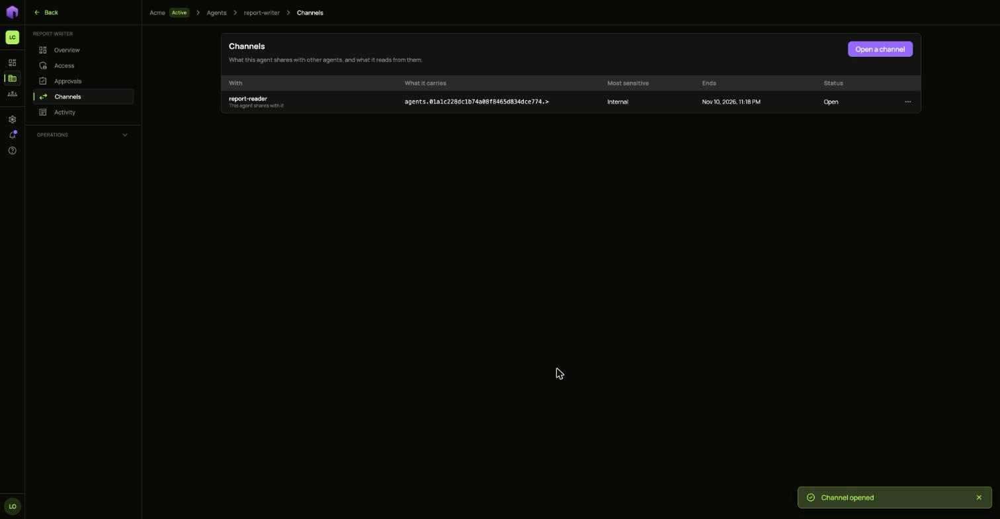

An agent reads its own area without help. To let another agent read it, open a channel. In this guide `report-writer` shares its reports with `report-reader`.

1. Open the agent that shares, then **Channels**, and choose **Open a channel**.
2. Under **Agent that may read it**, pick the other agent. Revoked agents are not offered.
3. Under **What it shares**, pick **Topics this agent publishes**, or a single resource.
4. Keep the **Topics** value that is filled in, or narrow it. A channel carries only topics in the sharing agent's own area.
5. Pick the **Most sensitive data allowed** and how long it **Stays open for**.
6. Choose **Open a channel**.

The channel appears with the other agent, what it carries and when it ends.

To end it early, open the row's **...** menu and choose **Close channel**.
