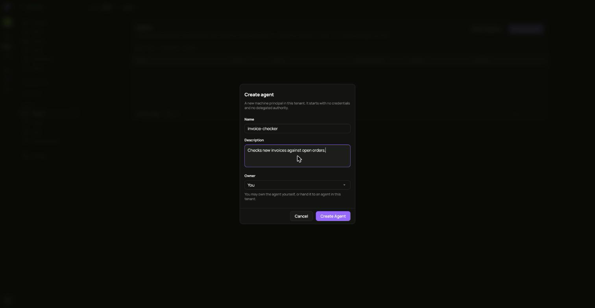
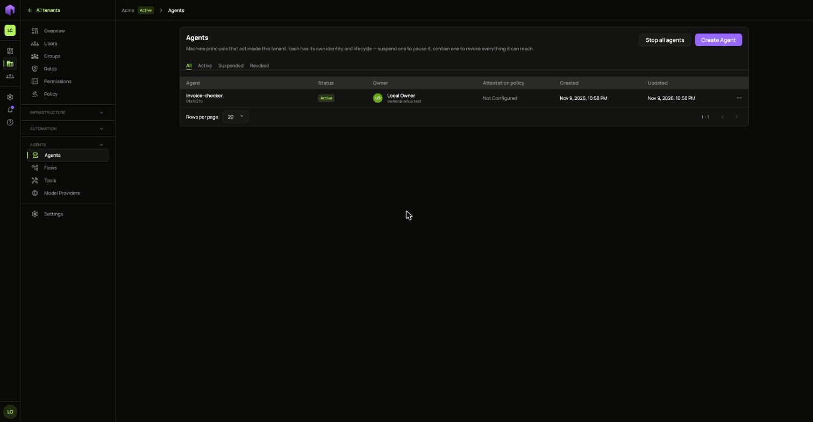
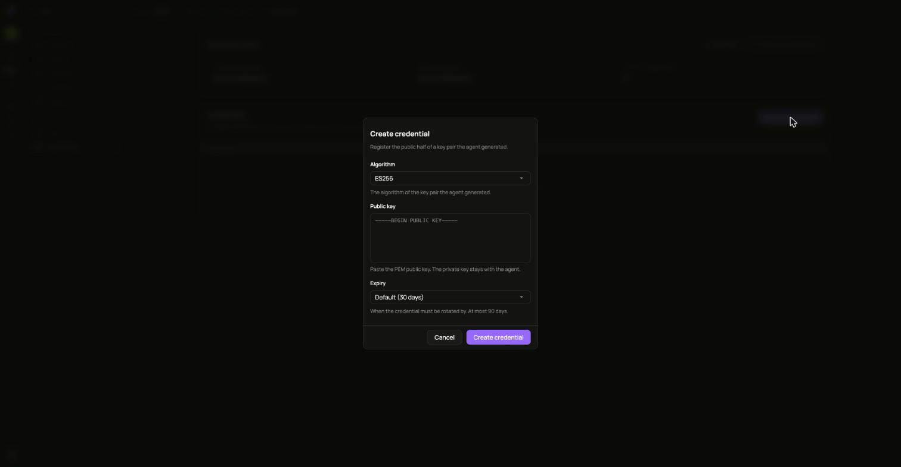
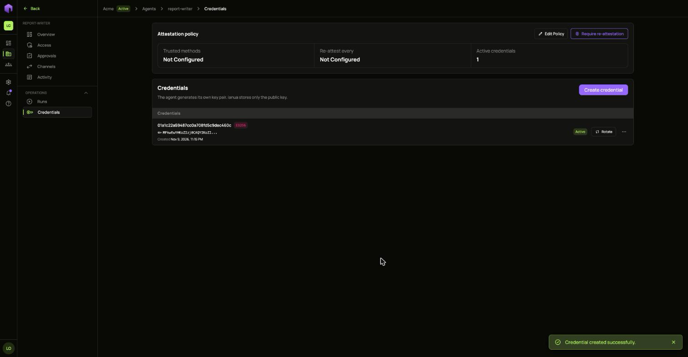
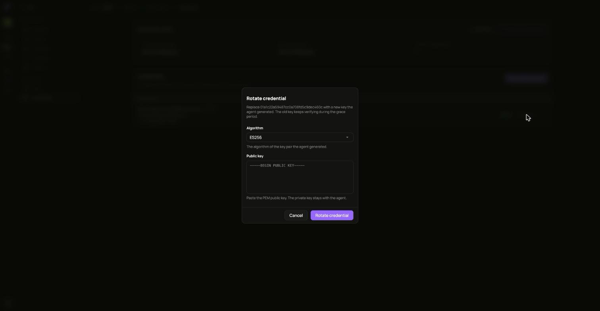
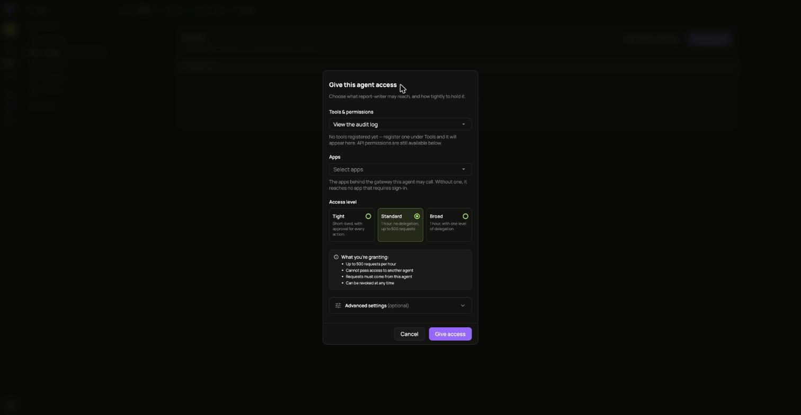
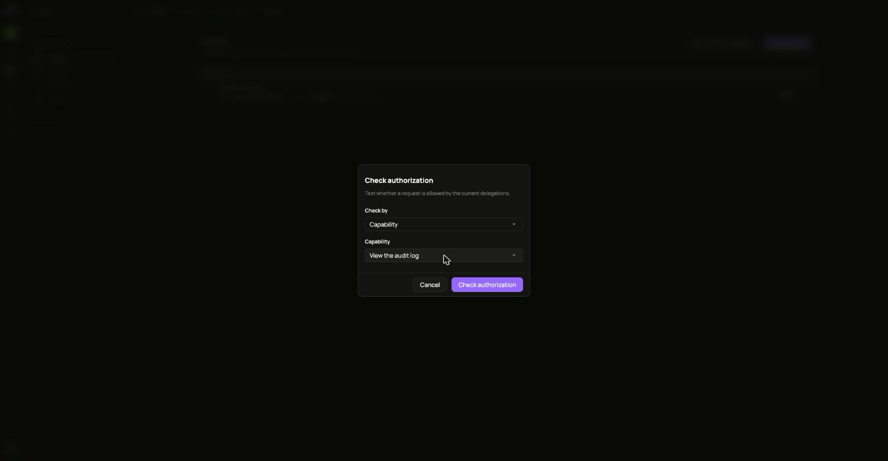
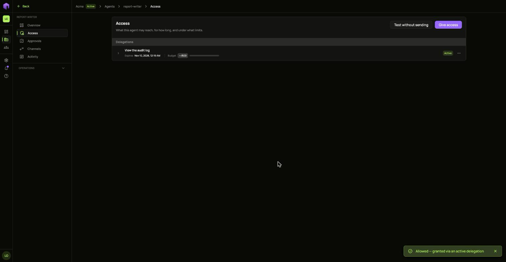
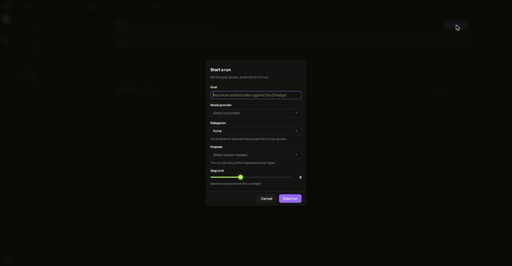
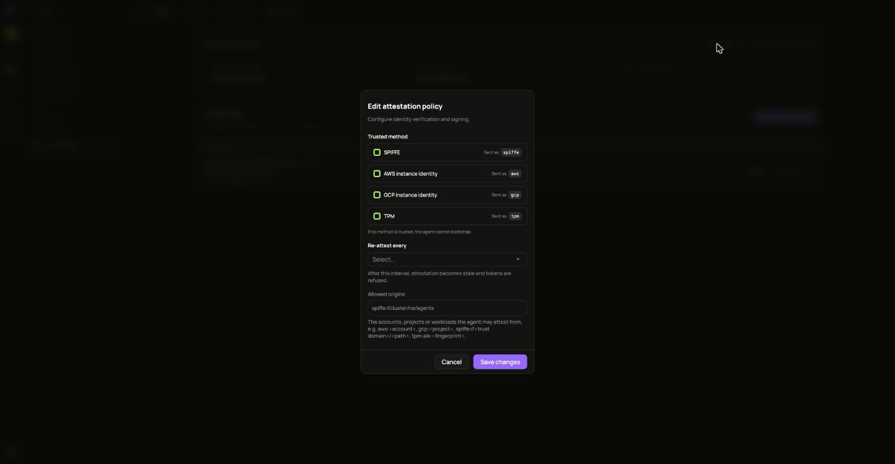

An agent is a machine that acts inside a tenant. It has its own identity and it can do nothing until someone gives it access. In this guide Ann makes `report-writer`, an agent that writes the weekly orders report.

Open your tenant and choose **Agents** in the **Agents** group of the side menu.

## 1. Create the agent

1. Choose **Create Agent**.
2. Fill in **Name** and **Description**. Under **Owner**, keep yourself or pick another agent of this tenant.
3. Choose **Create Agent**.

The agent appears in the list as **Active**. Open it to see its pages: **Overview**, **Access**, **Approvals**, **Channels** and **Activity**, and under **Operations**, **Runs** and **Credentials**.

## 2. Register its key

The agent makes its own key pair and keeps the private half. You only give ianua the public half.

1. Open **Credentials** and choose **Create credential**.
2. Pick the **Algorithm** of the key pair.
3. Paste the **Public key**. It starts with `-----BEGIN PUBLIC KEY-----`.
4. Pick an **Expiry**. The default is 30 days and the most is 90.
5. Choose **Create credential**.

An agent with no key cannot be given access: the request is refused until it holds one active key.

When the key is due to change, choose **Rotate** on its row and paste the new public key. The old key keeps working during a grace period. To stop a key at once, open its **...** menu and choose **Revoke**.

## 3. Give it access

1. Open **Access** and choose **Give access**.
2. Under **Tools & permissions**, pick what it may do. Under **Apps**, pick the apps behind the gateway it may call. Without an app it reaches no app that requires sign-in.
3. Pick an **Access level**:
   - **Tight**: short-lived, with approval for every action.
   - **Standard**: 1 hour, no passing on, up to 500 requests.
   - **Broad**: 1 hour, with one level of passing on.
4. Read **What you're granting**, then choose **Give access**.

The next window shows the agent's token. It is shown once, so copy it and hand it to the agent. Granting again makes a different token.

To take access back, open the row's **...** menu on the **Access** page.

## 4. Test without sending

**Test without sending** tells you whether a request would be allowed by the access the agent holds now. Nothing is sent to any app.

1. On **Access**, choose **Test without sending**.
2. Pick what to check, for example **View the audit log**.
3. Choose **Check authorization**.

The answer appears at the bottom of the page.

## 5. Start a run

**Runs** sends the agent toward a goal and shows its progress step by step. You need a [model provider](/ianua/guides/agents/tools-and-model-providers/) first.

1. Open **Runs** under **Operations** and choose **Start run**.
2. Write the **Goal** and pick a **Model provider**.
3. Under **Delegation**, pick which access this run uses.
4. Under **Purpose**, pick the kinds of action it may perform. It can only perform those.
5. Set the **Step limit**, then choose **Start run**.

Actions that need a person wait on the **Approvals** page.

## Prove where it runs

If the agent runs on a platform that can vouch for it, you can ask it to prove that. On **Credentials**, choose **Edit Policy** and pick the **Trusted method**, how often it must prove itself, and the origins it may prove itself from.

If no method is trusted, the agent cannot prove itself. Read [Stop an agent](/ianua/guides/agents/stop-an-agent/) before you choose **Require re-attestation** on such an agent.
