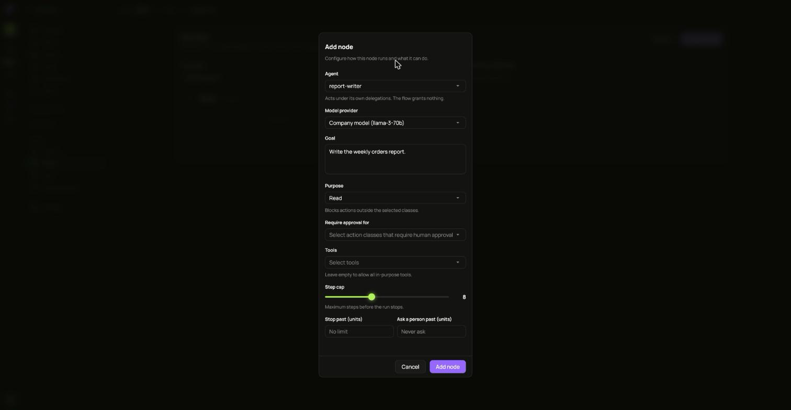
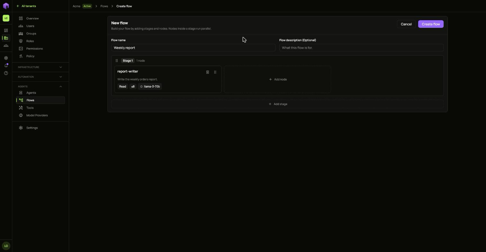
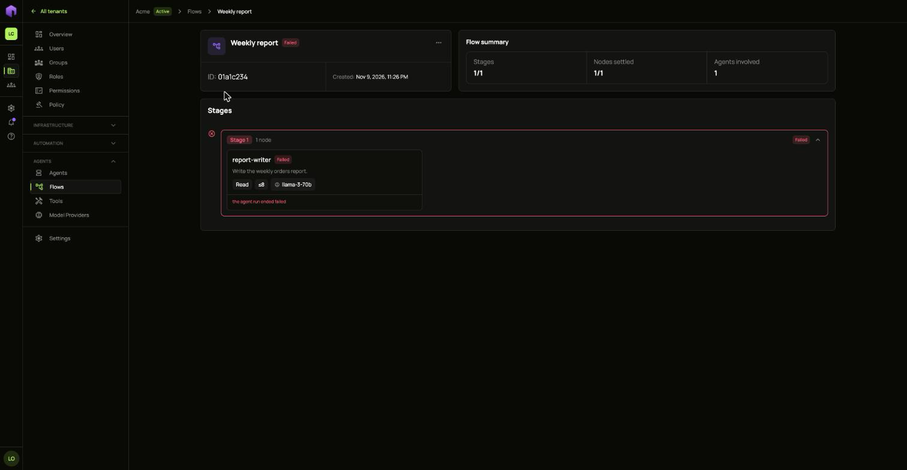

A flow runs agents in stages. Stages run one after another, and the agents inside a stage run at the same time. An agent in a flow acts under its own access: the flow grants it nothing.

Each agent needs [access](/ianua/guides/agents/create-an-agent/) and a [model provider](/ianua/guides/agents/tools-and-model-providers/) first.

1. Open **Flows** and choose **Create flow**.
2. Give it a **Flow name**.
3. Choose **Add node** and fill it in:
   - **Agent** and **Model provider**.
   - **Goal**: what this agent should do.
   - **Purpose**: the kinds of action allowed. Anything else is blocked.
   - **Require approval for**: the kinds of action a person must approve.
   - **Tools**: leave it empty to allow every tool that fits the purpose.
   - **Step cap**, and optional limits for when to stop or to ask a person.
4. Choose **Add node**. Add more nodes, or more stages with **Add stage**.
5. Choose **Create flow**. It starts at once.

Open a flow from the list to follow each stage. A node that failed shows why underneath it.

A flow that has ended can be deleted from its **...** menu.
