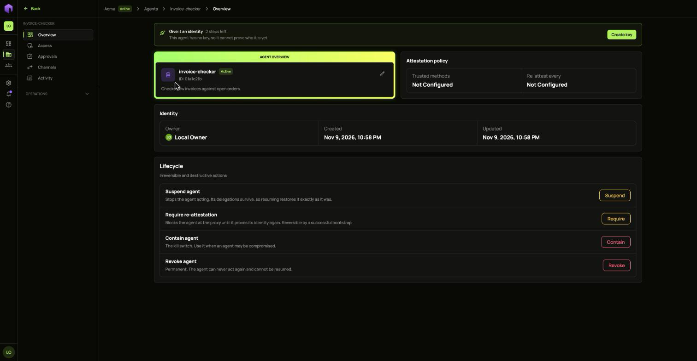
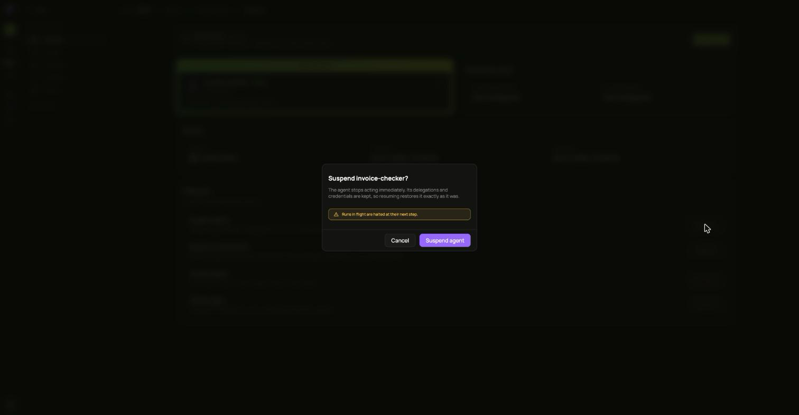
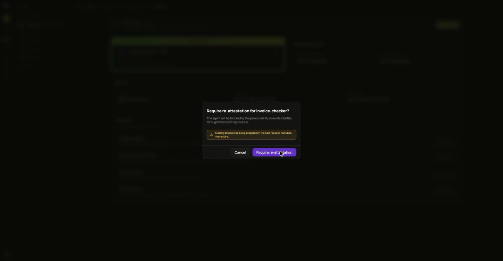
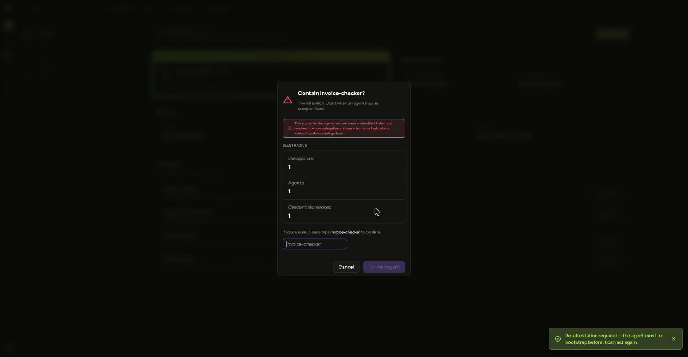
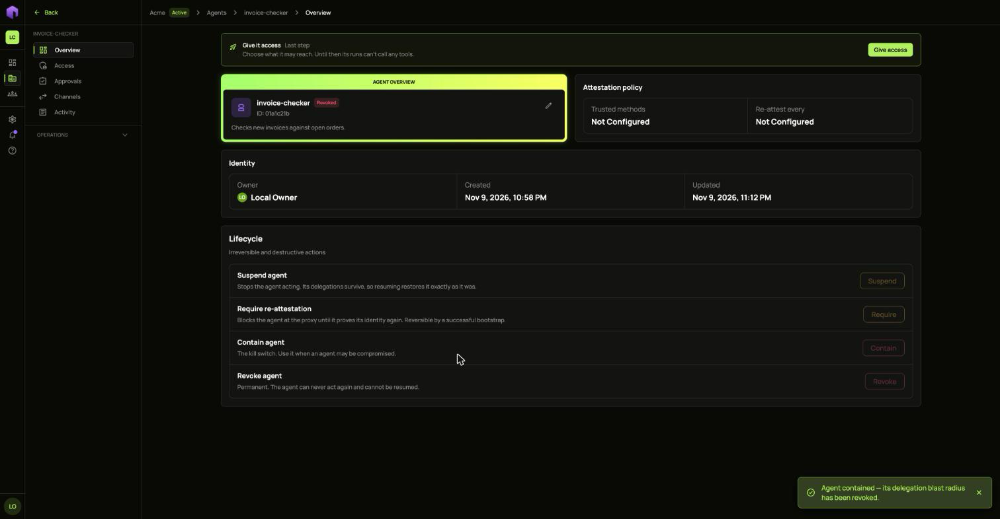

Each control on an agent's **Overview** page, under **Lifecycle**, is stronger than the one before it. In this guide Ann has an agent called `invoice-checker` and something looks wrong.

## Suspend

Choose **Suspend** and confirm. The agent stops acting and its access is kept, so **Resume** puts it back exactly as it was.

To stop every agent in the tenant at once, choose **Stop all agents** on the **Agents** list and type the tenant's slug. Each one is resumed by hand.

## Require re-attestation

Choose **Require** and confirm. The agent is blocked until it proves what it is again. Its badge reads **Must re-attest** until then, and it cannot be given new access.

Tokens it already holds stop working on its next request, not when they expire.

An agent can only prove itself through a method its policy trusts. An agent with no policy has no way back, so use **Suspend** for it instead.

## Contain

**Contain** is the kill switch, for an agent that may be compromised. It revokes the agent and the access it holds or handed on. It cannot be undone.

1. Choose **Contain**.
2. Type the agent's name to confirm.
3. Choose **Contain agent**.

The agent then shows as **Revoked** and every control is greyed out.

## Revoke

**Revoke** is for an agent you are finished with. It is permanent: the agent can never act again and cannot be resumed.
