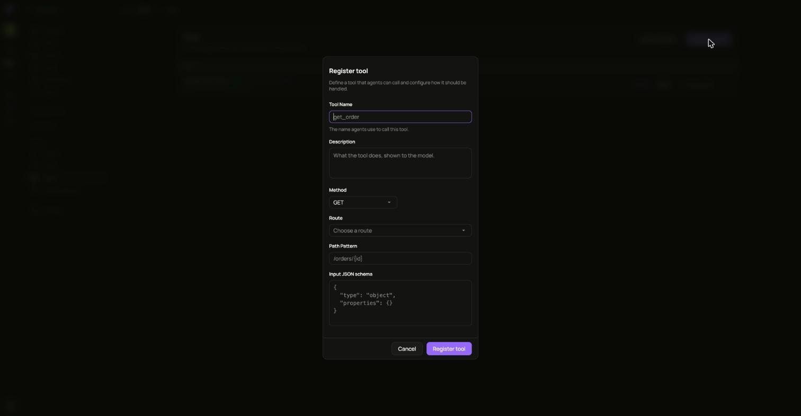
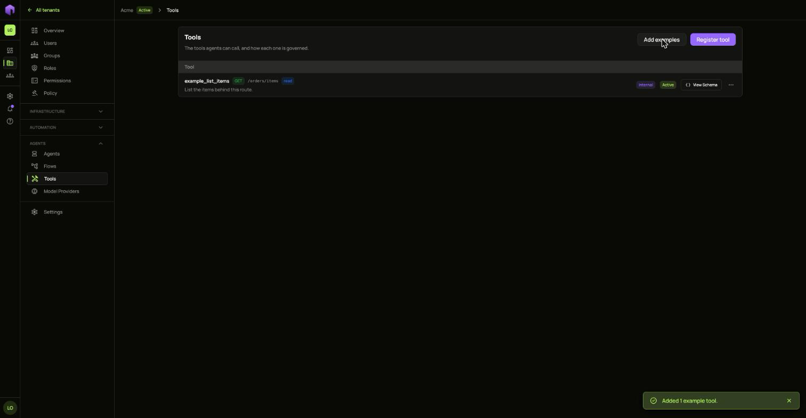
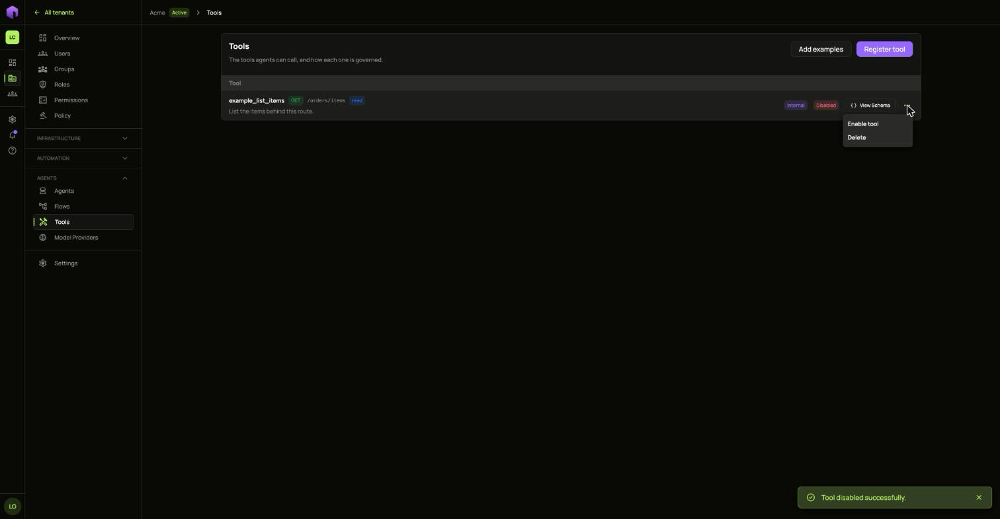
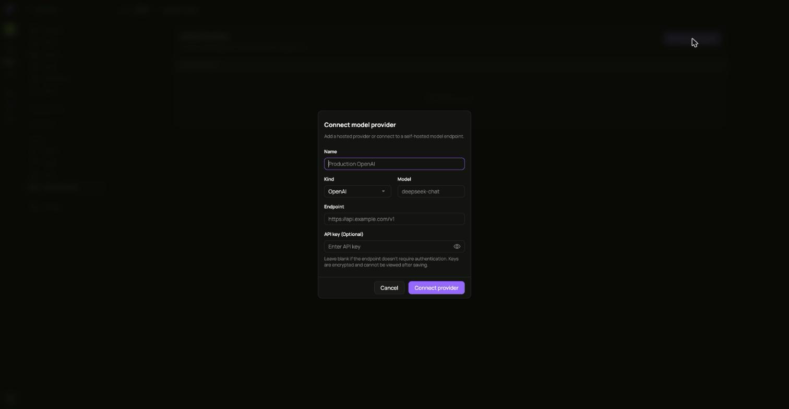
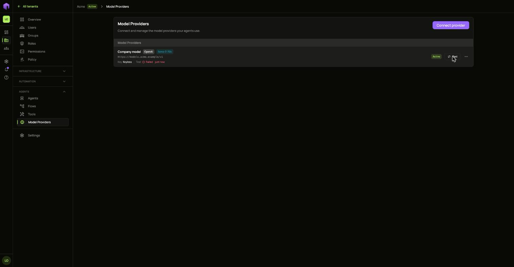
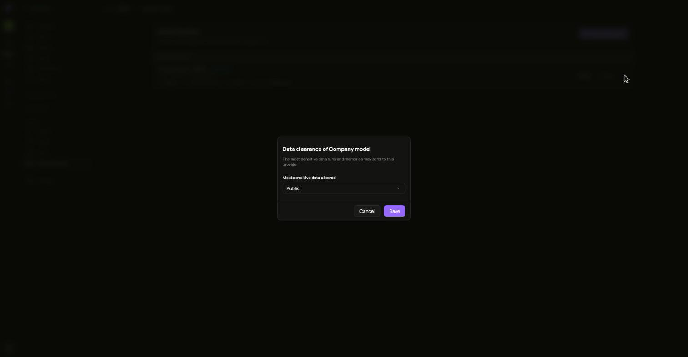
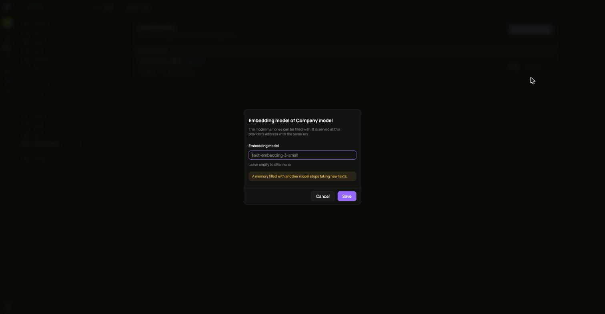

A **tool** is one call an agent can make through a route of yours. A **model provider** is the language model that decides what the agent does next.

## Register a tool

Open **Tools** and choose **Register tool**.

Fill in the name agents call it by, a description the model reads, the **Method**, the **Route**, the **Path Pattern** and the **Input JSON schema**. The route has to serve that method and path, or the tool is refused.

To try the idea first, choose **Add examples**. It adds a small set of example tools under your first route whose path ends in `/*`, using only the methods that route accepts. Pressing it again adds only the ones that are missing.

**View Schema** shows what a tool takes.

To stop agents calling a tool, open its **...** menu and choose **Disable tool**. A disabled tool can be enabled again or deleted.

## Connect a model provider

1. Open **Model Providers** and choose **Connect provider**.
2. Fill in **Name**, **Kind**, **Model** and **Endpoint**.
3. Add the **API key** if the endpoint needs one. Keys are encrypted and cannot be read back. Hosted kinds such as OpenAI need a key.
4. Choose **Connect provider**.

Choose **Test** on its row to see whether the model answers. A failure says why under the provider's name.

### Say what data it may see

A new provider may only be sent **Public** data. Open its **...** menu, choose **Data clearance**, and pick the most sensitive data runs and memories may send it.

### Offer an embedding model

Memories need an embedding model. Open the provider's **...** menu, choose **Embedding model**, and type its name. A memory filled with another model stops taking new texts.

