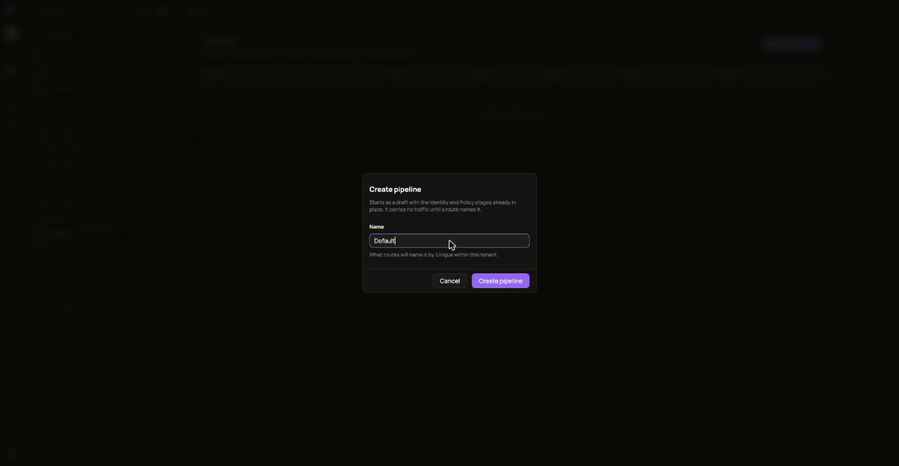
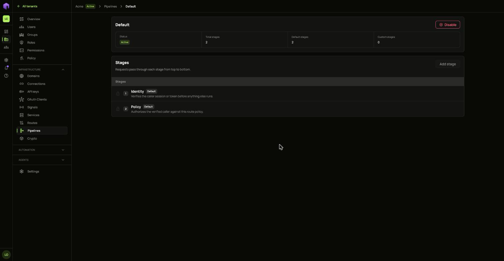
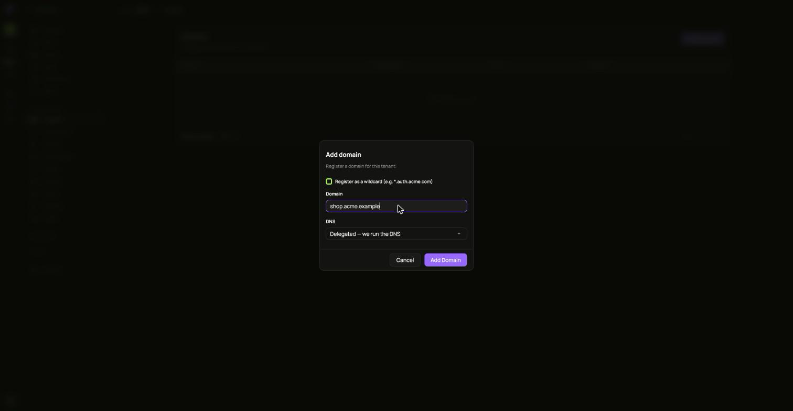
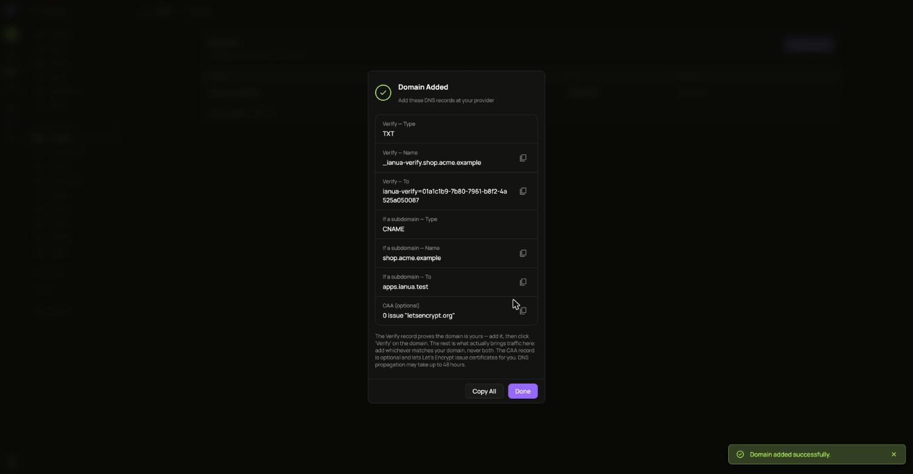
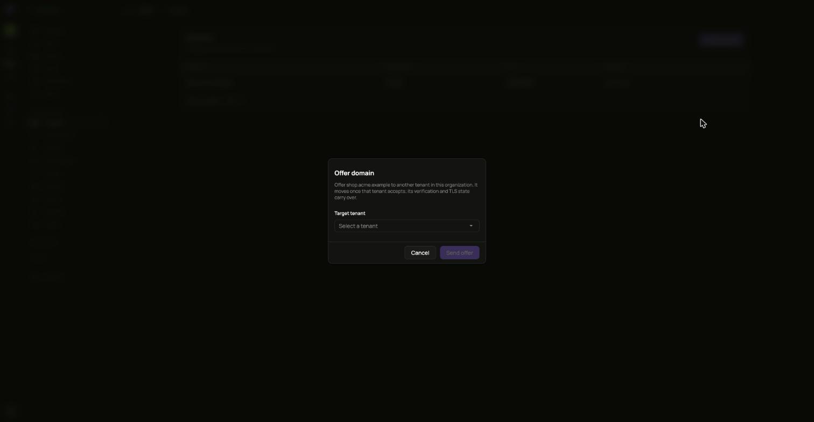

## Pipelines

A pipeline is the list of checks a request passes through, from top to bottom.

1. Open **Pipelines** and choose **Create pipeline**. It starts as a draft with the Identity and Policy stages already in place, and it carries no traffic until a route names it.
2. Open it and choose **Add stage** for each check you want. A stage takes effect as soon as it is added. To change an active pipeline, disable it first, or build the change on a second pipeline and move routes across.
3. Activate it. Every enabled stage starts enforcing on its routes immediately.

Disabling a pipeline stops every route running it from being served. Move those routes to another pipeline first.

## Domains

1. Open **Domains** and choose **Add Domain**.
2. Add the DNS records it shows at your provider. The Verify record proves the domain is yours.
3. Choose **Verify** on the domain.

**Transfer** offers a domain to another tenant in your organization. It moves once that tenant accepts.

Deleting a domain means people can no longer sign in using it.
