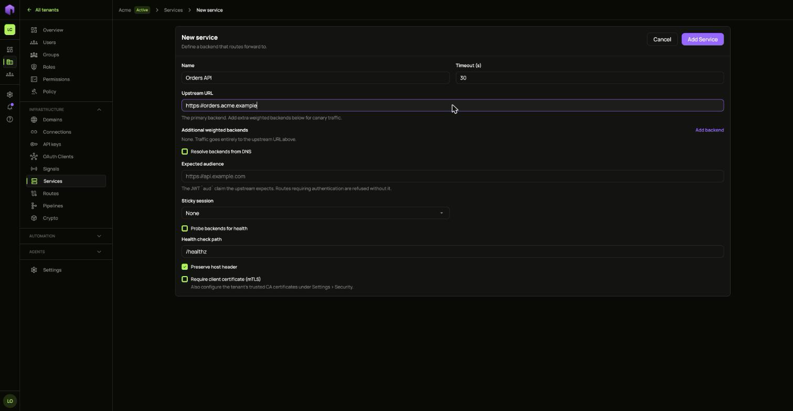
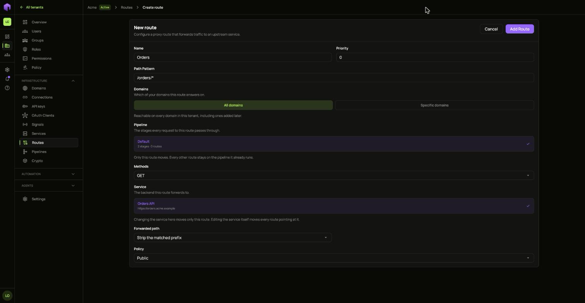
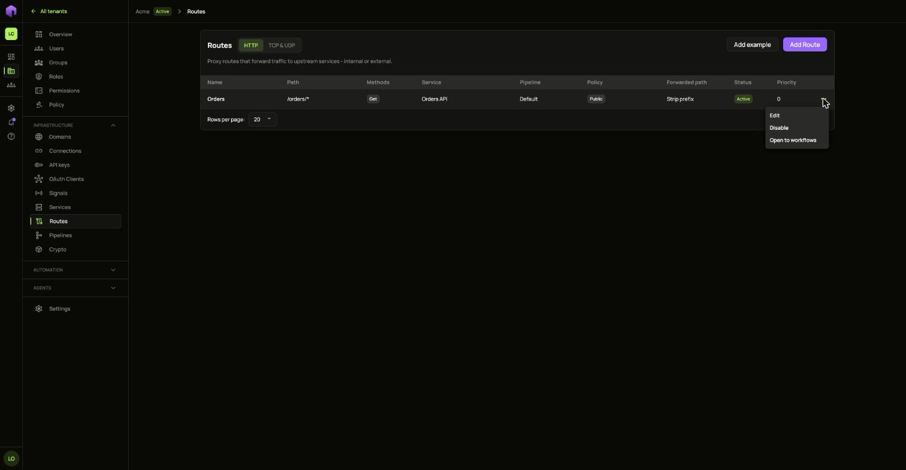
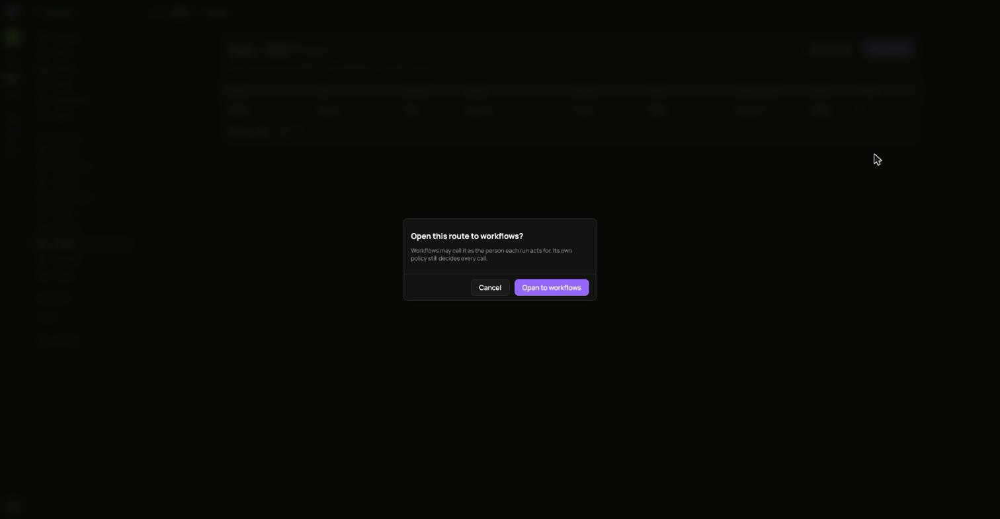

A **service** is the backend. Its address, timeout and probes live there, so many routes to one backend share one definition. A **route** says which requests go to it.

## 1. Add the service

1. Open **Services** in the **Infrastructure** group and choose **Add Service**.
2. Fill in the name and the backend's address.
3. Set the audience. This is the `aud` value the backend expects in its token. Routes that require sign-in are refused without it.
4. Save it.

Changing a service changes how every route pointing at it forwards. A service that still has routes pointing at it cannot be deleted.

## 2. Add the route

1. Open **Routes** and choose **Add Route**.
2. Fill in the name, the path pattern and the methods.
3. Pick the **Service** it forwards to and the **Pipeline** every request passes through.
4. Pick which of your domains it answers on. Leave it open to answer on every domain in this tenant, including ones added later.

## Change a route

The **...** menu on each route offers:

- **Disable**, which stops forwarding until you enable it again.
- **Open to workflows**, which lets workflows call it as the person each run acts for. Its own policy still decides every call.
- **Edit** and **Delete**.

