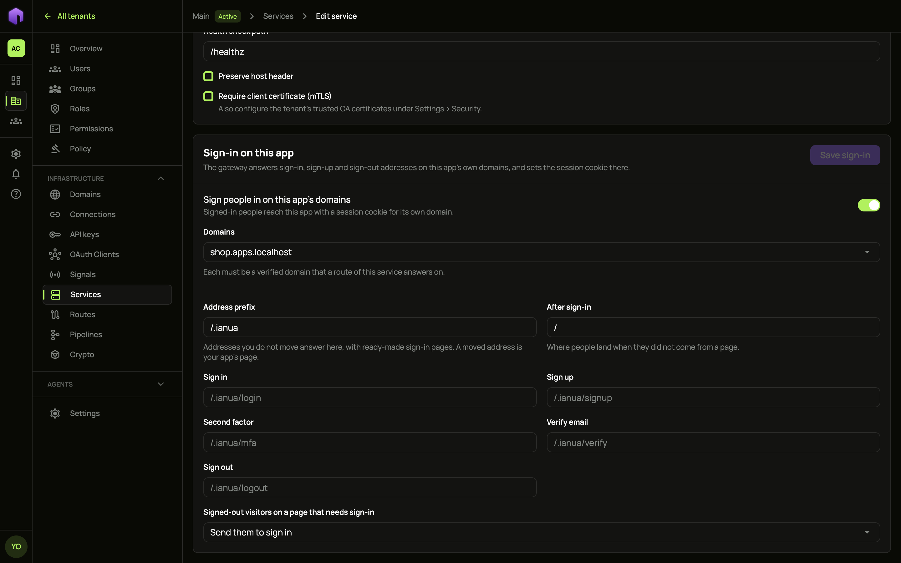
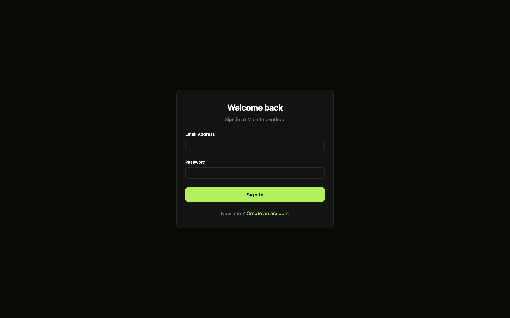
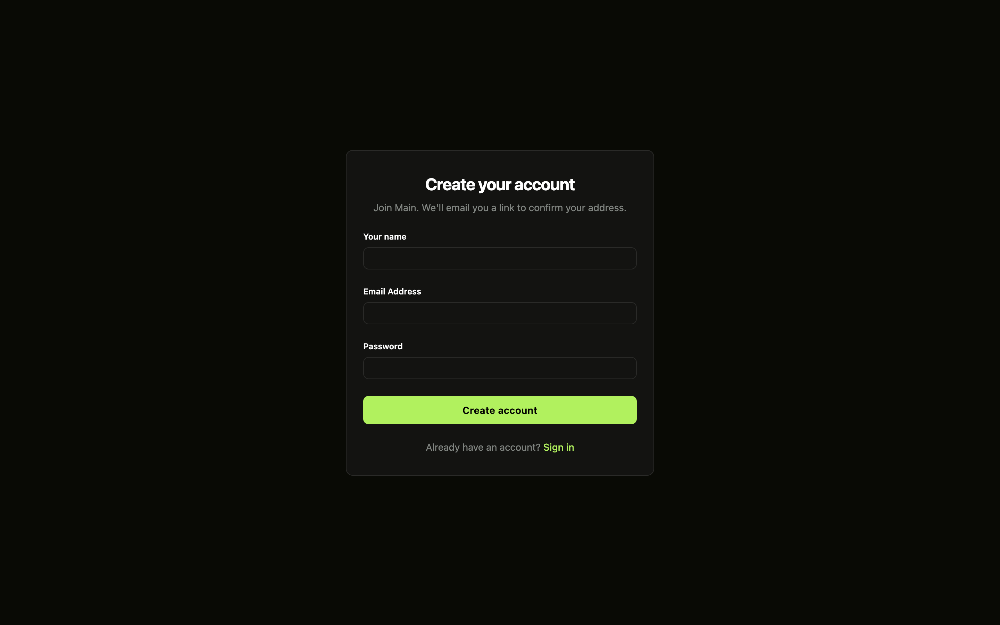
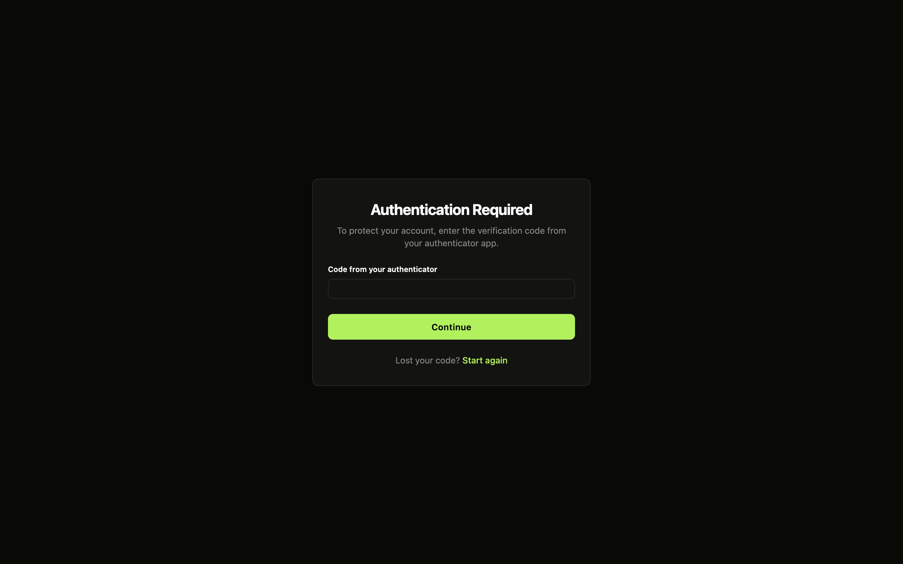
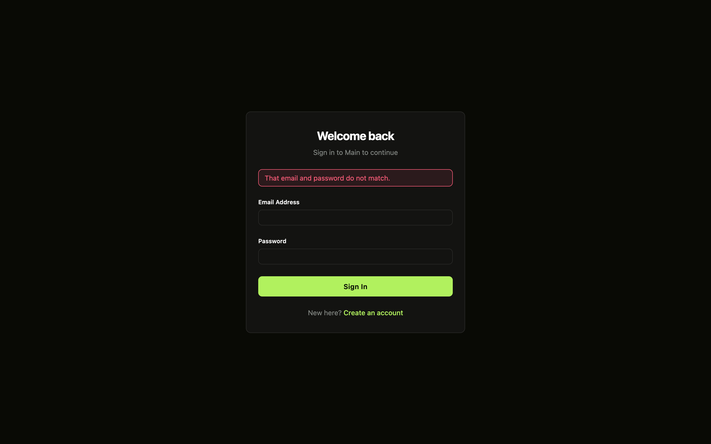
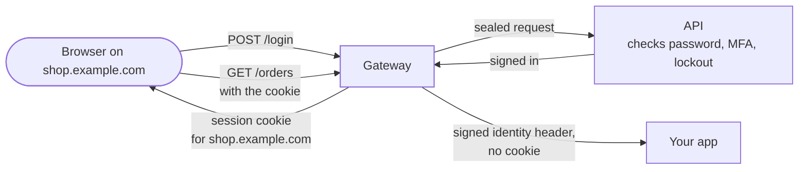
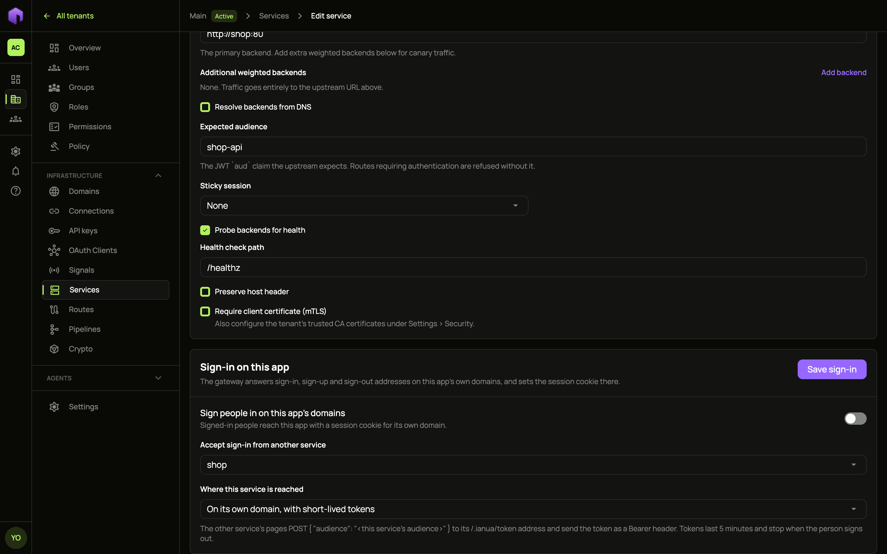

When your app sits behind the gateway, the gateway can also answer a few sign-in addresses on your app's own domain. People sign in at, say, `https://shop.example.com/login`, the gateway sets a session cookie for `shop.example.com`, and from then on that cookie gets them into the app's pages. Your app never handles a password or a session: it reads who is signed in from the signed `X-Ianua-Assertion` header, as for any other request.

This works alongside OpenID Connect. Use whichever suits each app.

## What you need first

- The app is a **service** with at least one **route**, and its domain is a **verified domain** of the tenant that a route of the service answers on.
- The service has an **expected audience** set. The session people get names it, so a session for this app is never taken by another.
- **Password sign-in** is on for the tenant. For sign-up, **Let people sign themselves up** is on too.

## Turn it on

1. Open **Services**, choose the service, and find **Sign-in on this app** below its settings.
2. Switch on **Sign people in on this app's domains**.
3. Choose the **Domains** to answer on.
4. Leave the addresses where they are, or move any of them (see below).
5. Choose what happens to a signed-out visitor on a page that needs sign-in: **Answer 401**, or **Send them to sign in**. They are sent to the sign-in address, and back to the page they wanted once signed in.
6. Choose **Save sign-in**.



The gateway picks up the change within moments.

## The addresses

By default every address answers under `/.ianua`, a path your app is very unlikely to use:

| Address | Default path | Method |
| --- | --- | --- |
| Sign in | `/.ianua/login` | `POST` |
| Sign up | `/.ianua/signup` | `POST` |
| Second factor | `/.ianua/mfa` | `POST` |
| Verify email | `/.ianua/verify` | `GET` (the link in the email) |
| Confirm sign-in | `/.ianua/confirm-sign-in` | `GET` (the link mailed to confirm a sign-in, opened in the same browser) |
| Sign out | `/.ianua/logout` | `POST` |
| Single sign-on | `/.ianua/sso` | `GET` (sends the browser to the tenant's identity provider) |
| Back from single sign-on | `/.ianua/sso-callback` | `GET` (where the identity provider sends the browser back) |
| Passkey | `/.ianua/passkey` | `POST` |
| Forgot password | `/.ianua/forgot-password` | `POST` (mails a link to set a new password) |
| Reset password | `/.ianua/reset-password` | `POST` (sets the new password from that link) |
| Change password | `/.ianua/change-password` | `POST` (sets the new password a sign-in owes, for example one an administrator set) |

Each emailed link opens its own address, so what a link does never depends on which cookies the browser holds. A link to confirm a sign-in only works in the browser that signed in. Opened anywhere else, it is refused.

:::note
The gateway is being rebuilt on the new application layer. Its current code answers only the first five addresses, and shows pages for sign in, sign up and the second factor. The others can already be set and moved.
:::

Change the **Address prefix** to move them all, or give a single address its own path, such as **Sign in** at `/login`. Nothing under the prefix ever reaches your app.

A moved address only takes the method it answers. With sign-in at `/login`, a `POST /login` signs someone in, while a `GET /login` still reaches your app, so your app can serve its own login page there.

## The gateway's own pages

You don't have to build any pages. Open **Sign in**, **Sign up**, **Second factor**, **Forgot password**, **Reset password** or **Change password** under the prefix in a browser, for example `https://shop.example.com/.ianua/login`, and the gateway shows a page for it. The page carries the tenant's name and its branding (logo, colours and custom CSS), and posts to the same address.



When the tenant lets people sign themselves up, **Create an account** leads to the sign-up page:



After the password, someone with a second factor is asked for their code:



Things to know about these pages:

- They run no scripts of their own, and they can't be shown inside a frame. The one exception is on the sign-in page. When the tenant allows passkeys, it shows **Sign in with a passkey**, run by a small script the gateway serves at `/.ianua/passkey.js`. The page's content security policy allows that one file and nothing else: no inline script and no `eval`. In a browser without passkey support, the button stays hidden.
- Passkeys work on the app's domain only when it is one the deployment's passkey settings allow. See `WEBAUTHN_RP_ID`, `WEBAUTHN_OTHER_ORIGINS` and `WEBAUTHN_SUBDOMAINS` in the configuration reference.
- Someone with a second factor is asked for it at every password sign-in, except from a browser they remembered.
- The second-factor page offers **Remember this device**. Ticked, the device is remembered for the person, as remembering a device from the dashboard does: later sign-ins on this app's domain from that browser skip the second factor while nothing else about the sign-in looks unusual, under the tenant's sign-in rules and trust window. See [Remembered devices on an app's domain](#remembered-devices-on-an-apps-domain).
- When a password must change before sign-in goes on, for example because an administrator set it, the browser is sent to **Change password**. There the person picks a new password, with a code from their authenticator if the change asks for one.
- **Sign up** only shows when the tenant lets people sign themselves up. Otherwise it answers `403`.
- After a refused attempt, the page says why in plain words, such as "That email and password do not match." It never shows text taken from its own address.

  
- A moved address has no gateway page. With **Sign in** at `/login`, your app serves the login page.



## A sign-in form in your app

Your app's page posts to the address from the same domain. A plain HTML form works:

```html
<form method="post" action="/login">
  <input type="hidden" name="return_to" value="/orders">
  <input name="email" type="email" autocomplete="username">
  <input name="password" type="password" autocomplete="current-password">
  <button>Sign in</button>
</form>
```

A form post is answered with a redirect: to `return_to` once signed in, to the second-factor address if a code is owed, or back to the sign-in address with `?error=` if it was refused. The redirects keep `return_to`, so a person who needs a second try or a code still lands where they were going. `return_to` must be a path on the same domain; anything else is ignored.

A script can send JSON instead, and gets JSON back:

```js
const res = await fetch('/login', {
  method: 'POST',
  headers: { 'Content-Type': 'application/json' },
  body: JSON.stringify({ email, password }),
});
// 200 { "signed_in": true, "return_to": "/" }
// 200 { "mfa_required": true }   then POST /.ianua/mfa with { "code": "123456" }
// 404 { "error": "not_found" }   wrong address or password
```

Requests must come from a page on the app's own domain. The gateway checks the browser's `Sec-Fetch-Site` and `Origin` headers, and refuses a sign-in posted from any other site.

For **sign up**, send `email`, `display_name` and `password`. The person gets an email with a link back to the app's verify address, and signs in once they have followed it. The answer is the same whether or not the address already had an account, so the form cannot be used to find out who has one.

## The session cookie

The gateway sets these cookies, all limited to the app's exact domain:

| Cookie | What it is |
| --- | --- |
| `__Host-ianua_app` | The session. Hidden from page scripts. |
| `__Host-ianua_csrf` | A value your page's scripts can read and send back in the `Ianua-CSRF-Token` header when a request from another site needs it. A request from the app's own pages needs nothing extra. |
| `__Host-ianua_mfa` | Held for a few minutes between the password and the second factor. |
| `__Host-ianua_hop` | Only on the domain of a service with its own cookie (see below). It lasts a few minutes while the sign-in reaches that domain, so the code it brings works only in this browser. |
| `__Host-ianua_device` | Only when the person ticked **Remember this device** with their code. It holds the secret of the remembered device, hidden from page scripts, kept for a year. Signing out leaves it. |

None of them reaches your app. The session lasts as long as the tenant's session lifetime, and ends early if it goes unused for longer than the tenant's idle timeout (both as set when the person signed in). Signing out, an administrator ending the session, changing the password or deactivating the account stops it within seconds.

## Remembered devices on an app's domain

When Ann types her code and ticks **Remember this device**, the gateway makes a fresh random secret for her browser and the API remembers the device for her. It is remembered only after her second factor, it counts for her alone, and it shows in her list of remembered devices as "Browser on shop.example.com", where she or an administrator can forget it. The browser keeps the secret in the `__Host-ianua_device` cookie; the API keeps only a digest of it.

A device remembered on one domain counts on that domain alone. The digest is made from the secret together with the domain, so:

- Mallory copies Ann's device cookie from `shop.example.com` and sends it to `billing.example.com`, another tenant's app, or the dashboard. It matches nothing there, and Ann's second factor is asked as usual.
- Ann forgets the laptop, or it is revoked. Its cookie no longer counts, and her next sign-in from it asks for her code again. Ticking the box again remembers it under a new secret.
- Bob signs in from a browser holding Ann's device cookie. The device is not his, so his own second factor is asked.

The session opened from a remembered device names it, so a route with a device posture stage knows which device a request comes from (see [Proxy](/ianua/domain-contexts/proxy/#device-posture)).

## Other services, such as your API

The session belongs to the service whose sign-in was used. Another service, for example your app's API, accepts it only when you say so: open that service, choose the first one under **Accept sign-in from another service**, then choose **Where this service is reached**.

| Choice | Use it when | What your app does |
| --- | --- | --- |
| **On the same domain as that service** | The API is served on the app's domain, such as `shop.example.com/api`. | Nothing. The browser already sends the cookie. |
| **On its own domain, with its own cookie** | The API has its own domain, such as `api.shop.example.com`, and your pages call it with cookies. | Call the API with `credentials: 'include'`, and let the app's domain call it (CORS, allowing credentials). |
| **On its own domain, with short-lived tokens** | The API has its own domain and your pages send an `Authorization` header. | Fetch a token from the app's token address and send it as `Bearer`. |



The service needs its own **expected audience** for the last two choices: its cookie or tokens are made for it and for nothing else.

### With its own cookie

Choose the API's domains under **This service's domains**. Each must be a verified domain that a route of the API answers on, and it must be on the same site as the app: both under one registered domain, such as `shop.example.com` and `api.shop.example.com`. Otherwise the browser would not send the cookie from the app's pages, so ianua refuses the setting and suggests tokens instead.

When someone signs in on the app with a form, the browser passes through each of those domains for a moment, collecting a cookie there, and then lands where it was going. A script that signs in with JSON gets the first stop back in `hop_to`, and sends the window there:

```js
const res = await fetch('/login', { method: 'POST', headers: { 'Content-Type': 'application/json' }, body: JSON.stringify({ email, password }) });
const { hop_to, return_to } = await res.json();
window.location.assign(hop_to ?? return_to);
```

`hop_to` is `null` when no service needs a cookie of its own. Open the address in the window, not with `fetch`. Each domain first keeps a value in a cookie of its own, then fetches its code from the app's domain, so the code only works in the browser that signed in. A hop link copied to another browser sets nothing there. Each code works once, for one minute. Your pages may then send requests to the API, and the gateway accepts them from the app's domain.

Every cookie set this way, and every token given, is written to the tenant's audit log.

### With short-lived tokens

The app's pages ask for a token while signed in. The token lasts five minutes and is made for the API's audience only:

```js
const res = await fetch('/.ianua/token', {
  method: 'POST',
  headers: { 'Content-Type': 'application/json' },
  body: JSON.stringify({ audience: 'shop-api' }),
});
const { access_token, expires_in } = await res.json();
await fetch('https://api.shop.example.com/orders', { headers: { Authorization: `Bearer ${access_token}` } });
```

Only a page on the app's own domain can ask, and only while its session is live. Each token is tied to the session it was fetched under: once someone signs out, or the session ends any other way, new tokens are refused and ones already given stop working within seconds.

## With the API

Sign in as in the [API quickstart](/ianua/start/quickstart-api/), then name the tenant and the service:

```sh
API=https://api.ianua.localhost/api/v1
TOKEN=$(curl -sk -X POST $API/login \
  -H 'Content-Type: application/json' \
  -d '{"email":"you@example.com","password":"Violet otters juggle 42 brass lanterns at dusk"}' | jq -r .refresh_token)
auth=(-sk -H "Authorization: Bearer $TOKEN" -H 'Content-Type: application/json')
TENANT=$API/organizations/acme/tenants/production
SERVICE_ID=...   # from: curl "${auth[@]}" $TENANT/services | jq '.items[] | {id, name}'
```

```sh
curl "${auth[@]}" -X PUT $TENANT/services/$SERVICE_ID/app-sign-in -d '{
  "app_sign_in": {
    "hosts": ["shop.example.com"],
    "paths": { "login": "/login" },
    "after_sign_in": "/orders",
    "signed_out_browsers": "redirect"
  }
}'
```

`paths` can move any of `login`, `signup`, `mfa`, `verify`, `confirm_sign_in`, `logout`, `sso`, `sso_callback`, `passkey`, `forgot_password`, `reset_password` and `change_password`; `prefix` moves them all, and `signed_out_browsers` is `refuse` (the default, answering `401`) or `redirect`. Send `{"app_sign_in": null}` to turn it off. On another service, send `{"accepts_app_sign_in_of": "<service id>", "delivery": {...}}` to accept this one's sign-in, where `delivery` is `{"kind": "same_host"}` (the default), `{"kind": "own_cookie", "hosts": ["api.shop.example.com"]}` or `{"kind": "tokens"}`.

The gateway configuration document (`GET` and `POST` on `$TENANT/gateway/config`) carries the same settings on each service: `app_sign_in` in the shape above, `accepts_app_sign_in_of` with the other service's **name**, and `sign_in_delivery` in the shape of `delivery`. An import checks them the same way, after the routes in the document exist. A service in the document without `app_sign_in` has its sign-in turned off.
