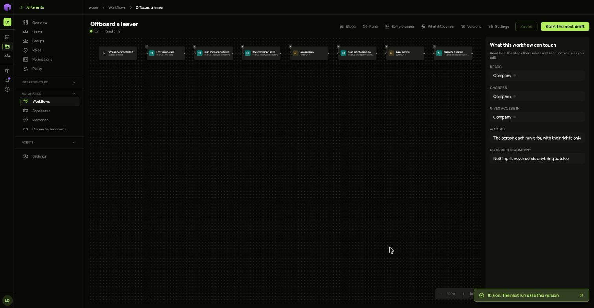
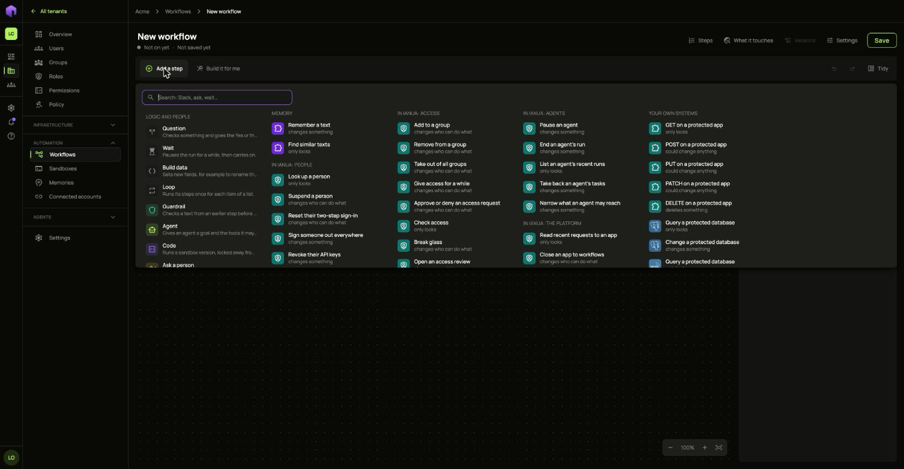
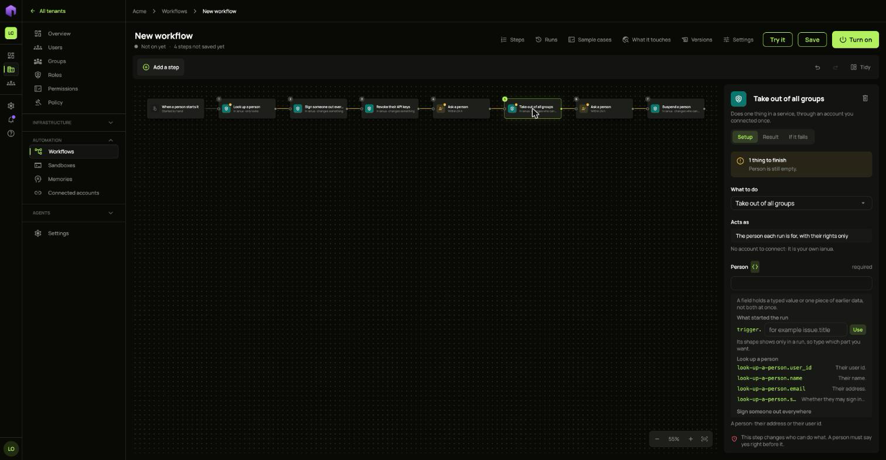
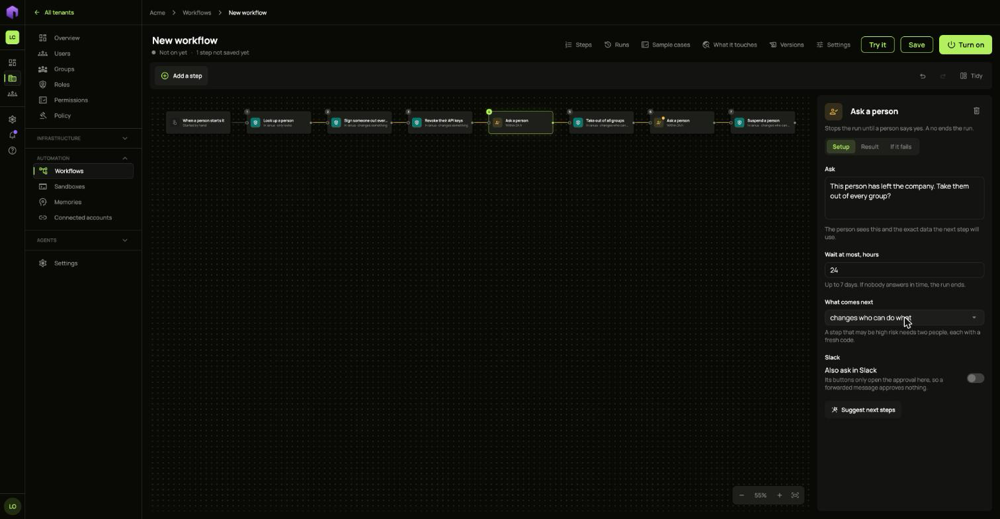
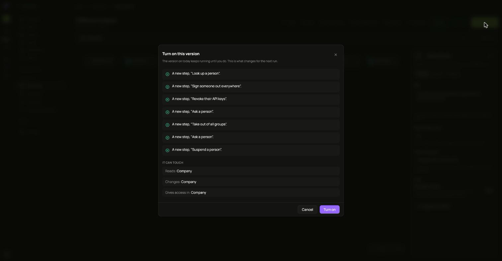
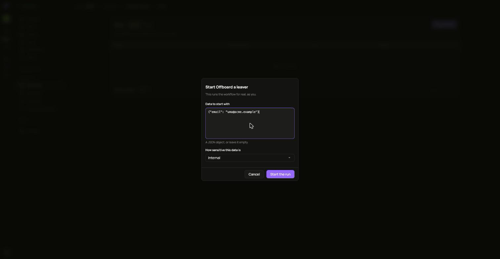
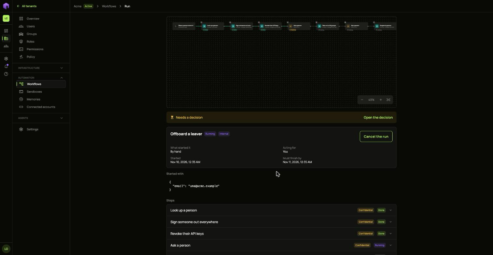
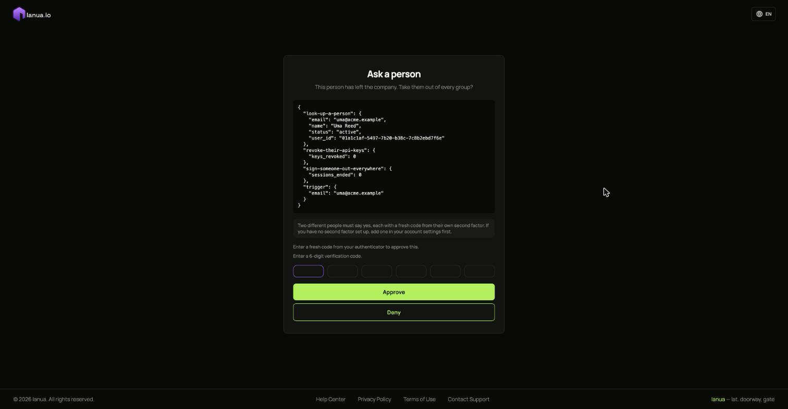

When someone leaves, several things must happen in the right order, and the steps that take away access should be checked by people. In this guide Ann builds that as one workflow. Pat runs it each time someone leaves, and Tess and Sam approve the access changes.

The finished workflow looks like this:



| Step | What it does | Who is involved |
| :-- | :-- | :-- |
| Look up a person | Finds the leaver from the address the run started with | Nobody |
| Sign someone out everywhere | Ends their sessions | Nobody |
| Revoke their API keys | Stops the keys they made | Nobody |
| Ask a person | Asks whether to take away their groups | Two people |
| Take out of all groups | Removes every group | Nobody |
| Ask a person | Asks whether to suspend the account | Two people |
| Suspend a person | Locks the account | Nobody |

## Before you start

- Each approver needs a second factor set up, because approving this asks for a fresh code.
- The person who runs the workflow needs the right to manage users. Each step acts with that person's own rights, so it can never do more than they could by hand.

## 1. Chain the steps

1. Open **Workflows** in the **Automation** group and choose **New workflow**.
2. Click the title at the top and name it `Offboard a leaver`.
3. Keep **When a person starts it** on the right.
4. Choose the green **+** on the right of the start, and pick **Look up a person**.

   

5. Choose the **+** on the right of each new step to add the next one, in the order of the table above. Use the **+** rather than **Add a step**, so that each step waits for the one before it.
6. Choose **Tidy** to line them up.

## 2. Use the data from earlier steps

The first step needs to know who is leaving. That comes from the data the run starts with.

1. Select **Look up a person** and choose `<>` beside **Person**.
2. Under **What started the run**, type `email` and choose **Use**.

The later steps should act on the exact person found, so they use the first step's answer:

1. Select **Sign someone out everywhere** and choose `<>` beside **Person**.
2. Choose `look-up-a-person.user_id`.
3. Do the same on **Revoke their API keys**, **Take out of all groups** and **Suspend a person**.



## 3. Add the approvals

A step that changes who can do what cannot be turned on unless **Ask a person** sits right before it. That is why there are two approvals here, one for each of those steps.

Select each **Ask a person** step and fill it in:

- **Ask**: what the approver reads, for example `This person has left the company. Take them out of every group?`
- **Wait at most, hours**: up to 7 days. If nobody answers in time, the run ends.
- **What comes next**: pick **changes who can do what**.



## 4. Turn it on

The draft saves itself. Choose **Turn on**. The window lists what changes and what the workflow can touch. Choose **Turn on** again.



A workflow that is on cannot be edited. To change it, choose **Start the next draft**. The version in service keeps running until you turn on the new one.

## 5. Run it

1. Open **Runs** on the workflow and choose **Start a run**.
2. Under **Data to start with**, give the leaver's address:

   ```json
   {"email": "uma@acme.example"}
   ```

3. Choose **Start the run**.



The run looks Uma up, signs them out and ends their keys. Then it stops at the first approval and shows **Needs a decision**.



## 6. Approve it

Choose **Open the decision**, or send the page to the approvers. They see the question and the exact data the next step will use.

Two different people must say yes, each with a fresh code from their own second factor. A **Deny** ends the run.



After both approvals, the run takes Uma out of their groups and stops at the second approval. After those two approvals, it suspends the account.

## How sensitive data is handled

Every run tracks how sensitive its data is, and every step has a limit.

- The answer from **Look up a person** is marked **Confidential**, because it holds personal details.
- Steps inside ianua can take data up to Confidential, because nothing leaves your company.
- Outside services, such as Slack or an HTTP request, take data only up to **Internal** unless your installation allows more. A run that tries to send a looked-up person to one of them stops with `The data was too sensitive for this step`.

**How sensitive this data is**, in the Start a run window, says how sensitive the starting data is. Use the highest level that fits it.

## Remove a workflow

On the **Workflows** list, open its **...** menu and choose **Remove**. It never runs again and its schedules stop. Its past runs stay on record, and it stays listed under the **Off** filter.

## If a run fails

Open the run and open the failed step to see why. **Retry** runs only the steps that did not finish, as a new run. **Start again** runs every step again. Either way, any approval is asked for again.
