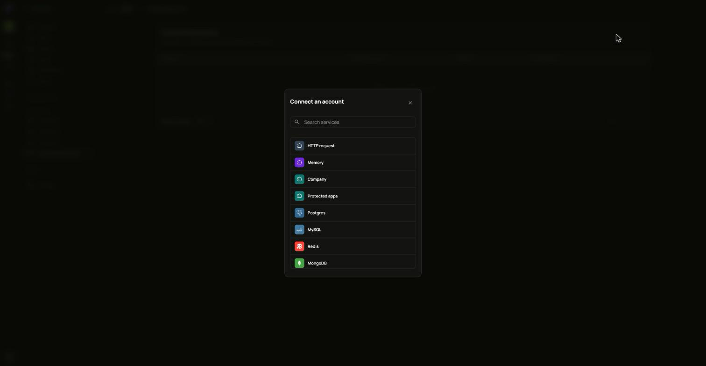
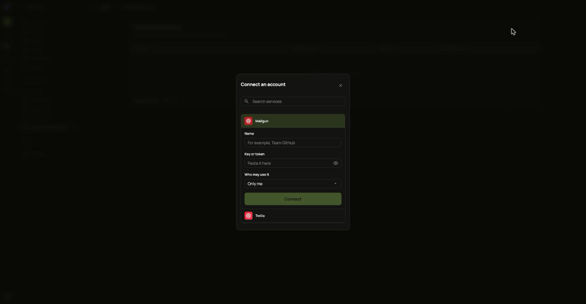

Workflows reach outside services through accounts you connect once. Steps inside ianua need no account.

1. Open **Connected accounts** and choose **Connect an account**.
2. Pick the service. You can search the list.
3. Fill in a **Name** and the service's **Key or token**, or sign in at the service if it offers that.
4. Under **Who may use it**, choose who may use the account in their workflows.
5. Choose **Connect**.

