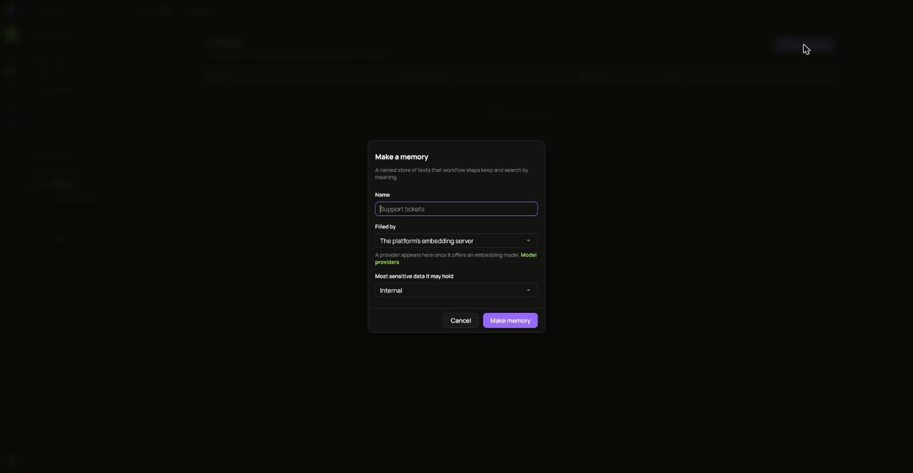

A memory is a named store of texts. Workflow steps keep texts in it with **Remember a text**, and search it by meaning with **Find similar texts**.

1. Open **Memories** and choose **Make a memory**.
2. Give it a **Name**.
3. Under **Filled by**, pick the installation's embedding server, or a [model provider that offers an embedding model](/ianua/guides/agents/tools-and-model-providers/).
4. Pick the **Most sensitive data it may hold**.
5. Choose **Make memory**.

ianua asks the embedding model for one vector while making the memory, so the model has to answer at that moment. The memory is refused if:

- The installation runs no embedding server and you picked it.
- The provider's [data clearance](/ianua/guides/agents/tools-and-model-providers/) is lower than the memory's sensitivity.
- The model does not answer. Try again once it does.
