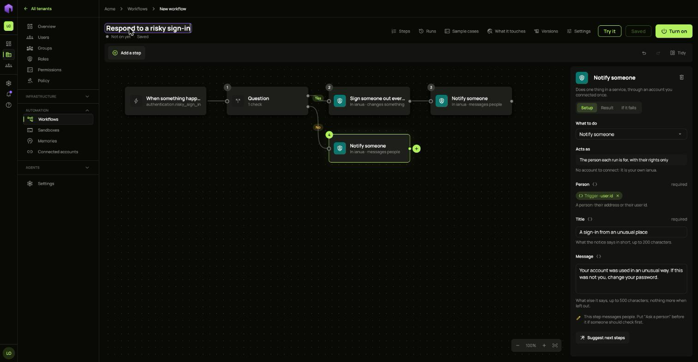
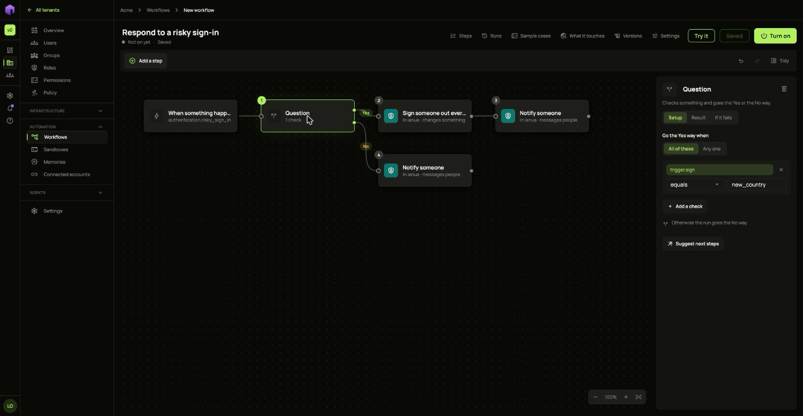
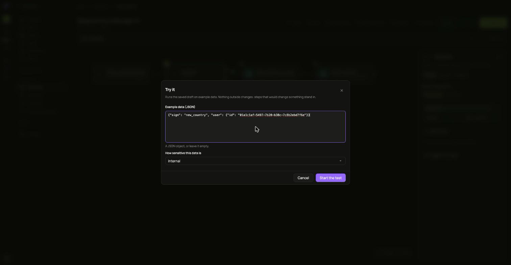
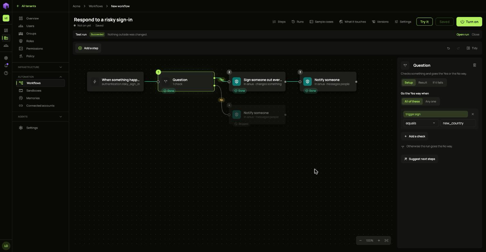
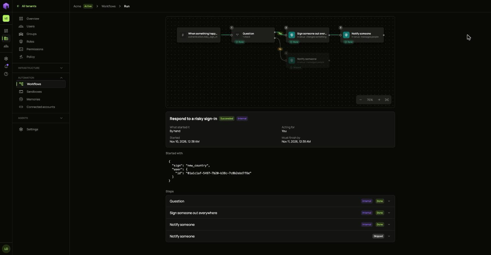

A workflow can start by itself when something happens in your company. In this guide Ann makes one for risky sign-ins. If the sign-in came from a new country, the person is signed out and told why. For any other risky sign-in, the person is only told.



## 1. Choose what starts it

1. Open **Workflows** and choose **New workflow**. Name it `Respond to a risky sign-in`.
2. On the right, under **Starts**, choose **When something happens in your company**.
3. Under **Event**, choose **A sign-in went ahead though it looked risky**.

A workflow can also start on a schedule, when a connected service sends an event, when another system calls it, or before a change happens.

A workflow started by an event acts for the person who turned it on, so that person needs the rights its steps use.

## 2. Ask a question

1. Choose the **+** after the start and pick **Question**.
2. Choose **Pick what to check**, type `sign` under **What started the run**, and choose **Use**.
3. Keep **equals**, and type `new_country` as the value.



The event gives one of three reasons: `new_country`, `fast_travel` or `fast_travel_to_new_country`. To catch both new-country reasons, choose **contains** instead of **equals**.

The step now has two **+** buttons. The top one is the **Yes** way and the bottom one is the **No** way.

## 3. Build each path

For the **Yes** way:

1. Choose the top **+** and pick **Sign someone out everywhere**. Choose `<>` beside **Person**, type `user.id` under **What started the run**, and choose **Use**.
2. Choose the **+** after it and pick **Notify someone**. Set **Person** the same way, and write a **Title** and a **Message**.

For the **No** way, select **Question**, choose the remaining **+**, and add another **Notify someone**.

Choose **Tidy** to lay the paths out.

## 4. Try it

**Try it** runs the saved draft on example data. Nothing outside changes, because steps that would change something stand in. Give the data the event would carry:

```json
{"sign": "new_country", "user": {"id": "01a1c1af-5497-7b20-b38c-7c8b2ebd7f6e"}}
```



The result shows on the steps. Here the **Yes** way ran, and the **No** way was skipped.



Choose **Open run** for the full record of each step.



Try the other way too, with `"sign"` set to something else.

## 5. Turn it on

Choose **Turn on**, check the list of changes, and confirm. From then on, each risky sign-in starts a run, listed under **Runs**.
