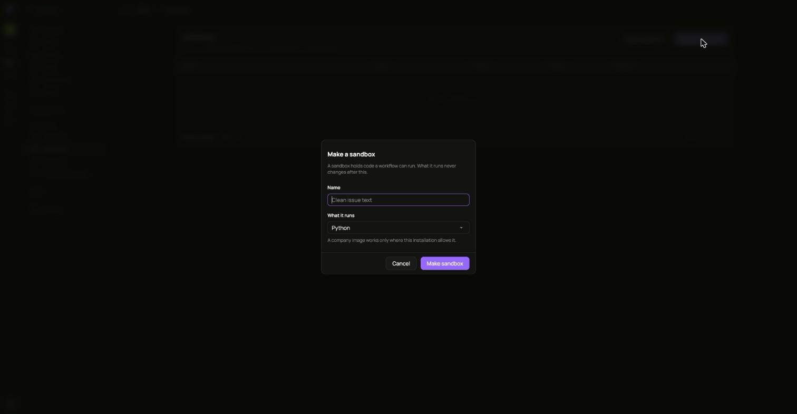
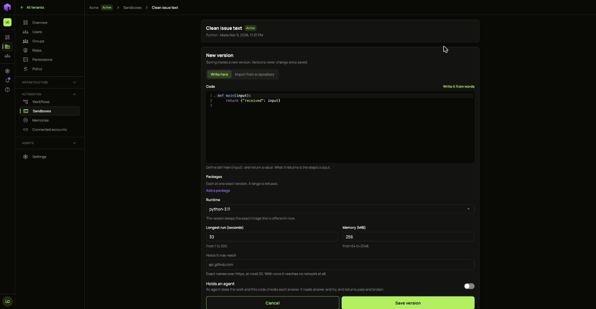
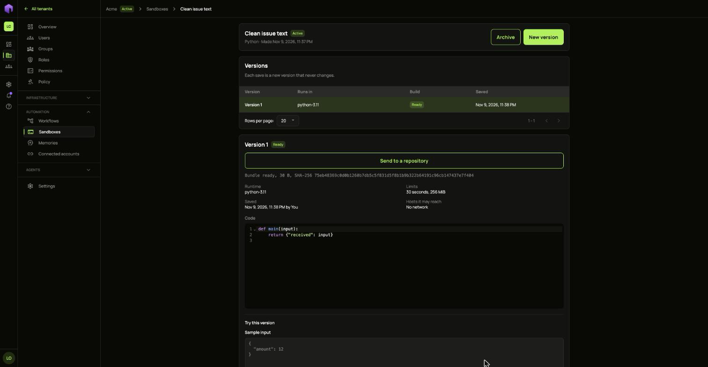
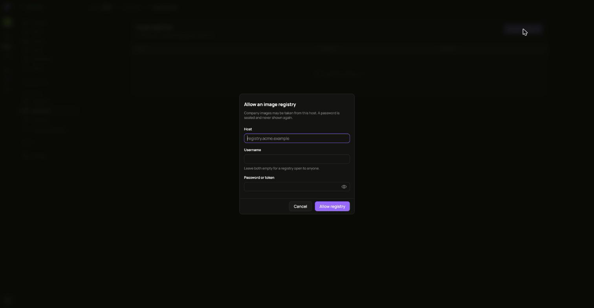

A sandbox holds code a workflow can run, locked away from everything else.

1. Open **Sandboxes** and choose **Make a sandbox**.
2. Give it a **Name** and pick **What it runs**. This never changes afterwards.
3. Choose **Make sandbox**.

## Save a version

1. Choose **New version**.
2. Write the code under **Write here**, or choose **Import from a repository**. In Python, define `main(input)` and return a value. What it returns is the step's output.
3. Add any **Packages**, each at one exact version. A range is refused.
4. Pick the **Runtime**, the **Longest run** and the **Memory**.
5. Under **Hosts it may reach**, list exact names over https. With none it reaches no network at all.
6. Choose **Save version**.

A saved version never changes. It shows **Building** while its packages are fetched, then **Ready**.

Add it to a workflow with the **Code** step.

## Use your own images

**Image registries** lists the hosts your company's images may come from. Choose **Allow a registry** and fill in the **Host**. Leave **Username** and **Password or token** empty for a registry open to anyone. A password is sealed and never shown again.

A company image works only where the installation allows it.
