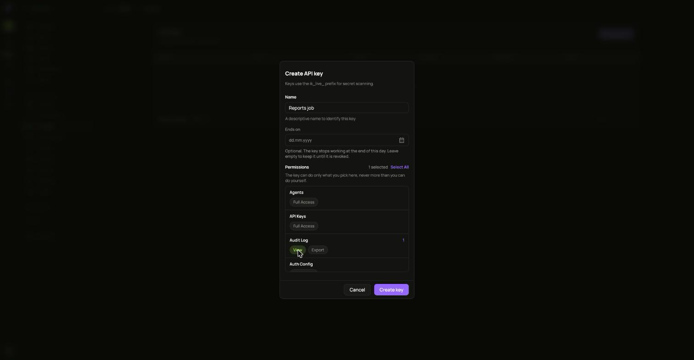
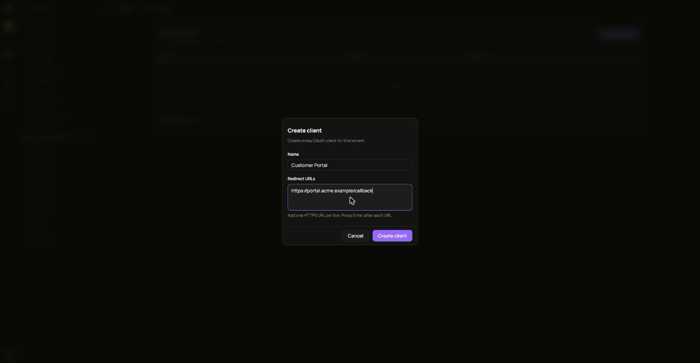

## API keys

An API key is for a script or a job. Open **API keys** and choose **Create**. Its full value is shown once.

The **...** menu offers **Pause**, which stops the key until you **Resume** it, and **Revoke**, which ends it for good.

## OAuth clients

An OAuth client is an app that signs people in through this tenant.

1. Open **OAuth Clients** and choose **Create Client**.
2. Fill in its name and redirect URLs, one HTTPS URL per line.
3. Copy the credentials it shows. They are not shown again.

The **...** menu offers:

- **Edit** for its details.
- **Rotate secret**. The current secret stops working immediately, and apps using it fail until you give them the new one.

  

- **Revoke**. The client can no longer sign in or issue new tokens. This cannot be undone.

  
