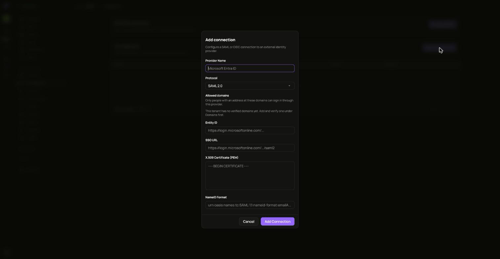
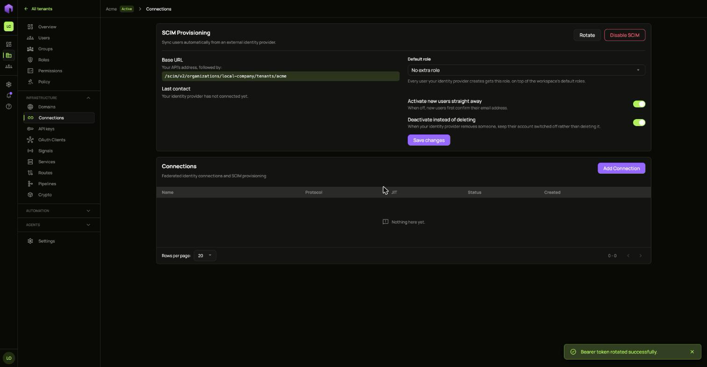
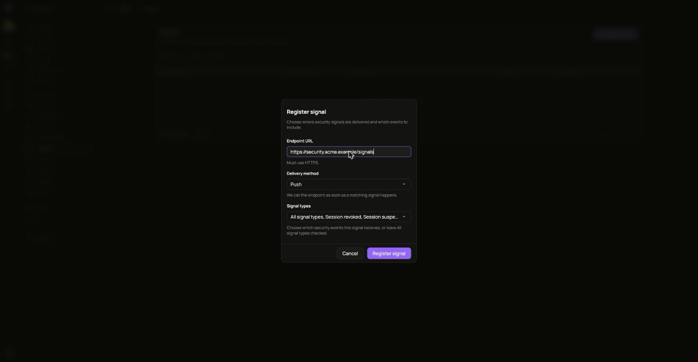
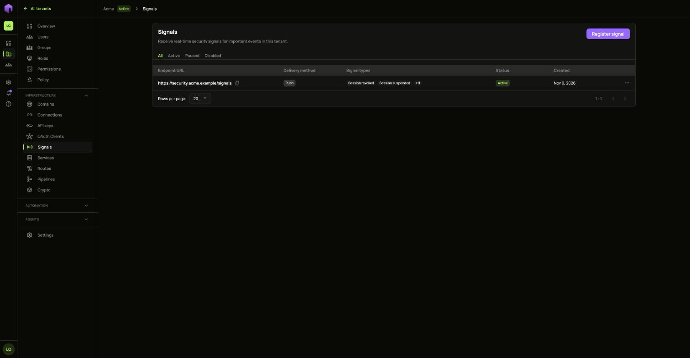
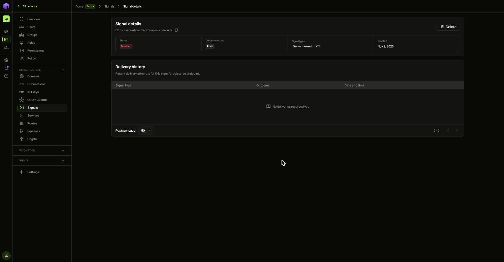
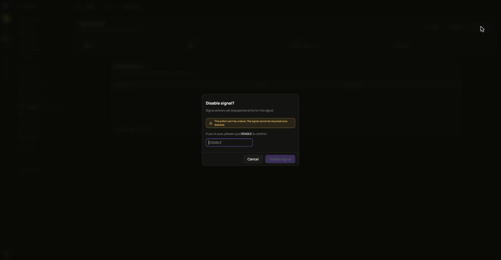

## Connections

Open **Connections** and choose **Add Connection** to connect a SAML or OIDC identity provider.

**Allowed domains** limits sign-in through that provider to people with an address at those domains.

Disabling a connection stops new sign-ins through it until you turn it back on. Sessions people already have are not affected.

### SCIM

SCIM syncs users automatically from your identity provider. Turn it on for a connection and copy the bearer token. It is not shown again.

Rotating the token stops the current one at once. Disabling SCIM stops provisioning.

## Signals

Signals send important security events to your own systems as they happen.

1. Open **Signals** and choose **Register signal**.
2. Choose where signals go. With push, ianua calls your endpoint as soon as a matching signal happens. With poll, your endpoint calls ianua on its own schedule.
3. Pick which events to include, or leave **All signal types** checked.
4. Copy the receiver key. Your endpoint checks deliveries with it, and it is shown once.

Open a signal to see recent delivery attempts.

The **...** menu offers **Pause** and **Resume**, **Edit**, and **Disable**. Disabling cannot be undone.

