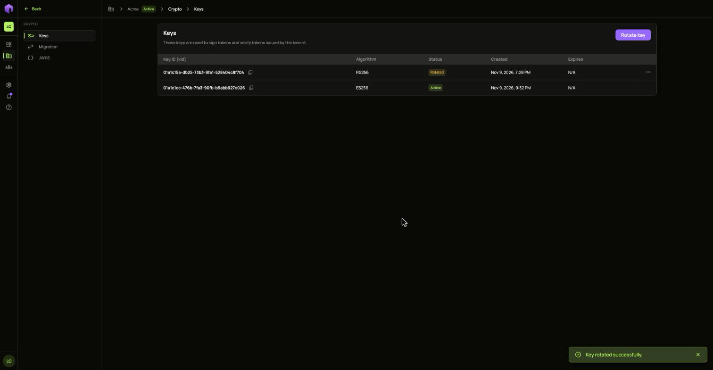
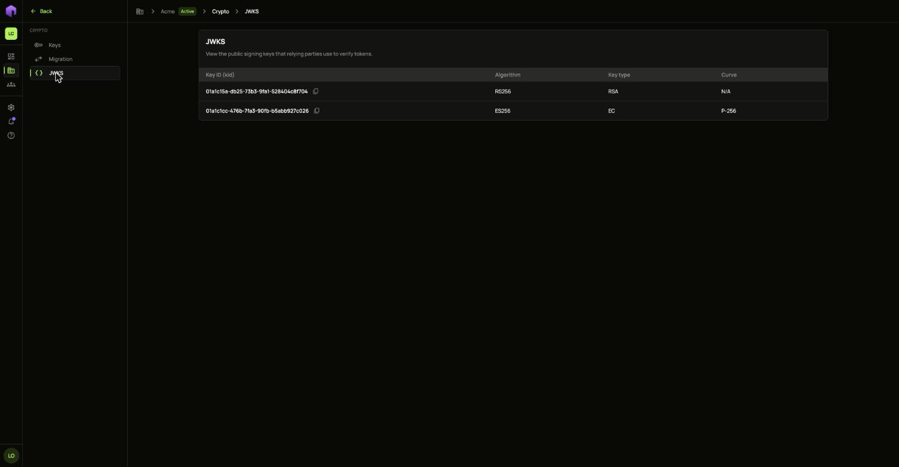
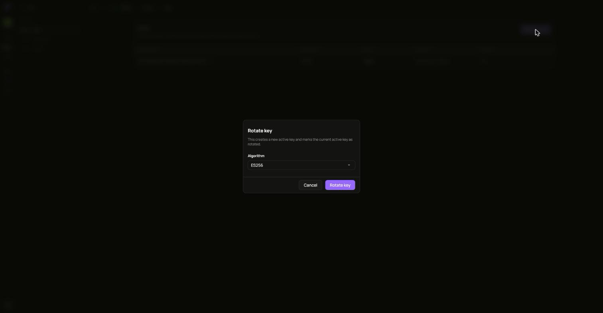
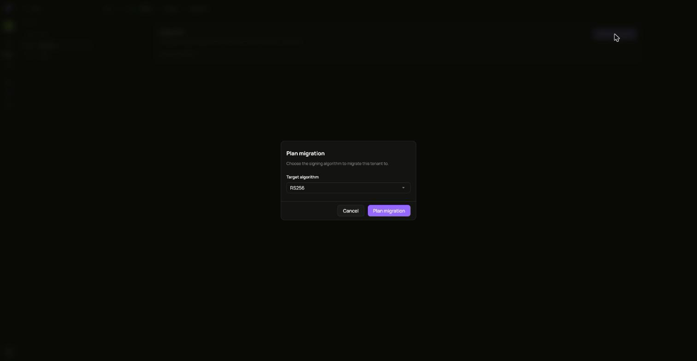
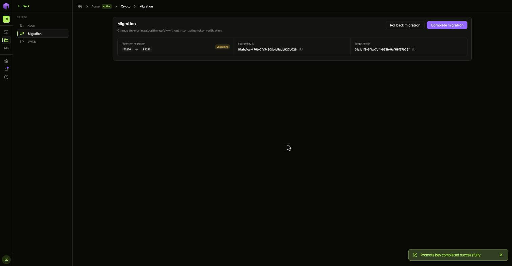

Open **Crypto** in the **Infrastructure** group.

**Keys** lists the keys that sign your tenant's tokens. **JWKS** shows the public keys that other services use to check those tokens.

## Rotate a key

Choose **Rotate**. A new key becomes active and the current one is marked as rotated.

Revoking a key removes it from JWKS, so tokens it signed can no longer be checked. The only active key cannot be revoked.

## Change the algorithm

**Migration** changes the signing algorithm without interrupting token checks.

1. Choose **Plan migration** and pick the algorithm.
2. Start it, and follow it through validation.

If something is wrong, roll it back and record why.
