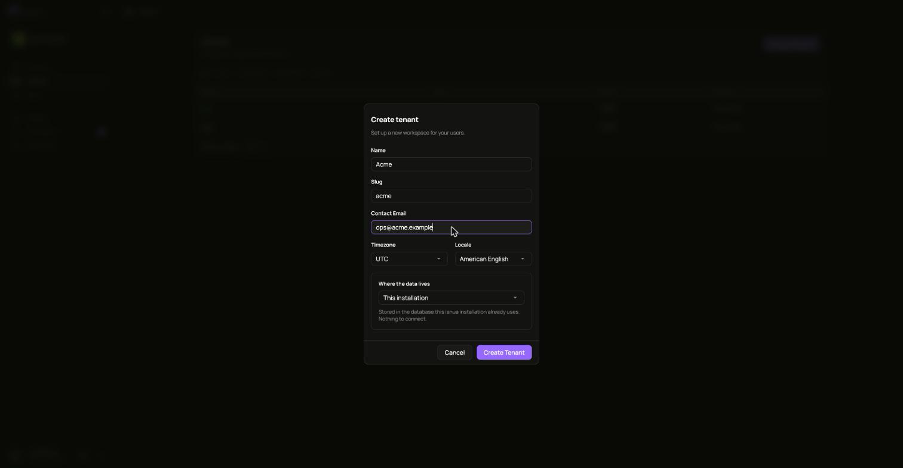
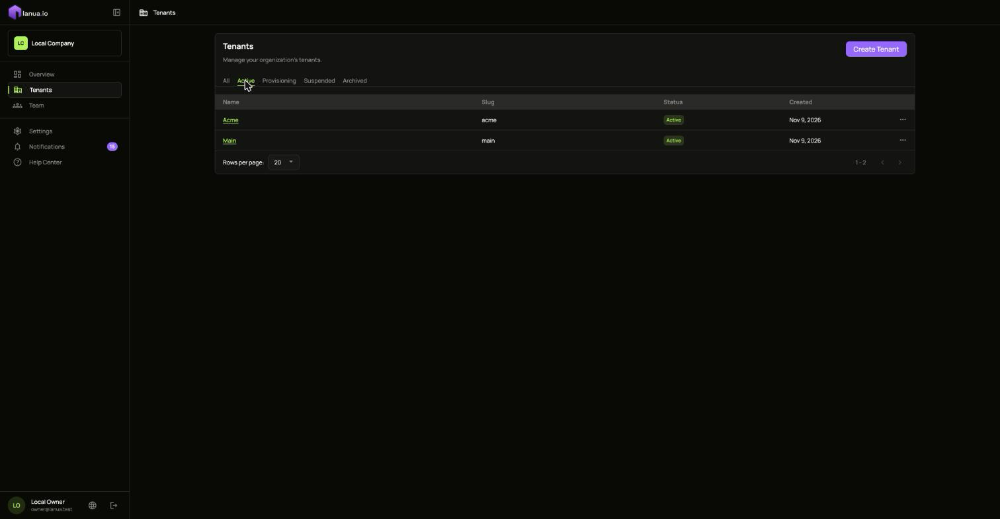
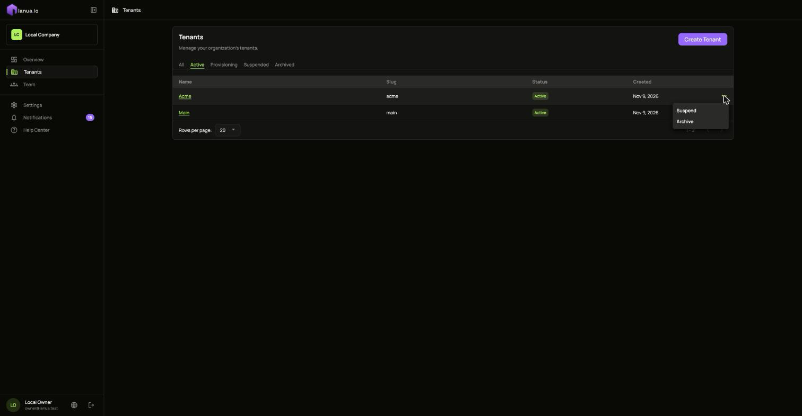

A tenant is a separate space with its own users, apps, keys and audit log. Read [Organizations and tenants](/ianua/concepts/organizations-and-tenants/) for what that means; this page is about doing it.

You need to be an **owner** or an **admin** of the organization to create, suspend, archive, restore or delete tenants.

## Create a tenant

1. Open **Tenants** and choose **Create tenant**.
2. Fill in:
   - **Name**: shown in the dashboard and in emails, for example `Staging`.
   - **Slug**: the short name used in addresses, for example `staging`. No other tenant of your organization may have it, but other organizations may use the same slug. It cannot be changed later.
   - **Contact Email**, **Timezone** and **Locale**.
   - **Where the data lives**: leave it on **This installation** to keep the tenant in the installation's own database.
3. Choose **Create Tenant**.



The tenant starts as **Provisioning** while ianua creates its default roles, its sign-in settings and its signing keys. After a few seconds it becomes **Active**, and you can open it.

A new tenant has no domain of its own. Add one once the tenant exists: it is proved first, and then it can be made the tenant's primary domain.



### Shared or dedicated schema

By default a tenant's rows sit in the same tables as every other tenant's, each one tagged with its tenant, and the database itself refuses to show one tenant's rows to another. If you want a tenant's tables kept physically apart as well, create it with a **dedicated schema**: its own set of tables inside the same database.

This choice is made once, at creation. The dashboard currently creates shared tenants; to create one with a dedicated schema, use the API (below).

## Change its details

Open the tenant, go to **Settings**, and edit its name, contact email, timezone, locale or primary domain under **General**. The slug stays as it is.

## Suspend, archive and delete

A tenant moves through the statuses shown in [a tenant's life](/ianua/concepts/organizations-and-tenants/#a-tenants-life). Its menu in **Tenants**, and the **Danger zone** in its **Settings**, offer what fits its current status:

| Status | What you can do |
| --- | --- |
| **Active** | **Suspend**, or **Archive** |
| **Suspended** | **Restore Access**, or **Archive** |
| **Archived** | Restore it, or once 30 days have passed, **Delete forever** |



- **Suspend** when something is wrong and everything must stop now: every session ends, nobody can sign in, and the gateway stops serving the tenant's apps. Nothing is lost, and **Restore Access** brings it all back.
- **Archive** when you are done with a tenant. It stops working as with suspending. For 30 days you can restore it, and it comes back as **Active**. Deleting it is refused until those 30 days have passed.
- **Delete forever** closes the tenant irreversibly and queues removal of its operational data. Its audit records remain in the organization's audit log and exports, for owners and admins, until their retention expires. Dedicated storage is removed after the retained trail is safe. There is no undo.

The gateway follows each change within moments, without a restart.

## With the API

Sign in as an owner, as in the [API quickstart](/ianua/start/quickstart-api/):

```sh
API=https://api.ianua.localhost/api/v1
TOKEN=$(curl -sk -X POST $API/login \
  -H 'Content-Type: application/json' \
  -d '{"email":"you@example.com","password":"Violet otters juggle 42 brass lanterns at dusk"}' | jq -r .refresh_token)
auth=(-sk -H "Authorization: Bearer $TOKEN" -H 'Content-Type: application/json')
ORG=$API/organizations/acme
```

Create a shared tenant:

```sh
curl "${auth[@]}" -X POST $ORG/tenants -d '{
  "slug": "staging",
  "display_name": "Staging",
  "contact_email": "you@example.com",
  "timezone": "UTC",
  "locale": "en-US"
}'
```

Create one with a dedicated schema instead, by adding where its data lives:

```sh
curl "${auth[@]}" -X POST $ORG/tenants -d '{
  "slug": "billing",
  "display_name": "Billing",
  "contact_email": "you@example.com",
  "timezone": "UTC",
  "locale": "en-US",
  "residency": { "kind": "platform", "isolation": "DedicatedSchema" }
}'
```

Rename it, then suspend, reactivate, archive and restore it:

```sh
curl "${auth[@]}" -X PATCH  $ORG/tenants/staging -d '{"display_name":"Staging (EU)"}'
curl "${auth[@]}" -X POST   $ORG/tenants/staging/suspend
curl "${auth[@]}" -X POST   $ORG/tenants/staging/reactivate
curl "${auth[@]}" -X POST   $ORG/tenants/staging/archive
curl "${auth[@]}" -X POST   $ORG/tenants/staging/restore
```

Each answers `204`, or `422` when the tenant's status does not allow the step. Delete an archived tenant once its 30 days have passed; before that, the answer is `409`:

```sh
curl "${auth[@]}" -X DELETE $ORG/tenants/staging
```

List your tenants and their status:

```sh
curl "${auth[@]}" $ORG/tenants | jq '.items[] | {slug, status}'
```
