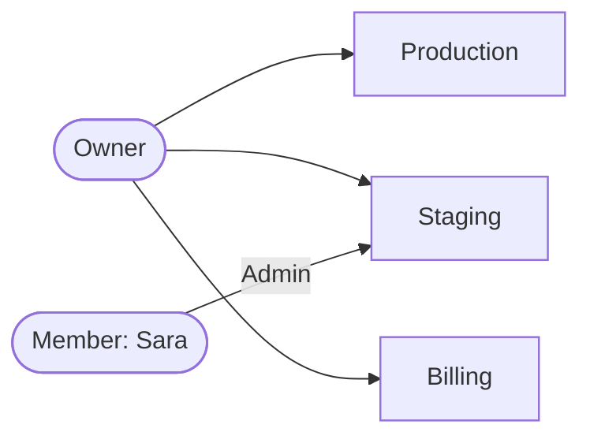
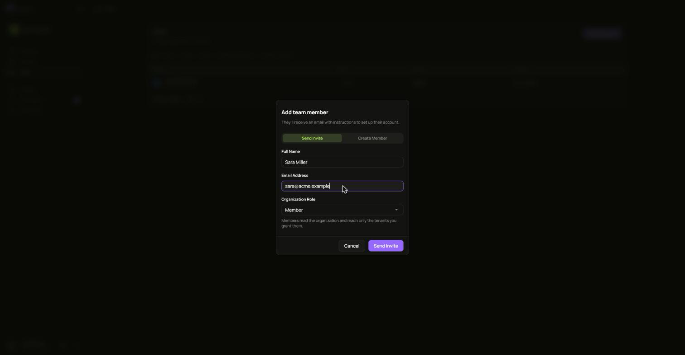
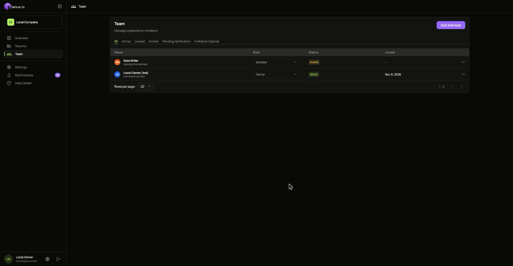
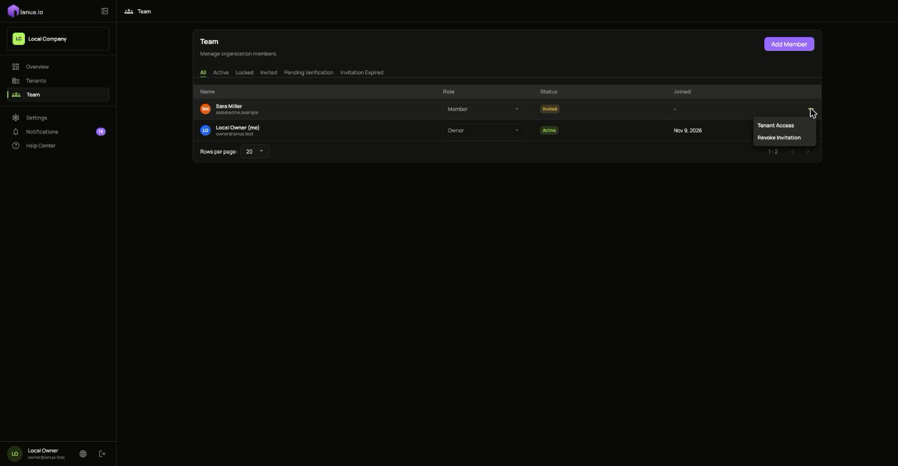
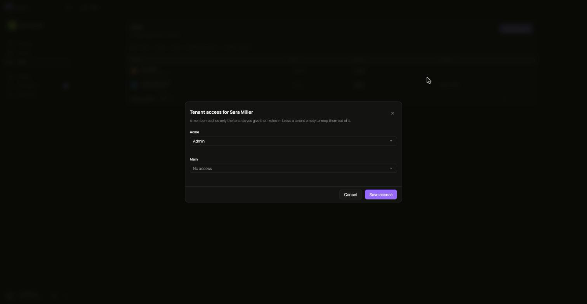

Your **team** is the people who run ianua: they sign in to the dashboard and manage tenants. They are not the users of your apps; those live inside each tenant. See [Organizations and tenants](/ianua/concepts/organizations-and-tenants/) for the difference.

You need to be an **owner** or an **admin** to do what this page describes. Only an owner can make someone an owner or a billing contact, or act on someone who is one.

## The team's roles

Every team member has one of five roles:

- **Owner**: runs the whole organization and can open every tenant, with full permissions in each.
- **Admin**: the same as an owner, except closing the organization and changing what it pays.
- **Member**: sees only the tenants an owner or admin gives them, and in each one can do only what the roles they hold there allow.
- **Billing**: runs the subscription and its payment, and opens no tenant.
- **Viewer**: reads the organization and its bill, and opens no tenant.



An owner reaches every tenant. Sara, a member, reaches only Staging, and holds only the **Admin** role there.

Give the owner and admin roles to the few people who manage ianua itself. Give everyone else who works in tenants the member role, with access to just the tenants they work on.

## Add someone

1. Open **Team** and choose **Add Member**.
2. Pick how they get in:
   - **Send Invite**: they get an email with a link and choose their own password. The link expires after one day; `INVITATION_TTL_SECONDS` changes that.
   - **Create Member**: you set their password, or choose **Generate** for a strong one. Pass it on to them yourself.
3. Enter their name and email address, choose their role, and confirm.



They appear in **Team** right away, as **Invited** until they accept.



A new **member** cannot reach any tenant yet. They can still sign in: their session works on the organization alone, where they read the team and their own account, and opens no tenant. Give them access next.

## Give a member access to tenants

1. In **Team**, open the menu on the member's row and choose **Tenant Access**.

   

2. Every tenant in your organization is listed, except archived ones. For each one the member should reach, pick the roles they should hold there, for example **Admin** or a role you made for them.
3. Leave a tenant empty to keep them out of it, and choose **Save access**.



The member sees those tenants the next time the dashboard loads their access. A member who signed in before you gave them a tenant signs in again, or moves their session into it, to open it. Inside each tenant they hold exactly the roles you picked, the same roles that tenant's own users can hold. To take someone out of a tenant, clear its roles and save.

Tenant access is only for members. Owners and admins already open every tenant, and billing contacts and viewers open none, so giving any of them tenant access is refused.

## Change someone's role

Use the **Role** column in **Team** to give someone another role. The change ends their sessions, so their next sign-in carries the new role. A change that would leave the organization without an active owner is refused.

An owner can also hand their ownership to another active member in one step, while signed in: the other person becomes an owner and the one handing it on becomes an admin, so the organization always has an owner. Both of them are signed out.

If the owner submits two handovers at the same time, only one can succeed. If the handover cannot be recorded in the audit trail, both people keep their previous roles and sessions.

Turning an owner or admin into a member takes away their access to every tenant until you give them some through **Tenant Access**.

## Lock, reset or remove someone

The menu on each row shows what can be done with that person right now:

| Their status | What you can do |
| --- | --- |
| **Active** | **Lock** stops them signing in and ends their sessions. **Reset Password** gives them a new one, shown to you once. **Delete Forever** removes them. |
| **Locked** | **Restore Access** lets them sign in again. |
| **Invited** | **Revoke Invitation** makes the link stop working. |
| **Invitation expired** | **Resend Invitation** sends a fresh link. |

Locking or deleting someone ends their sessions and revokes every delegation they gave an agent. You cannot delete yourself, and you cannot lock, deactivate or delete the last active owner.

## With the API

Everything above can be scripted. Sign in as an owner first, as in the [API quickstart](/ianua/start/quickstart-api/):

```sh
API=https://api.ianua.localhost/api/v1
TOKEN=$(curl -sk -X POST $API/login \
  -H 'Content-Type: application/json' \
  -d '{"email":"you@example.com","password":"Violet otters juggle 42 brass lanterns at dusk"}' | jq -r .refresh_token)
auth=(-sk -H "Authorization: Bearer $TOKEN" -H 'Content-Type: application/json')
ORG=$API/organizations/acme
```

Invite a member:

```sh
curl "${auth[@]}" -X POST $ORG/users \
  -d '{"email":"sara@example.com","display_name":"Sara","role":"Member"}'
```

Find their id, then give them the **Admin** role in the `staging` tenant:

```sh
SARA=$(curl "${auth[@]}" "$ORG/users" | jq -r '.items[] | select(.email=="sara@example.com") | .id')

curl "${auth[@]}" -X PUT $ORG/users/$SARA/tenants/staging -d '{"roles":["Admin"]}'
```

Roles are named as they appear in that tenant. Sending an empty list, `{"roles":[]}`, takes the member out of the tenant.

See what a team member can reach, tenant by tenant:

```sh
curl "${auth[@]}" $ORG/users/$SARA/access | jq
```

Make someone an admin, or lock them:

```sh
curl "${auth[@]}" -X PATCH $ORG/users/$SARA/role -d '{"role":"Admin"}'
curl "${auth[@]}" -X PATCH $ORG/users/$SARA/status -d '{"status":"Locked"}'
```

The role is one of `Owner`, `Admin`, `Member`, `Billing` and `Viewer`. The status is `Active`, `Locked` or `Deactivated`. A change that would leave no active owner answers `409`.

As an owner, hand your ownership to Sara. She becomes an owner and you become an admin:

```sh
curl "${auth[@]}" -X POST $ORG/users/$SARA/transfer-ownership
```
