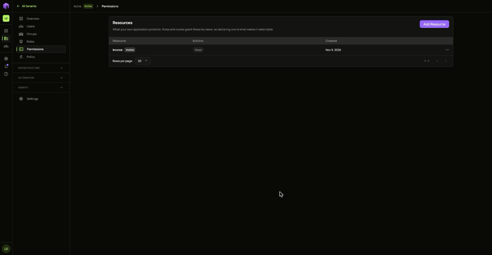
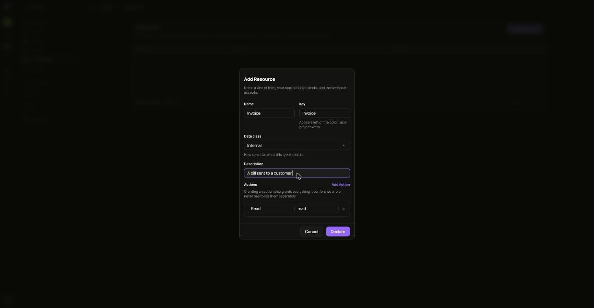
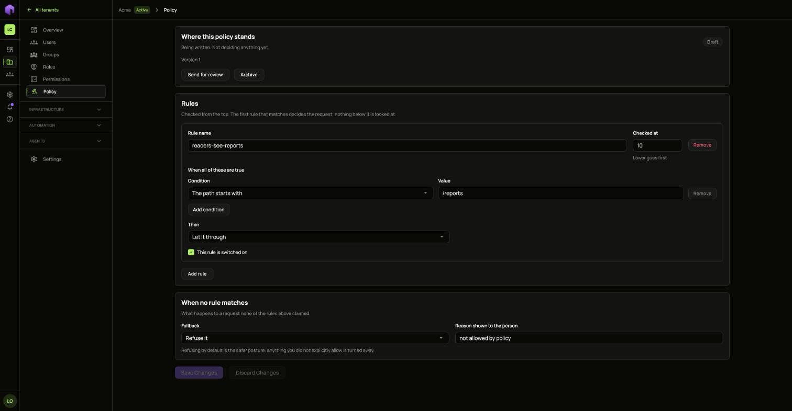

## Permissions

Open **Permissions** to describe the things your own apps protect and the actions on them. Choose **Create** and fill in a name. The key fills itself in from the name.

Use the row's **...** menu to change or delete one. What you define here can then be picked inside a [role](/ianua/guides/people-and-access/groups-and-roles/).

## Policy

Open **Policy** to decide which requests are allowed. Rules are checked from the top. The first rule that matches decides the request, and nothing below it is looked at.

**When no rule matches** says what happens to a request none of the rules claimed. Refusing by default is the safer choice: anything you did not explicitly allow is turned away.

A policy starts as a draft. Activating it makes its rules start deciding real requests straight away. Taking a version out of service leaves only each route's own policy deciding traffic until another version goes live.
