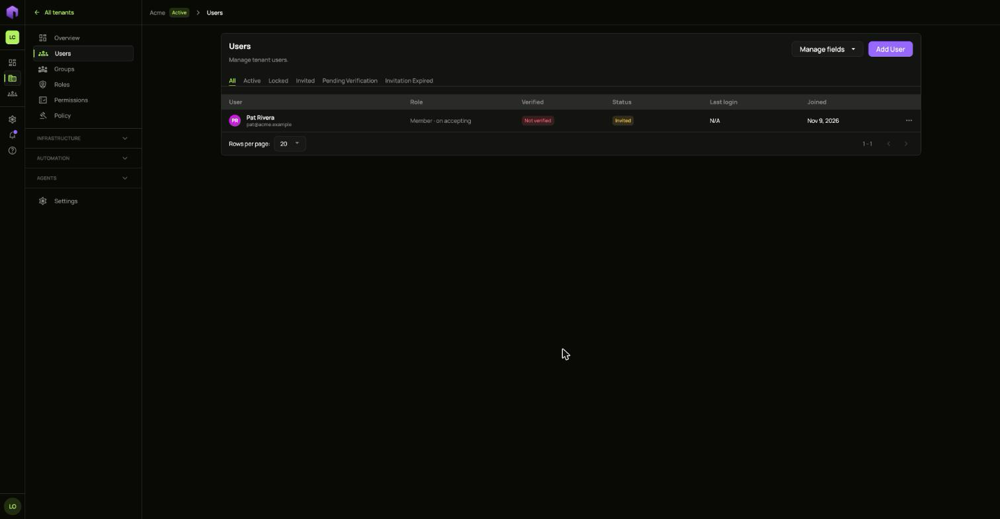
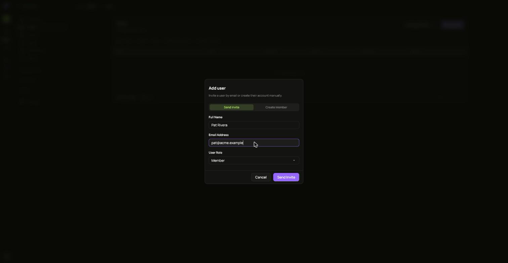
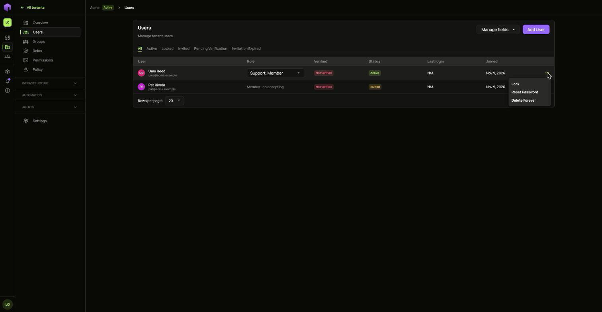
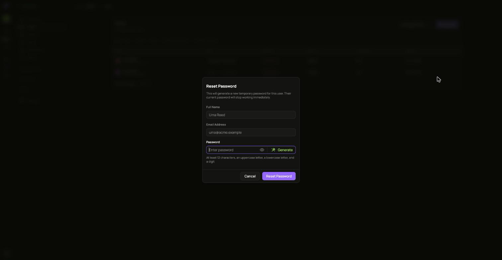
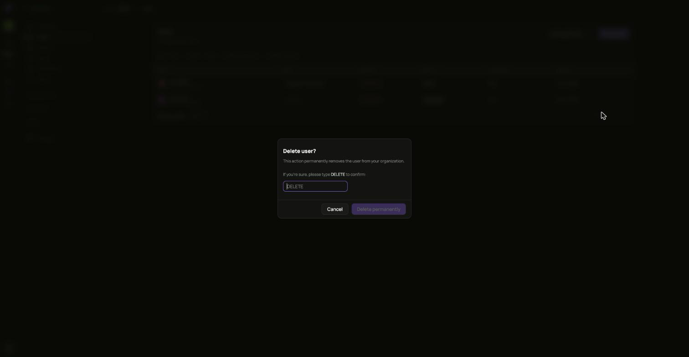

Users are the people who sign in to a tenant. Open your tenant and choose **Users**.

## Add a user

Choose **Add User**. You can invite someone by email or create their account yourself.

An install that cannot send mail shows you an invitation link instead. Hand that link to the person yourself.

## Act on a user

The **...** menu on each row offers what fits that person's state.

- **Reset password** gives you a temporary password to share. It is not shown again.

  

- **Lock user** stops the person signing in until you unlock them.

  

- **Revoke** withdraws an invitation that has not been accepted.

  

- **Delete** removes the person from the tenant. **Restore** brings a deleted person back.

  

  
