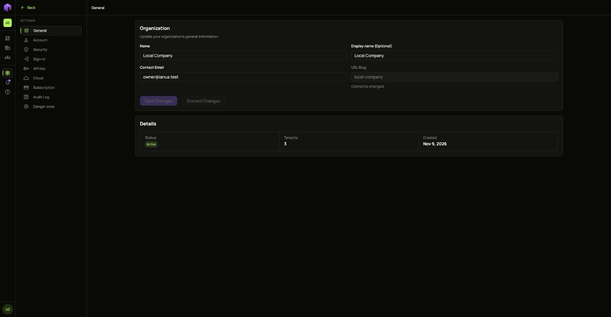
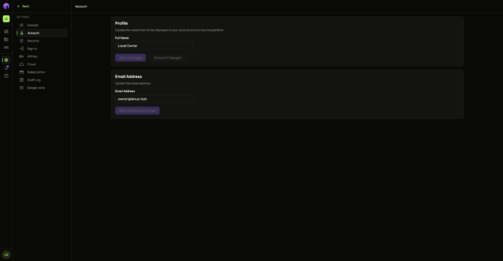
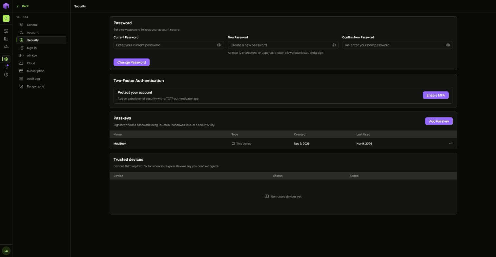
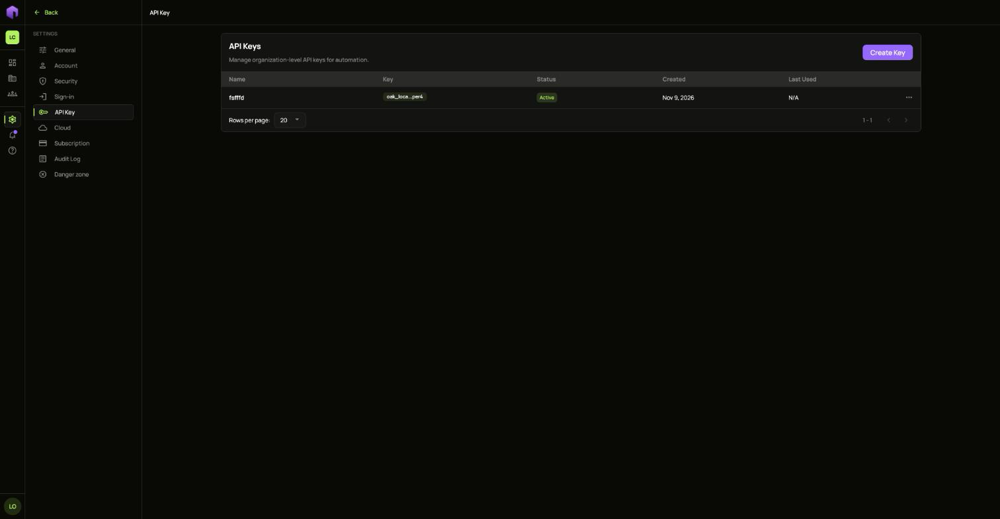
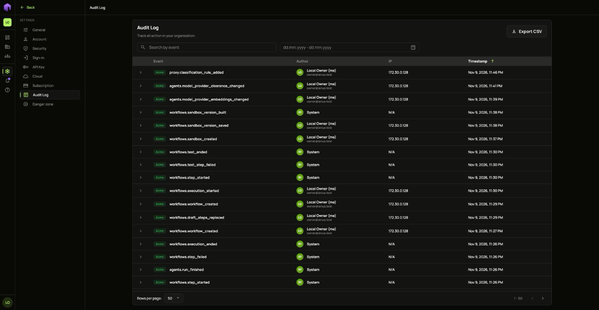
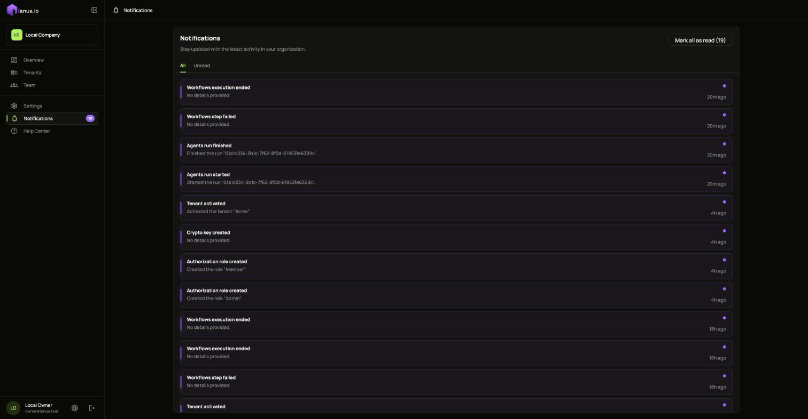
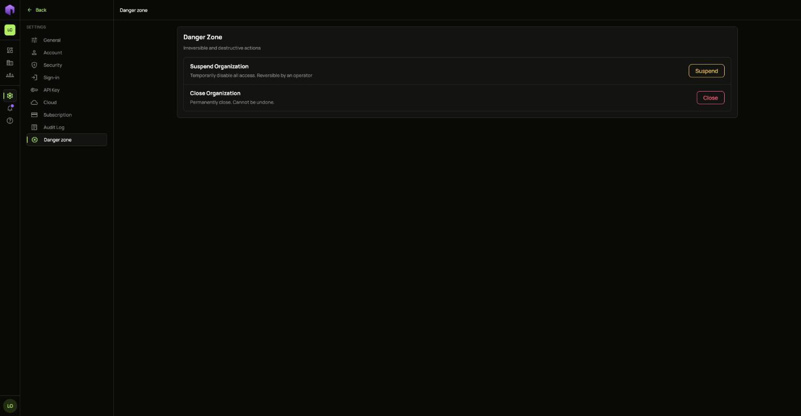

Choose **Settings** in the outer menu, outside any tenant.

## General

Change the organization's **Name**, **Display name** and **Contact Email**. The URL slug cannot be changed.

## Account and Security

**Account** holds your own name and email address. A new address has to be confirmed from a mail sent to it.

**Security** is where you change your password, turn on a second factor, add passkeys and remove devices you trust.

**Sign-in** holds the same rules as a [tenant's Sign-in settings](/ianua/guides/settings/tenant-settings/), for your team.

## API Key

Organization API keys are for automation. Choose **Create Key**. Each key's full value is shown once.

## Audit Log

Every change in the organization and its tenants is recorded here, with who did it, from where and when. Search by event, pick dates, or open a row for its details. **Export CSV** downloads what you filtered.

## Notifications

**Notifications** lists what happened in your organization. **Mark all as read** clears the count.

## Danger zone

**Suspend** turns off all access until an operator reverses it. **Close** ends the organization permanently.

