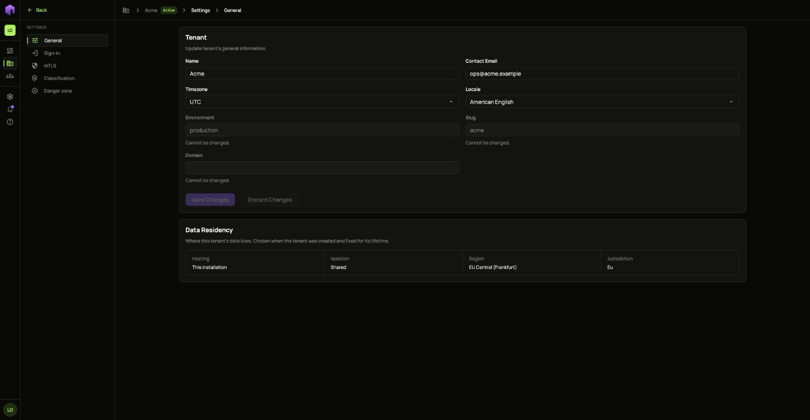
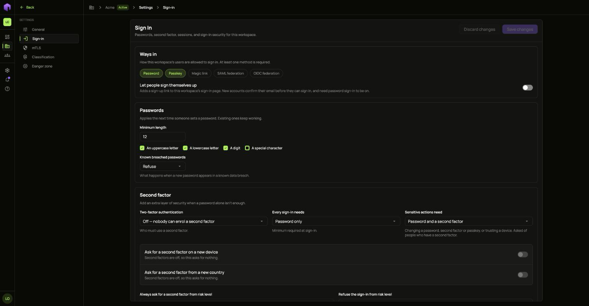
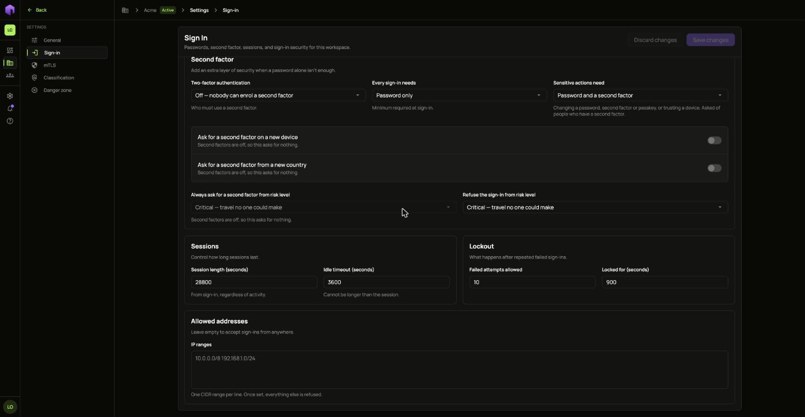
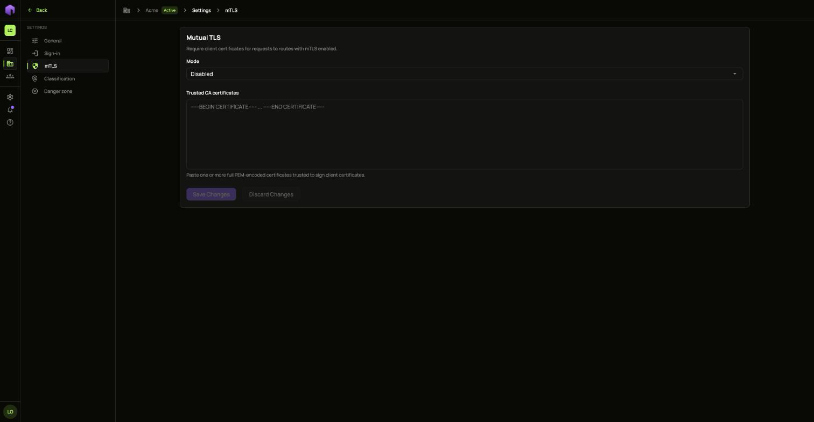
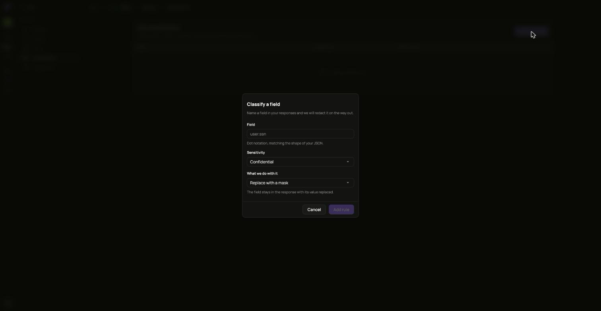
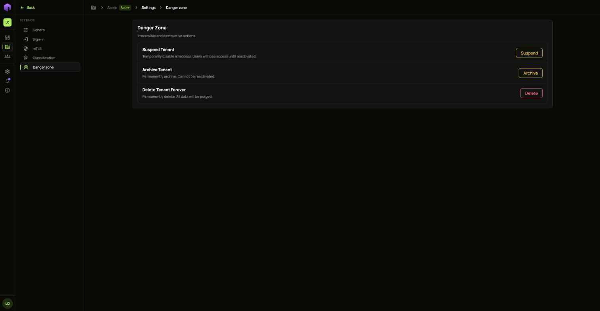

Open your tenant and choose **Settings** at the bottom of the side menu.

## General

Change the tenant's **Name**, **Contact Email**, **Timezone** and **Locale**. The environment, the slug and the domain cannot be changed here. **Data Residency** shows where the tenant's data lives, which was chosen when the tenant was created.

## Sign-in

Choose which **Ways in** people may use, whether they may sign themselves up, and the rules for passwords.

Lower down are **Second factor**, **Sessions**, **Lockout** and **Allowed addresses**. Once you add an address range, every address outside it is refused.

## mTLS

Requires client certificates on routes that have mutual TLS on. Pick the **Mode** and paste the certificates you trust.

## Classification

Names the fields the gateway strips, masks or hashes in responses before they leave.

1. Choose **Classify field**.
2. Type the **Field** in dot notation, matching your JSON, for example `customer.card_number`.
3. Pick its **Sensitivity** and **What we do with it**.
4. Choose **Add rule**.

## Danger zone

Suspend, archive or delete the tenant. See [Create and manage tenants](/ianua/guides/organizations-and-tenants/manage-tenants/).

