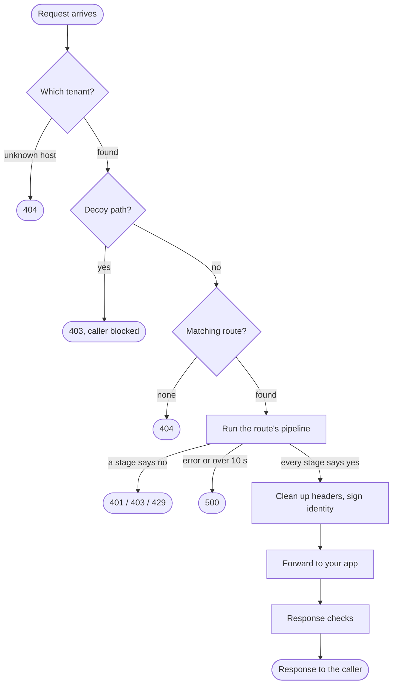
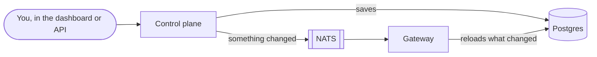

In the Quickstart you sent three requests. One reached the app, one was refused with `401`, and one with `404`. This page follows a request through the gateway step by step, so you can see where each of those answers came from.

The short version: **the gateway lets a request through only when every step says yes.** A step that says no, fails, or takes too long ends the request there, and your app never sees it.

:::note
The gateway (`ianua-zero`) is being rebuilt on top of the new application layer. This page describes the gateway's code as it is today, including its defaults, such as the 10-second limit on the checks.
:::

## The life of a request

### 1. Which tenant is this for?

The gateway reads the hostname and finds the tenant that owns it. It accepts three forms:

- **A domain you added to the tenant**, such as `app.example.com`.
- **A random tenant address**, such as `k7f3q9.apps.example.com`, with apps at `wiki.k7f3q9.apps.example.com`. Self-hosted installations with an operator wildcard use `wiki-k7f3q9.apps.example.com`.
- **An explicitly enabled readable address**, such as `main.acme.apps.example.com`, with apps one label below it. This is off by default and requires nested addressing.

Random labels are independent of tenant IDs. They reduce disclosure of organization names, but do not replace access policy. Readable addresses and their wildcard certificates become public in certificate transparency logs when issued by a publicly trusted authority. Disabling the setting stops serving the address; it cannot erase existing transparency entries. Without suitable platform TLS, the installation serves custom domains only and says so at startup.

A hostname no tenant owns gets `404`. Nothing about any tenant is revealed.

### 2. Is it a trap?

A tenant can set up **decoy paths**: addresses no real user would ever visit, such as `/.env` or `/wp-admin`. Before looking for a route, the gateway checks the path against them. Touching one answers `403`, blocks the caller's address for a while, and records the hit. A caller already blocked is refused here too, whatever path it asks for.

This runs before route matching on purpose, because a decoy path by definition matches no route.

### 3. Which route?

The gateway looks for a route whose path pattern, method and (optionally) hostname match the request. If none matches, the answer is `404`. This is the `/admin` request in the Quickstart: there was no route for it.

The route decides three things for the rest of the journey:

- **which pipeline** runs the checks,
- **which service** the request goes to,
- **who may use it** (the route's policy: anyone, any signed-in caller, or only callers holding a given permission).

### 4. The pipeline

A pipeline is an ordered list of **stages**. The gateway runs them from top to bottom, and each stage either lets the request continue or ends it with an answer.

Two stages are in every pipeline and can never be removed:

| Stage | What it asks |
| --- | --- |
| **Identity** | Who is calling? It checks the session token, API key or client certificate. A token must have a valid signature, the right issuer and audience, and must not be expired. |
| **Policy** | Is this caller allowed on this route? It checks the route's policy against what the caller holds, then the tenant's own policy, if one is in force. |

This is where the `/private/hello` request stopped: the route requires a signed-in caller, the request carried no token, so the answer was `401`.

Every other check is a stage you add to the pipeline: rate limits, a web application firewall, country restrictions, bot and scanner detection, step-up sign-in, data tagging, and more. Each route picks its pipeline, so a public website and an internal admin tool can be checked very differently.

Three rules make the pipeline safe by default:

- **No answer means no.** If the pipeline is not active, a stage fails, or the whole run takes longer than 10 seconds, the request is refused.
- **The decision is made before the body is read in full.** Stages that need to look at the body see only the first part of it, up to a limit. The rest streams straight through, so a huge upload cannot exhaust the gateway.
- **The body is capped.** A request declaring a body larger than the pipeline allows is refused with `413` before anything is read.

### 5. Cleaning up and signing

Once every stage has said yes, the gateway prepares the request for your app:

- **It removes identity headers the caller set.** A caller cannot claim to be someone by sending `X-Forwarded-User: admin` or a forged `X-Ianua-Assertion`. This is why neither header reached the app in the Quickstart.
- **It removes the credentials the caller presented.** Your app never sees the user's token or session cookie, so it cannot leak them.
- **It adds the standard forwarding headers:** `X-Forwarded-For`, `X-Forwarded-Host` and `X-Forwarded-Proto`.
- **It signs who the caller is.** When the caller is a known user or agent, the gateway adds `X-Ianua-Assertion`: a short-lived token, valid for 30 seconds, signed with the tenant's assertion key. It names the user, the tenant and the request, and lists the user's roles and permissions. When an agent acts for someone, it also names the agent and the person it acts for.

Your app can check that signature with the tenant's assertion keys, published at `/.well-known/ianua-assertion-keys.json` on the same host. They are not the keys in `/.well-known/jwks.json`: those sign the tenant's tokens, and the gateway never holds them. Because the assertion is signed, your app never has to trust a plain header.

### 6. Forwarding

The gateway sends the request to the route's service. If the service has several backends it picks a healthy one, and it never waits forever: every call to your app has a timeout.

The gateway also refuses to connect anywhere it should not. A service's address must be public or inside a private network the operator allowed, and cloud metadata addresses are refused whatever is allowed. This is checked both when the service is saved and again every time the gateway connects, so a name that later points somewhere internal is still caught.

If your app cannot be reached the answer is `502`, if it is too slow `504`, and if there is no copy of it to send to, for example because its DNS name resolves to nothing, `503`.

### 7. On the way back

Some stages look at the response instead of the request: adding security headers, masking sensitive fields, catching a leaked decoy credential, or caching. They run before the response is returned to the caller.

### Every decision is recorded

Whatever the outcome, the gateway writes one record per request: who called, which tenant and route, the decision, and for a refusal the reason. Tokens and passwords are never part of it.

## How your settings reach the gateway

The gateway never changes a setting. It reads them, and it learns about changes the moment they happen.

When you save a route, a pipeline or a domain, the control plane stores it and announces that it changed. Every running gateway hears the announcement and reloads just that part from the database. This is why your routes worked in the Quickstart without restarting anything.

The announcement carries no settings, only "this tenant's routes changed". The gateway always reads the settings themselves from the database. So even someone able to write to the event bus cannot tell the gateway what to do; at most they can make it reload what it already has.

## What's next

- **Install on Kubernetes** sets ianua up for real use.
- The **Concepts** pages go deeper into each part: tenants, authentication, routes and policies, and AI agents.
