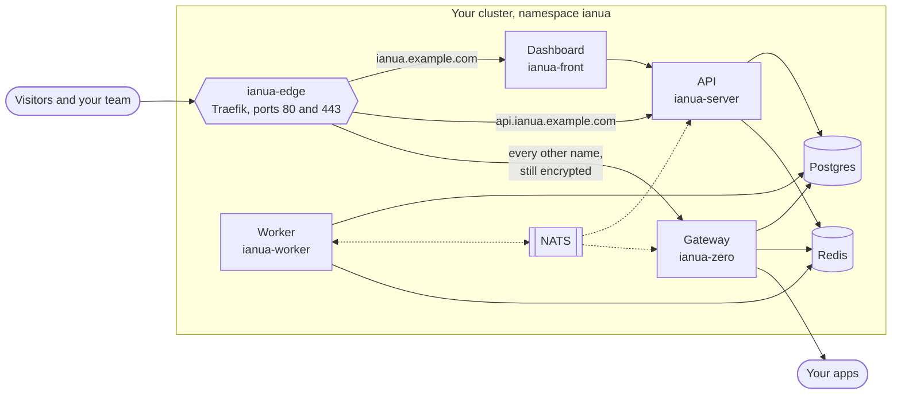
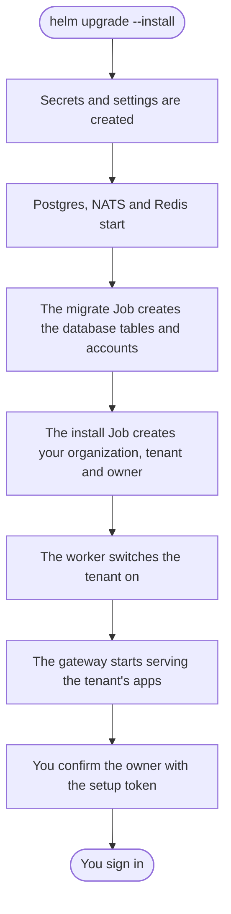

This installs ianua for real use: on your own cluster, on your own domains, with certificates issued automatically. It takes two Helm commands, one for ianua and one for the dashboard, and nothing needs to be installed in the cluster beforehand.

## What you will end up with



- **ianua-edge** is the one entrance. It is a Traefik installed by the chart, with a single public LoadBalancer.
- The **dashboard** and the **API** have their TLS ended at Traefik, with certificates from Let's Encrypt.
- **Every other hostname**, your apps, passes through to the **gateway still encrypted**. The gateway holds those certificates itself, so it can see who is calling and decide.
- The **worker** runs background jobs, such as setting up new tenants and renewing certificates, and relays every recorded change to NATS.
- **Postgres** stores everything, the job queue among it. **NATS** carries change notifications, and **Redis** holds the counts every node shares.
- A **volume** holds data exports and logos, shared by the API and the worker.

## Before you start

- **A Kubernetes cluster** that can create a `LoadBalancer` Service with a public address. Every managed cloud cluster can; on your own hardware, k3s's built-in load balancer or MetalLB works.
- **A storage class**, for the disks of Postgres, NATS, the file store and Traefik's certificates.
- **An SMTP server**, for sign-in links, invitations and password resets.
- **`kubectl` and `helm` 3**, pointed at that cluster.
- **A domain** you can add DNS records to. This guide uses `example.com`.
- **Ports 80 and 443 reachable from the internet**, so Let's Encrypt can check your domains.

## 1. Get the charts

```sh
git clone https://github.com/IanuaIDP/ianua.git
cd ianua
```

## 2. Write your settings

The chart ships with a ready file for a self-hosted install, `deploy/helm/ianua/values-selfhosted.yaml`. You only override what is yours. Create `my-values.yaml`:

```yaml
selfHosted:
  organizationName: Acme
  owner:
    email: you@example.com
    name: Your Name
  # Any name under these can be added to a tenant straight away.
  trustedDomains:
    - example.com

config:
  baseDomain: apps.example.com
  appBaseUrl: https://ianua.example.com
  emailLogoUrl: https://api.ianua.example.com/email-logo.png
  corsOrigin: https://ianua.example.com
  webauthn:
    rpId: ianua.example.com
    rpOrigin: https://ianua.example.com
  email:
    from: noreply@example.com
    fromName: Ianua
    smtp:
      host: smtp.example.com
      username: ianua

secrets:
  smtpPassword: "<your SMTP password>"

acme:
  contactEmail: you@example.com

traefik:
  terminated:
    - host: ianua.example.com
      service: ianua-front
      port: 80
    - host: api.ianua.example.com
      service: ianua-server
      port: 80
  # The dashboard's host. File links and logos are made under it, so its
  # /api/v1 goes straight to the API.
  appHosts:
    - ianua.example.com

edge:
  certificatesResolvers:
    letsencrypt:
      acme:
        email: you@example.com
        storage: /data/acme.json
        tlsChallenge: {}
```

Three names matter, and you will point all three at the cluster in step 5:

| Name | What it is |
| --- | --- |
| `ianua.example.com` | The dashboard. |
| `api.ianua.example.com` | The API. |
| `*.apps.example.com` | With an operator wildcard certificate, apps answer at `<app>-<random-label>.apps.example.com`. |

Create the wildcard certificate with your own tooling and supply it through `zero.tls.existingSecret`, then set `config.platformWildcardTls: true`. The bundled nameserver stays off. Without that certificate, platform addresses stay off and tenants use custom domains. To choose nested addresses instead, set `config.platformAddressing: nested`, configure ACME and the authoritative nameservers, and delegate the apps domain to them. A private ACME authority uses the same DNS-01 path with DNS reachable by that authority.

You do not need to set any other secrets. The signing keys, the encryption key, the database passwords and the owner's first password are all generated on the first install, and kept on every upgrade.

:::caution
Never delete the `ianua-secrets` Secret. It holds the encryption key, and stored keys and certificates cannot be read without it. Back it up together with the database.
:::

## 3. Install ianua

```sh
helm upgrade --install ianua deploy/helm/ianua \
  --namespace ianua --create-namespace \
  -f deploy/helm/ianua/values-selfhosted.yaml \
  -f my-values.yaml
```

Keep the release name `ianua`: the routes in the self-hosted file name the services it creates.

Helm runs two Jobs once the database is up. The **migrate** Job (`ianua migrate`) sets up the database tables and accounts. Then the **install** Job (`ianua install`) makes your organization, its first tenant and its owner from `selfHosted`. Both run again on every upgrade, and change nothing that is already there. Only the install Job receives the `selfHosted` settings, as `INSTALL_*`, with the owner's password from a Secret of its own. Every other command refuses them, so the first password never stays in a serving pod's environment.

## 4. Install the dashboard

The dashboard has its own chart, beside ianua's in `deploy/helm/`. Install it next to ianua, reachable only inside the cluster, and talking to the API directly:

```sh
helm upgrade --install ianua-front deploy/helm/ianua-front \
  --namespace ianua \
  --set service.type=ClusterIP \
  --set apiUrl=http://ianua-server/api/v1
```

Traefik already sends `ianua.example.com` to the `ianua-front` service, so there is nothing else to connect.

## 5. Point your domains at the cluster

Find the public address the entrance was given:

```sh
kubectl get svc -n ianua ianua-edge \
  -o jsonpath='{.status.loadBalancer.ingress[0].ip}'
```

Some clouds hand out a hostname instead of an address; then read `.hostname` in place of `.ip`, and use `CNAME` records below.

Create three DNS records pointing at it:

| Record | Type | Value |
| --- | --- | --- |
| `ianua.example.com` | `A` | the address |
| `api.ianua.example.com` | `A` | the address |
| `*.apps.example.com` | `A` | the address |

The first two get their certificates from Let's Encrypt as soon as DNS answers.

## 6. Sign in

Watch everything start:

```sh
kubectl get pods -n ianua -w
```

The first install Job printed a one-time setup token that confirms the owner's email address. Read it, and send it to the API within a day:

```sh
kubectl logs -n ianua job/ianua-install

curl -X POST https://ianua.example.com/api/v1/users/confirm-installer \
  -H 'Content-Type: application/json' \
  -d '{"token": "<the token>"}'
```

Then open **https://ianua.example.com** and sign in as the owner email from your settings. The password was generated; read it with:

```sh
kubectl get secret -n ianua ianua-install \
  -o jsonpath='{.data.INSTALL_OWNER_PASSWORD}' | base64 -d; echo
```

Change it in the dashboard after signing in.

## What happens on the first start



The organization, tenant and owner are created only once. Changing `selfHosted` settings afterwards does nothing: rename things in the dashboard instead.

## Good to know

### Which apps the gateway may reach

The gateway forwards only to public addresses, and to private networks you allow. The self-hosted install allows all three private ranges by default (`10.0.0.0/8`, `172.16.0.0/12` and `192.168.0.0/16`), which covers the services in your cluster and most office networks. Narrow it to what you use:

```yaml
selfHosted:
  upstreamNetworks:
    - 10.0.0.0/8
```

Cloud metadata addresses, where cloud servers keep their credentials, are refused whatever you list.

### Certificates for your apps

- **Your own domains**, added to a tenant in the dashboard, get a certificate from Let's Encrypt automatically once they point at the cluster.
- **Names under your apps domain** (`*.apps.example.com`) use a self-signed fallback certificate, so browsers warn. To avoid that, give the gateway a wildcard certificate for `*.apps.example.com` in a TLS Secret and set `zero.tls.secretName` to its name. A wildcard needs a DNS check, for example with cert-manager's DNS-01 solver.

### The audit log

ianua signs in to the bundled Postgres as three accounts. The API uses an ordinary one, which can add audit records but never change or remove them. Only the worker and the Jobs hold the database owner's account, which sets the tables up, and the audit purge's, the only one that may remove audit records once they are past retention. The API pods never get either, and refuse to start if they do.

### Files

Data exports and tenants' logos are kept on a volume the API and the worker share. Its default access mode, `ReadWriteOnce`, keeps the worker on the API's node. To run more than one API replica, or the two on different nodes, set `files.disk.accessMode` to `ReadWriteMany`, or keep files in an S3-compatible bucket with `files.store: objects`.

### Health and metrics

Every pod, the API's and the worker's, answers `GET /health/live` and `GET /health/ready` on the internal port (`server.internalPort`, `3001` by default), with its metrics in the Prometheus text format at `GET /metrics`. Ready answers `200` when the database, the message bus and the cache all answer, and `503` when one does not or the check takes longer than 5 seconds. No ingress routes to that port, and the chart points every probe there. The public port only answers `GET /health` with `ok`, which asks nothing of the database, the bus or the cache. The chart's network policy for the API lets only the gateway reach the API's relay port and no other pod reach the internal port, so allow your scraper there before you collect metrics.

### Links inside the cluster

The gateway asks the API about app sign-ins and agent approvals on the API's relay port (`server.relayPort`, `3002` by default). The worker's Protected apps steps call the gateway's workflow port (`zero.workflowPort`, `8083` by default). Both links use mutual TLS: each listener completes a handshake only with a certificate of the internal authority, and each pod holds only its own key. Agent runners reach the gateway's runner port (`zero.internalPort`) over TLS with a certificate of the same authority, which they trust alone for it. They hold no certificate of their own, because every request they send carries a proof made with the agent's key. The chart makes these certificates on the first install and keeps them across upgrades. It does not keep the authority's key. To bring your own, or to replace them before they lapse after `internalLinks.validityDays`, run `ianua internal-pki --gateway-name <name>-zero-workflow --api-name <name>-server-internal --out pki`, where `<name>` is the chart's full name: `ianua` for a release named `ianua`. Delete `pki/ca-key.pem`, make a Secret from the folder with `kubectl create secret generic`, and name it in `internalLinks.existingSecret`. The chart's network policies let only the gateway reach the relay port and only the worker reach the workflow port.

### Upgrading

Run the same `helm upgrade --install` commands again. Generated secrets and the owner's password are kept. The migrate Job applies database changes before the new version rolls out.

The database remembers each change it has applied, and the migrate Job applies only the ones it has not. A released version's changes are never edited afterwards, so an upgrade from any earlier version ends with the same tables as a fresh install. If a change the database already applied no longer matches, the server refuses to start rather than run on a schema it cannot vouch for.

## What's next

- **Self-host in production** covers backups, a sealed audit log, a managed database and high availability.
- Put your first app behind the gateway with the steps in the **Quickstart**. They work the same on your cluster, with two differences. Start the test app inside the cluster:

  ```sh
  kubectl -n ianua create deployment hello --image=traefik/whoami
  kubectl -n ianua expose deployment hello --port=80
  ```

  And read the gateway's decisions with `kubectl -n ianua logs deploy/ianua-zero` where the Quickstart says `docker compose logs zero`.
