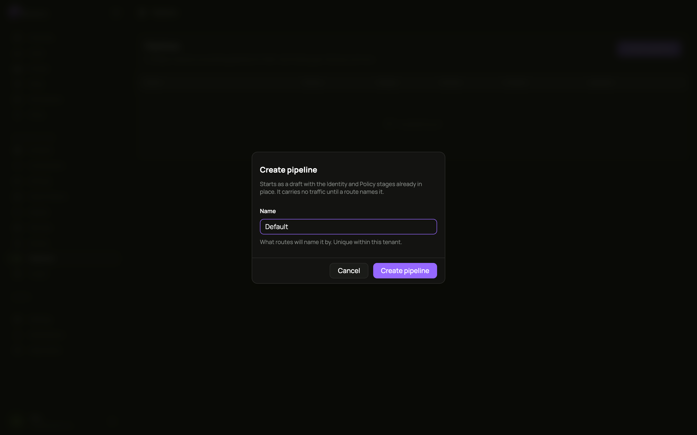
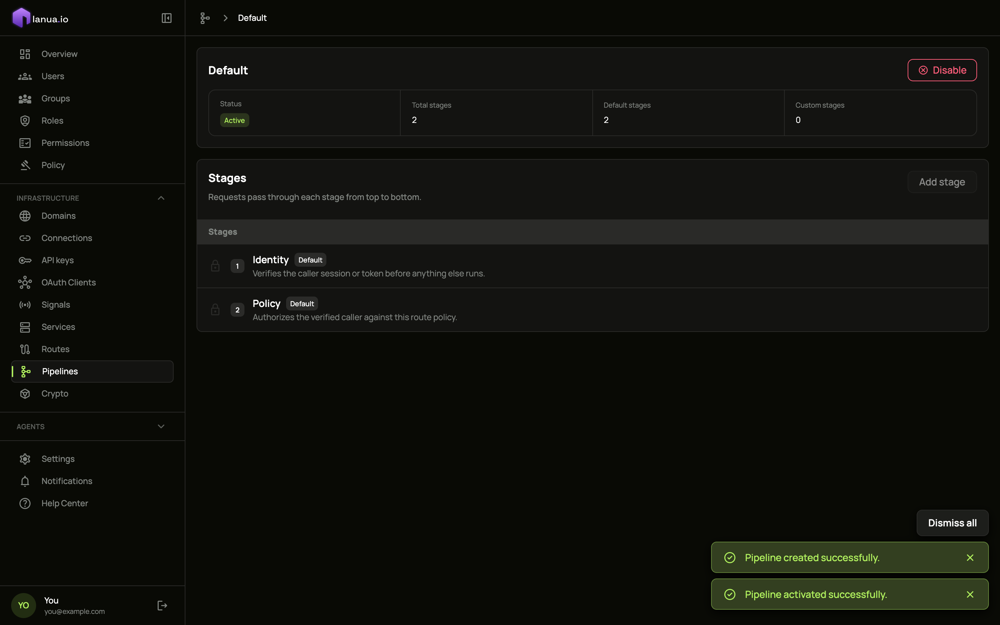
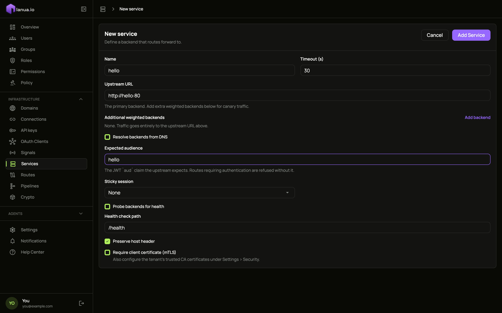
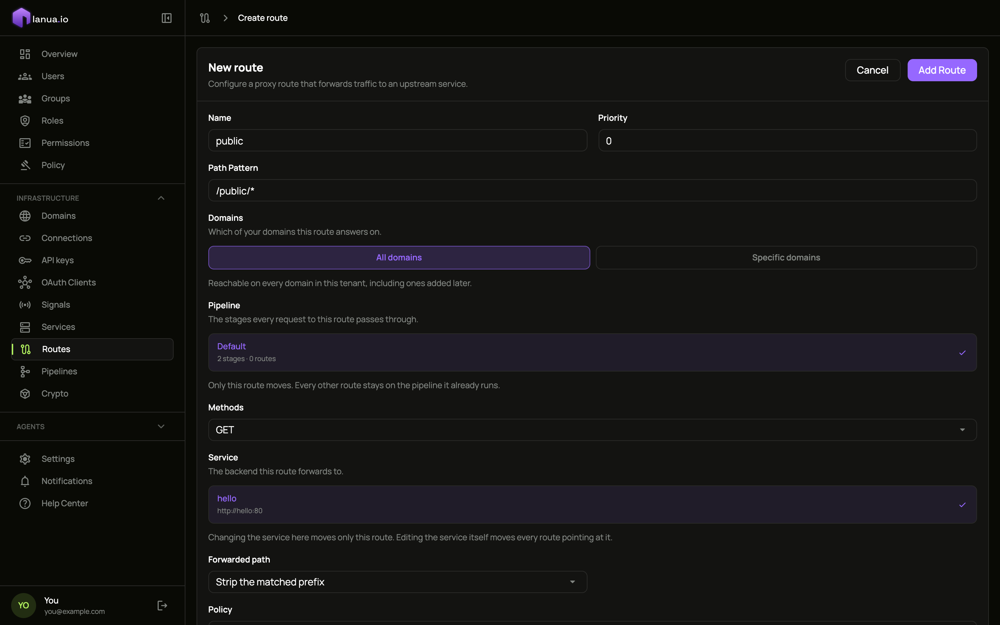
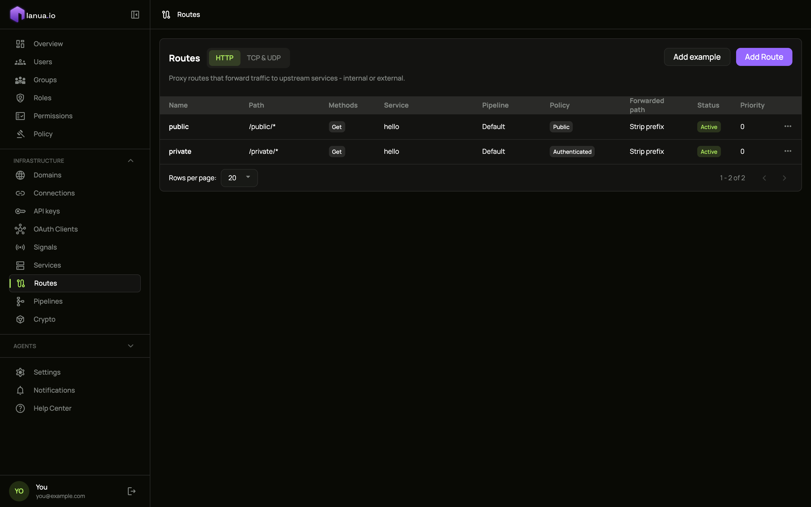
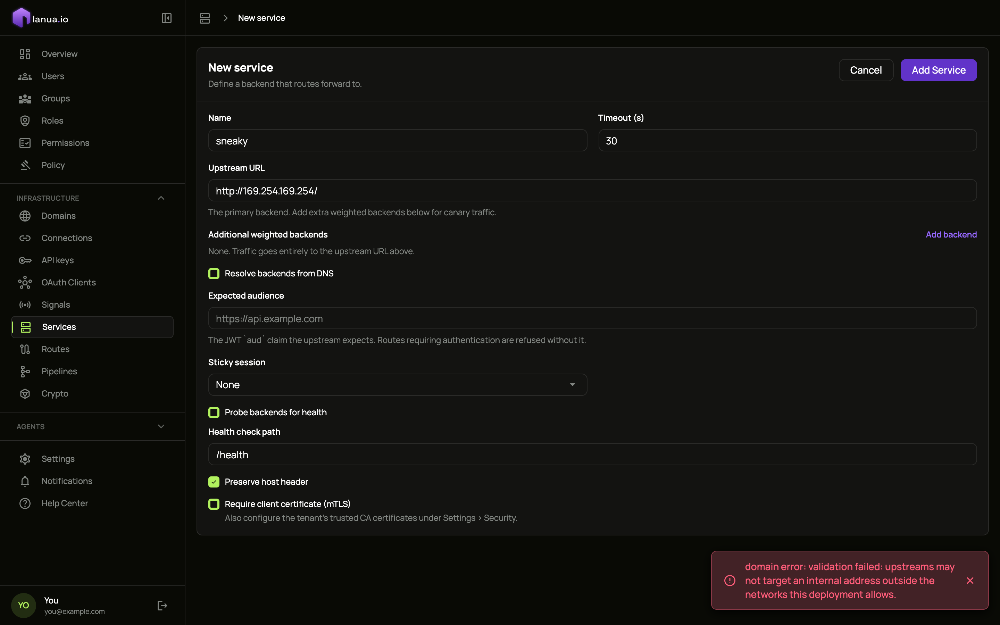

import SeeItWork from '../../../partials/see-it-work.mdx';
import WrapUp from '../../../partials/quickstart-wrap-up.mdx';

This continues the [Quickstart](/ianua/start/quickstart/). You have ianua running, you are signed in, and the `hello` test app is started.

Open your tenant from the dashboard. Everything below is under **Infrastructure** in the sidebar.

## 1. Create a pipeline

Go to **Pipelines**, click **Create pipeline**, name it `Default`, and confirm.

The pipeline opens with its two built-in stages, **Identity** and **Policy**. They check who is calling and whether they are allowed, and they can never be removed.

Click **Activate**, then confirm. The status changes to **Active**.

## 2. Add a service

Go to **Services** and click **Add Service**. Fill in:

- **Name**: `hello`
- **Upstream URL**: `http://hello:80`
- **Expected audience**: `hello`. Routes that need a signed-in caller refuse to save without it.

Leave everything else as it is and click **Add Service**.

## 3. Add two routes

Go to **Routes** and click **Add Route**. Fill in:

- **Name**: `public`
- **Path Pattern**: `/public/*`
- **Pipeline**: click **Default**
- **Methods**: `GET`
- **Service**: click **hello**
- **Policy**: `Public`

Click **Add Route**.

Add a second route the same way, with **Name** `private`, **Path Pattern** `/private/*` and **Policy** `Authenticated`. Your routes list now shows both:

## 4. See it work

<SeeItWork />

**And the gateway will not be pointed at the wrong place.** Go back to **Services**, click **Add Service**, and enter the address of the cloud metadata service, where cloud servers keep their credentials: `http://169.254.169.254/`. The dashboard refuses to save it, whatever networks you allow.

<WrapUp />
