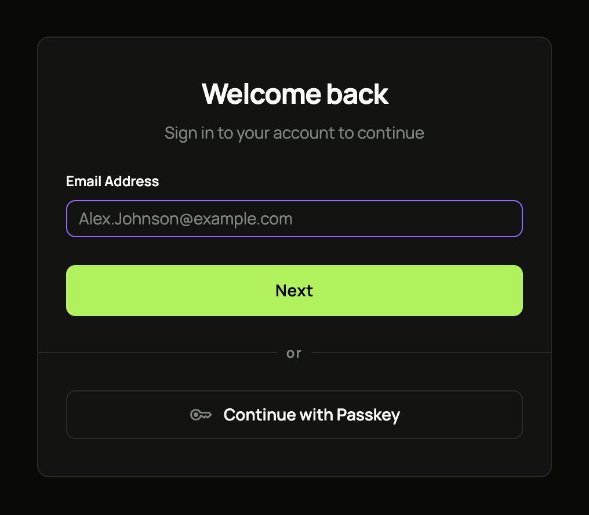

import { CardGrid, LinkCard } from '@astrojs/starlight/components';

In about ten minutes you will:

1. start ianua on your machine with Docker Compose,
2. confirm your owner account and sign in to the dashboard,
3. put a small test app behind the gateway, and
4. watch the gateway let one request through and refuse another.

Everything runs locally under `*.localhost` names, so there is no DNS to set up.

## Before you start

- **Docker** with Docker Compose.
- **Ports 80 and 443 free** on your machine.
- **`git`, `curl`, `openssl` and `jq`.**
- **Chrome, Firefox or Edge.** They send every `*.localhost` name to your own machine. Safari does not.

## 1. Get the files

```sh
git clone https://github.com/IanuaIDP/ianua.git
cd ianua/deploy/compose
```

## 2. Configure it

Create a `.env` file for a local install. This writes it for you, with fresh random secrets:

```sh
cat > .env <<EOF
IANUA_DASHBOARD_HOST=ianua.localhost
IANUA_API_HOST=api.ianua.localhost
IANUA_APPS_DOMAIN=apps.localhost

INSTALL_ORGANIZATION_NAME=Acme
INSTALL_TENANT_NAME=Main
INSTALL_OWNER_EMAIL=you@example.com
INSTALL_OWNER_NAME=You
INSTALL_OWNER_PASSWORD="Violet otters juggle 42 brass lanterns at dusk"

ACME_EMAIL=you@example.com
ACME_DIRECTORY_URL=https://acme-staging-v02.api.letsencrypt.org/directory

POSTGRES_PASSWORD=$(openssl rand -hex 32)
APP_DATABASE_PASSWORD=$(openssl rand -hex 32)
AUDIT_PURGE_DATABASE_PASSWORD=$(openssl rand -hex 32)
HMAC_SECRET=$(openssl rand -hex 32)
ENCRYPTION_KEY=$(openssl rand -hex 32)
EVENT_SIGNING_SECRET=$(openssl rand -hex 32)

EMAIL_FROM=noreply@example.com
EMAIL_FROM_NAME=Ianua
SMTP_HOST=localhost
EOF
```

What these mean:

- **The three hosts** are where the dashboard, the API and your apps will live.
- **`INSTALL_*`** is what the install step makes: your organization, its first tenant and its owner. The password needs at least 12 characters, with an uppercase letter, a lowercase letter and a digit, and must not appear in known data breaches: the install step looks it up, and refuses it with a "try again" if the lookup cannot be made. A sentence of your own makes a good one: keep the double quotes around it, so its spaces stay part of it. Only the install step reads these, and the server refuses them, so the compose file gives them to the `install` service alone. The first password never stays in the server's environment.
- **The three keys** protect stored secrets, tokens and events. Each must be exactly 32 random bytes, which `openssl rand -hex 32` makes. Never change `ENCRYPTION_KEY` after the first start: data encrypted with it cannot be read with another.
- **Three database passwords.** `POSTGRES_PASSWORD` is the database superuser, which sets up and upgrades the database. `APP_DATABASE_PASSWORD` is for the ordinary account ianua runs as, which the database itself confines to one tenant's data at a time. `AUDIT_PURGE_DATABASE_PASSWORD` is for the one account that may remove old audit records.
- **Email** is a placeholder here. Set `SMTP_HOST` to a real SMTP server, with `SMTP_USERNAME` and `SMTP_PASSWORD` if it needs a login: the first time you sign in from a browser ianua has not seen, it mails you a link to confirm the sign-in, and invitations and password resets are mailed too.

:::note
Apps behind the gateway may only live on private networks you allow. The default allows every private range (`10.0.0.0/8`, `172.16.0.0/12` and `192.168.0.0/16`), which covers this guide. To narrow it, set `UPSTREAM_NETWORKS` in `.env`.
:::

## 3. Start it

```sh
docker compose up -d
```

The first start downloads the images and builds the dashboard, which takes a few minutes. Check that everything is up:

```sh
docker compose ps -a
```

You should see `traefik`, `dashboard`, `ianua`, `zero`, `postgres`, `nats` and `redis` running, and `install` exited with code 0.

## 4. Confirm the owner

Before anything else runs, the `install` service sets the database up and makes your organization, its first tenant and its owner from `INSTALL_*`. Then it stops. Run again, it finds the organization and changes nothing.

The first time, it prints a one-time setup token that confirms the owner's email address. Read it:

```sh
docker compose logs install
```

Send it to the API within a day. `-k` accepts the local certificate:

```sh
curl -k -X POST https://api.ianua.localhost/api/v1/users/confirm-installer \
  -H 'Content-Type: application/json' \
  -d '{"token": "<the token>"}'
```

## 5. Sign in

Open **https://ianua.localhost** and sign in with the email and password from your `.env`. You have no second factor yet and this browser is new to ianua, so it mails you a link first. Follow it to finish signing in.



Your browser will warn about the certificate. That is expected: Let's Encrypt cannot reach a machine at `localhost`, so a local, untrusted certificate is used. Accept it to continue. On a real server with a real domain, certificates are issued automatically.

## 6. Start a test app

The test app echoes back every request it receives, so you can see exactly what reaches it. Start it on the same network as ianua:

```sh
docker run -d --name hello --network ianua_ianua traefik/whoami
```

Notice that it has no login of its own, and no published port. The only way to reach it from outside is through the gateway.

## 7. Put it behind the gateway

Three things make an app reachable:

- a **pipeline**: the list of checks every request goes through;
- a **service**: where the app lives;
- a **route**: which paths go to that service, and who may use them.

Set them up the way that suits you. Both end in exactly the same place, and both finish by showing the gateway at work.

<CardGrid>
	<LinkCard
		title="With the dashboard"
		description="Click through the screens, with a screenshot for every step. The quickest way to see how the pieces fit together."
		href="/ianua/start/quickstart-dashboard/"
	/>
	<LinkCard
		title="With the API"
		description="Copy a few curl commands. The way to script it, or to set up many apps at once."
		href="/ianua/start/quickstart-api/"
	/>
</CardGrid>

